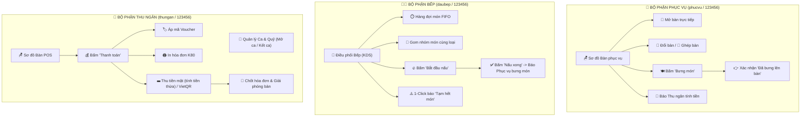

# BÁO CÁO CHUYÊN BIỆT HÓA PHÂN QUYỀN VÀ LUỒNG THAO TÁC CÁC BỘ PHẬN
**Dự án:** Website Quản Lý Nhà Hàng & Gọi Món QR (Quán Mộc POS)  
**Phiên bản hoàn thiện:** Đã nâng cấp Chuyên Biệt Hóa Toàn Diện Nghiệp Vụ (Strict Role-Based Specialization)  

---

## 1. MỤC TIÊU & NGUYÊN TẮC CHUYÊN BIỆT HÓA ("VIỆC AI NGƯỜI NẤY LÀM")

Để tối ưu hóa hiệu suất vận hành, tránh chồng chéo trách nhiệm và loại trừ hoàn toàn nguy cơ gian lận hoặc sai sót:
* **👨‍🍳 Đầu bếp:** Chỉ tập trung 100% vào việc chế biến món ăn trên màn hình KDS. Không can thiệp vào sơ đồ bàn, không xem doanh thu, không đụng vào tiền bạc.
* **💁 Phục vụ:** Chỉ tập trung vào việc đón tiếp khách tại bàn, mở bàn, đổi/ghép bàn, và quan trọng nhất là **theo dõi món đã nấu xong từ bếp để bưng ra bàn cho khách**. Phục vụ **tuyệt đối không thu tiền, không in hóa đơn, không sửa menu**.
* **💼 Thu ngân:** Chịu trách nhiệm hoàn toàn về **dòng tiền**, mở/đóng ca đối soát két tiền mặt, in hóa đơn tạm tính K80, áp dụng khuyến mãi, thu tiền mặt / VietQR và chốt thanh toán.
* **👑 Quản lý:** Toàn quyền điều hành, phân tích số liệu báo cáo, quản lý thực đơn, nhân sự và cấu hình.

---

## 2. CHI TIẾT CẢI TIẾN GIAO DIỆN & ROUTE GUARD THEO TỪNG VAI TRÒ

### 2.1. Nhân viên Phục vụ (Tài khoản: `phucvu` | Mật khẩu: `123456`)
* **Thanh điều hướng Sidebar:** Chỉ hiển thị **duy nhất** mục `🪑 Sơ đồ Bàn & Phục vụ`. Toàn bộ các mục Điều phối bếp KDS, Ca làm việc, Thống kê, Thực đơn, Nhân sự, Cấu hình đều bị ẩn hoàn toàn.
* **Tiêu đề trang:** Tự động điều chỉnh thành: *"🪑 Sơ Đồ Bàn & Phục Vụ Bàn Ăn - Mở bàn đón tiếp, chuyển/ghép bàn và bưng món ăn phục vụ"*.
* **Ẩn toàn bộ nút cấu hình bàn:** Phục vụ không thấy nút `+ Thêm Khu Vực`, `+ Thêm Bàn Ăn`, `🗑️ Xóa bàn`, `🔄 Làm mới mã QR`.
* **Ẩn nút `💰 Thanh toán`:** Phục vụ không thực hiện thanh toán tiền.
* **Nút chính trên thẻ bàn:** Hiển thị nút **"🍽️ Bưng món"** kèm huy hiệu màu đỏ báo số món đã xong (ví dụ: `2 xong`).
* **Modal Xem món & Bưng món chuyên dụng:**
  - Hiển thị danh sách món ăn của bàn kèm trạng thái: *Chờ nấu*, *Đang nấu*, *Bếp đã nấu xong*, *Đã phục vụ*.
  - Với các món bếp báo xong, có nút **"👉 Đã bưng ra bàn"** để phục vụ bấm xác nhận ngay khi mang món lên bàn ăn.
  - Có nút **"➕ Đặt món hộ"** nếu khách nhờ phục vụ gọi thêm món.
  - Có nút **"🔔 Báo tính tiền"** để chuyển bàn sang trạng thái Chờ thanh toán khi khách muốn thanh toán.

---

### 2.2. Đầu bếp (Tài khoản: `daubep` | Mật khẩu: `123456`)
* **Tự động điều hướng sau khi đăng nhập:** Chuyển thẳng vào `#/bep` (Màn hình Điều phối Bếp KDS).
* **Thanh điều hướng Sidebar:** Chỉ hiển thị **duy nhất** mục `🍳 Điều phối Bếp (KDS)`. Hoàn toàn không hiển thị Sơ đồ bàn, POS, Ca quỹ, Thực đơn, Báo cáo hay Nhân sự.
* **Header định danh chuyên trách:** Hiển thị thẻ chức danh `🧑‍🍳 Trực ban Đầu bếp`.
* **Route Guard bảo vệ:** Nếu đầu bếp gõ URL khác (như `#/so-do-ban` hay `#/thanh-toan`), hệ thống lập tức hiển thị cảnh báo `⚠️ Vai trò [Đầu bếp] chỉ thao tác tại màn hình chuyên trách của mình` và tự động đưa về `#/bep`.

---

### 2.3. Thu ngân (Tài khoản: `thungan` | Mật khẩu: `123456`)
* **Thanh điều hướng Sidebar:** Chỉ hiển thị 2 mục nghiệp vụ:
  1. `🪑 Sơ đồ Bàn & POS`
  2. `💼 Quản lý Ca & Quỹ`
  *(Ẩn hoàn toàn Điều phối bếp KDS, Thực đơn, Thống kê, Nhân sự).*
* **Sơ đồ bàn:** Nút chính trên từng bàn là **"💰 Thanh toán"** để mở màn hình thanh toán POS, tính tiền thối, xuất VietQR và in hóa đơn tạm tính K80.
* **Quản lý Ca & Quỹ:** Khai báo số tiền mặt đầu ca, lập phiếu thu chi lẻ và đếm tiền đối soát két cuối ca.

---

### 2.4. Quản lý / Admin (Tài khoản: `admin` | Mật khẩu: `123456`)
* Toàn quyền truy cập tất cả các tính năng, quản trị nhân sự, điều chỉnh giá và xem Dashboard báo cáo doanh thu.

---

## 3. DANH SÁCH TÀI KHOẢN ĐĂNG NHẬP KIỂM THỬ

| Tài khoản | Mật khẩu | Vai trò CSDL | Màn hình mặc định | Quyền hạn giao diện |
|:---|:---:|:---:|:---:|:---|
| **phucvu** | `123456` | `phuc_vu` | `#/so-do-ban` | Sơ đồ bàn phục vụ, mở bàn, đổi/ghép bàn, xem món và bưng món đã nấu xong ra bàn, báo thu ngân tính tiền. |
| **daubep** | `123456` | `bep` | `#/bep` | Hàng đợi KDS FIFO, gom món nấu đồng thời, cập nhật tiến độ nấu và gạt tắt món tạm hết. |
| **thungan** | `123456` | `thu_ngan` | `#/so-do-ban` | Sơ đồ bàn POS, thu tiền mặt/VietQR, in bill K80, mở/kết ca đối soát quỹ. |
| **admin** | `123456` | `quan_ly` | `#/so-do-ban` | Toàn quyền quản trị toàn bộ hệ thống. |
