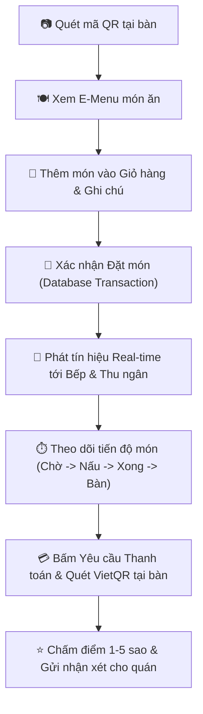
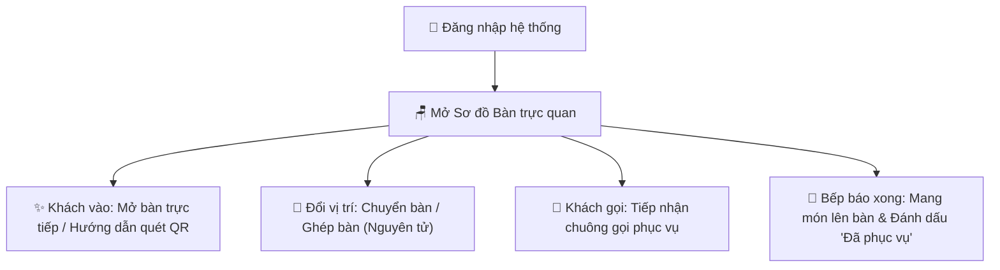
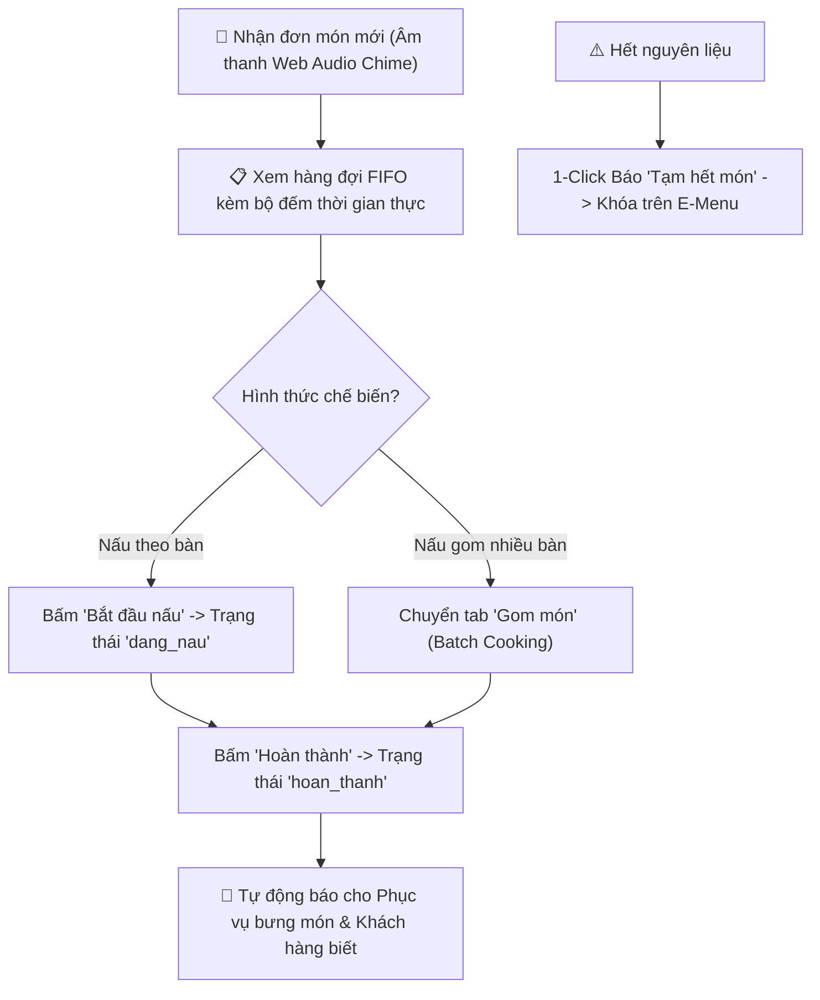
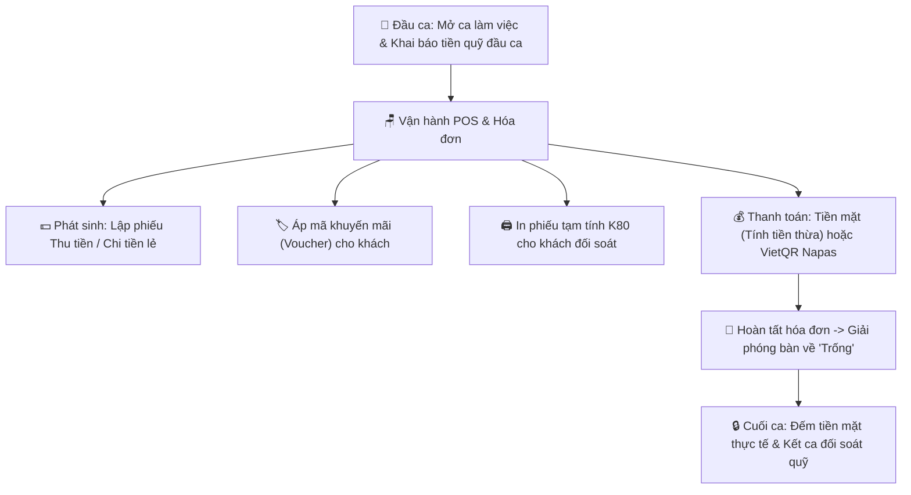
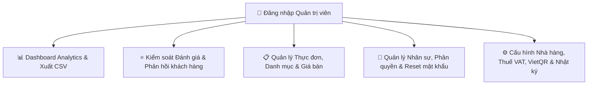
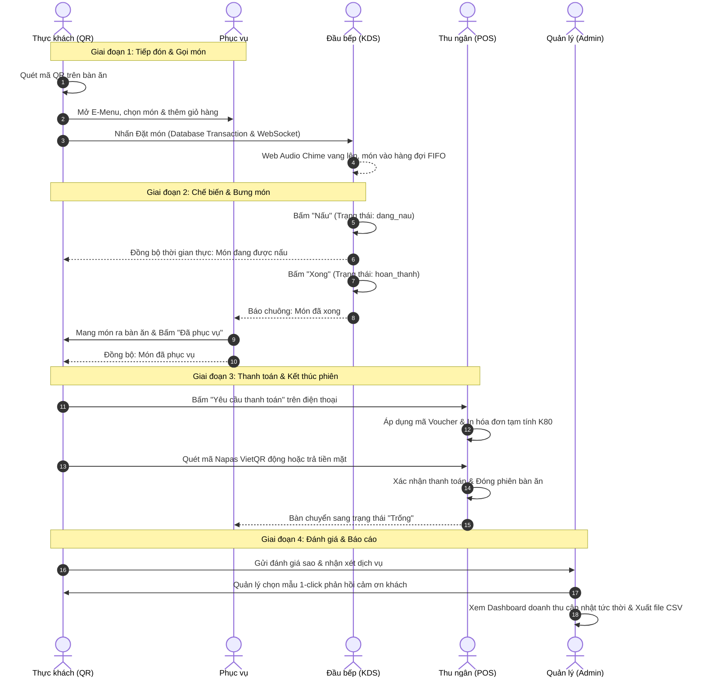

# BÁO CÁO PHÂN QUYỀN VÀ LUỒNG CHỨC NĂNG HỆ THỐNG
**Hệ Thống:** Website Quản Lý Nhà Hàng & Gọi Món QR (Quán Mộc POS)  
**Phiên bản hoàn thiện:** Sprint 1 - Sprint 4 (Full-stack Node.js / Express / SQLite / Real-time WebSockets)  
**Tác giả:** Đội ngũ Kỹ sư Phát triển Hệ thống Quán Mộc  

---

## 1. TỔNG QUAN KIẾN TRÚC BẢO MẬT & PHÂN QUYỀN (RBAC ARCHITECTURE)

Hệ thống Quán Mộc POS áp dụng mô hình phân quyền dựa trên vai trò (**Role-Based Access Control - RBAC**) kết hợp với mô hình xác thực phiên bàn định danh (**Session-Based Table Authorization**), tạo thành kiến trúc bảo mật 2 lớp:

```mermaid
flowchart TD
    subgraph Client["Lớp Truy Cập Giao Diện (Frontend)"]
        KH["📱 Thực khách (Mobile E-Menu)"]
        PV["💁 Nhân viên Phục vụ (Tablet/Mobile)"]
        DB["🍳 Đầu bếp (KDS Display)"]
        TN["💻 Thu ngân (POS Desktop/Tablet)"]
        QL["📊 Quản lý / Admin (Dashboard)"]
    end

    subgraph AuthLayer["Lớp Xác Thực & Kiểm Soát (Security Layer)"]
        TokenQR["🔑 Token QR Bàn Ăn (Per-table Session Token)"]
        JWT["🛡️ Bearer JSON Web Token (Role & Permissions)"]
        MW1["Middleware: xacThucNguoiDung"]
        MW2["Middleware: kiemTraVaiTro"]
    end

    subgraph ServiceLayer["Lớp Dịch Vụ Nghiệp Vụ (Backend REST API & Socket.io)"]
        S1["E-Menu & Giỏ hàng"]
        S2["Đơn món & Bếp KDS"]
        S3["Sơ đồ Bàn & POS"]
        S4["Ca làm việc & Quỹ"]
        S5["Thống kê & Đánh giá"]
        S6["Nhân sự & Cấu hình"]
    end

    KH -->|Token định danh| TokenQR --> S1
    PV -->|JWT Bearer| JWT --> MW1 --> MW2 --> S3
    DB -->|JWT Bearer| JWT --> MW1 --> MW2 --> S2
    TN -->|JWT Bearer| JWT --> MW1 --> MW2 --> S3 & S4
    QL -->|JWT Bearer (Bypass)| JWT --> MW1 --> MW2 --> S1 & S2 & S3 & S4 & S5 & S6
```

### 1.1. Lớp 1: Khách hàng (Thực khách tại bàn - E-Menu QR)
- **Cơ chế:** Khách hàng **không cần đăng ký tài khoản**. Khi dùng điện thoại quét mã QR dán trên mặt bàn (ví dụ `#/menu?token=token_b01_...`), hệ thống giải mã token qua API `/api/phien-ban/xac-thuc-qr`.
- **Phạm vi bảo mật:** Client lưu trữ `emenu_ban_an` và `emenu_phien_ban` trong `localStorage`. Khách hàng chỉ có thể xem thực đơn, đặt món và theo dõi đơn hàng của chính chiếc bàn mình đang ngồi, ngăn chặn việc can thiệp vào đơn món của các bàn khác.
- **Bảo vệ giá & dữ liệu:** Toàn bộ đơn giá, thành tiền và tính toán khuyến mãi đều được **tính toán lại và kiểm tra tại Server** (Server-side price verification), phòng chống việc người dùng sửa đổi giá ở trình duyệt.

### 1.2. Lớp 2: Nhân sự nội bộ (Internal Staff & Management)
- **Cơ chế:** Xác thực tập trung thông qua **JSON Web Token (JWT)**, mã hóa với khóa bảo mật hệ thống. Token có thời hạn hợp lệ và được truyền qua Header `Authorization: Bearer <token>`.
- **4 Vai trò nội bộ chính trong CSDL (`vai_tro` table):**
  1. `quan_ly` (Quản trị viên / Quản lý nhà hàng)
  2. `thu_ngan` (Nhân viên Thu ngân)
  3. `bep` (Nhân viên Bếp / Bar)
  4. `phuc_vu` (Nhân viên Phục vụ)
- **Middleware kiểm soát tại Backend:**
  - `xacThucNguoiDung`: Kiểm tra tính toàn vẹn và hạn dùng của JWT token.
  - `kiemTraVaiTro('vai_tro_1', 'vai_tro_2', ...)`: Kiểm tra mã vai trò của tài khoản. Vai trò `quan_ly` có đặc quyền Super Admin (tự động vượt qua mọi kiểm tra quyền hạn).

---

## 2. MA TRẬN PHÂN QUYỀN HỆ THỐNG (RBAC PERMISSION MATRIX)

Bảng đối chiếu quyền hạn chi tiết giữa 5 nhóm đối tượng sử dụng trên 11 phân hệ chức năng:

| STT | Phân hệ / Chức năng | Khách hàng (QR) | Phục vụ (`phuc_vu`) | Đầu bếp (`bep`) | Thu ngân (`thu_ngan`) | Quản lý (`quan_ly`) |
|:---:|:---|:---:|:---:|:---:|:---:|:---:|
| **1** | **E-Menu & Gọi món tại bàn** |
| 1.1 | Quét QR xem thực đơn, ảnh SVG, lọc danh mục |  Toàn quyền |  Xem |  Xem |  Xem |  Toàn quyền |
| 1.2 | Thêm giỏ hàng & Gửi đơn gọi món thời gian thực |  Toàn quyền |  Hỗ trợ đặt | ❌ Không |  Hỗ trợ đặt |  Toàn quyền |
| 1.3 | Theo dõi tiến độ chế biến món của bàn |  Chính bàn mình |  Các bàn |  Các bàn |  Các bàn |  Toàn quyền |
| 1.4 | Gửi yêu cầu phục vụ (nước, đá, hỗ trợ) |  Toàn quyền |  Nhận xử lý | ❌ Không |  Nhận xử lý |  Toàn quyền |
| 1.5 | Gửi đánh giá sao & nhận xét dịch vụ |  Toàn quyền | ❌ Không | ❌ Không | ❌ Không |  Xem & Phản hồi |
| **2** | **Sơ đồ Bàn & Vận hành Bàn** |
| 2.1 | Xem sơ đồ bàn trực quan theo khu vực & màu trạng thái | ❌ Không |  Toàn quyền | ❌ Không |  Toàn quyền |  Toàn quyền |
| 2.2 | Mở bàn mới cho khách vãng lai | ❌ Không |  Toàn quyền | ❌ Không |  Toàn quyền |  Toàn quyền |
| 2.3 | Chuyển bàn hoặc Ghép nhiều bàn (Transaction) | ❌ Không |  Toàn quyền | ❌ Không |  Toàn quyền |  Toàn quyền |
| 2.4 | Đánh dấu món đã bưng lên bàn (`da_phuc_vu`) | ❌ Không |  Toàn quyền | ❌ Không | ❌ Không |  Toàn quyền |
| **3** | **Bếp KDS (Kitchen Display System)** |
| 3.1 | Xem danh sách món chờ nấu theo thứ tự FIFO | ❌ Không | ❌ Không |  Toàn quyền | ❌ Không |  Toàn quyền |
| 3.2 | Gom món nấu hàng loạt (Batch cooking) | ❌ Không | ❌ Không |  Toàn quyền | ❌ Không |  Toàn quyền |
| 3.3 | Chuyển trạng thái món: *Nấu* (`dang_nau`), *Xong* (`hoan_thanh`) | ❌ Không | ❌ Không |  Toàn quyền | ❌ Không |  Toàn quyền |
| 3.4 | Bật/tắt nhanh trạng thái món: "Đang bán" / "Tạm hết" | ❌ Không | ❌ Không |  Toàn quyền | ❌ Không |  Toàn quyền |
| 3.5 | Nhận chuông báo âm thanh KDS Web Audio khi có món mới | ❌ Không | ❌ Không |  Có chuông | ❌ Không |  Có chuông |
| **4** | **Thu ngân & POS Thanh toán** |
| 4.1 | Xem bảng kê tạm tính hóa đơn (Món, VAT, Giảm giá) |  Xem của bàn |  Xem của bàn | ❌ Không |  Toàn quyền |  Toàn quyền |
| 4.2 | Áp dụng mã khuyến mãi / Voucher giảm giá | ❌ Không | ❌ Không | ❌ Không |  Toàn quyền |  Toàn quyền |
| 4.3 | In phiếu tạm tính chuẩn in nhiệt K80 | ❌ Không | ❌ Không | ❌ Không |  Toàn quyền |  Toàn quyền |
| 4.4 | Tạo và hiển thị mã thanh toán VietQR Napas động |  Xem tại bàn | ❌ Không | ❌ Không |  Toàn quyền |  Toàn quyền |
| 4.5 | Thu tiền mặt, tính tiền thừa & Hoàn tất hóa đơn | ❌ Không | ❌ Không | ❌ Không |  Toàn quyền |  Toàn quyền |
| **5** | **Quản lý Ca làm việc & Quỹ** |
| 5.1 | Mở ca làm việc & Khai báo tiền quỹ đầu ca | ❌ Không | ❌ Không | ❌ Không |  Toàn quyền |  Toàn quyền |
| 5.2 | Lập phiếu thu tiền mặt / phiếu chi tiền mặt trong ca | ❌ Không | ❌ Không | ❌ Không |  Toàn quyền |  Toàn quyền |
| 5.3 | Kết ca làm việc, kiểm đếm tiền thực tế & đối soát quỹ | ❌ Không | ❌ Không | ❌ Không |  Toàn quyền |  Toàn quyền |
| **6** | **Báo cáo Thống kê & Doanh thu** |
| 6.1 | Xem Dashboard tổng quan doanh thu ngày & hóa đơn | ❌ Không | ❌ Không | ❌ Không | ❌ Không |  Toàn quyền |
| 6.2 | Lọc doanh thu theo ngày / tuần / tháng / khoảng ngày | ❌ Không | ❌ Không | ❌ Không | ❌ Không |  Toàn quyền |
| 6.3 | Phân tích tỷ trọng phương thức trả tiền (Tiền mặt vs VietQR) | ❌ Không | ❌ Không | ❌ Không | ❌ Không |  Toàn quyền |
| 6.4 | Xem Top 5 món bán chạy & Tỷ trọng doanh mục | ❌ Không | ❌ Không | ❌ Không | ❌ Không |  Toàn quyền |
| 6.5 | Xem biểu đồ khung giờ cao điểm & Tỷ lệ hủy món | ❌ Không | ❌ Không | ❌ Không | ❌ Không |  Toàn quyền |
| 6.6 | Xuất báo cáo Doanh thu & Hóa đơn ra file Excel / CSV | ❌ Không | ❌ Không | ❌ Không | ❌ Không |  Toàn quyền |
| **7** | **Đánh giá Khách hàng** |
| 7.1 | Xem điểm đánh giá trung bình & danh sách nhận xét | ❌ Không | ❌ Không | ❌ Không | ❌ Không |  Toàn quyền |
| 7.2 | Lọc đánh giá tiêu cực (< 4 sao) để xử lý khiếu nại | ❌ Không | ❌ Không | ❌ Không | ❌ Không |  Toàn quyền |
| 7.3 | Phản hồi đánh giá (Sử dụng mẫu trả lời 1-click hoặc soạn riêng) | ❌ Không | ❌ Không | ❌ Không | ❌ Không |  Toàn quyền |
| **8** | **Quản trị Menu & Nhà hàng** |
| 8.1 | Quản lý Thực đơn (Thêm, sửa, tải ảnh SVG, xóa mềm) | ❌ Không | ❌ Không | ❌ Không | ❌ Không |  Toàn quyền |
| 8.2 | Quản lý Danh mục món & Khu vực bàn ăn | ❌ Không | ❌ Không | ❌ Không | ❌ Không |  Toàn quyền |
| 8.3 | Quản lý Nhân sự (Tạo tài khoản, đổi vai trò, reset mật khẩu) | ❌ Không | ❌ Không | ❌ Không | ❌ Không |  Toàn quyền |
| 8.4 | Cấu hình nhà hàng (Tên, địa chỉ, hotline, VAT, VietQR) | ❌ Không | ❌ Không | ❌ Không | ❌ Không |  Toàn quyền |
| 8.5 | Tra cứu Nhật ký hoạt động hệ thống (Audit Logs) | ❌ Không | ❌ Không | ❌ Không | ❌ Không |  Toàn quyền |

---

## 3. CHI TIẾT LUỒNG CHỨC NĂNG (WORKFLOWS) CỦA TỪNG ĐỐI TƯỢNG

### 3.1. Đối tượng 1: KHÁCH HÀNG (Thực khách tại bàn)

Khách hàng trải nghiệm quy trình gọi món hiện đại, không chạm, khép kín từ lúc ngồi vào bàn đến khi rời quán:



- **Bước 1 - Quét QR & Nhận diện Bàn:** Khách dùng camera điện thoại quét mã QR tại bàn. Ứng dụng điều hướng vào `#/menu?token=...`, tự động gắn phiên bàn với bàn ăn tương ứng.
- **Bước 2 - Lựa chọn món ăn:** Xem thực đơn trực quan với hình ảnh vector minh họa, danh mục dạng thẻ trượt (sticky header), nhãn món nổi bật (`HOT`), tìm kiếm món theo tên.
- **Bước 3 - Giỏ hàng & Ghi chú:** Khách điều chỉnh số lượng món, thêm ghi chú chi tiết (ví dụ: "ít cay", "không hành"). Thanh giỏ hàng nổi cố định chân màn hình hiển thị tức thời tổng tiền và số món.
- **Bước 4 - Đặt món thời gian thực:** Bấm "Gửi gọi món". Hệ thống chạy Database Transaction kiểm tra giá và tạo đơn món, phát tín hiệu Socket.io tới Bếp (`room:bep`) và Thu ngân (`room:thu_ngan`).
- **Bước 5 - Theo dõi món (Order Tracker):** Xem trực tiếp tiến độ của từng món: *Chờ chế biến -> Đang nấu -> Hoàn thành -> Đã phục vụ*.
- **Bước 6 - Gọi phục vụ / Thanh toán tại bàn:** Khi cần hỗ trợ, khách bấm "Gọi phục vụ". Khi kết thúc bữa ăn, khách bấm "Thanh toán", xem chi tiết hóa đơn tạm tính và có thể quét trực tiếp mã Napas VietQR hiển thị ngay trên màn hình điện thoại để chuyển khoản.
- **Bước 7 - Đánh giá dịch vụ:** Sau bữa ăn, thực khách chấm sao từ 1 đến 5 sao và để lại phản hồi về đồ ăn và thái độ phục vụ.

---

### 3.2. Đối tượng 2: NHÂN VIÊN PHỤC VỤ (`phuc_vu`)

Nhân viên phục vụ quản lý khu vực bàn ăn, hỗ trợ khách hàng và điều chuyển món ăn:



- **Bước 1 - Theo dõi Sơ đồ Bàn:** Giao diện hiển thị trực quan các bàn với mã màu trạng thái (Trống - Xanh lá, Đang dùng - Đỏ, Chờ thanh toán - Vàng). Có bộ lọc theo trạng thái và tìm kiếm số bàn nhanh.
- **Bước 2 - Mở bàn & Chăm sóc khách:** Đối với khách không dùng điện thoại quét QR, nhân viên phục vụ có thể mở bàn trực tiếp trên POS và chọn món hộ khách.
- **Bước 3 - Chuyển bàn / Ghép bàn:** Khi khách yêu cầu đổi chỗ ngồi hoặc đi theo nhóm đông cần ghép 2 bàn lại với nhau:
  - Hệ thống thực hiện SQLite Transaction di chuyển toàn bộ đơn món và tích lũy hóa đơn sang bàn đích.
  - Tự động ghi nhật ký hệ thống để quản lý kiểm tra.
- **Bước 4 - Bưng món & Xác nhận phục vụ:** Khi bếp hoàn thành món ăn, nhân viên phục vụ nhận thông báo trên màn hình, mang món đến bàn và nhấn nút "Đã phục vụ" để cập nhật tiến độ cho khách.

---

### 3.3. Đối tượng 3: ĐẦU BẾP / NHÂN VIÊN BẾP (`bep`)

Màn hình điều phối bếp (Kitchen Display System - KDS) được tối ưu hóa cho tốc độ và sự chính xác:



- **Bước 1 - Chuông báo âm thanh:** Mỗi khi có đơn món mới từ khách hoặc phục vụ, KDS tự động phát chuông báo âm thanh chuyên dụng (Web Audio Chime) để nhà bếp nhận biết ngay lập tức mà không cần nhìn liên tục vào màn hình.
- **Bước 2 - Hàng đợi chế biến FIFO:** Đơn món hiển thị dạng thẻ trực quan xếp theo thứ tự thời gian gọi (First-In, First-Out) kèm nhãn thời gian chờ để ưu tiên nấu món gọi trước.
- **Bước 3 - Gom món thông minh (Batch Cooking):** Tab "Gom món" tự động tính tổng số lượng của các món giống nhau giữa các bàn khác nhau (ví dụ: 3 bàn cùng gọi Lẩu riêu cua -> Bếp gom nấu đồng thời để tiết kiệm thời gian).
- **Bước 4 - Cập nhật trạng thái chế biến:**
  - Bấm nút **"Nấu"**: Món chuyển sang trạng thái Đang nấu (`dang_nau`).
  - Bấm nút **"Xong"**: Món chuyển sang trạng thái Hoàn thành (`hoan_thanh`), hệ thống phát tín hiệu cho phục vụ và khách hàng.
- **Bước 5 - Kiểm soát món hết:** Khi nguyên liệu hết, đầu bếp có thể click nút gạt trạng thái để chuyển món sang "Tạm hết", hệ thống sẽ vô hiệu hóa nút đặt món này trên E-menu của toàn bộ khách hàng.

---

### 3.4. Đối tượng 4: NHÂN VIÊN THU NGÂN (`thu_ngan`)

Thu ngân chịu trách nhiệm chính xác về dòng tiền, lập hóa đơn, quản lý ca và đối soát quỹ:



- **Bước 1 - Mở ca làm việc:** Đầu ca, thu ngân bắt buộc mở ca làm việc và nhập số tiền mặt đầu ca để làm căn cứ quỹ ban đầu.
- **Bước 2 - Quản lý thu - chi lẻ:** Khi có các khoản chi phát sinh trong ca (nhập đá, mua đồ vặt, chuyển tiền lẻ), thu ngân lập phiếu thu/chi có ghi chú rõ ràng để số liệu quỹ luôn khớp.
- **Bước 3 - Kiểm tra hóa đơn & Khuyến mãi:** Chọn bàn khách cần thanh toán, rà soát danh sách món. Nhập mã voucher ưu đãi nếu khách có mã giảm giá.
- **Bước 4 - In phiếu tạm tính:** Xuất lệnh in phiếu tạm tính định dạng chuẩn in nhiệt K80 để khách hàng kiểm tra trước khi thanh toán.
- **Bước 5 - Thu tiền:**
  - **Tiền mặt:** Sử dụng các phím bấm nhanh mệnh giá (50.000đ, 100.000đ, 200.000đ, 500.000đ). Hệ thống tự động tính chính xác tiền thừa cần trả khách.
  - **Chuyển khoản VietQR:** Màn hình POS sinh mã VietQR Napas động chuẩn xác đến từng đồng kèm nội dung chuyển khoản tự động.
- **Bước 6 - Đóng bàn:** Hệ thống đổi trạng thái hóa đơn sang `da_thanh_toan`, đóng phiên phục vụ và đưa bàn về trạng thái `trong`.
- **Bước 7 - Kết ca & Bàn giao quỹ:** Thu ngân đếm tiền mặt thực tế trong két, nhập số tiền vào biểu mẫu Kết ca. Hệ thống tự động so khớp với Doanh thu bán hàng + Phiếu thu - Phiếu chi, tính ra tiền chênh lệch (khớp/thừa/thiếu) và xuất biên bản kết ca.

---

### 3.5. Đối tượng 5: QUẢN LÝ / CHỦ NHÀ HÀNG (`quan_ly`)

Quản lý có quyền hạn cao nhất, nắm bắt toàn bộ hoạt động kinh doanh và vận hành hệ thống:



- **1. Bảng điều khiển Doanh thu & Phân tích số liệu (Dashboard Analytics):**
  - Biểu đồ doanh thu trực quan theo ngày, tuần, tháng hoặc khoảng ngày tùy chọn (`tuNgay` - `denNgay`).
  - Biểu đồ tròn phân tích tỷ trọng phương thức trả tiền (Tiền mặt vs Chuyển khoản VietQR).
  - Bảng xếp hạng Top 5 món bán chạy nhất và tỷ trọng đóng góp của từng danh mục ẩm thực.
  - Biểu đồ phân tích khung giờ cao điểm và thống kê tỷ lệ món bị hủy để quản trị thất thoát.
  - **Xuất báo cáo:** Hỗ trợ 1-click xuất dữ liệu doanh thu và hóa đơn ra file Excel/CSV chuẩn mã hóa UTF-8 BOM tiếng Việt.
- **2. Quản lý Đánh giá Thực khách:**
  - Theo dõi điểm hài lòng trung bình (ví dụ: 4.8 / 5.0 ⭐).
  - Bộ lọc thông minh xem riêng các đánh giá tiêu cực (< 4 sao) để can thiệp kịp thời.
  - Bộ mẫu phản hồi nhanh (Quick Reply Templates) giúp trả lời chăm sóc khách hàng chuyên nghiệp chỉ với 1 click.
- **3. Quản lý Thực đơn & Bàn ăn:**
  - Thêm mới món ăn, cập nhật giá, tải lên hình ảnh minh họa vector SVG sắc nét, quản lý danh mục và khu vực phòng/bàn.
  - Tải mã QR Code chất lượng cao của từng bàn để in ấn dán tại mặt bàn.
- **4. Quản lý Đội ngũ Nhân sự:**
  - Khởi tạo tài khoản nhân viên mới, phân vai trò (`phuc_vu`, `bep`, `thu_ngan`, `quan_ly`).
  - Khóa hoặc mở khóa tài khoản, cấp lại mật khẩu về mặc định khi nhân viên quên mật khẩu.
- **5. Cấu hình Thương hiệu & Kiểm soát Nhật ký (Audit Logs):**
  - Cấu hình tên quán, địa chỉ, số hotline, mật khẩu wifi, tỷ lệ thuế VAT và thông tin tài khoản nhận tiền VietQR Napas.
  - Hệ thống Nhật ký hoạt động (System Audit Log) lưu vết toàn bộ các thao tác trọng yếu (mở ca, thanh toán, đổi bàn, sửa giá món) phục vụ công tác thanh tra và phòng ngừa gian lận nội bộ.

---

## 4. SƠ ĐỒ LUỒNG TƯƠNG TÁC ĐA TÁC TỬ (END-TO-END SEQUENCE DIAGRAM)

Sơ đồ tuần tự thể hiện sự phối hợp nhịp nhàng giữa Khách hàng, Phục vụ, Bếp, Thu ngân và Quản trị viên trên cùng một vòng đời phục vụ bàn ăn:



---

## 5. TỔNG KẾT & GIÁ TRỊ VẬN HÀNH

Mô hình phân quyền và luồng nghiệp vụ trên mang lại những lợi ích vượt trội cho nhà hàng:
1. **Tính độc lập & minh bạch:** Mỗi nhân viên chỉ thấy và thao tác đúng chức năng thuộc quyền hạn của mình, giảm thiểu tối đa sai sót nhầm lẫn giữa khâu Bếp và Thu ngân.
2. **Tốc độ phục vụ vượt trội:** Khách tự gọi món qua QR và nhà bếp nhận thông tin tức thì qua WebSocket kèm chuông báo, loại bỏ thời gian ghi chép giấy thủ công.
3. **Chống thất thoát & gian lận tuyệt đối:** Quy trình kiểm soát giá phía Server, quản lý ca quỹ có đối soát tiền mặt đầu/cuối ca, cùng hệ thống Audit Log ghi nhận từng hành động giúp chủ nhà hàng hoàn toàn yên tâm quản lý từ xa.
4. **Trải nghiệm thực khách 5 sao:** Thực khách chủ động theo dõi món, thanh toán nhanh qua VietQR tại bàn và dễ dàng để lại phản hồi để nhà hàng không ngừng nâng cao chất lượng dịch vụ.
