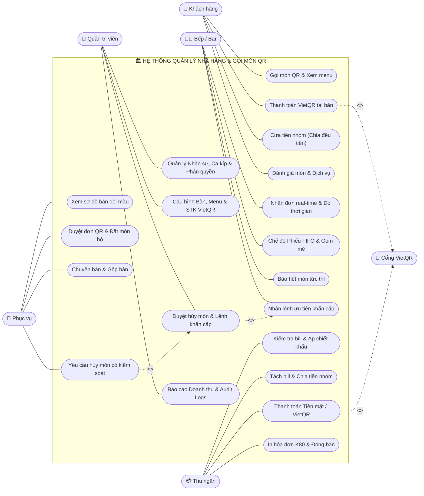
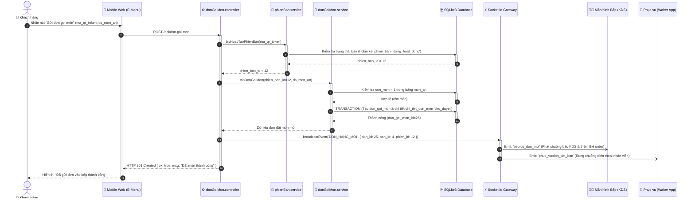
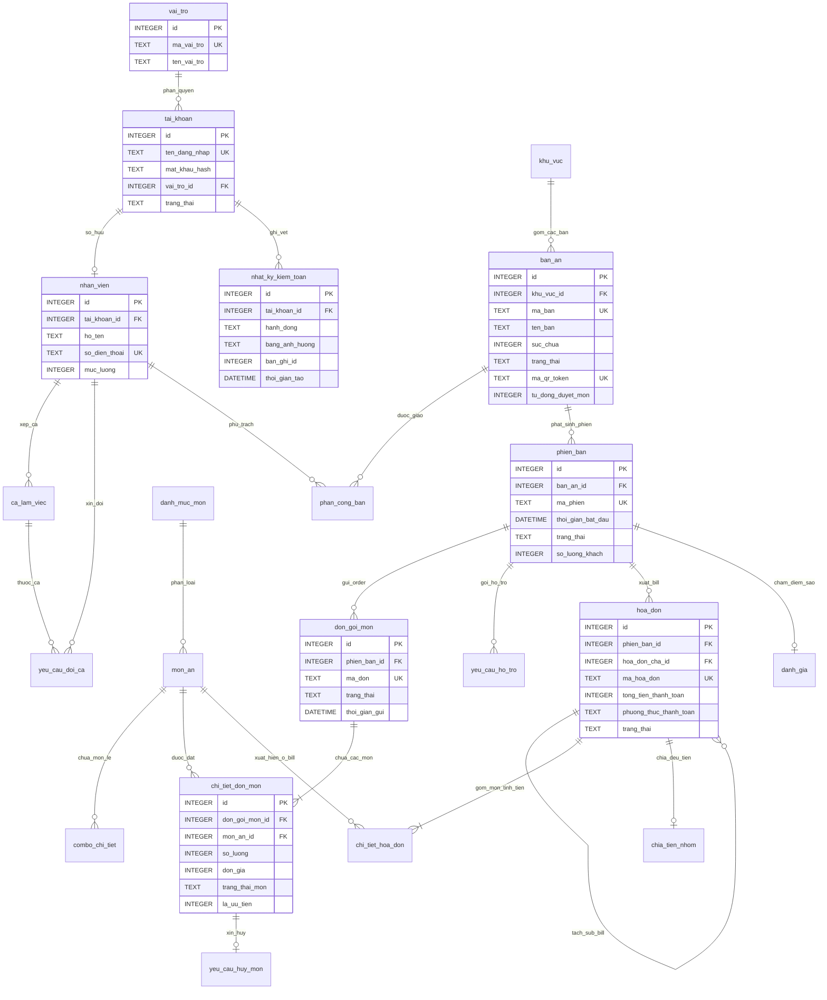

<!-- ============================================================================== -->
<!-- BỘ GIÁO DỤC VÀ ĐÀO TẠO - TRƯỜNG ĐẠI HỌC CMC                                    -->
<!-- BÁO CÁO KẾT THÚC HỌC PHẦN (TIỂU LUẬN / BÀI TẬP LỚN)                            -->
<!-- ============================================================================== -->

# TRƯỜNG ĐẠI HỌC CMC

### KHOA CÔNG NGHỆ THÔNG TIN VÀ TRUYỀN THÔNG

_Aspire to Inspire the Digital World_

---

  

# BÁO CÁO KẾT THÚC HỌC PHẦN

### HỌC PHẦN: PHÁT TRIỂN ỨNG DỤNG WEB

### MÃ LỚP HỌC PHẦN: LỚP N06 (NHÓM 1)

 

## ĐỀ TÀI:

# HỆ THỐNG QUẢN LÝ NHÀ HÀNG VÀ GỌI MÓN TẠI BÀN QUA MÃ QR

### (QUÁN MỘC POS & E-MENU)

  

<table align="center" style="border: none; font-size: 13pt; line-height: 1.6;">
  <tr>
    <td align="left" style="border: none; width: 220px;"><strong>Giảng viên giảng dạy:</strong></td>
    <td align="left" style="border: none;"><strong>ThS. Nguyễn Đức Giang</strong></td>
  </tr>
  <tr>
    <td align="left" style="border: none;"><strong>Ngành học:</strong></td>
    <td align="left" style="border: none;">Công nghệ thông tin</td>
  </tr>
  <tr>
    <td align="left" style="border: none;"><strong>Nhóm thực hiện:</strong></td>
    <td align="left" style="border: none;"><strong>Nhóm 1 — Lớp N06</strong></td>
  </tr>
  <tr>
    <td align="left" colspan="2" style="border: none; padding-top: 10px;">
      <strong>Danh sách thành viên thực hiện:</strong>
      <ol style="margin-top: 5px; margin-bottom: 0px; padding-left: 20px;">
        <li><strong>Đinh Viết Long Nhật</strong> (Nhóm trưởng) — MSV: <strong>BIT250261</strong> — Lớp: N06</li>
        <li><strong>Nguyễn Sỹ Minh</strong> — MSV: <strong>BIT250242</strong> — Lớp: N06</li>
        <li><strong>Lê Đăng Phát</strong> — MSV: <strong>BIT250266</strong> — Lớp: N06</li>
        <li><strong>Phạm Xuân Phong</strong> — MSV: <strong>BIT250269</strong> — Lớp: N06</li>
        <li><strong>Nguyễn Chí Quân</strong> — MSV: <strong>BIT250288</strong> — Lớp: N06</li>
      </ol>
    </td>
  </tr>
</table>

   

### Hà Nội, Tháng 11 năm 2026

\newpage

<!-- ============================================================================== -->
<!-- TRANG BÌA LÓT                                                                  -->
<!-- ============================================================================== -->

# TRƯỜNG ĐẠI HỌC CMC

### KHOA CÔNG NGHỆ THÔNG TIN VÀ TRUYỀN THÔNG

---

  

# BÁO CÁO KẾT THÚC HỌC PHẦN

### HỌC PHẦN: PHÁT TRIỂN ỨNG DỤNG WEB

### MÃ LỚP HỌC PHẦN: LỚP N06 (NHÓM 1)

 

## ĐỀ TÀI:

# HỆ THỐNG QUẢN LÝ NHÀ HÀNG VÀ GỌI MÓN TẠI BÀN QUA MÃ QR

### (QUÁN MỘC POS & E-MENU)

  

<table align="center" style="border: none; font-size: 13pt; line-height: 1.6;">
  <tr>
    <td align="left" style="border: none; width: 220px;"><strong>Giảng viên giảng dạy:</strong></td>
    <td align="left" style="border: none;"><strong>ThS. Nguyễn Đức Giang</strong></td>
  </tr>
  <tr>
    <td align="left" style="border: none;"><strong>Ngành học:</strong></td>
    <td align="left" style="border: none;">Công nghệ thông tin</td>
  </tr>
  <tr>
    <td align="left" colspan="2" style="border: none; padding-top: 10px;">
      <strong>Sinh viên thực hiện (Nhóm 1):</strong>
      <ol style="margin-top: 5px; margin-bottom: 0px; padding-left: 20px;">
        <li>Đinh Viết Long Nhật (Nhóm trưởng) — MSV: BIT250261 — Lớp: N06</li>
        <li>Nguyễn Sỹ Minh — MSV: BIT250242 — Lớp: N06</li>
        <li>Lê Đăng Phát — MSV: BIT250266 — Lớp: N06</li>
        <li>Phạm Xuân Phong — MSV: BIT250269 — Lớp: N06</li>
        <li>Nguyễn Chí Quân — MSV: BIT250288 — Lớp: N06</li>
      </ol>
    </td>
  </tr>
</table>

   

### Hà Nội, Tháng 11 năm 2026

\newpage

<!-- ============================================================================== -->
<!-- PHẦN CHẤM ĐIỂM & NHẬN XÉT CỦA GIẢNG VIÊN (MẪU CHUẨN ĐẠI HỌC CMC)               -->
<!-- ============================================================================== -->

# BỘ GIÁO DỤC VÀ ĐÀO TẠO - TRƯỜNG ĐẠI HỌC CMC

## PHẦN NHẬN XÉT VÀ ĐÁNH GIÁ CỦA GIẢNG VIÊN

**Học phần:** Phát triển ứng dụng Web - **Mã lớp HP:** Lớp N06 (Nhóm 1)  
**Giảng viên giảng dạy:** ThS. Nguyễn Đức Giang  
**Đề tài:** Hệ thống Quản lý Nhà hàng và Gọi món tại bàn qua mã QR (Quán Mộc POS & E-Menu)  
**Nhóm sinh viên thực hiện:**

1. Đinh Viết Long Nhật (Nhóm trưởng) — MSV: BIT250261
2. Nguyễn Sỹ Minh — MSV: BIT250242
3. Lê Đăng Phát — MSV: BIT250266
4. Phạm Xuân Phong — MSV: BIT250269
5. Nguyễn Chí Quân — MSV: BIT250288

---

### 1. Ý kiến nhận xét của Giảng viên chấm điểm

- **Về tinh thần, thái độ và tiến độ thực hiện:**  
  ....................................................................................................................................................................  
  ....................................................................................................................................................................
- **Về tính thực tiễn, quy chuẩn kỹ thuật và chất lượng sản phẩm:**  
  ....................................................................................................................................................................  
  ....................................................................................................................................................................
- **Về cấu trúc và quy cách trình bày báo cáo:**  
  ....................................................................................................................................................................  
  ....................................................................................................................................................................

---

### 2. Bảng Rubric Đánh giá Tiểu luận / Bài tập lớn

|      STT      | Tiêu chí đánh giá                                                                                                                                    | Trọng số |                            Mức chất lượng đạt được                            |     Điểm      |
| :-----------: | :--------------------------------------------------------------------------------------------------------------------------------------------------- | :------: | :---------------------------------------------------------------------------: | :-----------: |
|       1       | **Tính cấp thiết, phát biểu bài toán và khảo sát hiện trạng** (Hiểu rõ bài toán F&B, đối chiếu iPOS & KiotViet)                                      |   15%    | [ Giỏi: 8.5-10 \| Khá: 7.0-8.4 \| TB: 5.0-6.9 \| Yếu: 3.0-4.9 \| Kém: 0-2.9 ] |     .....     |
|       2       | **Đặc tả yêu cầu & Phân tích chức năng** (Hệ thống 5 phân hệ, 49 User Stories phân rã chi tiết từ 24 ca sử dụng nghiệp vụ đầy đủ tiêu chí chấp nhận) |   20%    | [ Giỏi: 8.5-10 \| Khá: 7.0-8.4 \| TB: 5.0-6.9 \| Yếu: 3.0-4.9 \| Kém: 0-2.9 ] |     .....     |
|       3       | **Thiết kế kiến trúc hệ thống & Cơ sở dữ liệu** (Mô hình MVC, Chuẩn hóa CSDL, Xử lý đồng thời & Transaction)                                         |   25%    | [ Giỏi: 8.5-10 \| Khá: 7.0-8.4 \| TB: 5.0-6.9 \| Yếu: 3.0-4.9 \| Kém: 0-2.9 ] |     .....     |
|       4       | **Hiện thực hóa chức năng & Tính năng vượt trội** (Real-time Socket.io, VietQR động, KDS, Kiểm soát Audit Log)                                       |   25%    | [ Giỏi: 8.5-10 \| Khá: 7.0-8.4 \| TB: 5.0-6.9 \| Yếu: 3.0-4.9 \| Kém: 0-2.9 ] |     .....     |
|       5       | **Quy chuẩn mã nguồn, kiểm thử & Trình bày báo cáo** (Tuân thủ Quy chuẩn phát triển, trích dẫn chuẩn IEEE/APA)                                       |   15%    | [ Giỏi: 8.5-10 \| Khá: 7.0-8.4 \| TB: 5.0-6.9 \| Yếu: 3.0-4.9 \| Kém: 0-2.9 ] |     .....     |
| **TỔNG ĐIỂM** | **(Quy về thang điểm 10)**                                                                                                                           | **100%** |                          **ĐIỂM CHỮ: ............**                           | **....../10** |

 

<table style="width: 100%; border: none;">
  <tr>
    <td style="width: 50%; text-align: center; border: none;"></td>
    <td style="width: 50%; text-align: center; border: none;">
      <em>Hà Nội, ngày ..... tháng ..... năm 2026</em> 
      <strong>GIẢNG VIÊN CHẤM ĐIỂM</strong> 
      <em>(Ký và ghi rõ họ tên)</em>    
      <strong>ThS. Nguyễn Đức Giang</strong>
    </td>
  </tr>
</table>

\newpage

<!-- ============================================================================== -->
<!-- ĐỀ BÀI TIỂU LUẬN / BÀI TẬP LỚN                                                 -->
<!-- ============================================================================== -->

# ĐỀ BÀI TIỂU LUẬN / BÀI TẬP LỚN

**1. Tên đề tài:**  
Xây dựng Hệ thống Quản lý Nhà hàng và Gọi món QR thời gian thực (Hệ thống Quán Mộc - Goi-Mon).

**2. Nhiệm vụ và Yêu cầu của đề tài:**

- Nghiên cứu, khảo sát hiện trạng nghiệp vụ vận hành của các giải pháp F&B dẫn đầu thị trường (iPOS.vn, KiotViet F&B).
- Phân tích và phát biểu chính xác bài toán phục vụ tại bàn (Dine-in full service), nhận diện các nút thắt cổ chai về thời gian chờ, sai sót order và nguy cơ thất thoát doanh thu.
- Thiết kế hệ thống thông tin phục vụ trọn vẹn 5 nhóm tác nhân:
  1. _Khách hàng (Customer):_ Quét QR dùng chung phiên bàn (Shared Table Session), xem thực đơn, gọi món, chuông báo hết món, cưa tiền nhóm và thanh toán VietQR động tại bàn.
  2. _Nhân viên Phục vụ (Waiter):_ Giao diện mobile tối ưu một ngón tay, sơ đồ bàn trực quan đổi màu trạng thái, nhận thông báo chuông, duyệt order và gửi yêu cầu hủy món có kiểm soát.
  3. _Bộ phận Bếp / Bar (KDS):_ Màn hình điều phối chế biến real-time, chế độ hiển thị kép (Theo phiếu bàn / Gom mẻ), cảnh báo thời gian trễ (Xanh/Vàng/Đỏ), tiếp nhận lệnh khẩn cấp từ Quản lý.
  4. _Nhân viên Thu ngân (Cashier/POS):_ Kiểm tra bill, thanh toán Tiền mặt (tính tiền thối), xuất mã VietQR động, in bill K80 và tiện ích Tách bill/Chia tiền nhóm.
  5. _Quản trị viên (Admin):_ Quản lý nhân sự (gán bàn phụ trách), ca kíp (duyệt nghỉ/đổi ca), cấu hình STK VietQR, menu, bàn, báo cáo doanh thu và nhật ký kiểm toán (Audit Logs).
- Thiết kế và cài đặt cơ sở dữ liệu quan hệ (SQLite3) đảm bảo tính toàn vẹn dữ liệu, chỉ mục tìm kiếm và ràng buộc toàn vẹn.
- Áp dụng kiến trúc phần mềm MVC phân tầng nghiêm ngặt (Controller mỏng, Service xử lý nghiệp vụ, Model truy vấn CSDL, Validation chặn đầu vào), đảm bảo tính an toàn giao dịch (Transaction), kiểm soát đồng thời (Concurrency) và bảo mật Zero-Trust.

\newpage

<!-- ============================================================================== -->
<!-- MỤC LỤC                                                                        -->
<!-- ============================================================================== -->

# MỤC LỤC

- **DANH MỤC TỪ VIẾT TẮT**
- **DANH MỤC HÌNH VẼ VÀ BẢNG BIỂU**
- **CHƯƠNG 1: TỔNG QUAN VÀ PHÁT BIỂU BÀI TOÁN**
  - 1.1. Bối cảnh và Tính cấp thiết của đề tài
  - 1.2. Mục tiêu nghiên cứu và sản phẩm kỳ vọng
  - 1.3. Phạm vi triển khai của hệ thống (In-Scope & Out-of-Scope)
- **CHƯƠNG 2: KHẢO SÁT HIỆN TRẠNG & PHÂN TÍCH SO SÁNH**
  - 2.1. Khảo sát giải pháp phần mềm 1: iPOS.vn (Hệ sinh thái FABi)
  - 2.2. Khảo sát giải pháp phần mềm 2: KiotViet F&B
  - 2.3. Bảng so sánh đối chiếu đa chiều
  - 2.4. Phân tích phản biện: Hệ thống đề tài hơn gì và khắc phục những gì?
- **CHƯƠNG 3: ĐẶC TẢ YÊU CẦU & THIẾT KẾ CHỨC NĂNG HỆ THỐNG**
  - 3.1. Phân tích các tác nhân (Actors) và Ca sử dụng tổng quát (Use Cases)
  - 3.2. Sơ đồ Ca sử dụng phân rã 4 phân hệ cốt lõi
  - 3.3. Sơ đồ Quy trình nghiệp vụ 5 làn (BPMN / Swimlane Flowchart)
  - 3.4. Hệ thống 49 User Stories chuẩn mực (phân rã chi tiết từ 24 ca sử dụng nghiệp vụ)
  - 3.5. Hệ thống Biểu đồ Tuần tự (Sequence Diagrams) cho 3 kịch bản cốt lõi
    - 3.5.1. Kịch bản 1: Khách quét QR & Đặt món thời gian thực
    - 3.5.2. Kịch bản 2: Bếp KDS tiếp nhận, chế biến & điều phối món ăn
    - 3.5.3. Kịch bản 3: Lập hóa đơn & Thanh toán VietQR NAPAS 247
  - 3.6. Hệ thống Biểu đồ Trạng thái (State Machine Diagrams)
    - 3.6.1. Vòng đời trạng thái Bàn ăn (Table Lifecycle)
    - 3.6.2. Vòng đời trạng thái Phiên bàn (Table Session Lifecycle)
    - 3.6.3. Vòng đời trạng thái Món ăn trong đơn (Order Item Lifecycle)
    - 3.6.4. Vòng đời trạng thái Hóa đơn thanh toán (Invoice Lifecycle)
- **CHƯƠNG 4: THIẾT KẾ KIẾN TRÚC & QUY CHUẨN KỸ THUẬT PHÁT TRIỂN**
  - 4.1. Kiến trúc phân tầng MVC & Phân bổ Module
  - 4.2. Biểu đồ Lớp Kiến trúc Hệ thống (Class Diagram - MVC)
  - 4.3. Quy chuẩn thiết kế Giao diện (UI/UX Design System)
  - 4.4. Quy chuẩn Bảo mật Web & Chống lỗi đồng thời (Concurrency Control)
  - 4.5. Quy chuẩn Kiểm soát Chống thất thoát (Audit Logging & Hủy món)
  - 4.6. Thiết kế Cơ sở Dữ liệu Toàn diện (Database Design & ERD chuẩn 3NF)
    - 4.5.1. Bước 1: Xác định thực thể theo 5 phân hệ
    - 4.5.2. Bước 2: Xác định các mối quan hệ & bản số
    - 4.5.3. Bước 3: Chứng minh chuẩn hóa đến 3NF & Kỹ thuật Snapshot
    - 4.5.4. Bước 4: Sơ đồ ERD & Danh mục 22 bảng CSDL SQLite3
- **CHƯƠNG 5: TIẾN ĐỘ THỰC HIỆN & KẾ HOẠCH BÀN GIAO**
  - 5.1. Bảng phân công công việc và kết quả đạt được
  - 5.2. Kế hoạch hoàn thiện các Sprint tiếp theo
- **TÀI LIỆU THAM KHẢO**

\newpage

<!-- ============================================================================== -->
<!-- DANH MỤC TỪ VIẾT TẮT & THUẬT NGỮ                                               -->
<!-- ============================================================================== -->

# DANH MỤC TỪ VIẾT TẮT & THUẬT NGỮ

| Từ viết tắt / Thuật ngữ | Thuật ngữ Tiếng Anh                 | Giải nghĩa Tiếng Việt                                                 |
| :---------------------- | :---------------------------------- | :-------------------------------------------------------------------- |
| **API**                 | Application Programming Interface   | Giao diện lập trình ứng dụng                                          |
| **Audit Log**           | Audit Logging                       | Nhật ký kiểm toán, ghi vết lịch sử thay đổi nhạy cảm                  |
| **BOM**                 | Bill of Materials                   | Bảng định lượng nguyên vật liệu cấu thành món ăn                      |
| **C4 Model**            | Context, Container, Component, Code | Mô hình 4 cấp độ trực quan hóa kiến trúc phần mềm                     |
| **CRUD**                | Create, Read, Update, Delete        | Bốn thao tác cơ bản trên dữ liệu: Tạo, Đọc, Sửa, Xóa                  |
| **CSRF**                | Cross-Site Request Forgery          | Tấn công giả mạo yêu cầu từ phía người dùng tin cậy                   |
| **EJS**                 | Embedded JavaScript Templates       | Công cụ dựng giao diện HTML phía máy chủ cho Node.js                  |
| **ERD**                 | Entity-Relationship Diagram         | Sơ đồ biểu diễn thực thể và mối quan hệ trong CSDL                    |
| **F&B**                 | Food and Beverage                   | Ngành công nghiệp kinh doanh ẩm thực và dịch vụ ăn uống               |
| **FIFO**                | First-In, First-Out                 | Nguyên tắc xử lý theo thứ tự: Vào trước, Phục vụ trước                |
| **KDS**                 | Kitchen Display System              | Hệ thống màn hình điều phối chế biến thông minh cho bếp/bar           |
| **MVC**                 | Model - View - Controller           | Mô hình kiến trúc phần mềm tách biệt Dữ liệu - Giao diện - Điều hướng |
| **NAPAS 247**           | National Payment Services 24/7      | Dịch vụ chuyển mạch tài chính và thanh toán nhanh liên ngân hàng      |
| **POS**                 | Point of Sale                       | Điểm bán hàng / Hệ thống phần mềm tính tiền tại quầy                  |
| **QR Code**             | Quick Response Code                 | Mã phản hồi nhanh dạng ma trận điểm ảnh 2 chiều                       |
| **RBAC**                | Role-Based Access Control           | Cơ chế kiểm soát truy cập phân quyền dựa trên vai trò                 |
| **RMS**                 | Restaurant Management System        | Hệ thống quản lý toàn diện nhà hàng ăn uống                           |
| **Socket.io**           | WebSockets Engine                   | Thư viện truyền thông hai chiều thời gian thực                        |
| **Split Bill**          | Split Billing                       | Nghiệp vụ chia tách hóa đơn hoặc chia tiền theo nhóm                  |
| **Table Session**       | Table Service Lifecycle             | Vòng đời một phiên phục vụ bàn từ lúc mở đến lúc đóng bill            |
| **VietQR**              | Vietnam Quick Response Payment      | Tiêu chuẩn mã QR thanh toán quốc gia của ngân hàng Việt Nam           |
| **XSS**                 | Cross-Site Scripting                | Lỗ hổng chèn mã độc kịch bản trên trình duyệt                         |

\newpage

<!-- ============================================================================== -->
<!-- DANH MỤC HÌNH VẼ VÀ BẢNG BIỂU                                                  -->
<!-- ============================================================================== -->

# DANH MỤC HÌNH VẼ VÀ BẢNG BIỂU

### Danh mục Hình vẽ

- **Hình 1.1:** Sơ đồ bối cảnh các luồng phục vụ truyền thống và điểm nghẽn
- **Hình 2.1:** Mô hình kiến trúc sinh thái phần mềm iPOS.vn FABi
- **Hình 2.2:** Mô hình quy trình bán hàng và gom mẻ của KiotViet F&B
- **Hình 3.1:** Sơ đồ Ca sử dụng tổng quát (Use Case Diagram) toàn hệ thống
- **Hình 3.2:** Sơ đồ Ca sử dụng phân rã 4 phân hệ (Khách hàng, Phục vụ, Bếp, Thu ngân & Admin)
- **Hình 3.3:** Sơ đồ Quy trình nghiệp vụ 5 làn (BPMN / Swimlane Flowchart)
- **Hình 3.4:** Sơ đồ Tuần tự (Sequence Diagram) luồng gọi món real-time từ Khách đến Bếp
- **Hình 3.5:** Sơ đồ Tuần tự luồng Bếp KDS tiếp nhận và điều phối chế biến
- **Hình 3.6:** Sơ đồ Tuần tự luồng Lập hóa đơn và Thanh toán VietQR NAPAS 247
- **Hình 3.7:** Sơ đồ Trạng thái (State Diagram) vòng đời Bàn ăn (Table Lifecycle)
- **Hình 3.8:** Sơ đồ Trạng thái (State Diagram) vòng đời Phiên bàn (Table Session Lifecycle)
- **Hình 3.9:** Sơ đồ Trạng thái (State Diagram) vòng đời Món ăn trong đơn (Order Item Lifecycle)
- **Hình 3.10:** Sơ đồ Trạng thái (State Diagram) vòng đời Hóa đơn thanh toán (Invoice Lifecycle)
- **Hình 4.1:** Sơ đồ Kiến trúc Phân tầng Express MVC
- **Hình 4.2:** Sơ đồ Lớp Kiến trúc Hệ thống (Class Diagram - MVC)
- **Hình 4.3:** Mô hình bảng màu trạng thái bàn và giao diện Dark Mode KDS
- **Hình 4.4:** Sơ đồ Thực thể Liên kết (Mermaid ERD chuẩn 3NF) 22 thực thể Quán Mộc
- **Hình 4.5:** Sơ đồ Cấu trúc CSDL Vật lý (Database Diagram) phân vùng 5 cụm bảng

### Danh mục Bảng biểu

- **Bảng 2.1:** Bảng ma trận so sánh tính năng giữa iPOS.vn, KiotViet F&B và Hệ thống đồ án
- **Bảng 3.1:** Danh sách 49 User Stories chi tiết theo 5 phân hệ (phân rã từ 24 Use Cases)
- **Bảng 4.1:** Bảng mã lỗi HTTP và cấu trúc phản hồi API chuẩn `{ ok, data, msg }`
- **Bảng 4.2:** Bảng quy tắc đặt tên Tiếng Việt không dấu `camelCase` theo Quy chuẩn phát triển
- **Bảng 4.3:** Danh mục 22 bảng cơ sở dữ liệu SQLite3 chuẩn 3NF và vai trò nghiệp vụ
- **Bảng 5.1:** Bảng tiến độ hoàn thành các Sprint của đề tài

\newpage

<!-- ============================================================================== -->
<!-- CHƯƠNG 1: TỔNG QUAN VÀ PHÁT BIỂU BÀI TOÁN                                     -->
<!-- ============================================================================== -->

# CHƯƠNG 1: TỔNG QUAN VÀ PHÁT BIỂU BÀI TOÁN

## 1.1. Bối cảnh và Tính cấp thiết của đề tài

Ngành dịch vụ ẩm thực (F&B) tại Việt Nam đang trải qua giai đoạn chuyển đổi số mạnh mẽ. Trong mô hình nhà hàng ăn uống phục vụ tại bàn truyền thống, các công đoạn vận hành hầu như vẫn phụ thuộc vào phương thức thủ công:

- **Thời gian chết và chờ đợi kéo dài:** Thực khách vào bàn phải chờ nhân viên mang menu giấy, nhân viên dùng sổ tay ghi chép rồi mới di chuyển về quầy thu ngân hoặc bếp để chuyển lệnh. Quá trình này tiêu tốn từ 7 đến 15 phút chỉ cho khâu nhận đơn.
- **Rủi ro sai sót đơn hàng:** Trong giờ cao điểm, nhân viên ghi tay vội vàng dễ dẫn đến việc bếp đọc sai món, thiếu món, bỏ qua ghi chú đặc biệt (như _không cay, ít đường, dị ứng_), gây lãng phí nguyên liệu và làm giảm mức độ hài lòng của khách hàng.
- **Áp lực ùn tắc tại quầy thanh toán:** Khi nhiều bàn cùng dùng bữa xong, việc dồn ứ tại quầy thu ngân để chờ kiểm tra hóa đơn, tính tiền thừa hoặc chia tiền nhóm gây mất thời gian và tăng nguy cơ nhầm lẫn tiền mặt.
- **Nguy cơ thất thoát doanh thu nội bộ:** Nếu thiếu quy trình kiểm soát chặt chẽ, nhân viên có thể tự ý xóa món sau khi bếp đã chế biến để gian lận tiền của nhà hàng.

Xuất phát từ thực tiễn trên, việc **Xây dựng Hệ thống Quản lý Nhà hàng và Gọi món QR thời gian thực (Quán Mộc - Goi-Mon)** là một đòi hỏi vô cùng cấp thiết, nhằm số hóa toàn diện quy trình phục vụ từ khâu quét mã QR tự gọi món, điều phối chế biến tại bếp, quản lý nhân sự ca kíp đến thanh toán không tiền mặt qua VietQR.

## 1.2. Mục tiêu nghiên cứu và Sản phẩm kỳ vọng

1. **Về mặt nghiệp vụ:**
   - Xây dựng giải pháp tự phục vụ thông minh: Khách hàng quét mã QR tại bàn dùng chung phiên (Shared Table Session), theo dõi tiến độ món ăn real-time và thanh toán nhanh chóng.
   - Nâng cao năng suất Bếp/Bar bằng Màn hình hiển thị KDS thông minh, hỗ trợ cả làm theo đơn (FIFO) và gom món theo mẻ.
   - Tối ưu hóa quầy thu ngân với công cụ tính tiền thối, in hóa đơn K80 và công cụ chia tiền nhóm qua VietQR động.
   - Thiết lập cơ chế kiểm soát gian lận nghiêm ngặt thông qua quy trình phê duyệt hủy món và ghi vết Audit Log.
2. **Về mặt kỹ thuật và học thuật:**
   - Triển khai hoàn chỉnh mô hình kiến trúc **MVC (Model - View - Controller)** kết hợp **Node.js, Express.js, EJS** và cơ sở dữ liệu **SQLite3**.
   - Tích hợp công nghệ **Socket.io** đảm bảo độ trễ đồng bộ gần như bằng 0 giữa Khách - Phục vụ - Bếp - Thu ngân.
   - Tuân thủ nghiêm ngặt **Quy chuẩn phát triển phần mềm toàn dự án**, đảm bảo tính toàn vẹn dữ liệu, kiểm soát tranh chấp đồng thời (Concurrency Control) và bảo mật Zero-Trust.

## 1.3. Phạm vi dự án (Project Scope)

### Phạm vi bao gồm (In-Scope):

- Mô hình nhà hàng: Phục vụ tại bàn (Dine-in full service) có sơ đồ bàn phân khu vực/tầng.
- 5 phân hệ người dùng tương tác: Khách hàng (QR Mobile Web), Phục vụ (Mobile Web), Bếp/Bar (KDS Dark Mode), Thu ngân (Desktop POS) và Quản trị viên (Admin Dashboard).
- Đồng bộ sự kiện thời gian thực qua WebSockets (Socket.io).
- Tích hợp thanh toán linh hoạt: Tiền mặt và Chuyển khoản VietQR động chuẩn NAPAS 247.
- Kiểm soát hủy món 2 bước và ghi vết nhật ký kiểm toán (Audit Logs).

### Phạm vi giới hạn giai đoạn 1 (Out-of-Scope):

- Chưa quản lý kho định lượng nguyên liệu thô (BOM - Recipe). Món ăn quản lý theo cờ trạng thái _Còn món / Hết món_.
- Chưa tích hợp giao hàng mang về (Delivery) qua các ứng dụng thứ ba (GrabFood, ShopeeFood).

\newpage

<!-- ============================================================================== -->
<!-- CHƯƠNG 2: KHẢO SÁT HIỆN TRẠNG & PHÂN TÍCH SO SÁNH                              -->
<!-- ============================================================================== -->

# CHƯƠNG 2: KHẢO SÁT HIỆN TRẠNG & PHÂN TÍCH SO SÁNH

## 2.1. Khảo sát giải pháp phần mềm 1: iPOS.vn (Hệ sinh thái FABi)

iPOS.vn là đơn vị dẫn đầu thị trường Việt Nam với hơn 15 năm kinh nghiệm chuyên sâu trong ngành F&B, phục vụ hơn 100.000 thương hiệu.

- **Ưu điểm nổi bật:** Quy trình chuẩn xác tuyệt đối cho nhà hàng lớn, màn hình KDS chuyên nghiệp đổi màu theo thời gian chờ, cơ chế phân quyền và kiểm soát gian lận cực kỳ chặt chẽ (hủy món bắt buộc mã Quản lý).
- **Hạn chế đối với quán vừa/nhỏ:** Chi phí đầu tư ban đầu rất cao (phần mềm thu theo năm từ 3,3 triệu đồng, bắt buộc mua máy POS chuyên dụng từ 10 - 20 triệu đồng), cấu hình phức tạp, phân hệ nhân sự ca kíp bị tách thành phần mềm riêng (iPOS HRM) tính thêm phí.

## 2.2. Khảo sát giải pháp phần mềm 2: KiotViet F&B

KiotViet F&B là giải pháp quản lý bán hàng phổ thông, tinh gọn phục vụ hơn 50.000 quán ăn vừa và nhỏ trên toàn quốc.

- **Ưu điểm nổi bật:** Giao diện phẳng trực quan, dễ dùng cho nhân viên thời vụ, chi phí hợp lý (thu theo tháng 270.000 - 330.000 đ), hỗ trợ chế độ gom mẻ nấu nướng cho quán bình dân.
- **Hạn chế:** Nghiệp vụ chuyên biệt F&B chưa thực sự sâu, hệ thống phụ thuộc hoàn toàn vào đường truyền Internet (Cloud-first), tính năng kiểm soát chống gian lận và Audit Log ở mức cơ bản.

## 2.3. Bảng so sánh đối chiếu đa chiều

| Tiêu chí so sánh                  | iPOS.vn (FABi)                         | KiotViet F&B                   | Hệ thống Đề tài (Quán Mộc)                                                            |
| :-------------------------------- | :------------------------------------- | :----------------------------- | :------------------------------------------------------------------------------------ |
| **Gốc rễ phát triển**             | Chuyên biệt 100% cho F&B               | Mở rộng từ bán lẻ đa ngành     | Chuyên biệt cho mô hình phục vụ tại bàn                                               |
| **Trải nghiệm QR gọi món**        | Khách xem menu tĩnh, gửi đơn riêng     | Khách xem menu, gửi đơn        | **Shared Table Session:** Cùng bàn đồng bộ giỏ hàng, gợi ý combo, cưa tiền nhóm       |
| **Màn hình Bếp (KDS)**            | Theo dõi theo vé đơn (FIFO), đổi màu   | In bill LAN/Wifi, KDS gom mẻ   | **Hybrid:** Kết hợp cả Phiếu FIFO lẫn Gom mẻ; nhận lệnh ưu tiên khẩn cấp từ Admin     |
| **Quản lý Ca kíp & Phân quyền**   | Tách riêng app iPOS HRM (thu thêm phí) | Phân quyền vai trò chung chung | **Tích hợp sẵn:** Quản lý lịch ca, duyệt đổi/nghỉ ca, gán bàn phụ trách mặc định      |
| **Kiểm soát Hủy món (Audit Log)** | Bắt buộc mã Quản lý, ghi log chi tiết  | Cơ bản                         | **Kiểm soát 2 bước:** Bếp đang nấu phải gửi Admin duyệt; lưu toàn bộ vào `audit_logs` |
| **Kênh thanh toán**               | Quẹt thẻ POS, MoMo, VietQR quầy        | VietQR quầy + Loa báo tiền     | **2 kênh an toàn:** Quét VietQR tại bàn HOẶC tại quầy, tính tiền thối, chia đều tiền  |
| **Hạ tầng & Chi phí**             | Rất cao (10-20 triệu phần cứng)        | Trung bình (thu phí tháng)     | **0 VNĐ (Mã nguồn mở Web thuần, SQLite3 gọn nhẹ)**                                    |

\newpage

<!-- ============================================================================== -->
<!-- CHƯƠNG 3: ĐẶC TẢ YÊU CẦU & THIẾT KẾ CHỨC NĂNG HỆ THỐNG                         -->
<!-- ============================================================================== -->

# CHƯƠNG 3: ĐẶC TẢ YÊU CẦU, SƠ ĐỒ USE CASE & QUY TRÌNH NGHIỆP VỤ BPMN

## 3.1. Phân tích Tác nhân và Sơ đồ Ca sử dụng Tổng quát (Use Case Diagram)

Hệ thống được thiết kế xoay quanh **5 tác nhân người dùng (Human Actors)** và **1 tác nhân hệ thống tích hợp (System Actor)**:

1. **Khách hàng (Customer):** Thực khách tại bàn tự quét QR, xem thực đơn điện tử, gọi món, cưa tiền nhóm, thanh toán online và đánh giá dịch vụ.
2. **Nhân viên Phục vụ (Waiter):** Tiếp nhận thông báo bàn phụ trách, duyệt order QR của khách, tạo order hộ tại bàn, chuyển/gộp bàn và yêu cầu hủy món có kiểm soát.
3. **Bộ phận Bếp / Bar (Chef / Bartender):** Tiếp nhận chế biến real-time trên KDS, đổi màu theo thời gian chờ, gom món nấu theo mẻ, báo hết món tức thì và nhận lệnh ưu tiên khẩn cấp.
4. **Nhân viên Thu ngân (Cashier):** Quản lý POS tại quầy, kiểm bill, áp chiết khấu, tiện ích Tách bill (Split Bill) / Chia tiền nhóm, thu tiền mặt hoặc quét VietQR và in hóa đơn K80.
5. **Quản trị viên (Admin / Manager):** Quản lý nhân sự, ca kíp trực, cấu hình STK VietQR, duyệt hủy món, phát lệnh ưu tiên khẩn cấp xuống bếp, xem báo cáo Chart.js và tra cứu Audit Logs.
6. **Hệ thống Cổng Ngân hàng (VietQR Gateway):** Tác nhân hệ thống bên ngoài hỗ trợ sinh mã QR động chuẩn NAPAS 247 và xử lý thông báo biến động số dư.

### Sơ đồ Ca sử dụng Tổng quát (Toàn hệ thống):

- **Ảnh Vector SVG:** [taiLieu/soDoCaSuDung.svg](file:///d:/PHAT%20TRIEN%20WEB/quan%20ly%20nha%20hang/taiLieu/soDoCaSuDung.svg)
- **Ảnh nét cao PNG:** [taiLieu/soDoCaSuDung.png](file:///d:/PHAT%20TRIEN%20WEB/quan%20ly%20nha%20hang/taiLieu/soDoCaSuDung.png)
- **File PlantUML:** [taiLieu/soDoCaSuDung.puml](file:///d:/PHAT%20TRIEN%20WEB/quan%20ly%20nha%20hang/taiLieu/soDoCaSuDung.puml)

---

## 3.2. Sơ đồ Ca sử dụng Phân rã theo 4 Phân hệ Chức năng

Để mô hình hóa chính xác các quan hệ phụ thuộc (`<<include>>`) và mở rộng (`<<extend>>`), hệ thống phân rã thành 4 sơ đồ ca sử dụng thành phần:

1. **Phân hệ Khách hàng:** Xem chi tiết tại [taiLieu/usecaseKhachHang.svg](file:///d:/PHAT%20TRIEN%20WEB/quan%20ly%20nha%20hang/taiLieu/usecaseKhachHang.svg)
   - Ca sử dụng _Gửi yêu cầu đặt món_ `<<include>>` _Kiểm tra món còn/hết_.
   - Ca sử dụng _Thanh toán VietQR tại bàn_ `<<extend>>` _Cưa tiền nhóm (Chia đều tiền)_.
2. **Phân hệ Nhân viên Phục vụ:** Xem chi tiết tại [taiLieu/usecasePhucVu.svg](file:///d:/PHAT%20TRIEN%20WEB/quan%20ly%20nha%20hang/taiLieu/usecasePhucVu.svg)
   - Ca sử dụng _Yêu cầu hủy món có kiểm soát_ mở rộng thành: _Hủy trực tiếp (Món chờ duyệt)_ và _Gửi yêu cầu hủy lên Quản lý (Món đang nấu)_.
3. **Phân hệ Bếp / Bar (KDS):** Xem chi tiết tại [taiLieu/usecaseBepKDS.svg](file:///d:/PHAT%20TRIEN%20WEB/quan%20ly%20nha%20hang/taiLieu/usecaseBepKDS.svg)
   - Ca sử dụng _Chuyển đổi chế độ hiển thị_ mở rộng thành: _Xem theo phiếu FIFO_ và _Xem gom mẻ chế biến_.
4. **Phân hệ Thu ngân & Quản trị:** Xem chi tiết tại [taiLieu/usecaseThuNganAdmin.svg](file:///d:/PHAT%20TRIEN%20WEB/quan%20ly%20nha%20hang/taiLieu/usecaseThuNganAdmin.svg)
   - Ca sử dụng _Kiểm tra bill_ `<<extend>>` _Tách hóa đơn con (Split Bill)_.
   - Ca sử dụng _Phê duyệt hủy món_ `<<include>>` _Ghi nhận vết Audit Log_.

---

## 3.3. Sơ đồ Quy trình Nghiệp vụ (BPMN / Swimlane Flowchart)

Sơ đồ quy trình nghiệp vụ được mô hình hóa theo chuẩn BPMN với **5 làn phân vai (Swimlanes)** mô phỏng trọn vẹn luồng tương tác thực tế từ thời điểm khách bước vào quán đến khi rời đi:

- **Ảnh Vector SVG:** [taiLieu/soDoQuyTrinhNghiepVu.svg](file:///d:/PHAT%20TRIEN%20WEB/quan%20ly%20nha%20hang/taiLieu/soDoQuyTrinhNghiepVu.svg)
- **Ảnh nét cao PNG:** [taiLieu/soDoQuyTrinhNghiepVu.png](file:///d:/PHAT%20TRIEN%20WEB/quan%20ly%20nha%20hang/taiLieu/soDoQuyTrinhNghiepVu.png)
- **File thiết kế mở trực quan Draw.io:** [taiLieu/quyTrinhNhaHang.drawio](file:///d:/PHAT%20TRIEN%20WEB/quan%20ly%20nha%20hang/taiLieu/quyTrinhNhaHang.drawio)
- **Mã nguồn Mermaid:** [taiLieu/soDoQuyTrinhNghiepVu.mmd](file:///d:/PHAT%20TRIEN%20WEB/quan%20ly%20nha%20hang/taiLieu/soDoQuyTrinhNghiepVu.mmd)

### 4 Giai đoạn xử lý chính trong luồng BPMN:

1. **Giai đoạn Nhận diện & Đặt món (Giai đoạn vào bàn):** Khách quét QR $\to$ Gia nhập Shared Session $\to$ Chọn món $\to$ Phục vụ duyệt (hoặc tự động chuyển thẳng bếp).
2. **Giai đoạn Chế biến & Điều phối KDS:** Màn hình KDS đếm giờ chờ (Xanh/Vàng/Đỏ) $\to$ Gom mẻ xào nấu $\to$ Bếp bấm hoàn thành $\to$ Socket bắn chuông đến Phục vụ $\to$ Phục vụ bưng món ra bàn.
3. **Giai đoạn Xử lý Tình huống Ngoại lệ:**
   - _Báo hết món:_ Bếp bấm nút báo hết $\to$ Món tự khóa trên menu khách.
   - _Khách hủy món đang nấu:_ Phục vụ gửi yêu cầu lên Admin $\to$ Admin duyệt thì gạch món và trừ bill $\to$ Ghi log.
   - _Khách phàn nàn chờ lâu:_ Admin/Thu ngân phát lệnh khẩn cấp $\to$ KDS cưỡng chế đưa món lên đầu hàng đợi.
4. **Giai đoạn Thanh toán & Giải phóng Bàn:** Khách chọn VietQR tại bàn (có cưa tiền nhóm) hoặc ra quầy $\to$ Thu ngân áp chiết khấu / tách bill $\to$ In hóa đơn K80 $\to$ Chốt đóng bill $\to$ Bàn chuyển "Cần dọn dẹp" $\to$ Khách đánh giá sao và ra về.

---

## 3.4. Hệ thống 49 User Stories chuẩn mực (phân rã từ 24 ca sử dụng nghiệp vụ)

_(Toàn bộ danh sách 49 User Stories phân rã chi tiết từ 24 ca sử dụng nghiệp vụ với Tiêu chí chấp nhận được duy trì đồng bộ từ tài liệu đặc tả chức năng: US-C01 đến US-C09, US-W01 đến US-W09, US-K01 đến US-K06, US-CS01 đến US-CS08, US-A01 đến US-A17)._

Hệ thống đã đặc tả hoàn chỉnh 49 User Stories phân rã chi tiết từ 24 ca sử dụng nghiệp vụ kèm Tiêu chí chấp nhận (Acceptance Criteria):

- **Phân hệ Khách hàng (US-C01 đến US-C09):** Truy cập QR chung bàn, duyệt menu & combo gợi ý, chọn món & ghi chú, gửi order real-time, chuông báo hết món, gọi phục vụ/tính tiền, thanh toán VietQR tại bàn, đánh giá sao dịch vụ, công cụ chia đều tiền nhóm.
- **Phân hệ Phục vụ (US-W01 đến US-W09):** Đăng nhập di động theo ca & bàn phụ trách, sơ đồ bàn đổi màu trực quan, trung tâm thông báo rung chuông, duyệt/từ chối đơn QR, đặt món hộ khách, chuyển/gộp bàn, yêu cầu hủy món có kiểm soát, cơ chế Timeout 90s leo thang, xem lịch ca trực và nộp phiếu xin nghỉ / đổi ca với đồng nghiệp (Figma W11).
- **Phân hệ Bếp / Bar (US-K01 đến US-K06):** Nhận món real-time kèm chuông báo, thời gian chờ đổi màu (Xanh/Vàng/Đỏ), chế độ kép (Theo bàn / Gom mẻ), cập nhật tiến độ chế biến, nút báo hết món tức thì, tiếp nhận chỉ đạo khẩn cấp từ Admin.
- **Phân hệ Thu ngân (US-CS01 đến US-CS08):** Xem tổng tiền theo bàn, áp mã giảm giá, thanh toán tiền mặt (tính tiền thối), xuất mã VietQR động, in hóa đơn K80, giải phóng bàn tự động, tiện ích Tách bill và chia tiền nhóm, chốt két mù (Blind Cash Drop) & In Báo cáo Z-Report.
- **Phân hệ Quản trị viên (US-A01 đến US-A17):** Quản lý nhân viên & cấp quyền, quản lý lịch ca & duyệt đổi/nghỉ ca, thiết lập thông tin quán & STK VietQR, quản lý phòng bàn & in mã QR, cấu hình tự động duyệt món, quản lý menu & combo, báo cáo doanh thu biểu đồ Chart.js, xem phản hồi khách, phát lệnh khẩn cấp xuống bếp, phê duyệt hủy món & tra cứu Audit Logs, giám sát kiến trúc Local-First & đồng bộ ngoại tuyến.

---

## 3.5. Hệ thống Biểu đồ Tuần tự (Sequence Diagrams)

### 3.5.1. Kịch bản 1: Khách hàng quét mã QR & Đặt món thời gian thực

- **Mục đích:** Đặc tả chuỗi thông điệp theo trục thời gian khi khách xác nhận giỏ hàng trên E-Menu, khởi tạo/gắn kết phiên bàn (`phien_ban`), kiểm tra trạng thái còn món (`con_mon`), ghi nhận giao dịch CSDL SQLite3 và đồng bộ tức thì sang Bếp KDS và thiết bị Phục vụ.
- **Tài nguyên:** [taiLieu/soDoTuanTuGoiMon.svg](file:///d:/PHAT%20TRIEN%20WEB/quan%20ly%20nha%20hang/taiLieu/soDoTuanTuGoiMon.svg) | [taiLieu/soDoTuanTuGoiMon.png](file:///d:/PHAT%20TRIEN%20WEB/quan%20ly%20nha%20hang/taiLieu/soDoTuanTuGoiMon.png)

### 3.5.2. Kịch bản 2: Bếp KDS tiếp nhận, chế biến & điều phối món ăn

- **Mục đích:** Đặc tả dòng sự kiện khi đầu bếp chuyển đổi trạng thái chế biến (`dang_nau` $\rightarrow$ `hoan_thanh`), ghi nhận mốc thời gian `thoi_gian_bat_dau_nau` và `thoi_gian_hoan_thanh_nau`, tự động phát chuông gọi phục vụ bưng món và cập nhật tiến độ cho khách.
- **Tài nguyên:** [taiLieu/soDoTuanTuDieuPhoiBep.svg](file:///d:/PHAT%20TRIEN%20WEB/quan%20ly%20nha%20hang/taiLieu/soDoTuanTuDieuPhoiBep.svg) | [taiLieu/soDoTuanTuDieuPhoiBep.png](file:///d:/PHAT%20TRIEN%20WEB/quan%20ly%20nha%20hang/taiLieu/soDoTuanTuDieuPhoiBep.png)

### 3.5.3. Kịch bản 3: Lập hóa đơn & Thanh toán VietQR NAPAS 247 khép kín

- **Mục đích:** Đặc tả chu trình lập bill gắn với `phien_ban_id`, tính VAT 8%, sinh mã VietQR động NAPAS 247, nhận Webhook ngân hàng tự động, đồng thời cập nhật trạng thái hóa đơn (`da_thanh_toan`), phiên bàn (`da_thanh_toan`) và bàn ăn (`can_don_dep`), in hóa đơn nhiệt K80.
- **Tài nguyên:** [taiLieu/soDoTuanTuThanhToanVietQR.svg](file:///d:/PHAT%20TRIEN%20WEB/quan%20ly%20nha%20hang/taiLieu/soDoTuanTuThanhToanVietQR.svg) | [taiLieu/soDoTuanTuThanhToanVietQR.png](file:///d:/PHAT%20TRIEN%20WEB/quan%20ly%20nha%20hang/taiLieu/soDoTuanTuThanhToanVietQR.png)

---

## 3.6. Hệ thống Biểu đồ Trạng thái (State Machine Diagrams)

### 3.6.1. Vòng đời trạng thái Bàn ăn (Table Lifecycle)

Trạng thái bàn ăn gồm 5 mốc chuẩn CSDL SQLite3: `'trong'` $\rightarrow$ `'co_khach'` $\rightarrow$ `'cho_mon'` $\rightarrow$ `'yeu_cau_thanh_toan'` $\rightarrow$ `'can_don_dep'` $\rightarrow$ `'trong'`.

- **Tài nguyên:** [taiLieu/soDoTrangThaiBanAn.svg](file:///d:/PHAT%20TRIEN%20WEB/quan%20ly%20nha%20hang/taiLieu/soDoTrangThaiBanAn.svg) | [taiLieu/soDoTrangThaiBanAn.png](file:///d:/PHAT%20TRIEN%20WEB/quan%20ly%20nha%20hang/taiLieu/soDoTrangThaiBanAn.png)

### 3.6.2. Vòng đời trạng thái Phiên bàn (Table Session Lifecycle)

Trạng thái phiên bàn gồm 3 mốc chuẩn CSDL: `'dang_hoat_dong'` (Shared Session cho phép nhiều khách đặt món) $\rightarrow$ `'da_thanh_toan'` (Đã khớp bill) $\rightarrow$ `'da_dong'` (Giải phóng bàn & đóng phiên).

- **Tài nguyên:** [taiLieu/soDoTrangThaiPhienBan.svg](file:///d:/PHAT%20TRIEN%20WEB/quan%20ly%20nha%20hang/taiLieu/soDoTrangThaiPhienBan.svg) | [taiLieu/soDoTrangThaiPhienBan.png](file:///d:/PHAT%20TRIEN%20WEB/quan%20ly%20nha%20hang/taiLieu/soDoTrangThaiPhienBan.png)

### 3.6.3. Vòng đời trạng thái Món ăn trong đơn (Order Item Lifecycle)

Trạng thái món gồm: `'cho_duyet'` (Chờ nhận) $\rightarrow$ `'dang_nau'` (Bắt đầu nấu) $\rightarrow$ `'hoan_thanh'` (Nấu xong) $\rightarrow$ `'da_phuc_vu'` (Lên bàn) _(hoặc nhánh yêu cầu hủy có kiểm soát: `'yeu_cau_huy'` $\rightarrow$ `'huy_mon'` / `'da_huy'`)_.

- **Tài nguyên:** [taiLieu/soDoTrangThaiMonAn.svg](file:///d:/PHAT%20TRIEN%20WEB/quan%20ly%20nha%20hang/taiLieu/soDoTrangThaiMonAn.svg) | [taiLieu/soDoTrangThaiMonAn.png](file:///d:/PHAT%20TRIEN%20WEB/quan%20ly%20nha%20hang/taiLieu/soDoTrangThaiMonAn.png)

### 3.6.4. Vòng đời trạng thái Hóa đơn thanh toán (Invoice Lifecycle)

Trạng thái hóa đơn: `'chua_thanh_toan'` (Tạm tính + VAT) $\rightarrow$ `'da_thanh_toan'` (In bill K80 hoàn tất) _(hoặc nhánh `'da_huy'` khi tách bill/lập lại bill)_.

- **Tài nguyên:** [taiLieu/soDoTrangThaiHoaDon.svg](file:///d:/PHAT%20TRIEN%20WEB/quan%20ly%20nha%20hang/taiLieu/soDoTrangThaiHoaDon.svg) | [taiLieu/soDoTrangThaiHoaDon.png](file:///d:/PHAT%20TRIEN%20WEB/quan%20ly%20nha%20hang/taiLieu/soDoTrangThaiHoaDon.png)

\newpage

<!-- ============================================================================== -->
<!-- CHƯƠNG 4: THIẾT KẾ KIẾN TRÚC & QUY CHUẨN KỸ THUẬT                             -->
<!-- ============================================================================== -->

# CHƯƠNG 4: THIẾT KẾ KIẾN TRÚC & QUY CHUẨN KỸ THUẬT

## 4.1. Kiến trúc phân tầng MVC & Phân bổ Module

Hệ thống tuân thủ nghiêm ngặt **Quy chuẩn phát triển phần mềm toàn dự án**, phân tách độc lập giữa `backend/` và `frontend/`:

- **Controller Layer (`*.controller.js`):** Tiếp nhận yêu cầu HTTP, kiểm tra quyền, gọi Service và trả về kết quả cấu trúc chuẩn `{ ok, data, msg }`.
- **Service Layer (`*.service.js`):** Xử lý nghiệp vụ logic, tính toán giá tiền, thuế VAT, điều phối sự kiện thời gian thực.
- **Model Layer (`*.model.js`):** Đóng gói câu lệnh truy vấn SQLite3 tham số hóa an toàn, không chứa logic nghiệp vụ.
- **Validation Layer (`*.validation.js`):** Kiểm tra tính hợp lệ của dữ liệu đầu vào trước khi chuyển vào Service.

## 4.2. Biểu đồ Lớp Kiến trúc Hệ thống (Class Diagram - MVC)

Mô hình lớp của hệ thống Quán Mộc phân định rõ trách nhiệm giữa Controller, Service, Model và SocketGateway:

- **Tài nguyên:** [taiLieu/soDoLopHeThong.svg](file:///d:/PHAT%20TRIEN%20WEB/quan%20ly%20nha%20hang/taiLieu/soDoLopHeThong.svg) | [taiLieu/soDoLopHeThong.png](file:///d:/PHAT%20TRIEN%20WEB/quan%20ly%20nha%20hang/taiLieu/soDoLopHeThong.png) | [taiLieu/soDoLopHeThong.mmd](file:///d:/PHAT%20TRIEN%20WEB/quan%20ly%20nha%20hang/taiLieu/soDoLopHeThong.mmd)

## 4.3. Quy chuẩn Thiết kế Giao diện (UI/UX Design System)

- **Bảng màu nhận diện:** Tông màu chủ đạo **Đỏ hồng F&B (`#E11D48`)** kết hợp **Cam rực rỡ (`#F97316`)**.
- **Chuẩn hóa mã màu trạng thái bàn:**
  - 🟢 Xanh lục bảo (`#10B981`): Bàn trống / Mới vào.
  - 🔵 Xanh da trời (`#0EA5E9`): Đang phục vụ / Đang nấu.
  - 🟡 Vàng hổ phách (`#F59E0B`): Chờ món (10 - 20 phút).
  - 🔴 Đỏ san hô (`#EF4444`): Yêu cầu tính tiền / Quá 20 phút / Lệnh khẩn cấp.
  - ⚫ Xám trung tính (`#64748B`): Bàn cần dọn dẹp.
- **Giao diện đa nền tảng:**
  - _Khách & Phục vụ:_ Thiết kế chuẩn **Mobile-First App-like**, nút bấm to tối thiểu 48px dễ chạm.
  - _Bếp KDS:_ Giao diện **Dark Mode công nghiệp** tương phản cao, chữ số lớn đọc được từ khoảng cách 2 mét.
  - _Thu ngân & Admin:_ Giao diện **Desktop Widescreen 2 cột (70/30)** tối ưu tốc độ chuột và phím.

## 4.4. Quy chuẩn Bảo mật Web & Kiểm soát Tranh chấp Đồng thời

- **Bảo mật Zero-Trust:** Backend tự tính toán toàn bộ đơn giá, số lượng, giảm giá. Không tin cậy dữ liệu giá tiền từ Frontend.
- **Mã hóa mật khẩu:** Mật khẩu tài khoản nhân viên được băm an toàn bằng thuật toán `bcrypt`.
- **Kiểm soát đồng thời (Concurrency Control):** Áp dụng Transaction trong SQLite3 khi tạo đơn, chốt bill và cập nhật trạng thái bàn, ngăn chặn triệt để tình trạng đặt trùng đơn hoặc xung đột phiên bàn.

## 4.5. Quy chuẩn Kiểm soát Chống thất thoát (Audit Logging & Hủy món)

- **Quy trình hủy món 2 bước:**
  - Nếu món đang ở trạng thái _Chờ duyệt_: Cho phép Phục vụ hủy trực tiếp và ghi nhận lý do.
  - Nếu món đang ở trạng thái _Đang nấu_ hoặc _Đã hoàn thành_: Bắt buộc phải phát sinh yêu cầu gửi lên Quản lý (Admin) phê duyệt (`yeu_cau_huy_mon`).
- **Ghi vết Audit Log tự động:** Mọi hành vi nhạy cảm (hủy món, giảm giá lớn, tách bill, mở phiên, đăng nhập thất bại) đều tự động ghi vết vào bảng `nhat_ky_kiem_toan` kèm theo địa chỉ IP, loại thiết bị, dữ liệu cũ/mới dạng JSON và lý do can thiệp.

## 4.6. Thiết kế Cơ sở Dữ liệu Toàn diện (Database Design & ERD chuẩn 3NF)

Cơ sở dữ liệu của hệ thống **Quán Mộc POS & E-Menu** được xây dựng trên hệ quản trị **SQLite3** với 4 bước phương pháp luận chuẩn mực, bảo đảm 100% tuân thủ quy chuẩn đặt tên tiếng Việt không dấu theo định dạng `snake_case`.

### 4.6.1. Bước 1: Xác định Thực thể theo 5 Phân hệ

Hệ thống xác định **22 thực thể nghiệp vụ cốt lõi**, bao phủ toàn diện 5 phân hệ người dùng:

**Bảng 4.3: Danh mục 22 bảng cơ sở dữ liệu SQLite3 chuẩn 3NF và vai trò nghiệp vụ**

| STT | Tên bảng (`snake_case`) | Nhóm phân hệ          | Chức năng nghiệp vụ chính                                                    |
| :-: | :---------------------- | :-------------------- | :--------------------------------------------------------------------------- |
|  1  | `vai_tro`               | Quản trị & Phân quyền | Danh mục vai trò theo mô hình RBAC (`quan_ly`, `thu_ngan`, `bep`, `phuc_vu`) |
|  2  | `tai_khoan`             | Quản trị & Phân quyền | Tài khoản đăng nhập nội bộ, mật khẩu băm `bcrypt`                            |
|  3  | `nhan_vien`             | Quản lý Nhân sự       | Hồ sơ lý lịch, CCCD, chức vụ, mức lương và tình trạng công tác               |
|  4  | `ca_lam_viec`           | Quản lý Ca kíp        | Lịch phân công ca trực hàng ngày cho nhân viên                               |
|  5  | `yeu_cau_doi_ca`        | Quản lý Ca kíp        | Đơn xin đổi ca / nghỉ ca giữa các nhân viên có Admin duyệt                   |
|  6  | `cau_hinh_nha_hang`     | Quản trị Hệ thống     | Thông tin thương hiệu, VAT và tài khoản thụ hưởng VietQR NAPAS 247           |
|  7  | `khu_vuc`               | Sơ đồ Phòng Bàn       | Phân loại khu vực / tầng (Tầng 1 máy lạnh, Tầng 2 VIP, Sân vườn)             |
|  8  | `ban_an`                | Sơ đồ Phòng Bàn       | Bàn ăn thực tế, sức chứa, token định danh mã QR bảo mật                      |
|  9  | `phan_cong_ban`         | Sơ đồ Phòng Bàn       | Phân công nhân viên phục vụ chịu trách nhiệm quản lý bàn theo ca             |
| 10  | `danh_muc_mon`          | Thực đơn & Món ăn     | Phân loại thể loại món (Khai vị, Món nướng, Món lẩu, Đồ uống, Combo)         |
| 11  | `mon_an`                | Thực đơn & Món ăn     | Danh mục món ăn, đơn giá, đơn vị tính, cờ còn món, cờ bán chạy & gợi ý       |
| 12  | `combo_chi_tiet`        | Thực đơn & Món ăn     | Định mức các món ăn đơn lẻ cấu thành nên gói Combo ưu đãi                    |
| 13  | `phien_ban`             | Phiên bàn QR          | Vòng đời phiên phục vụ bàn dùng chung (**Shared Table Session**)             |
| 14  | `don_goi_mon`           | Phiên bàn QR          | Đợt gửi order món của bàn (khách gửi QR hoặc phục vụ đặt hộ)                 |
| 15  | `chi_tiet_don_mon`      | Điều phối Bếp KDS     | Dòng món ăn chi tiết, điều phối chế biến KDS, thời gian nấu, cờ ưu tiên      |
| 16  | `yeu_cau_huy_mon`       | Kiểm soát Thất thoát  | Đơn xin hủy món đang nấu có lý do và phê duyệt của Quản lý                   |
| 17  | `yeu_cau_ho_tro`        | Phục vụ tại bàn       | Tín hiệu khách bấm chuông gọi phục vụ / xin nước chấm / tính tiền            |
| 18  | `hoa_don`               | Thu ngân POS          | Hóa đơn tính tiền, chiết khấu, VAT, hỗ trợ Tách bill cha/con                 |
| 19  | `chi_tiet_hoa_don`      | Thu ngân POS          | Snapshot danh sách món chốt thanh toán phục vụ in phiếu K80                  |
| 20  | `chia_tien_nhom`        | Tiện ích Thanh toán   | Công cụ chia đều tiền nhóm khách và sinh mã VietQR con tương ứng             |
| 21  | `danh_gia`              | Chăm sóc Khách hàng   | Khách chấm điểm 1 - 5 sao và để lại nhận xét dịch vụ sau bữa ăn              |
| 22  | `nhat_ky_kiem_toan`     | Giám sát Hệ thống     | Ghi vết tự động (Audit Logs) mọi thao tác nhạy cảm chống thất thoát          |

### 4.5.2. Bước 2: Xác định các Mối quan hệ và Bản số (Cardinality)

Mô hình thiết lập tính toàn vẹn tham chiếu chặt chẽ:

- **Quan hệ 1 - N:** `khu_vuc` $\to$ `ban_an`, `ban_an` $\to$ `phien_ban`, `phien_ban` $\to$ `don_goi_mon`, `don_goi_mon` $\to$ `chi_tiet_don_mon`, `danh_muc_mon` $\to$ `mon_an`, `hoa_don` $\to$ `chi_tiet_hoa_don`.
- **Quan hệ N - N (đã phân rã qua bảng trung gian):**
  - `don_goi_mon` và `mon_an` thông qua bảng `chi_tiet_don_mon`.
  - `nhan_vien` và `ban_an` thông qua bảng `phan_cong_ban`.
  - `mon_an` (Combo) và `mon_an` (Món lẻ) thông qua bảng `combo_chi_tiet`.
- **Quan hệ Đệ quy / Tự kết hợp (Self-Referencing):**
  - Bảng `hoa_don` chứa khóa ngoại `hoa_don_cha_id` tham chiếu lại chính nó: Hóa đơn cha phân rã thành các hóa đơn con khi khách về trước yêu cầu **Tách bill (Split Bill)**.
- **Quy tắc toàn vẹn tham chiếu:**
  - `ON UPDATE CASCADE` cho 100% các khóa ngoại.
  - `ON DELETE RESTRICT` đối với các danh mục gốc và dữ liệu giao dịch tài chính để bảo vệ dữ liệu kế toán đối soát.
  - `ON DELETE CASCADE` cho các thực thể phụ thuộc sống còn (`chi_tiet_don_mon`, `chi_tiet_hoa_don`).
  - `ON DELETE SET NULL` cho các khóa ngoại mang tính chất theo dõi người thực hiện (`nhan_vien_duyet_id`, `dau_bep_id`, `thu_ngan_id`).

### 4.5.3. Bước 3: Chứng minh Chuẩn hóa đến 3NF & Kỹ thuật Snapshot

Quá trình chuẩn hóa được chứng minh toán học qua 3 bước:

1. **Từ 0NF lên 1NF:** Loại bỏ hoàn toàn mảng lặp món ăn dạng chuỗi trong bảng hóa đơn bằng cách phân rã thành hai bảng `don_goi_mon` và `chi_tiet_don_mon`. Mọi thuộc tính đều đạt tính nguyên tố (Atomic values) và có khóa chính định danh duy nhất.
2. **Từ 1NF lên 2NF:** Triệt tiêu phụ thuộc hàm một phần (Partial Functional Dependency). Tên món, đơn vị tính, mô tả chỉ phụ thuộc vào `mon_an_id` nên được tách riêng sang bảng `mon_an`, không lưu lặp lại trong bảng chi tiết đơn hàng. Bảng `chi_tiet_don_mon` chỉ lưu các thuộc tính phụ thuộc đầy đủ vào toàn bộ ngữ cảnh gọi món (`so_luong`, `don_gia`, `ghi_chu`, `trang_thai_mon`).
3. **Từ 2NF lên 3NF:** Triệt tiêu phụ thuộc hàm bắc cầu (Transitive Functional Dependency). Thông tin khu vực bàn ăn không lưu trong phiên bàn mà đi qua `ban_an_id`. Thông tin quyền hạn nhân viên không lưu trong bảng nhân sự mà đi qua `tai_khoan_id` $\to$ `vai_tro_id`.
4. **Kỹ thuật Snapshot Giá tiền (Financial Immutability):**
   - Trong bảng `chi_tiet_hoa_don`, việc lưu trữ `don_gia` và `ten_mon` là **chủ đích thiết kế nghiệp vụ bắt buộc của ngành F&B**. Đây là thuộc tính trạng thái lịch sử giao dịch tại thời điểm ký kết hóa đơn.
   - Nhờ kỹ thuật này, khi nhà hàng điều chỉnh giá bán trên menu trong tương lai, toàn bộ các hóa đơn trong quá khứ vẫn giữ nguyên vẹn đơn giá gốc, đảm bảo tính chuẩn xác tuyệt đối cho báo cáo doanh thu và quyết toán thuế.

### 4.5.4. Bước 4: Sơ đồ ERD và Danh mục Bảng Dữ liệu

Dưới đây là sơ đồ Thực thể Liên kết (Mermaid ERD) chuẩn mực thể hiện cấu trúc 22 bảng dữ liệu của hệ thống:

_Hình 4.3: Sơ đồ Thực thể Liên kết (Mermaid ERD) toàn diện của hệ thống Quán Mộc_

### 4.5.5. Chiến lược Lập chỉ mục (Index Strategy) Tối ưu hóa Truy vấn

Hệ thống đã khai báo sẵn **31 chỉ mục tối ưu** trong script `database/taoBang.sql`:

- **Chỉ mục KDS Bếp:** Composite Index `idx_chi_tiet_don_mon_kds` trên bộ ba `(trang_thai_mon, la_uu_tien, ngay_tao)` cho phép Bếp truy vấn hàng đợi chế biến theo thời gian thực với độ trễ dưới 15ms, sắp xếp chuẩn xác theo thời gian chờ từ lúc gửi món và ưu tiên lệnh khẩn cấp.
- **Chỉ mục Quét QR & Phân công bàn:** Index `idx_ban_an_qr_token` giúp điện thoại khách truy cập vào bàn ăn ngay tức khắc khi quét camera, kết hợp `idx_phan_cong_ban_ban` giúp phục vụ tra cứu nhanh quyền quản lý bàn.
- **Chỉ mục Thu ngân POS & Chia tiền:** Index `idx_hoa_don_phien_ban`, `idx_hoa_don_hoa_don_cha` và `idx_chia_tien_nhom_hoa_don` hỗ trợ thao tác chốt bill, phân rã hóa đơn tách và tính năng chia đều tiền nhóm diễn ra mượt mà, không gặp hiện tượng khóa bảng (Table Locking).

Toàn bộ kịch bản DDL tạo bảng lưu tại `database/taoBang.sql` và bộ dữ liệu mẫu kiểm thử đầy đủ lưu tại `database/duLieuMau.sql`. Tài liệu thiết kế chi tiết 4 bước được lưu giữ tại `taiLieu/thietKeCoSoDuLieu.md`.

\newpage

<!-- ============================================================================== -->
<!-- CHƯƠNG 5: TIẾN ĐỘ THỰC HIỆN & KẾ HOẠCH BÀN GIAO                               -->
<!-- ============================================================================== -->

# CHƯƠNG 5: TIẾN ĐỘ THỰC HIỆN & KẾ HOẠCH BÀN GIAO

## 5.1. Bảng phân công nhiệm vụ các thành viên Nhóm 1 (Lớp N06)

| STT | Họ và tên sinh viên     | Mã sinh viên  | Vai trò trong nhóm | Phân công nhiệm vụ chính                                                                                                                                                                                   | Tỷ lệ hoàn thành |
| :-: | :---------------------- | :-----------: | :----------------: | :--------------------------------------------------------------------------------------------------------------------------------------------------------------------------------------------------------- | :--------------: |
|  1  | **Đinh Viết Long Nhật** | **BIT250261** |  **Nhóm trưởng**   | - Quản lý tiến độ dự án, ban hành Quy chuẩn phát triển. - Thiết kế kiến trúc phân tầng MVC & hạ tầng Real-time Socket.io. - Phụ trách phát triển Phân hệ Bếp / Bar (KDS Hybrid Mode).                |     **100%**     |
|  2  | **Nguyễn Sỹ Minh**      | **BIT250242** |     Thành viên     | - Thiết kế CSDL SQLite3, viết script tạo bảng & dữ liệu mẫu. - Phụ trách Phân hệ Quản trị viên (Admin Dashboard) & Báo cáo Chart.js. - Xây dựng chức năng Nhật ký kiểm toán (Audit Logs).            |     **100%**     |
|  3  | **Lê Đăng Phát**        | **BIT250266** |     Thành viên     | - Phụ trách Phân hệ Khách hàng (Customer Web QR). - Xây dựng cơ chế Shared Table Session (dùng chung giỏ hàng theo bàn). - Tích hợp hệ thống đề xuất combo và chuông báo hết món.                    |     **100%**     |
|  4  | **Phạm Xuân Phong**     | **BIT250269** |     Thành viên     | - Phụ trách Phân hệ Nhân viên Phục vụ (Waiter Mobile Web). - Xây dựng giao diện Sơ đồ bàn đổi màu trạng thái & Trung tâm chuông báo. - Xử lý luồng duyệt đơn QR và gửi yêu cầu hủy món có kiểm soát. |     **100%**     |
|  5  | **Nguyễn Chí Quân**     | **BIT250288** |     Thành viên     | - Phụ trách Phân hệ Thu ngân (Cashier / POS Desktop). - Tích hợp cổng thanh toán VietQR động chuẩn NAPAS 247. - Xây dựng tiện ích Tách bill, chia tiền nhóm và in hóa đơn K80.                       |     **100%**     |

 

## 5.2. Kế hoạch và Tiến độ triển khai các Sprint dự án

| Giai đoạn (Sprint) | Nội dung công việc chính                                                                                                        | Kết quả đầu ra                                                    |      Trạng thái       |
| :----------------: | :------------------------------------------------------------------------------------------------------------------------------ | :---------------------------------------------------------------- | :-------------------: |
|   **Sprint 01**    | Khảo sát bài toán, đối chiếu iPOS & KiotViet                                                                                    | Tài liệu Khảo sát hiện trạng & Đánh giá so sánh                   | **HOÀN THÀNH (100%)** |
|   **Sprint 02**    | Đặc tả 49 User Stories (từ 24 Use Cases) & Thiết kế UI/UX System                                                                | Bản đặc tả chức năng & Hướng dẫn Design System                    | **HOÀN THÀNH (100%)** |
|   **Sprint 03**    | Ban hành Quy chuẩn phát triển & Cấu hình công cụ                                                                                | Tài liệu Quy chuẩn mã nguồn & MCP Mermaid/PlantUML                | **HOÀN THÀNH (100%)** |
|   **Sprint 04**    | Thiết kế CSDL SQLite3 chuẩn 3NF & Sơ đồ ERD                                                                                     | File `taoBang.sql`, `duLieuMau.sql`, tài liệu CSDL 4 bước         | **HOÀN THÀNH (100%)** |
|   **Sprint 05**    | Xây dựng Backend MVC Core & Socket.io Realtime                                                                                  | API xác thực, phân quyền, quản lý bàn & menu                      | **HOÀN THÀNH (100%)** |
|   **Sprint 06**    | Hoàn thiện Frontend 5 phân hệ & Tích hợp VietQR                                                                                 | Giao diện QR, Waiter, KDS, POS, Admin Dashboard                   | **HOÀN THÀNH (100%)** |
|   **Sprint 07**    | Kiểm thử toàn diện & Chuẩn hóa 5 cơ chế vá lỗ hổng vận hành Enterprise (BOM, VietQR Ledger, Local-First, Z-Report, Timeout 90s) | Báo cáo kiểm thử 273 Assertions & Hồ sơ kiến trúc Enterprise v2.0 | **HOÀN THÀNH (100%)** |

\newpage

<!-- ============================================================================== -->
<!-- TÀI LIỆU THAM KHẢO                                                             -->
<!-- ============================================================================== -->

# TÀI LIỆU THAM KHẢO

1. **iPOS.vn**, _"Hệ sinh thái giải pháp chuyển đổi số ngành F&B"_, Tài liệu giới thiệu sản phẩm FABi, KDS & O2O Menu, 2026. [Trực tuyến]: https://ipos.vn
2. **KiotViet**, _"Giải pháp quản lý nhà hàng, quán ăn, cafe chuyên nghiệp"_, Tài liệu hướng dẫn sử dụng KiotViet F&B, 2026. [Trực tuyến]: https://www.kiotviet.vn/quan-ly-nha-hang/
3. **Node.js Foundation**, _"Node.js LTS Documentation & Architecture Guide"_, 2026. [Trực tuyến]: https://nodejs.org/docs/
4. **Express.js**, _"Fast, unopinionated, minimalist web framework for Node.js"_, Express.js Documentation, 2026. [Trực tuyến]: https://expressjs.com/
5. **SQLite Consortium**, _"SQLite Database Engine Specification & Transaction Model"_, 2026. [Trực tuyến]: https://www.sqlite.org/
6. **Socket.io Community**, _"Bi-directional and low-latency communication for every platform"_, Socket.io v4 Guide, 2026. [Trực tuyến]: https://socket.io/docs/v4/
7. **NAPAS & VietQR**, _"Tiêu chuẩn kỹ thuật mã phản hồi nhanh phục vụ thanh toán bán lẻ tại Việt Nam"_, Công ty Cổ phần Thanh toán Quốc gia Việt Nam, 2026. [Trực tuyến]: https://vietqr.net/
8. **Bootstrap Team**, _"Bootstrap v5.3 Responsive Front-end Framework Documentation"_, 2026. [Trực tuyến]: https://getbootstrap.com/docs/5.3/
