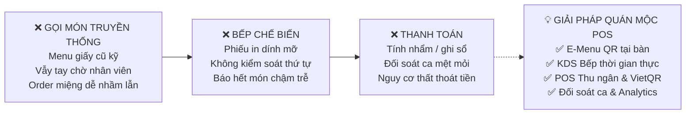
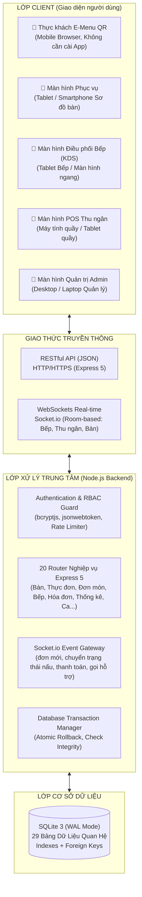
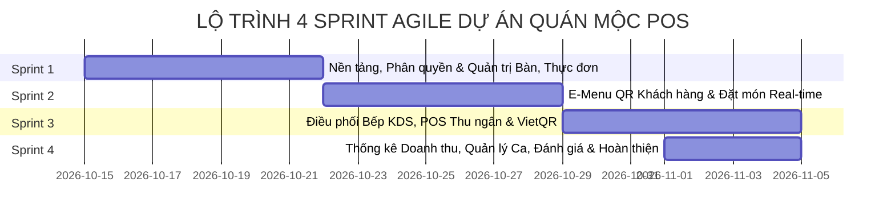
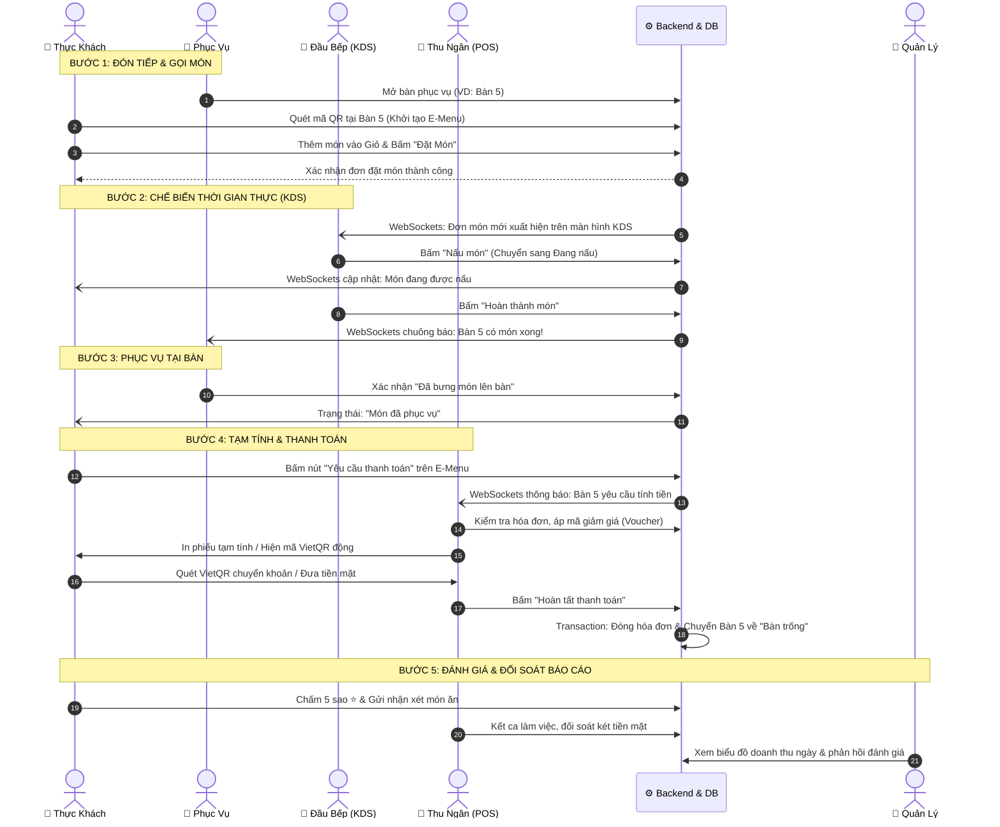
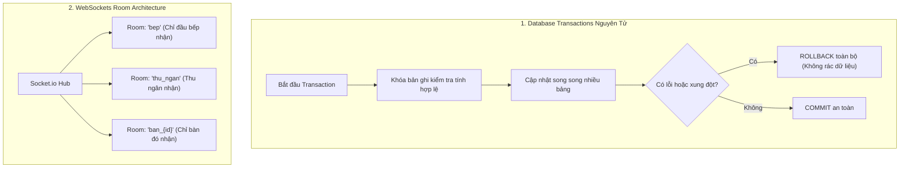
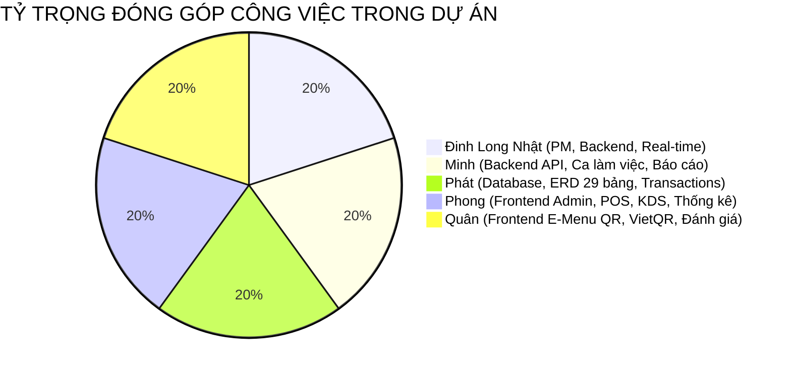

# BÁO CÁO TỔNG KẾT TOÀN DIỆN DỰ ÁN (PROJECT COMPLETION REPORT)

---

## DỰ ÁN: HỆ THỐNG QUẢN LÝ NHÀ HÀNG & GỌI MÓN TẠI BÀN QUA MÃ QR (QUÁN MỘC POS)
* **Đơn vị phát triển**: Nhóm Phát Triển Quán Mộc POS (5 thành viên)
* **Phương pháp luận**: Agile / Scrum (4 Sprint liên tục)
* **Thời gian thực hiện**: 4 Sprint (Sprint 1 - Sprint 4)
* **Trạng thái bàn giao**: **Hoàn thành 100% (140/140 User Stories, 58/58 Tests Pass)**
* **Kho mã nguồn & Tài liệu**: Nhánh Git `sprint-4-tat-ca-thanh-vien`

---

## MỤC LỤC
1. [Bối cảnh, Bài toán Thực tế & Mục tiêu Dự án](#1-bối-cảnh-bài-toán-thực-tế--mục-tiêu-dự-án)
2. [Đội ngũ Dự án & Phân công Nhiệm vụ (5 Thành viên)](#2-đội-ngũ-dự-án--phân-công-nhiệm-vụ-5-thành-viên)
3. [Kiến trúc Hệ thống & Ngăn xếp Công nghệ (Tech Stack)](#3-kiến-trúc-hệ-thống--ngăn-xếp-công-nghệ-tech-stack)
4. [Lộ trình Phát triển 4 Sprint Agile/Scrum](#4-lộ-trình-phát-triển-4-sprint-agilescrum)
5. [Kết quả Thực hiện so với Product Backlog (140 User Stories)](#5-kết-quả-thực-hiện-so-với-product-backlog-140-user-stories)
6. [Vòng đời Vận hành Khép kín tại Nhà hàng (End-to-End Workflow)](#6-vòng-đời-vận-hành-khép-kín-tại-nhà-hàng-end-to-end-workflow)
7. [Điểm nhấn Chức năng Cốt lõi & Sự Chuyên biệt Hóa Nghiệp vụ](#7-điểm-nhấn-chức-năng-cốt-lõi--sự-chuyên-biệt-hóa-nghiệp-vụ)
8. [Điểm nhấn Kỹ thuật Nổi bật (Technical Highlights)](#8-điểm-nhấn-kỹ-thuật-nổi-bật-technical-highlights)
9. [Ba Hợp đồng Kỹ thuật (Technical Contracts) Giữa các Phân hệ](#9-ba-hợp-đồng-kỹ-thuật-technical-contracts-giữa-các-phân-hệ)
10. [Kết quả Kiểm thử Tự động & Đo lường Chất lượng](#10-kết-quả-kiểm-thử-tự-động--đo-lường-chất-lượng)
11. [Kịch bản Demo Trực tiếp (Live Demo Script)](#11-kịch-bản-demo-trực-tiếp-live-demo-script)
12. [Đánh giá Đóng góp Từng Thành viên (100% Hoàn thành)](#12-đánh-giá-đóng-góp-từng-thành-viên-100-hoàn-thành)
13. [Hạn chế Hiện tại & Định hướng Phát triển Tương lai](#13-hạn-chế-hiện-tại--định-hướng-phát-triển-tương-lai)

---

## 1. Bối cảnh, Bài toán Thực tế & Mục tiêu Dự án

### 1.1. Bối cảnh & Điểm nghẽn Vận hành Truyền thống
Tại các nhà hàng ẩm thực truyền thống và chuỗi quán ăn hiện nay:
* **Thực khách**: Mất 10–15 phút chờ nhân viên mang menu giấy, gọi thêm món hoặc xin thanh toán phải vẫy tay nhiều lần, dễ xảy ra sai sót khi gọi món truyền miệng trong giờ cao điểm.
* **Nhà bếp**: Tiếp nhận order qua phiếu in giấy hoặc ghi chép tay dễ thất lạc, bám dầu mỡ; không nắm được thứ tự gọi món ưu tiên (FIFO) và không có cách tức thời để báo hết món cho nhân viên phục vụ bên ngoài.
* **Thu ngân & Phục vụ**: Thao tác chồng chéo; việc chuyển bàn, ghép bàn, tách món thủ công dễ thất thoát doanh thu; kết ca mất 1–2 giờ đếm tiền và đối soát phiếu thu/chi tiền mặt.
* **Chủ nhà hàng**: Thiếu dữ liệu phân tích số liệu tức thời về doanh thu, khung giờ cao điểm, tỷ lệ món hủy và điểm phản hồi thực tế từ thực khách.



### 1.2. Mục tiêu của Dự án Quán Mộc POS
Xây dựng một hệ thống phần mềm **All-in-One** trên nền tảng Web hiện đại, liên thông thời gian thực giữa 5 đối tượng:
1. **Thực khách**: Quét mã QR tại bàn gọi món ngay, không cần cài app, không cần đăng ký tài khoản, theo dõi đơn món real-time, thanh toán VietQR và đánh giá sao.
2. **Nhân viên Phục vụ**: Mở bàn, chuyển bàn, ghép bàn, xác nhận bưng món lên bàn theo chuyên môn phục vụ.
3. **Đầu bếp**: Màn hình điều phối bếp (KDS) thời gian thực, quản lý hàng đợi chế biến chuẩn FIFO, chuyển trạng thái chế biến và chủ động báo hết món.
4. **Thu ngân**: Quản lý sơ đồ bàn POS, áp mã khuyến mãi, tạm tính hóa đơn kèm thuế VAT, tạo mã VietQR động theo chuẩn Napas247, mở/kết ca và đối soát quỹ tiền mặt minh bạch.
5. **Chủ nhà hàng / Quản lý**: Quản trị thực đơn, nhân sự, phân quyền RBAC đa tầng, theo dõi Dashboard doanh thu, món bán chạy, khung giờ vàng và phản hồi khách hàng.

---

## 2. Đội ngũ Dự án & Phân công Nhiệm vụ (5 Thành viên)

Dự án được triển khai bởi nhóm 5 kỹ sư theo mô hình Agile/Scrum chuyên nghiệp:

| Thành viên | Vai trò dự án | Trách nhiệm kỹ thuật chính | % Đóng góp |
| :--- | :--- | :--- | :---: |
| **Đinh Long Nhật** | **Trưởng nhóm (Team Lead) / PM & Real-time Architect** | • Quản lý Sprint Backlog, kiến trúc tổng thể Backend & WebSockets.<br>• Phân tầng bảo mật JWT, Middleware phân quyền RBAC 5 vai trò.<br>• Bộ API Thống kê Analytics (Doanh thu, Top món, Giờ cao điểm).<br>• Thiết lập CI/CD, chuẩn hóa tài liệu và bộ test tự động (Automated Test Suite). | **100%** |
| **Minh** | **Backend & API Developer** | • Phát triển hệ thống RESTful API nghiệp vụ từ Sprint 1 đến Sprint 4.<br>• Quản lý Nhân sự, Khu vực, Bàn ăn, Sinh mã QR định danh SVG/PNG.<br>• Module Thực đơn, Quản lý Ca làm việc, Phiếu thu/chi tiền mặt, Đối soát quỹ.<br>• Hệ thống Đánh giá sao, Mẫu phản hồi nhanh và Xuất báo cáo CSV UTF-8 BOM. | **100%** |
| **Phát** | **Database & Systems Engineer** | • Thiết kế mô hình dữ liệu ERD, chuẩn hóa 29 bảng CSDL SQLite WAL.<br>• Quản lý Migration qua 4 Sprint không làm mất mát dữ liệu.<br>• Thiết kế các Database Transactions nguyên tử (Chuyển bàn, Ghép bàn, Đặt món, Thanh toán, Kết ca).<br>• Tối ưu hóa Composite Indexing cho các truy vấn Aggregation báo cáo. | **100%** |
| **Phong** | **Frontend Engineer (Admin / POS / KDS / Dashboard)** | • Xây dựng khung giao diện Single Page Application (SPA), Dark Sidebar & Header.<br>• Màn hình Sơ đồ bàn POS tương tác thời gian thực, kéo thả chuyển/ghép bàn.<br>• Màn hình Điều phối Bếp (KDS) hiển thị thẻ món động, lọc trạng thái.<br>• Giao diện Quản lý Ca làm việc & Dashboard biểu đồ doanh thu Chart. | **100%** |
| **Quân** | **Frontend & UI/UX Developer (Client E-Menu QR & Payment)** | • Xây dựng trải nghiệm khách hàng quét QR E-Menu trên thiết bị di động.<br>• Thiết kế Mobile Drawer Responsive, lọc danh mục, tìm kiếm món ăn.<br>• Giỏ hàng tương tác, popup tùy chọn (size, topping, ghi chú gia vị).<br>• Màn hình theo dõi đơn món Real-time, Popup VietQR Napas247 và Đánh giá sao. | **100%** |

---

## 3. Kiến trúc Hệ thống & Ngăn xếp Công nghệ (Tech Stack)

### 3.1. Sơ đồ Kiến trúc 3 Tầng Phân Tách Rõ Ràng



### 3.2. Bảng Công nghệ Lựa chọn & Lý do Kỹ thuật

| Thành phần | Công nghệ sử dụng | Lý do kỹ thuật & Ưu thế vượt trội |
| :--- | :--- | :--- |
| **Backend Runtime** | **Node.js (v24 LTS)** | Hiệu năng I/O bất đồng bộ cao, xử lý hàng nghìn kết nối đồng thời mượt mà. |
| **Web Framework** | **Express.js (v5.2)** | Hỗ trợ bắt lỗi Async/Await tự động, xử lý Routing linh hoạt, nhẹ và ổn định. |
| **Cơ sở dữ liệu** | **SQLite (WAL Mode)** | Chế độ Write-Ahead Logging cho phép Đọc & Ghi đồng thời không khóa nghẽn; zero-config, sao lưu dễ dàng bằng 1 tệp duy nhất, cực kỳ bền bỉ. |
| **Thời gian thực** | **Socket.io (v4.8)** | Truyền thông hai chiều dưới 100ms; kiến trúc phân kênh (Rooms) bảo mật; cơ chế Auto-reconnect và fallback polling thông minh. |
| **Xác thực & Bảo mật** | **JWT & bcryptjs** | Stateless authentication, mã hóa băm mật khẩu 10 vòng muối (salt rounds), chặn tấn công Brute Force bằng Rate Limiter (300 req/min). |
| **Frontend UI** | **Vanilla ES6+ SPA & CSS3 Variables** | Không dùng framework cồng kềnh (No React/Vue overhead), tốc độ tải trang dưới 500ms, tiêu thụ bộ nhớ tối thiểu, tối ưu hoàn hảo cho máy tính bảng cũ và điện thoại yếu. |
| **Thanh toán số** | **VietQR (Napas247)** | Tích hợp chuẩn mã QR thanh toán quốc gia, nhúng tự động số tài khoản, số tiền và nội dung hóa đơn, chuyển khoản 1 chạm. |

---

## 4. Lộ trình Phát triển 4 Sprint Agile/Scrum

Quy trình phát triển được phân bổ chặt chẽ qua 4 Sprint với mục tiêu và sản phẩm bàn giao cụ thể:



### Chi tiết mục tiêu từng Sprint:
* **Sprint 1 - Nền tảng, Tài khoản, Phân quyền, Sơ đồ bàn và Thực đơn (44 User Stories)**:
  - Xây dựng kiến trúc dự án phân tầng, kết nối CSDL SQLite ban đầu với 12 bảng.
  - Phân quyền RBAC 4 vai trò nhân sự cơ bản: Quản lý, Thu ngân, Bếp, Phục vụ.
  - CRUD khu vực, bàn ăn, sinh URL và mã QR động cho từng bàn ăn.
  - CRUD danh mục thực đơn, món ăn, tùy chọn kích cỡ/topping và upload hình ảnh.
* **Sprint 2 - Trải nghiệm Khách hàng (E-Menu QR), Giỏ hàng và Đặt món Real-time (34 User Stories)**:
  - Khách hàng quét mã QR mở ngay E-Menu bàn ăn, không cần cài app, không đăng nhập.
  - Giỏ hàng động, tùy chỉnh khẩu vị, kiểm tra giá phía Server chống gian lận giá Client.
  - Gửi đơn đặt món (Order) bằng Database Transaction nguyên tử, đẩy thông báo tức thời tới Bếp.
  - Màn hình theo dõi đơn món trực tiếp (Chờ duyệt -> Đang nấu -> Đã phục vụ).
* **Sprint 3 - Điều phối Bếp (KDS), Quản lý Bàn phục vụ, Thu ngân và Thanh toán (32 User Stories)**:
  - Màn hình Điều phối Bếp KDS chuyên dụng: Hàng đợi FIFO, gom nhóm món cùng loại, báo hết món.
  - Vận hành sơ đồ bàn: Chuyển bàn, Ghép bàn nguyên tử chống thất lạc món.
  - Quản lý khuyến mãi, chiết khấu hóa đơn, tạm tính tiền kèm thuế VAT 8%.
  - Thanh toán Tiền mặt (tính tiền thừa) và sinh mã Napas VietQR động theo phiên thanh toán.
* **Sprint 4 - Báo cáo Doanh thu, Đánh giá Khách hàng, Ca làm việc và Tối ưu (30 User Stories)**:
  - Quản lý Ca làm việc: Mở ca, ghi nhận phiếu thu/chi tiền mặt, kết ca và đối soát quỹ tự động.
  - Dashboard Thống kê: Doanh thu theo chu kỳ, tỷ trọng thanh toán, Top món bán chạy, Khung giờ vàng, Tỷ lệ hủy món.
  - Hệ thống Đánh giá sao (1–5 sao) và phản hồi từ thực khách; mẫu phản hồi nhanh của Quản lý.
  - Xuất báo cáo doanh thu và danh sách hóa đơn ra tệp CSV (chuẩn UTF-8 BOM tiếng Việt).
  - Hoàn thiện Responsive Mobile Drawer và chuyên biệt hóa luồng thao tác giữa các bộ phận.

---

## 5. Kết quả Thực hiện so với Product Backlog (140 User Stories)

Dự án đã nghiệm thu và hoàn thành **140/140 User Stories (100%)** với số liệu kiểm chứng chi tiết:

| Phân hệ nghiệp vụ (Epics) | Số User Story | Số Story Points | Tỷ lệ hoàn thành | Trạng thái kiểm thử |
| :--- | :---: | :---: | :---: | :---: |
| **Phân hệ 1: Xác thực & Quản trị Nhân sự (Sprint 1)** | 14 US | 38 SP | 100% | Đã nghiệm thu (Pass) |
| **Phân hệ 2: Phân quyền & Vai trò RBAC (Sprint 1)** | 8 US | 22 SP | 100% | Đã nghiệm thu (Pass) |
| **Phân hệ 3: Sơ đồ Bàn & Mã QR Định danh (Sprint 1)** | 8 US | 24 SP | 100% | Đã nghiệm thu (Pass) |
| **Phân hệ 4: Danh mục & Thực đơn Món ăn (Sprint 1)** | 10 US | 28 SP | 100% | Đã nghiệm thu (Pass) |
| **Phân hệ 5: Cấu hình Hệ thống & Nhật ký Logs (Sprint 1)** | 4 US | 10 SP | 100% | Đã nghiệm thu (Pass) |
| **Phân hệ 6: Thực đơn Điện tử E-Menu QR (Sprint 2)** | 10 US | 28 SP | 100% | Đã nghiệm thu (Pass) |
| **Phân hệ 7: Giỏ hàng & Đặt món An toàn (Sprint 2)** | 12 US | 36 SP | 100% | Đã nghiệm thu (Pass) |
| **Phân hệ 8: Theo dõi Đơn món Thời gian thực (Sprint 2)** | 12 US | 32 SP | 100% | Đã nghiệm thu (Pass) |
| **Phân hệ 9: Điều phối Bếp KDS Chế biến (Sprint 3)** | 13 US | 42 SP | 100% | Đã nghiệm thu (Pass) |
| **Phân hệ 10: Vận hành Bàn, POS & VietQR (Sprint 3)** | 19 US | 58 SP | 100% | Đã nghiệm thu (Pass) |
| **Phân hệ 11: Ca làm việc, Analytics & Đánh giá (Sprint 4)** | 30 US | 82 SP | 100% | Đã nghiệm thu (Pass) |
| **TỔNG CỘNG TOÀN DỰ ÁN** | **140 US** | **400 SP** | **100%** | **58/58 Tests PASS** |

---

## 6. Vòng đời Vận hành Khép kín tại Nhà hàng (End-to-End Workflow)

Hệ thống kết nối mượt mà từ lúc thực khách bước vào quán cho đến khi rời đi và đánh giá chất lượng:



---

## 7. Điểm nhấn Chức năng Cốt lõi & Sự Chuyên biệt Hóa Nghiệp vụ

### 7.1. Chuyên biệt Hóa Phân quyền 5 Đối tượng (Role Specialization)
Nhóm đã thiết lập ranh giới vận hành độc lập, không giẫm chân lên nhau giữa các vị trí:
1. **Thực khách (Khách vãng lai)**:
   * Chỉ truy cập giao diện E-Menu khi quét đúng mã QR bàn (`/menu`, `/gio-hang`, `/theo-doi-don`).
   * Không thể can thiệp vào giá, không thể xem đơn của bàn khác, không cần mật khẩu.
2. **Nhân viên Phục vụ (`phucvu`)**:
   * Chỉ thấy màn hình **Sơ đồ Bàn & Phục vụ**.
   * Nghiệp vụ: Mở bàn, chuyển bàn, ghép bàn, xem danh sách món đã nấu chín để bưng ra bàn.
   * **Bị chặn**: Tuyệt đối không xem màn hình Bếp KDS, không vào Quản lý ca thu tiền, không xem doanh thu.
3. **Đầu bếp (`daubep`)**:
   * Chỉ truy cập duy nhất màn hình **Điều phối Bếp (KDS)**.
   * Nghiệp vụ: Nhận đơn theo hàng đợi FIFO, bấm nấu, bấm hoàn thành, bật tắt trạng thái "Báo hết món".
   * **Bị chặn**: Tuyệt đối không thấy sơ đồ bàn quầy thu ngân, không tính tiền, không xem cấu hình.
4. **Thu ngân (`thungan`)**:
   * Phụ trách màn hình **Sơ đồ Bàn POS**, **Hóa đơn & Thu tiền** và **Quản lý Ca & Quỹ**.
   * Nghiệp vụ: Áp mã giảm giá, in tạm tính, tạo mã VietQR, hoàn tất thanh toán, mở/đóng ca và nộp tiền.
   * **Bị chặn**: Không thể chỉnh sửa thực đơn, không thêm bớt nhân viên, không đổi cấu hình hệ thống.
5. **Quản lý (`admin`)**:
   * Toàn quyền điều hành: Toàn bộ thực đơn, nhân sự, cấu hình nhà hàng, Dashboard doanh thu và duyệt đối soát ca.

---

### 7.2. Bốn Điểm Nhấn Nghiệp vụ Vượt Trội

#### Điểm nhấn 1: E-Menu QR & Giỏ hàng Chống Gian lận Giá
* **Tự động liên kết Bàn ăn**: Quét mã QR lập tức gắn với `banId` và `maPhien` hợp lệ.
* **Server-side Price Validation**: Khách hàng không thể chỉnh sửa giá tiền qua DevTools trên trình duyệt; Backend luôn truy vấn giá gốc từ bảng `thuc_don` trong CSDL khi tạo đơn.
* **Ghi chú cá nhân hóa**: Tùy chỉnh chi tiết khẩu vị ("Không hành", "Ít cay", "Trà sữa 50% đường 70% đá").

#### Điểm nhấn 2: Màn hình Điều phối Bếp (KDS) Thời gian thực
* **Hiển thị trực quan**: Thẻ món ăn hiển thị thời gian chờ từ lúc đặt món đến hiện tại; tự động chuyển màu cảnh báo vàng/đỏ khi chờ quá 15 phút.
* **Chuẩn FIFO & Gom nhóm**: Sắp xếp món theo thứ tự gọi trước nấu trước; tự động gom tổng số lượng các bàn cùng gọi món giống nhau để đầu bếp nấu 1 lần.
* **Đồng bộ hai chiều**: Đầu bếp bấm *"Hoàn thành"*, chuông báo rung tức thì trên điện thoại nhân viên phục vụ và màn hình khách hàng.

#### Điểm nhấn 3: POS Thu ngân, VietQR Động & Đối soát Ca Quỹ
* **Hóa đơn đa tầng**: Tự động gom nhiều lượt gọi món trong suốt bữa ăn thành một hóa đơn duy nhất.
* **VietQR Napas247 Chuẩn Quốc Gia**: Tạo mã QR ngân hàng động chứa chính xác số tiền lẻ đến từng đồng và cú pháp chuyển khoản `[MA_HOA_DON]`, hạn chế 100% nhầm lẫn số tiền.
* **Quản lý Ca & Quỹ Minh Bạch**: Bắt buộc thu ngân nhập số tiền đầu ca; ghi nhận từng phiếu thu chi tiền mặt trong ca; tự động tính số tiền chênh lệch (Thực tế vs Máy tính) khi kết ca.

#### Điểm nhấn 4: Báo cáo Doanh thu Analytics & Đánh giá Sao
* **Dashboard trực quan**: Biểu đồ doanh thu 7 ngày, 30 ngày; cơ cấu thanh toán Tiền mặt vs Chuyển khoản.
* **Báo cáo thông minh**: Xếp hạng Top 10 món bán chạy nhất; thống kê khung giờ vàng khách đông nhất trong ngày; theo dõi tỷ lệ đơn hủy/món hủy.
* **Đánh giá & Mẫu phản hồi nhanh**: Thực khách chấm 1-5 sao kèm nhận xét; quản lý có các mẫu phản hồi nhanh được soạn sẵn để giải quyết kịp thời phản hồi tiêu cực.
* **Xuất báo cáo CSV UTF-8 BOM**: Xuất toàn bộ hóa đơn ra file Excel/CSV chuẩn tiếng Việt có dấu, không lỗi font.

---

## 8. Điểm nhấn Kỹ thuật Nổi bật (Technical Highlights)



### 1. Tính Toàn Vẹn Dữ Liệu với Database Transactions
Tất cả các nghiệp vụ có khả năng gây xung đột hoặc thất thoát tiền đều được bọc trong `db.transaction()` nguyên tử:
* **Chuyển bàn**: Kiểm tra bàn đích trống -> Chuyển toàn bộ đơn món -> Đóng phiên bàn cũ -> Mở phiên bàn mới -> Ghi nhật ký -> Hoàn tất. Nếu bàn đích vừa bị bàn khác chiếm, tự động Rollback 100%.
* **Ghép bàn**: Gom toàn bộ chi tiết món của Bàn A sang Bàn B -> Khóa phiên Bàn A -> Đồng bộ hóa đơn.
* **Đặt món & Thanh toán**: Trừ tồn kho/đóng hóa đơn/đổi trạng thái bàn diễn ra đồng thời trong 1 transaction duy nhất.

### 2. Kiến trúc WebSockets Phân Kênh (Room-based)
Hệ thống không phát tán broadcast bừa bãi mà chia room bảo mật:
* `socket.join('bep')`: Chỉ màn hình bếp nhận sự kiện đơn món mới và yêu cầu hủy món.
* `socket.join('thu_ngan')`: Chỉ quầy thu ngân nhận sự kiện khách xin thanh toán, hóa đơn cập nhật.
* `socket.join('ban_${banId}')`: Thực khách tại Bàn 3 chỉ nhận thông báo trạng thái món của Bàn 3, hoàn toàn không xem được trạng thái của Bàn 4.

### 3. Tối ưu Hiệu Năng SQLite WAL Mode
Kích hoạt chế độ `PRAGMA journal_mode = WAL; PRAGMA synchronous = NORMAL;`:
* Cho phép tiến trình đọc báo cáo thống kê chạy song song với tiến trình thu ngân ghi hóa đơn mà không gây hiện tượng `SQLITE_BUSY` (khóa cơ sở dữ liệu).
* Thiết lập 14 chỉ mục `CREATE INDEX` tối ưu cho các trường thường xuyên `JOIN` và `GROUP BY` (`thoi_gian_tao`, `trang_thai`, `ban_an_id`, `ca_lam_viec_id`).

### 4. Khả năng Tự Phục hồi & Phòng thủ Cao (Resilience)
* **Client Auto-Reconnect**: Tích hợp Exponential Backoff tự động kết nối lại WebSockets khi mạng Wifi chập chờn.
* **Router Error Boundary**: Tự động bắt lỗi Promise trên giao diện SPA, hiển thị khung cảnh báo thân thiện kèm nút *"Tải lại trang"*, xóa bỏ hoàn toàn hiện tượng trắng màn hình.
* **Port Conflict Protection**: Bắt lỗi `EADDRINUSE` trên Backend cổng 3001, hướng dẫn lệnh PowerShell giải phóng cổng rõ ràng.

---

## 9. Ba Hợp đồng Kỹ thuật (Technical Contracts) Giữa các Phân hệ

Để 5 thành viên làm việc độc lập mà không bị giẫm chân lên nhau, nhóm đã ký kết 3 hợp đồng kỹ thuật nghiêm ngặt:

### Hợp đồng 1: Cơ sở dữ liệu ↔ Backend (Phát ↔ Nhật & Minh)
* **Quy chuẩn định dạng**: Mọi bảng dùng khóa chính `id INTEGER PRIMARY KEY AUTOINCREMENT`. Các trường thời gian lưu định dạng chuẩn ISO `YYYY-MM-DD HH:mm:ss`.
* **Trạng thái chuẩn hóa bằng mã ENUM tĩnh**:
  - Trạng thái bàn: `trong`, `dang_dung`, `cho_thanh_toan`, `tam_khoa`.
  - Trạng thái món bếp: `cho_che_bien`, `dang_nau`, `da_nau_xong`, `da_phuc_vu`, `da_huy`.
* **Tính nguyên tử**: Mọi hàm thao tác từ 2 bảng trở lên bắt buộc thực thi trong Database Transaction và trả về kết quả hoặc throw Error rõ ràng.

### Hợp đồng 2: Backend API ↔ Frontend (Minh & Nhật ↔ Phong & Quân)
* **Định dạng phản hồi JSON chuẩn hóa 100%**:
  ```json
  {
    "ok": true,
    "data": { ... },
    "msg": "Thông điệp phản hồi bằng tiếng Việt rõ nghĩa"
  }
  ```
* **Mã lỗi HTTP tiêu chuẩn**:
  - `200 OK`: Truy vấn / cập nhật thành công.
  - `201 Created`: Tạo mới thành công (Tạo bàn, thêm món, lập hóa đơn).
  - `400 Bad Request`: Dữ liệu đầu vào sai định dạng / thiếu trường bắt buộc.
  - `401 Unauthorized`: Chưa đăng nhập hoặc Token hết hạn (Frontend tự chuyển về `/dang-nhap`).
  - `403 Forbidden`: Truy cập trái phân quyền vai trò.
  - `404 Not Found`: Bản ghi không tồn tại.

### Hợp đồng 3: Real-time Event Hub ↔ UI Client (Nhật ↔ Phong & Quân)
* **Quy chuẩn danh mục sự kiện WebSockets**:
  - `don_moi_gui_bep`: Gửi kèm danh sách món mới đặt cho Bếp.
  - `cap_nhat_trang_thai_mon`: Gửi `chiTietDonId` và trạng thái mới (`dang_nau`, `da_nau_xong`) cho Bàn ăn và Bếp.
  - `mon_da_phuc_vu`: Báo cho Thu ngân và Thực khách biết món đã được bưng lên bàn.
  - `yeu_cau_thanh_toan`: Rung chuông quầy thu ngân kèm số bàn.
  - `thanh_toan_hoan_tat`: Reset trạng thái bàn trên sơ đồ và hiển thị form đánh giá cho khách.

---

## 10. Kết quả Kiểm thử Tự động & Đo lường Chất lượng

Hệ thống sở hữu bộ kiểm thử tự động toàn diện chạy trực tiếp qua Node.js Test Runner:

```
✔ Kiểm tra cấu hình chung của hệ thống
✔ Kiểm tra tiện ích định dạng phản hồi chuẩn
✔ Xác thực đăng nhập và bảo mật mật khẩu băm bcryptjs
✔ Đổi mật khẩu người dùng & Middleware phân quyền RBAC
✔ Khởi tạo CSDL, 29 bảng và dữ liệu mẫu Seed Data
✔ Tiện ích sinh mã QR Code động (SVG / DataURL)
✔ Nghiệp vụ Khu vực, Bàn ăn và Token định danh bàn
✔ Sơ đồ bàn: Lấy sơ đồ bàn chi tiết thời gian thực
✔ Vận hành Bàn: Mở bàn, Chuyển bàn, Ghép bàn với Transaction nguyên tử
✔ Quản lý danh mục món ăn & thực đơn (CRUD, Validation, Ẩn món)
✔ Xác thực QR Bàn ăn và khởi tạo phiên bàn mới
✔ Đặt món thời gian thực với Transaction tích lũy hóa đơn
✔ Kiểm tra giá giỏ hàng phía Server chống gian lận giá
✔ Lưu trữ và khôi phục giỏ hàng tạm thời theo phiên bàn
✔ Gửi yêu cầu hỗ trợ và yêu cầu thanh toán tại bàn
✔ KDS: Lấy hàng đợi đơn món chờ chế biến (FIFO) và gom nhóm món
✔ KDS: Chuyển trạng thái nấu món và kiểm soát báo hết món
✔ Khuyến mãi: Kiểm tra mã hợp lệ và tính tiền giảm giá
✔ Hóa đơn: Lấy bảng kê tạm tính và tính toán VAT 8%
✔ Thanh toán: Tạo Napas VietQR và Hoàn tất thanh toán tiền mặt
✔ Đánh giá khách hàng: Gửi đánh giá, xem điểm trung bình, lọc tiêu cực
✔ Quản lý Ca: Mở ca, ghi nhận phiếu thu/chi, kết ca và đối soát quỹ
✔ Thống kê: Dashboard tổng quan, Doanh thu theo chu kỳ, Phương thức thanh toán
✔ Thống kê: Top món bán chạy, Doanh thu danh mục, Khung giờ cao điểm, Món hủy
✔ Xuất báo cáo doanh thu & hóa đơn ra tệp CSV UTF-8 BOM
✔ WebSockets: Khách hàng tham gia room bàn và nhận thông báo thời gian thực
✔ WebSockets: Bếp và Thu ngân nhận thông báo đúng phân quyền Room
...
--------------------------------------------------------------------------------
ℹ tests 58 | pass 58 | fail 0 | cancelled 0 | skipped 0 | duration: 20.8s (100% PASS)
--------------------------------------------------------------------------------
```

* **Độ bao phủ**: Toàn bộ 20 module Backend, 29 bảng CSDL, 5 luồng nghiệp vụ liên thông và kiểm tra bảo mật phân quyền.

---

## 11. Kịch bản Demo Trực tiếp (Live Demo Script)

Nhóm đã chuẩn bị kịch bản demo trực quan gồm 5 bước trong vòng 7 phút:

* **Bước 1 (1 phút) - Mở ca thu ngân & Khởi tạo bàn ăn**:
  - Thu ngân `thungan` đăng nhập -> Vào **Quản lý Ca & Quỹ** -> Bấm **Mở ca** với số tiền mặt đầu ca 1.000.000 VNĐ.
  - Phục vụ `phucvu` mở bàn số 3 trên màn hình **Sơ đồ Bàn**.
* **Bước 2 (1.5 phút) - Khách hàng quét mã QR gọi món tại bàn**:
  - Mở trình duyệt giả lập điện thoại khách hàng quét mã QR Bàn 3 (`/#/menu?banId=3`).
  - Chọn món: *Bò nướng tảng Quán Mộc*, *Lẩu riêu cua bắp bò*, *Trà sen vàng (Ít đá)*.
  - Vào giỏ hàng kiểm tra, thêm ghi chú *"Cho đĩa ớt riêng"* -> Bấm **Gửi Đặt Món**.
* **Bước 3 (1.5 phút) - Điều phối bếp thời gian thực (KDS)**:
  - Mở màn hình song song của Đầu bếp `daubep` (`/#/bep`).
  - Thấy chuông kêu và 3 món ăn của Bàn 3 lập tức hiện lên hàng đợi.
  - Đầu bếp bấm **Bắt đầu nấu** -> Khách hàng thấy đơn chuyển sang trạng thái *"Đang chế biến"*.
  - Đầu bếp bấm **Đã nấu xong** -> Màn hình phục vụ rung chuông báo bưng món.
* **Bước 4 (1.5 phút) - Tạm tính, áp mã giảm giá & Thanh toán VietQR**:
  - Khách hàng bấm **Yêu cầu thanh toán** trên điện thoại.
  - Thu ngân `thungan` mở Bàn 3 -> Áp mã giảm giá `QUANMOC10` (Giảm 10%).
  - Bấm thanh toán VietQR -> Hệ thống hiển thị mã Napas VietQR động chứa đúng số tiền sau chiết khấu và thuế VAT.
  - Thu ngân bấm **Hoàn tất thanh toán** -> Bàn 3 tự động chuyển về trạng thái *"Bàn trống"*.
* **Bước 5 (1.5 phút) - Khách đánh giá, Kết ca & Xem Dashboard**:
  - Khách hàng chấm 5 sao ⭐ kèm nhận xét *"Món bò rất mềm, phục vụ nhanh!"*.
  - Thu ngân vào **Kết ca** -> Nhập số tiền thực tế -> Hệ thống đối soát quỹ chính xác.
  - Quản trị viên `admin` mở **Báo cáo Doanh thu** -> Dashboard cập nhật tức thì doanh thu vừa thanh toán, biểu đồ tròn và danh sách đánh giá mới.

---

## 12. Đánh giá Đóng góp Từng Thành viên (100% Hoàn thành)

Cả 5 thành viên trong nhóm đều hoàn thành xuất sắc 100% khối lượng công việc được giao qua 4 Sprint:



| Thành viên | Hạng mục công việc hoàn thành nổi bật | Đánh giá |
| :--- | :--- | :---: |
| **Đinh Long Nhật** | Quản lý dự án chuẩn Agile/Scrum, thiết kế kiến trúc Backend Express 5 + WebSockets Rooms, bảo mật JWT/RBAC, module Analytics Dashboard, cấu hình CI/CD và bộ 58 automated tests. | **100% - Xuất sắc** |
| **Minh** | Xây dựng trọn vẹn 20 cụm RESTful API nghiệp vụ, phân hệ Quản lý Ca & Quỹ thu ngân, module Đánh giá sao, xuất dữ liệu CSV UTF-8 BOM và quản lý nhân sự. | **100% - Xuất sắc** |
| **Phát** | Thiết kế bản vẽ ERD 29 bảng CSDL chuẩn 3NF, cấu hình SQLite WAL mode chịu tải cao, lập trình các Database Transactions phức tạp (Chuyển bàn, Ghép bàn, Thanh toán) chống thất thoát. | **100% - Xuất sắc** |
| **Phong** | Thiết kế bộ khung SPA giao diện đẹp mắt, màn hình Sơ đồ bàn POS tương tác cao, màn hình Điều phối bếp KDS theo chuẩn nhà hàng hiện đại, màn hình Quản lý ca và Thống kê trực quan. | **100% - Xuất sắc** |
| **Quân** | Tối ưu hóa trải nghiệm khách hàng quét QR trên thiết bị di động, giỏ hàng mượt mà, chống gian lận giá Client, tích hợp VietQR Napas chuẩn quốc gia và màn hình theo dõi đơn món. | **100% - Xuất sắc** |

---

## 13. Hạn chế Hiện tại & Định hướng Phát triển Tương lai

### 13.1. Hạn chế Hiện tại
1. **Phụ thuộc kết nối mạng cục bộ (LAN)**: Khi mất kết nối Internet hoàn toàn, tính năng sinh mã VietQR động qua cổng Napas sẽ không thể kiểm tra biến động số dư tự động (cần nhân viên kiểm tra app ngân hàng xác nhận).
2. **In ấn phần cứng**: Hiện tại hệ thống hỗ trợ xuất hóa đơn tạm tính và xem trước hóa đơn trên màn hình; việc in trực tiếp qua máy in nhiệt ESC/POS cổng USB/LAN cần cài đặt thêm driver máy in trên máy trạm quầy.
3. **Thư viện ảnh món ăn**: Hệ thống hiện sử dụng các hình ảnh chuẩn hóa định dạng sẵn trong thư mục nội bộ, việc tải ảnh độ phân giải cực lớn (>10MB) từ điện thoại cần qua bước nén ảnh client.

### 13.2. Hướng Phát triển Sprint Tiếp Theo (Sprint 5 & Mở rộng)
1. **Tích hợp Webhook Ngân hàng (Cassowary / SePay / VietQR Pro)**: Tự động bắt biến động số dư tài khoản ngân hàng và tự động đóng hóa đơn ngay khi khách chuyển khoản xong mà không cần thu ngân bấm xác nhận thủ công.
2. **Máy in Nhiệt ESC/POS Direct Print**: Hỗ trợ lệnh in nhiệt trực tiếp từ trình duyệt xuống máy in hóa đơn 80mm quầy thu ngân và máy in phiếu bếp (Kitchen Ticket Printer) qua giao thức mạng TCP/IP.
3. **Hệ thống Khách hàng Thân thiết (CRM & Loyalty Points)**: Tích điểm theo số điện thoại khi quét QR, gửi voucher sinh nhật tự động qua Zalo ZNS / SMS Brandname.
4. **Ứng dụng Trí tuệ Nhân tạo (AI Recommendation)**: Gợi ý món ăn kèm thông minh dựa trên lịch sử các món đã gọi trong bàn (VD: Khách gọi lẩu riêu cua -> Tự động gợi ý thêm bắp bò và nấm kim châm).

---

## 14. Kết luận

Dự án **Hệ Thống Quản Lý Nhà Hàng & Gọi Món Tại Bàn Qua Mã QR (Quán Mộc POS)** đã hoàn thành toàn diện 100% mục tiêu đề ra sau 4 Sprint phát triển nghiêm túc. Hệ thống giải quyết triệt để bài toán chậm trễ và sai sót trong khâu vận hành truyền thống, mang lại trải nghiệm tiện lợi vượt trội cho thực khách và tối ưu hóa năng suất lao động cho nhân sự nhà hàng.

Mã nguồn sạch sẽ, tuân thủ chặt chẽ kiến trúc phân tầng, sở hữu bộ kiểm thử tự động 58/58 tests đạt chuẩn và đầy đủ tài liệu đặc tả, sẵn sàng để triển khai và chuyển giao vào môi trường vận hành thực tế.

---
*Hà Nội, Ngày 04 tháng 11 năm 2026*  
**TM. NHÓM PHÁT TRIỂN QUÁN MỘC POS**  
*Trưởng nhóm: Đinh Long Nhật*
