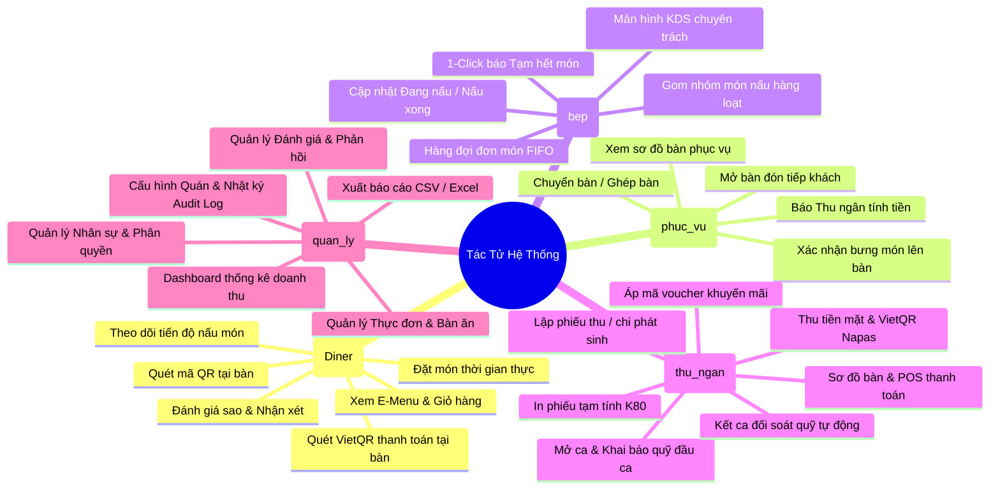
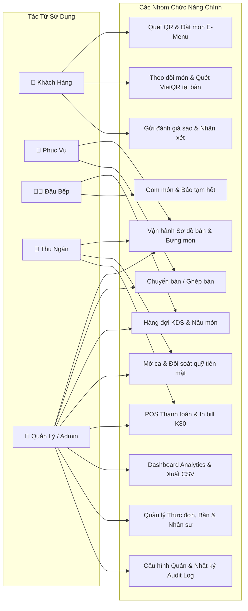

# ĐẶC TẢ YÊU CẦU PHẦN MỀM (SOFTWARE REQUIREMENTS SPECIFICATION - SRS)
**Hệ Thống:** Website Quản Lý Nhà Hàng & Gọi Món QR (Quán Mộc POS & E-Menu)  
**Phiên bản hoàn thiện:** 4.0 (Hoàn thành Sprint 1 - Sprint 4)  
**Tác giả:** Đội ngũ Kỹ sư Phát triển Hệ thống Quán Mộc  
**Ngày cập nhật:** Tháng 11/2026  

---

## 1. GIỚI THIỆU TỔNG QUAN

### 1.1. Mục đích tài liệu
Tài liệu này đặc tả chi tiết toàn bộ các yêu cầu nghiệp vụ, yêu cầu chức năng (Functional Requirements) và yêu cầu phi chức năng (Non-Functional Requirements) cho hệ thống **Website Quản Lý Nhà Hàng & Gọi Món QR - Quán Mộc POS**. Đây là cơ sở chuẩn mực phục vụ quá trình phát triển, kiểm thử chất lượng (QA/QC), đào tạo người dùng và bàn giao sản phẩm.

### 1.2. Bối cảnh dự án
Trong mô hình nhà hàng ẩm thực truyền thống, việc gọi món qua menu giấy, ghi chép tay và giao tiếp thủ công giữa phục vụ - bếp - thu ngân thường gây ra nhiều bất cập: chậm trễ, sai sót món, thất thoát nguyên liệu, và ùn ứ thanh toán giờ cao điểm.  
Dự án **Quán Mộc POS & E-Menu QR** ra đời nhằm số hóa toàn diện quy trình vận hành nhà hàng:
1. **Khách hàng:** Tự phục vụ (Self-service) qua mã QR định danh tại bàn, xem thực đơn điện tử trực quan, đặt món không chạm và theo dõi tiến độ món theo thời gian thực.
2. **Nhân viên Phục vụ:** Tinh gọn công việc đón tiếp, chuyển/ghép bàn và bưng món từ bếp lên bàn.
3. **Đầu bếp:** Tiếp nhận đơn hàng theo hàng đợi FIFO trên màn hình bếp KDS chuyên dụng, gom món nấu hàng loạt và thông báo hoàn thành tức thì.
4. **Thu ngân:** Vận hành POS hiện đại, in bill chuẩn nhiệt K80, thanh toán tiền mặt tự động tính tiền thừa, sinh mã VietQR Napas động và quản lý két ca làm việc đối soát quỹ.
5. **Quản lý / Chủ quán:** Kiểm soát toàn bộ số liệu kinh doanh trên Dashboard Analytics thời gian thực, quản lý thực đơn, nhân sự và cấu hình thương hiệu.

---

## 2. CÁC TÁC TỬ HỆ THỐNG (ACTORS & PERSONAS)

---

## 3. YÊU CẦU CHỨC NĂNG CHI TIẾT (FUNCTIONAL REQUIREMENTS)

### PHÂN HỆ 1: XÁC THỰC, PHÂN QUYỀN & TÀI KHOẢN (AUTH & RBAC)
* **FR-1.1:** Đăng nhập tài khoản nội bộ bằng Tên đăng nhập và Mật khẩu, mã hóa mật khẩu với `bcryptjs`, sinh mã JWT Bearer Token chứa thông tin định danh và vai trò.
* **FR-1.2:** Phân quyền theo 4 vai trò nội bộ: `quan_ly`, `thu_ngan`, `bep`, `phuc_vu`. Quản lý có đặc quyền Super Admin (bypass kiểm tra quyền hạn).
* **FR-1.3:** Định tuyến chuyên biệt (Role-based Navigation & Route Guard):
  - Người dùng thuộc vai trò nào chỉ nhìn thấy menu chức năng chuyên trách của vai trò đó.
  - Chặn truy cập trái quyền hạn và tự động chuyển hướng về màn hình làm việc tương ứng.
* **FR-1.4:** Định danh khách hàng phi tài khoản thông qua Token phiên bàn (`ma_qr_token`), lưu trữ tại `localStorage` trình duyệt khách.
* **FR-1.5:** Quản lý thông tin cá nhân, cập nhật số điện thoại, đổi mật khẩu và đăng xuất an toàn.

### PHÂN HỆ 2: SƠ ĐỒ BÀN & ĐỊNH DANH MÃ QR (TABLE MANAGEMENT)
* **FR-2.1:** Quản lý khu vực/tầng phục vụ (Thêm, sửa, xóa khu vực, sắp xếp thứ tự).
* **FR-2.2:** Quản lý danh sách bàn ăn (Thêm bàn, sửa tên/mã/sức chứa, xóa mềm bàn).
* **FR-2.3:** Tự động sinh mã QR định danh độc nhất cho từng bàn, hỗ trợ xem trực tiếp mã QR, tải ảnh PNG độ phân giải cao và in phiếu dán bàn.
* **FR-2.4:** Cơ chế làm mới Token QR bảo mật khi cần vô hiệu hóa mã cũ.
* **FR-2.5:** Hiển thị sơ đồ bàn trực quan theo khu vực, lọc theo màu trạng thái (Trống - Xanh lá, Đang phục vụ - Cam, Chờ thanh toán - Đỏ, Tạm khóa - Xám), tìm kiếm bàn theo tên hoặc mã bàn thời gian thực.
* **FR-2.6:** Thao tác nghiệp vụ bàn ăn: Mở bàn trực tiếp, Chuyển bàn, Ghép bàn sử dụng Database Transaction bảo đảm toàn vẹn đơn món và hóa đơn.

### PHÂN HỆ 3: QUẢN LÝ THỰC ĐƠN & DANH MỤC (MENU & CATEGORIES)
* **FR-3.1:** Quản lý danh mục món ăn (Khai vị, Món nướng, Món lẩu, Món đặc sản, Đồ uống...).
* **FR-3.2:** Quản lý món ăn: Thêm mới, cập nhật giá, đơn vị tính, hình ảnh minh họa vector SVG nội bộ, tùy chọn khẩu vị/kích cỡ, nhãn món nổi bật (`HOT`).
* **FR-3.3:** Cơ chế xóa mềm (`da_xoa = 1`) để giữ tính toàn vẹn dữ liệu cho lịch sử hóa đơn bán hàng cũ.
* **FR-3.4:** Bật/tắt nhanh trạng thái kinh doanh của món ăn ("Đang bán" / "Tạm hết") từ màn hình Quản lý hoặc màn hình Bếp KDS.

### PHÂN HỆ 4: E-MENU QR & GỌI MÓN KHÁCH HÀNG (CUSTOMER E-MENU)
* **FR-4.1:** Thực khách dùng điện thoại quét mã QR tại bàn để truy cập E-Menu ngay trên trình duyệt mà không cần cài đặt ứng dụng.
* **FR-4.2:** Tự động xác thực phiên bàn, hiển thị tên bàn và khu vực tương ứng.
* **FR-4.3:** Danh mục món dạng thẻ trượt (sticky header), xem hình ảnh món ăn sắc nét, lọc nhanh danh mục và tìm kiếm món theo tên.
* **FR-4.4:** Giỏ hàng tiện ích: Điều chỉnh số lượng, thêm ghi chú chi tiết cho từng món (ví dụ: "ít cay", "không hành").
* **FR-4.5:** Thanh giỏ hàng nổi chân trang cố định hiển thị tức thời tổng tiền và số món đã chọn.
* **FR-4.6:** Đặt món an toàn: Kiểm tra đơn giá và tính thành tiền phía Server chống gian lận giá Client; lưu giỏ hàng tạm thời vào cơ sở dữ liệu.

### PHÂN HỆ 5: ĐIỀU PHỐI BẾP (KITCHEN DISPLAY SYSTEM - KDS)
* **FR-5.1:** Giao diện KDS chuyên trách nền tối, hỗ trợ chế độ Toàn màn hình (Fullscreen) và phát âm thanh chuông báo Web Audio Chime mỗi khi có đơn món mới.
* **FR-5.2:** Hàng đợi đơn món hiển thị theo thứ tự thời gian gọi (FIFO - First In, First Out) kèm bộ đếm thời gian thực và cảnh báo màu đỏ nếu đơn chờ quá 15 phút.
* **FR-5.3:** Chức năng Gom nhóm món (Batch Cooking): Tự động tổng hợp số lượng các món giống nhau giữa các bàn khác nhau để đầu bếp nấu cùng lúc tiết kiệm thời gian.
* **FR-5.4:** Cập nhật trạng thái chế biến:
  - Bấm "Nấu": Chuyển trạng thái sang `dang_che_bien`.
  - Bấm "Xong": Chuyển trạng thái sang `hoan_thanh`, lập tức gửi thông báo tới phục vụ và khách hàng.
* **FR-5.5:** 1-Click báo "Tạm hết món" khi cạn nguyên liệu, lập tức vô hiệu hóa nút đặt món này trên E-menu của toàn bộ khách hàng.
* **FR-5.6:** Lịch sử món đã nấu xong trong ca để đầu bếp đối soát.

### PHÂN HỆ 6: PHỤC VỤ BÀN ĂN & BƯNG MÓN (WAITER OPERATIONS)
* **FR-6.1:** Mở bàn trực tiếp cho khách vãng lai và đặt món hộ khách vãng lai nếu khách không sử dụng điện thoại thông minh.
* **FR-6.2:** Modal "Xem & Bưng món" trên từng bàn: Phân loại trực quan danh sách món đang chờ, đang nấu, đã nấu xong và đã phục vụ.
* **FR-6.3:** Xác nhận bưng món: Phục vụ bấm nút "👉 Đã bưng ra bàn" đối với các món bếp đã nấu xong để cập nhật trạng thái `da_phuc_vu` và đồng bộ tới khách hàng.
* **FR-6.4:** Báo tính tiền: Phục vụ bấm nút "🔔 Báo tính tiền" để chuyển bàn sang trạng thái Chờ thanh toán khi khách chuẩn bị ra về.
* **FR-6.5:** Tiếp nhận chuông gọi phục vụ, xin đá, xin nước từ khách hàng thời gian thực.

### PHÂN HỆ 7: THU NGÂN, HÓA ĐƠN & THANH TOÁN POS (CASHIER & POS CHECKOUT)
* **FR-7.1:** Quản lý bàn chờ thanh toán trên sơ đồ POS.
* **FR-7.2:** Xem bảng kê chi tiết hóa đơn tạm tính: tiền món ăn, chiết khấu voucher, thuế VAT, phụ phí và tổng thanh toán.
* **FR-7.3:** Áp dụng mã khuyến mãi (Voucher): Kiểm tra điều kiện hiệu lực (hạn dùng, đơn tối thiểu, số lượt dùng tối đa) và tính toán giảm giá phần trăm / tiền mặt chuẩn xác.
* **FR-7.4:** In phiếu tạm tính định dạng chuẩn in nhiệt K80 chuyên dụng cho máy in bill nhà hàng.
* **FR-7.5:** Thanh toán tiền mặt: Hỗ trợ các phím bấm nhanh mệnh giá tiền chẵn (50.000đ, 100.000đ, 200.000đ, 500.000đ), tự động tính số tiền thừa thối lại cho khách.
* **FR-7.6:** Thanh toán chuyển khoản Napas VietQR: Tự động sinh mã VietQR động chứa chính xác số tiền cần trả và cú pháp chuyển khoản định danh hóa đơn, hỗ trợ hiển thị trên màn hình POS lẫn màn hình điện thoại của khách tại bàn.
* **FR-7.7:** Đóng phiên phục vụ: Đổi trạng thái hóa đơn sang `da_thanh_toan`, ghi nhận giao dịch thanh toán và tự động giải phóng bàn ăn về trạng thái `trong`.

### PHÂN HỆ 8: QUẢN LÝ CA LÀM VIỆC & ĐỐI SOÁT QUỸ (CASHIER SHIFT & DRAWER)
* **FR-8.1:** Khởi tạo ca làm việc chuẩn (Ca sáng, Ca chiều, Ca tối).
* **FR-8.2:** Mở ca thu ngân: Ghi nhận nhân viên trực ca và số tiền mặt đầu ca có trong két.
* **FR-8.3:** Quản lý phiếu thu / chi tiền mặt phát sinh trong ca (mua đá, nhập hàng gấp, nạp thêm tiền lẻ) có lý do rõ ràng.
* **FR-8.4:** Kết ca & Đối soát quỹ: Thu ngân kiểm đếm tiền mặt thực tế cuối ca, hệ thống tự động so sánh với (Tiền đầu ca + Doanh thu tiền mặt bán hàng + Thu phát sinh - Chi phát sinh), tính toán tiền chênh lệch thừa/thiếu và xuất biên bản bàn giao ca.

### PHÂN HỆ 9: ĐÁNH GIÁ & CHĂM SÓC KHÁCH HÀNG (CUSTOMER REVIEWS & FEEDBACK)
* **FR-9.1:** Sau bữa ăn, khách hàng chấm điểm từ 1 đến 5 sao và để lại nhận xét về chất lượng món ăn và thái độ phục vụ (hỗ trợ gửi ẩn danh).
* **FR-9.2:** Màn hình quản lý đánh giá: Hiển thị điểm hài lòng trung bình toàn quán, bộ lọc thông minh lọc riêng các đánh giá tiêu cực (< 4 sao).
* **FR-9.3:** Mẫu phản hồi nhanh (Quick Reply Templates): Quản lý 1-click chọn mẫu thư cảm ơn hoặc xin lỗi chuyên nghiệp để phản hồi thực khách tức thì.

### PHÂN HỆ 10: DASHBOARD THỐNG KÊ, BÁO CÁO & XUẤT CSV (ANALYTICS & EXPORT)
* **FR-10.1:** Thống kê tổng quan ngày: Doanh thu hôm nay, số hóa đơn thành công, số lượng khách ngồi, giá trị trung bình/đơn và tỷ lệ tăng trưởng.
* **FR-10.2:** Biểu đồ doanh thu đa chu kỳ: Theo ngày (7 ngày gần nhất), theo tuần (8 tuần gần nhất), theo tháng (12 tháng gần nhất) và bộ lọc khoảng ngày tùy chọn (`tuNgay` - `denNgay`).
* **FR-10.3:** Biểu đồ tỷ trọng phương thức trả tiền: So sánh tỷ lệ thanh toán Tiền mặt vs Chuyển khoản VietQR.
* **FR-10.4:** Bảng xếp hạng Top 5 món bán chạy nhất và tỷ trọng doanh thu theo từng danh mục thực đơn.
* **FR-10.5:** Biểu đồ phân tích khung giờ cao điểm (24 giờ trong ngày) và báo cáo tỷ lệ món bị hủy để quản lý thất thoát nguyên liệu.
* **FR-10.6:** Xuất báo cáo dữ liệu: 1-Click xuất báo cáo doanh thu và danh sách hóa đơn ra file CSV chuẩn UTF-8 BOM hiển thị tiếng Việt hoàn hảo trên Microsoft Excel.

### PHÂN HỆ 11: CẤU HÌNH NHÀ HÀNG & NHẬT KÝ HỆ THỐNG (SYSTEM CONFIG & AUDIT LOGS)
* **FR-11.1:** Cấu hình thông tin nhà hàng: Tên quán, địa chỉ, hotline, mật khẩu wifi, tỷ lệ thuế VAT (%).
* **FR-11.2:** Cấu hình tài khoản nhận tiền VietQR: Ngân hàng thụ hưởng, số tài khoản, tên chủ tài khoản.
* **FR-11.3:** Nhật ký hoạt động hệ thống (System Audit Logs): Tự động ghi lại toàn bộ thao tác quan trọng (đăng nhập, mở ca, thanh toán, đổi bàn, sửa giá món) phục vụ công tác thanh tra nội bộ.

---

## 4. YÊU CẦU PHI CHỨC NĂNG (NON-FUNCTIONAL REQUIREMENTS)

### 4.1. Hiệu năng & Khả năng đáp ứng (Performance)
* **Thời gian phản hồi API:** Dưới 200ms cho 95% các yêu cầu truy vấn chuẩn.
* **Đồng bộ thời gian thực (Real-time latency):** Tín hiệu WebSocket qua Socket.io gửi từ Khách tới Bếp và Thu ngân đạt độ trễ dưới 50ms trong mạng nội bộ.
* **Xử lý đồng thời (Concurrency):** Hệ thống phục vụ mượt mà tối thiểu 100 kết nối đồng thời mà không bị nghẽn (nhờ cơ chế WAL của SQLite và kiến trúc Event-Driven của Node.js).

### 4.2. Bảo mật & Tính toàn vẹn dữ liệu (Security & Integrity)
* **Mật khẩu an toàn:** Băm mật khẩu bằng thuật toán `bcrypt` với độ phức tạp cao, không bao giờ lưu mật khẩu dưới dạng văn bản thuần.
* **Bảo vệ Endpoint:** Toàn bộ API nội bộ được bảo vệ bởi Middleware xác thực JWT Bearer và kiểm tra mã vai trò (RBAC).
* **Phòng chống tấn công:**
  - Áp dụng Rate Limiting chặn brute-force và DDoS (giới hạn 300 requests/phút).
  - Sử dụng Prepared Statements trong SQLite ngăn ngừa hoàn toàn lỗi SQL Injection.
  - Kiểm tra giá phía máy chủ (Server-side price validation) chống sửa đổi giá trên trình duyệt.
* **Tính nguyên tử (ACID Transactions):** Các thao tác đặt món, chuyển/ghép bàn và thanh toán hóa đơn đều được bọc trong Database Transaction nguyên tử; tự động Rollback nếu có lỗi phát sinh.

### 4.3. Tính khả dụng & Trải nghiệm người dùng (Usability & UX)
* **Thiết kế Responsive đa thiết bị:** Tối ưu hiển thị hoàn hảo trên điện thoại di động (Mobile Drawer Navigation, Sticky Tabs), máy tính bảng (Tablet POS/KDS) và máy tính để bàn (Desktop Admin).
* **Tối ưu thao tác cảm ứng:** Kích thước nút bấm tối thiểu 44px x 44px, khoảng cách hợp lý tránh bấm nhầm trong môi trường nhà hàng bận rộn.
* **Thông báo tức thời (Toast Notifications):** Phản hồi kết quả thao tác bằng thông báo nổi trực quan (Thành công, Thất bại, Cảnh báo).

---

## 5. SƠ ĐỒ USE CASE TỔNG THỂ HỆ THỐNG

---
*Tài liệu Đặc tả Yêu cầu Phần mềm (SRS) được phê chuẩn và áp dụng cho toàn bộ dự án Quán Mộc POS.*
