# TÀI LIỆU PHÂN TÍCH THIẾT KẾ CHỨC NĂNG & USER STORIES
## ĐỀ TÀI: HỆ THỐNG QUẢN LÝ NHÀ HÀNG PHỤC VỤ TẠI BÀN (RESTAURANT MANAGEMENT SYSTEM)

---

## 1. TỔNG QUAN HỆ THỐNG (SYSTEM OVERVIEW)

Hệ thống Quản lý Nhà hàng phục vụ tại bàn là một ứng dụng Web toàn diện ứng dụng mô hình kiến trúc **MVC (Model - View - Controller)** kết hợp công nghệ truyền thông hai chiều thời gian thực (**Socket.io**). Hệ thống số hóa toàn bộ chu trình phục vụ nhà hàng, kết nối 5 phân hệ người dùng tác động tương hỗ:
1. **Phân hệ Khách hàng (Customer Web QR):** Trải nghiệm tự phục vụ tại bàn không cần cài app, dùng chung giỏ hàng theo bàn, chia tiền nhóm.
2. **Phân hệ Phục vụ (Waiter Mobile Web/Tablet):** Quản lý bàn, điều phối, duyệt món di động và yêu cầu hủy món có kiểm soát.
3. **Phân hệ Bếp / Bar (Kitchen Display System - KDS):** Điều phối chế biến thời gian thực, chế độ kép (FIFO / Gom mẻ), quản lý trạng thái món.
4. **Phân hệ Thu ngân (Cashier / POS):** Tính tiền nhanh, in bill K80, thanh toán Tiền mặt & VietQR động, tiện ích Tách bill & Chia tiền.
5. **Phân hệ Quản trị (Admin / Manager Dashboard):** Quản lý nhân sự, ca kíp, sơ đồ bàn, menu, cấu hình nhà hàng, phê duyệt hủy món, giám sát thất thoát qua Nhật ký kiểm toán (**Audit Logs**) và báo cáo doanh thu.

---

## 2. DANH SÁCH 49 USER STORIES CHI TIẾT THEO 5 PHÂN HỆ
*(Hệ thống gồm 49 User Stories hoàn chỉnh bao phủ toàn diện 5 phân hệ người dùng, tập trung cốt lõi vào trải nghiệm phục vụ tại bàn và vận hành F&B thời gian thực, tích hợp 4 cơ chế vận hành chuyên sâu: Ngoại lệ VietQR Ledger, Chốt két mù Z-Report, Timeout hủy món 90s và Mạng Hybrid Local-First).*

### 2.1. Phân hệ 1: Khách hàng (Customer - QR Order)

| Mã US | Tên User Story | Mô tả (As a... I want to... So that...) | Tiêu chí chấp nhận (Acceptance Criteria) |
| :--- | :--- | :--- | :--- |
| **US-C01** | **Truy cập menu bàn qua QR** | Là một **Khách hàng**, tôi muốn **quét mã QR dán tại bàn để vào thẳng menu của bàn mình** mà **không cần tải app hay đăng nhập**, để tôi có thể gọi món nhanh chóng. | - Quét QR mở đúng bàn `table_id`. - Phiên dùng chung: Mọi người cùng bàn đều thấy chung giỏ hàng và danh sách món của bàn. |
| **US-C02** | **Duyệt menu & Xem gợi ý** | Là một **Khách hàng**, tôi muốn **xem danh mục món ăn, tìm kiếm, xem các combo bán chạy và món đề xuất thông minh**, để dễ dàng chọn món ngon. | - Phân loại theo Danh mục (Khai vị, Món chính, Đồ uống...). - Hiển thị nhãn "Bán chạy" (Best Seller) và "Gợi ý" (Recommended). |
| **US-C03** | **Chọn món & Ghi chú** | Là một **Khách hàng**, tôi muốn **thêm món vào giỏ hàng và kèm theo ghi chú riêng (ít cay, không đá...)**, để món ăn được nấu đúng khẩu vị. | - Chọn số lượng `+ / -`. - Nhập ghi chú tự do cho từng món. - Xem tổng tiền tạm tính trong giỏ trước khi gửi. |
| **US-C04** | **Gửi order & Theo dõi trạng thái** | Là một **Khách hàng**, tôi muốn **gửi order và xem trạng thái chế biến thời gian thực của từng món**, để tôi biết món ăn của mình đang được chuẩn bị đến đâu. | - Trạng thái món: *Chờ duyệt -> Đang chế biến -> Hoàn thành*. - Cập nhật tức thì không cần tải lại trang (F5). |
| **US-C05** | **Nhận chuông báo hết món** | Là một **Khách hàng**, tôi muốn **nhận thông báo nổi bật kèm âm thanh chuông khi món tôi gọi bị hết nguyên liệu**, để tôi kịp thời đổi sang món khác. | - Hiển thị popup/banner cảnh báo màu đỏ kèm chuông âm thanh khi Bếp bấm "Báo hết món". |
| **US-C06** | **Gọi phục vụ & Yêu cầu tính tiền** | Là một **Khách hàng**, tôi muốn **bấm nút "Gọi phục vụ" hoặc "Yêu cầu thanh toán" ngay trên điện thoại**, để nhân viên đến hỗ trợ mà không phải vẫy tay gọi to. | - Nút bấm nổi bật trên giao diện. - Bắn thông báo chuông và popup lập tức đến màn hình Phục vụ và Thu ngân. |
| **US-C07** | **Thanh toán VietQR tại bàn** | Là một **Khách hàng**, tôi muốn **quét mã VietQR động hiển thị trên điện thoại để chuyển khoản thanh toán**, để tôi chủ động thanh toán không tiền mặt ngay tại bàn. | - Hiển thị mã QR chuẩn NAPAS 247 có sẵn STK, số tiền chính xác và nội dung chuyển khoản. - Có nút thông báo "Đã chuyển khoản". |
| **US-C08** | **Đánh giá món & Dịch vụ** | Là một **Khách hàng**, tôi muốn **để lại số sao đánh giá và nhận xét về món ăn, thái độ phục vụ**, để phản ánh trải nghiệm của mình cho nhà hàng cải thiện. | - Chấm điểm 1 - 5 sao. - Nhập nhận xét văn bản gửi về Dashboard của Quản lý. |
| **US-C09** | **Công cụ chia đều tiền tại bàn** *(Bổ sung)* | Là một **Khách hàng đi cùng nhóm bạn**, tôi muốn **nhập số người tại bàn để hệ thống tự chia đều số tiền và hiển thị mã VietQR tương ứng**, để từng người trong nhóm quét chuyển khoản phần của mình. | - Nhập số người $N$ -> Hiển thị số tiền/người. - Mã VietQR tự động cập nhật số tiền đã chia kèm nội dung `[Mã_bàn] - [Người_i]`. |

---

### 2.2. Phân hệ 2: Nhân viên Phục vụ (Waiter Subsystem)

| Mã US | Tên User Story | Mô tả (As a... I want to... So that...) | Tiêu chí chấp nhận (Acceptance Criteria) |
| :--- | :--- | :--- | :--- |
| **US-W01** | **Đăng nhập di động** | Là một **Nhân viên phục vụ**, tôi muốn **dùng tài khoản được cấp đăng nhập trên điện thoại cá nhân**, để bắt đầu ca làm việc. | - Giao diện tối ưu hoàn hảo cho màn hình điện thoại. - Tự động mở khu vực/bàn được phân công phụ trách mặc định. |
| **US-W02** | **Xem sơ đồ bàn trực quan** | Là một **Nhân viên phục vụ**, tôi muốn **xem sơ đồ bàn theo tầng/khu vực với màu sắc thể hiện trạng thái bàn**, để nắm bắt tình hình phục vụ nhanh nhất. | - Màu sắc phân biệt: Trống (Xanh), Có khách (Vàng), Đang chờ món (Cam), Yêu cầu thanh toán (Đỏ), Cần dọn (Xám). |
| **US-W03** | **Trung tâm thông báo & Chuông rung** | Là một **Nhân viên phục vụ**, tôi muốn **nhận thông báo rung/chuông khi: (1) Khách gọi, (2) Khách gửi order QR, (3) Bếp báo món đã nấu xong**, để tôi kịp thời xử lý. | - Thanh thông báo cố định trên cùng màn hình. - Có phát âm thanh chuông thông báo. |
| **US-W04** | **Duyệt / Từ chối đơn QR** | Là một **Nhân viên phục vụ**, tôi muốn **kiểm tra và bấm Duyệt nhanh các order do khách gửi từ mã QR**, để chuyển lệnh nấu xuống Bếp (đối với bàn bật chế độ cần duyệt). | - Xem chi tiết danh sách món khách vừa chọn. - Nút "Duyệt" -> bắn xuống KDS; nút "Từ chối" kèm lý do. |
| **US-W05** | **Đặt món hộ khách tại bàn** | Là một **Nhân viên phục vụ**, tôi muốn **tự tay chọn bàn và tạo order cho khách không dùng smartphone**, để phục vụ được mọi đối tượng khách hàng. | - Chọn bàn -> Mở menu -> Thêm món -> Gửi thẳng xuống Bếp. |
| **US-W06** | **Chuyển bàn & Gộp bàn** | Là một **Nhân viên phục vụ**, tôi muốn **thao tác chuyển khách từ bàn A sang bàn B, hoặc gộp 2 bàn lại với nhau**, để đáp ứng nhu cầu đổi chỗ của khách. | - Dữ liệu order và tổng tiền tự động chuyển sang bàn mới hoặc cộng gộp. |
| **US-W07** | **Yêu cầu hủy món có kiểm soát** *(Bổ sung)* | Là một **Nhân viên phục vụ**, tôi muốn **gửi yêu cầu hủy món có ghi rõ lý do khi khách muốn đổi/hủy món**, để đảm bảo tính minh bạch và tránh sai lệch số liệu với Bếp. | - Nếu món còn ở trạng thái *Chờ duyệt*: Cho phép hủy ngay. - Nếu món *Đang nấu* hoặc *Đã xong*: Bắt buộc gửi yêu cầu duyệt lên Quản lý kèm lý do. - Ghi nhận thao tác vào `audit_logs`. |
| **US-W08** | **Cơ chế Timeout 90s & Leo thang khi hủy món** *(Vá lỗ hổng 5)* | Là một **Nhân viên phục vụ**, tôi muốn **khi gửi yêu cầu hủy món đang nấu, màn hình Bếp KDS đếm ngược 90 giây; nếu Bếp không bấm sau 90s thì tự động rung chuông lần 2 và báo động lên Admin**, để tránh tình trạng đơn hủy bị treo vô thời hạn. | - Đếm ngược 90s trên thẻ KDS. - Quá 90s tự động escalate về Admin Dashboard. - Lưu rõ `loai_hao_hut` (`nha_hang_chiu` / `khach_hang_chiu`). |
| **US-W09** | **Xem lịch làm & Gửi yêu cầu xin nghỉ / đổi ca** *(Figma W11)* | Là một **Nhân viên phục vụ**, tôi muốn **xem lịch ca làm việc trong tuần và chủ động gửi phiếu xin nghỉ hoặc đề xuất đổi ca với đồng nghiệp kèm lý do**, để quản lý nắm được tình hình và sắp xếp nhân sự thay thế kịp thời. | - **Xem lịch:** Hiển thị ca hôm nay (giờ, khu vực/bàn phân công) và lịch làm việc 7 ngày tới. - **Tạo phiếu:** Cho phép chọn loại yêu cầu (*Xin nghỉ* hoặc *Đổi ca*). - Nếu chọn *Đổi ca*: Chọn ngày/ca muốn đổi và chọn đồng nghiệp đổi cùng (`nhan_vien_nhan_ca_id`). - Trường *Lý do*: Bắt buộc nhập văn bản giải trình. - Sau khi gửi: Phiếu ở trạng thái `cho_duyet`; hiển thị cảnh báo *"Lịch cũ vẫn có hiệu lực cho đến khi Quản lý phê duyệt"*. - Bắn thông báo đẩy Socket.io tức thì đến màn hình Admin (`US-A05` / Màn hình `A07`). |

---

### 2.3. Phân hệ 3: Bếp / Bar (Kitchen Display System - KDS)

| Mã US | Tên User Story | Mô tả (As a... I want to... So that...) | Tiêu chí chấp nhận (Acceptance Criteria) |
| :--- | :--- | :--- | :--- |
| **US-K01** | **Nhận đơn chế biến real-time** | Là một **Đầu bếp / Pha chế**, tôi muốn **màn hình KDS tự động cập nhật món mới ngay khi có đơn kèm chuông cảnh báo**, để tôi bắt tay vào nấu ngay mà không cần xé giấy in. | - Cập nhật tức thời qua Socket.io. - Phát âm thanh thông báo mỗi khi có món mới được gửi xuống. |
| **US-K02** | **Theo dõi thời gian chờ & Đổi màu** | Là một **Đầu bếp**, tôi muốn **phiếu món ăn tự động đổi màu theo thời gian chờ (Xanh -> Vàng -> Đỏ)**, để tôi biết món nào đang bị trễ và ưu tiên làm trước. | - Dưới 10 phút: Màu xanh lá. - 10 - 20 phút: Màu vàng. - Quá 20 phút: Màu đỏ nhấp nháy cảnh báo. |
| **US-K03** | **Chế độ hiển thị kép (Hybrid: Phiếu / Gom món)** | Là một **Đầu bếp**, tôi muốn **dễ dàng chuyển đổi giữa xem theo từng Bàn và xem Gom món theo mẻ**, để tối ưu hiệu suất nấu nướng trong giờ cao điểm. | - Tab "Theo bàn": Làm theo thứ tự đơn (FIFO). - Tab "Gom món": Tổng hợp (ví dụ: Gom 6 đĩa Bò lúc lắc từ các bàn để xào cùng mẻ). |
| **US-K04** | **Cập nhật tiến độ món** | Là một **Đầu bếp**, tôi muốn **chạm vào món để đổi trạng thái: *Đang nấu* -> *Đã nấu xong***, để báo cho phục vụ bưng ra bàn. | - Trạng thái đổi tức thì. - Khi bấm "Đã xong", hệ thống bắn thông báo đến máy của Phục vụ phụ trách bàn đó. |
| **US-K05** | **Báo hết món tức thì** | Là một **Đầu bếp**, tôi muốn **bấm nút "Báo hết món" đối với món đã cạn nguyên liệu**, để hệ thống khóa món ngay trên menu của khách và app phục vụ. | - Nút tắt mở trạng thái món ngay trên KDS. - Món lập tức bị mờ đi và khóa nút "Thêm vào giỏ" ở phía khách hàng. |
| **US-K06** | **Tiếp nhận lệnh ưu tiên / Khẩn cấp** | Là một **Đầu bếp**, tôi muốn **nhận được tín hiệu ưu tiên làm món từ Thu ngân hoặc lệnh bắt buộc từ Quản lý**, để xử lý gấp các trường hợp khách phàn nàn. | - Thẻ món được đẩy lên đầu danh sách kèm nhãn "ƯU TIÊN / KHẨN CẤP" màu đỏ. - Đối với lệnh bắt buộc từ Admin: KDS hiển thị thông báo cưỡng chế ưu tiên. |

---

### 2.4. Phân hệ 4: Thu ngân (Cashier / POS)

| Mã US | Tên User Story | Mô tả (As a... I want to... So that...) | Tiêu chí chấp nhận (Acceptance Criteria) |
| :--- | :--- | :--- | :--- |
| **US-CS01** | **Xem tổng tiền & Kiểm bill bàn** | Là một **Thu ngân**, tôi muốn **chọn bàn trên màn hình POS để xem danh sách món đã dùng, số lượng, đơn giá và tổng tiền**, để kiểm tra trước khi tính tiền. | - Hiển thị chi tiết từng lần gọi món. - Tính đúng tổng tiền theo thời gian thực. |
| **US-CS02** | **Áp dụng giảm giá & Chiết khấu** | Là một **Thu ngân**, tôi muốn **nhập số tiền giảm giá trực tiếp hoặc áp dụng chiết khấu %**, để thực hiện các chương trình ưu đãi cho khách. | - Nhập số tiền giảm (VND) hoặc % chiết khấu. - Tự động trừ tiền và hiển thị rõ mục giảm giá trên hóa đơn. Ghi log nếu chiết khấu cao. |
| **US-CS03** | **Thanh toán Tiền mặt** | Là một **Thu ngân**, tôi muốn **nhập số tiền khách đưa để hệ thống tự tính số tiền thối lại**, giúp tôi trả lại tiền thừa chuẩn xác và tránh nhầm lẫn. | - Nhập "Khách đưa" -> Hiển thị "Tiền thừa trả khách". - Bấm "Hoàn tất" để chốt hóa đơn. |
| **US-CS04** | **Thanh toán VietQR tại quầy** | Là một **Thu ngân**, tôi muốn **bấm xuất mã VietQR động trên màn hình hoặc in ra giấy tạm tính**, để khách quét thanh toán chính xác từng đồng. | - Sinh mã QR có sẵn STK nhà hàng + Số tiền thực thu + Mã hóa đơn. - Khách không cần tự nhập tiền hay nội dung. |
| **US-CS05** | **In hóa đơn thanh toán** | Là một **Thu ngân**, tôi muốn **in phiếu tạm tính và hóa đơn thanh toán chính thức**, để gửi cho khách hàng đối soát. | - Định dạng hóa đơn nhiệt chuẩn 80mm (K80). - Đầy đủ tên quán, bàn, giờ vào, giờ ra, danh sách món, tiền giảm, tổng thanh toán. |
| **US-CS06** | **Chốt hóa đơn & Giải phóng bàn** | Là một **Thu ngân**, tôi muốn **sau khi bấm thanh toán thành công, bàn tự động chuyển sang trạng thái "Cần dọn dẹp"**, để thông báo cho phục vụ vào dọn bàn cho lượt khách mới. | - Chốt đóng đơn trong CSDL. - Đổi trạng thái bàn thành công và giải phóng phiên QR cũ. |
| **US-CS07** | **Tách hóa đơn (Split Bill) & Chia tiền** *(Bổ sung)* | Là một **Thu ngân**, tôi muốn **dễ dàng tách các món khách về trước sang một hóa đơn phụ, hoặc dùng công cụ chia đều tiền cho nhóm khách**, để giải quyết nhanh chóng bài toán thanh toán nhóm. | - Tính năng "Chia đều tiền": Nhập số người, hệ thống sinh mã VietQR với số tiền đã chia. - Tính năng "Tách bill": Chọn món cần tách -> Tạo Sub-invoice mới -> Thanh toán độc lập. |
| **US-CS08** | **Chốt két mù (Blind Cash Drop) & In Báo cáo Z-Report** *(Vá lỗ hổng 4)* | Là một **Thu ngân khi kết thúc ca làm**, tôi muốn **kiểm đếm tiền mặt thực tế trong két và nhập vào hệ thống mà không được xem trước con số dự kiến**, để hệ thống tự so khớp tiền thực tế vs tiền sổ sách và in Báo cáo Z-Report minh bạch. | - Nhập số tiền thực đếm đầu/cuối ca. - Hệ thống tính chênh lệch thừa/thiếu. - In phiếu Z-Report chuẩn K80. - Bàn giao phiên các bàn đang ngồi ăn dở cho ca tiếp theo. |
| **US-CS09** | **Xử lý ngoại lệ VietQR & Sổ cái lũy kế (Ledger Model)** *(Vá lỗ hổng 2)* | Là một **Thu ngân**, tôi muốn **khi khách chuyển khoản VietQR bị thiếu tiền, chuyển thừa tiền hoặc sai cú pháp, hệ thống tự động trừ lùi số tiền còn thiếu vào sổ cái và đưa vào tab 'Chờ đối soát'**, để tôi dễ dàng hoàn tiền thừa hoặc khớp bill. | - Bàn chỉ đóng khi `con_lai == 0`. - Tự sinh phiếu chi hoàn tiền khi khách chuyển dư. - Chống xử lý lặp Webhook với khóa `UNIQUE(ma_giao_dich)`. |

---

### 2.5. Phân hệ 5: Quản trị viên (Admin / Manager Dashboard)

#### Nhóm 1: Quản lý Nhân sự & Phân quyền
| Mã US | Tên User Story | Mô tả (As a... I want to... So that...) | Tiêu chí chấp nhận (Acceptance Criteria) |
| :--- | :--- | :--- | :--- |
| **US-A01** | **Tạo, sửa, đình chỉ nhân viên** | Là một **Quản trị viên**, tôi muốn **thêm mới, chỉnh sửa thông tin hoặc tạm đình chỉ tài khoản nhân viên**, để quản lý danh sách nhân sự trong quán. | - Form nhập: Họ tên, SĐT, Email, CCCD, Mức lương, Hình thức (Full-time / Part-time). - Nút kích hoạt / Tạm dừng tài khoản. |
| **US-A02** | **Phân vai trò & Gán bàn phụ trách** | Là một **Quản trị viên**, tôi muốn **gán vai trò (Admin, Thu ngân, Bếp, Phục vụ) và thiết lập khu vực/bàn phụ trách mặc định cho nhân viên phục vụ**, để phân định rõ trách nhiệm. | - Dropdown chọn vai trò. - Checkbox chọn các bàn/tầng nhân viên phục vụ chịu trách nhiệm chính. |
| **US-A03** | **Cấp tài khoản thiết bị di động** | Là một **Quản trị viên**, tôi muốn **cấp tài khoản và mật khẩu đăng nhập cho nhân viên để họ đăng nhập trên điện thoại cá nhân**, để họ thực hiện công việc. | - Tạo username/password riêng biệt. - Kiểm tra phân quyền truy cập đúng màn hình tương ứng khi đăng nhập. |

#### Nhóm 2: Quản lý Ca kíp & Ngày nghỉ
| Mã US | Tên User Story | Mô tả (As a... I want to... So that...) | Tiêu chí chấp nhận (Acceptance Criteria) |
| :--- | :--- | :--- | :--- |
| **US-A04** | **Xem lịch & Ngày nghỉ nhân viên** | Là một **Quản trị viên**, tôi muốn **xem lịch trực và danh sách ngày nghỉ của nhân viên**, để chủ động sắp xếp đủ người phục vụ trong các ca. | - Lịch trực theo tuần/tháng trực quan. - Hiển thị ai đang làm ca sáng/chiều/tối. |
| **US-A05** | **Duyệt yêu cầu nghỉ ca, đổi ca** | Là một **Quản trị viên**, tôi muốn **nhận và phê duyệt các đơn xin nghỉ ca hoặc đổi ca giữa các nhân viên**, để đảm bảo quán luôn đủ nhân sự vận hành. | - Danh sách đơn xin nghỉ/đổi ca kèm lý do. - Nút "Chấp thuận" hoặc "Từ chối". |

#### Nhóm 3: Quản lý Cấu hình Nhà hàng
| Mã US | Tên User Story | Mô tả (As a... I want to... So that...) | Tiêu chí chấp nhận (Acceptance Criteria) |
| :--- | :--- | :--- | :--- |
| **US-A06** | **Thiết lập thông tin nhà hàng** | Là một **Quản trị viên**, tôi muốn **cài đặt tên nhà hàng, địa chỉ, hotline, logo, thuế VAT**, để hiển thị đúng trên hóa đơn và trang menu QR. | - Cập nhật thông tin cơ bản dễ dàng. - Ảnh logo nhà hàng hiển thị trên đầu menu QR và bill in. |
| **US-A07** | **Cấu hình tài khoản VietQR thụ hưởng** | Là một **Quản trị viên**, tôi muốn **nhập Tên ngân hàng, Số tài khoản, Tên chủ thẻ của nhà hàng**, để hệ thống tự động sinh mã VietQR thanh toán chuẩn xác. | - Tích hợp danh sách ngân hàng Việt Nam (Vietcombank, MBBank, Techcombank...). - Sinh mã VietQR chuẩn xác theo đúng STK đã cấu hình. |

#### Nhóm 4: Quản lý Sơ đồ Bàn & Mã QR
| Mã US | Tên User Story | Mô tả (As a... I want to... So that...) | Tiêu chí chấp nhận (Acceptance Criteria) |
| :--- | :--- | :--- | :--- |
| **US-A08** | **Quản lý phòng bàn & Tải mã QR** | Là một **Quản trị viên**, tôi muốn **thêm/sửa/xóa bàn theo khu vực và xuất file ảnh mã QR cho từng bàn**, để in ra dán lên bàn ăn. | - Tạo bàn: Tên bàn, Khu vực (Tầng 1, Tầng 2, Sân vườn), Sức chứa. - Tải xuống ảnh mã QR chuẩn định dạng PNG/SVG. |
| **US-A09** | **Cấu hình duyệt món theo bàn** | Là một **Quản trị viên**, tôi muốn **cài đặt chế độ "Tự động duyệt" hoặc "Cần nhân viên duyệt" cho từng bàn/khu vực**, để linh hoạt theo khung giờ cao điểm. | - Bật công tắc "Tự động duyệt" -> Đơn QR bắn thẳng xuống Bếp KDS. - Tắt -> Đơn QR chờ nhân viên phục vụ xác nhận trước. |

#### Nhóm 5: Quản lý Thực đơn (Menu) & Món ăn
| Mã US | Tên User Story | Mô tả (As a... I want to... So that...) | Tiêu chí chấp nhận (Acceptance Criteria) |
| :--- | :--- | :--- | :--- |
| **US-A10** | **Quản lý danh mục & Món ăn** | Là một **Quản trị viên**, tôi muốn **thêm, sửa, xóa món ăn, đặt giá, tải ảnh món và phân loại danh mục**, để làm phong phú thực đơn của quán. | - CRUD danh mục và món ăn. - Upload và nén ảnh món ăn. - Đặt cờ trạng thái "Còn món" / "Hết món". |
| **US-A11** | **Thiết lập Combo & Gợi ý món** | Là một **Quản trị viên**, tôi muốn **tạo các combo món giá ưu đãi và đánh dấu các món bán chạy/được gợi ý**, để kích thích khách gọi thêm món. | - Tạo combo gồm nhiều món lẻ với giá trọn gói. - Tích chọn "Món đề xuất" hiển thị nổi bật trên đầu trang menu QR. |

#### Nhóm 6: Quản lý Doanh thu & Báo cáo
| Mã US | Tên User Story | Mô tả (As a... I want to... So that...) | Tiêu chí chấp nhận (Acceptance Criteria) |
| :--- | :--- | :--- | :--- |
| **US-A12** | **Báo cáo doanh thu trực quan** | Là một **Quản trị viên**, tôi muốn **xem biểu đồ doanh thu theo ngày, tuần, tháng và số lượng khách**, để nắm bắt tình hình kinh doanh của nhà hàng. | - Biểu đồ cột/đường doanh thu theo thời gian. - Thống kê tổng tiền mặt và tổng chuyển khoản VietQR. |
| **US-A13** | **Thống kê Top món bán chạy** | Là một **Quản trị viên**, tôi muốn **xem bảng xếp hạng các món ăn được gọi nhiều nhất**, để có kế hoạch chuẩn bị nguyên liệu phù hợp. | - Danh sách Top 10 món bán chạy nhất kèm số lượng và doanh thu mang lại. |

#### Nhóm 7: Quản lý Phản hồi, Chỉ đạo khẩn cấp & Giám sát Chống thất thoát
| Mã US | Tên User Story | Mô tả (As a... I want to... So that...) | Tiêu chí chấp nhận (Acceptance Criteria) |
| :--- | :--- | :--- | :--- |
| **US-A14** | **Xem phản hồi & Đánh giá của khách** | Là một **Quản trị viên**, tôi muốn **đọc toàn bộ các đánh giá sao và nhận xét do khách gửi từ mã QR**, để kịp thời chấn chỉnh chất lượng phục vụ. | - Danh sách đánh giá xếp theo ngày giờ. - Bộ lọc theo số sao (1 sao, 5 sao...) và theo bàn. |
| **US-A15** | **Giao việc / Lệnh khẩn cấp xuống Bếp** | Là một **Quản trị viên**, tôi muốn **phát thông báo chỉ đạo trực tiếp hoặc gửi lệnh bắt buộc ưu tiên làm món xuống màn hình Bếp KDS**, để giải quyết các tình huống khách phàn nàn khẩn cấp. | - Gửi lệnh ưu tiên bắt buộc: Màn hình Bếp KDS phát chuông cảnh báo và bắt buộc đưa món lên đầu danh sách chế biến. |
| **US-A16** | **Duyệt hủy món & Nhật ký kiểm toán (Audit Logs)** *(Bổ sung)* | Là một **Quản trị viên**, tôi muốn **nhận và duyệt các yêu cầu hủy món đã nấu từ phục vụ, đồng thời tra cứu toàn bộ lịch sử hủy/sửa đơn**, để kiểm soát chống thất thoát tiền của quán. | - Popup duyệt yêu cầu hủy món kèm lý do từ phục vụ. - Bảng tra cứu Audit Log ghi vết: Ai hủy? Lúc nào? Món gì? Lý do là gì? |
| **US-A17** | **Giám sát Hạ tầng Mạng Cục bộ (Hybrid Local-First) & Offline Sync** *(Vá lỗ hổng 3)* | Là một **Quản trị viên**, tôi muốn **hệ thống vận hành độc lập trên mạng LAN quán qua máy chủ Mini PC nội bộ, tự động chuyển mạch khi đứt cáp Internet ngoài đường**, để toàn bộ quán vẫn gọi món, nấu nướng và in bill 100% không bị gián đoạn. | - Server nội bộ kết nối trực tiếp LAN Switch. - Cấu hình Cloudflare Tunnel định tuyến traffic 4G của khách. - Service Worker lưu tạm đơn offline, gán `client_request_id` (UUIDv4) chống lặp đơn khi flush. |

---

## 3. SƠ ĐỒ ĐẶC TẢ TỔNG THỂ TƯƠNG TÁC GIỮA CÁC PHÂN HỆ

```mermaid
flowchart TB
    subgraph CustomerSubsystem["1. Phân hệ Khách hàng (QR Order)"]
        C1["Quét QR vào bàn chung session"]
        C2["Xem menu, combo bán chạy & món gợi ý"]
        C3["Thêm giỏ hàng & Ghi chú món"]
        C4["Gửi order & Theo dõi trạng thái real-time"]
        C5["Chuông báo hết món & đổi món"]
        C6["Nút Gọi phục vụ / Gọi tính tiền"]
        C7["Thanh toán VietQR động tại bàn"]
        C8["Đánh giá món ăn & Dịch vụ"]
        C9["Chia đều tiền hóa đơn theo nhóm"]
    end

    subgraph WaiterSubsystem["2. Phân hệ Phục vụ (Mobile/Tablet)"]
        W1["Đăng nhập di động theo ca & bàn phụ trách"]
        W2["Sơ đồ bàn trực quan theo trạng thái màu"]
        W3["Trung tâm thông báo: Khách gọi, Order mới, Bếp xong món"]
        W4["Duyệt / Từ chối đơn QR"]
        W5["Đặt món hộ khách & Thêm món"]
        W6["Chuyển bàn & Gộp bàn"]
        W7["Yêu cầu hủy món có kiểm soát (gửi Admin duyệt)"]
        W8["Cơ chế Timeout 90s & Leo thang khi hủy món"]
        W9["Xem lịch ca & Gửi yêu cầu xin nghỉ/đổi ca (W11)"]
    end

    subgraph KitchenSubsystem["3. Phân hệ Bếp / Bar (KDS)"]
        K1["Nhận món mới real-time (Socket.io) kèm âm thanh"]
        K2["Thời gian chờ đổi màu (Xanh -> Vàng -> Đỏ)"]
        K3["Chế độ kép: Theo phiếu bàn & Gom món theo mẻ"]
        K4["Đổi trạng thái: Đang nấu -> Hoàn thành"]
        K5["Nút Báo hết món tức thì"]
        K6["Nhận lệnh ưu tiên từ Thu ngân / Chỉ đạo bắt buộc từ Admin"]
    end

    subgraph CashierSubsystem["4. Phân hệ Thu ngân (POS)"]
        CS1["Xem tổng tiền & Kiểm bill theo bàn"]
        CS2["Áp dụng chiết khấu / Giảm giá"]
        CS3["Thanh toán Tiền mặt (tính tiền thối)"]
        CS4["Thanh toán VietQR động tại quầy"]
        CS5["In phiếu tạm tính & Hóa đơn K80"]
        CS6["Chốt đơn & Giải phóng bàn sang 'Cần dọn'"]
        CS7["Tiện ích Tách bill & Chia tiền nhóm"]
    end

    subgraph AdminSubsystem["5. Phân hệ Quản trị (Admin Dashboard)"]
        A1["Quản lý nhân sự & phân quyền bàn"]
        A2["Quản lý ca kíp & duyệt đổi ca/nghỉ ca"]
        A3["Cấu hình nhà hàng & STK nhận VietQR"]
        A4["Quản lý phòng bàn & Tải mã QR"]
        A5["Cấu hình tự động duyệt theo bàn/khu vực"]
        A6["Quản lý món ăn, combo & gợi ý"]
        A7["Báo cáo doanh thu & Top món bán chạy"]
        A8["Xem đánh giá & Chỉ đạo khẩn cấp xuống Bếp"]
        A9["Duyệt hủy món & Giám sát Audit Logs"]
    end

    %% Tương tác luồng nghiệp vụ
    C1 --> C2 --> C3 --> C4
    C4 -.->|"Socket.io"| W3
    W4 -->|"Duyệt order"| K1
    A5 -.->|"Nếu bật tự duyệt"| K1
    K4 -.->|"Báo xong món"| W3
    W3 -->|"Phục vụ bưng món"| C4
    C6 -.->|"Báo khách gọi"| W3
    K5 -.->|"Khóa món hết"| C5
    C7 -.->|"Báo đã chuyển tiền"| CS1
    C9 -.->|"Quét QR chia tiền"| CS4
    CS6 -.->|"Bàn trống"| W2
    A8 ==>|"Lệnh khẩn cấp bắt buộc"| K6
    CS1 -->|"Yêu cầu ưu tiên"| K6
    W7 -->|"Gửi duyệt hủy món"| A9
    W9 -->|"Gửi đơn đổi/nghỉ ca"| A2
    CS7 -->|"Tách Sub-bill"| CS1
```

---

## 4. KẾT LUẬN

Bản đặc tả chức năng và hệ thống **49 User Stories** (phân rã chuẩn mực từ 24 Ca sử dụng) đã hoàn thiện và đồng bộ 100% với bản thiết kế Figma (57 màn hình) cùng 3 trụ cột nâng cấp cốt lõi:
1. **Kiểm soát hủy món & Ghi vết Audit Log:** Ngăn chặn triệt để thất thoát doanh thu, bảo vệ tính trung thực trong vận hành nhà hàng.
2. **Tiện ích Tách bill & Chia tiền nhóm:** Tối ưu hóa trải nghiệm khách hàng hiện đại, gia tăng năng suất cho quầy thu ngân trong giờ cao điểm.
3. **Quản trị Ca kíp & Điều chuyển Nhân sự 2 chiều (Figma W11 & A07):** Cho phép nhân viên chủ động xem lịch trực 7 ngày và gửi phiếu xin nghỉ/đổi ca minh bạch, quản trị viên phê duyệt real-time.
