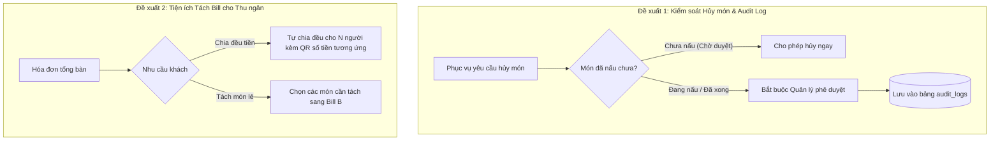

# BÁO CÁO ĐÁNH GIÁ & SO SÁNH ĐỐI CHIẾU LUỒNG XỬ LÝ
## GIỮA HỆ THỐNG ĐỒ ÁN VỚI iPOS.vn & KiotViet F&B

---

## 1. MỤC TIÊU ĐÁNH GIÁ
Sau khi hoàn thiện bản đặc tả chức năng và User Stories, tài liệu này tiến hành **đánh giá phản biện (Critical Review)** đối chiếu với hai phần mềm thương mại đầu ngành (**iPOS.vn** và **KiotViet F&B**) nhằm:
1. Xác định rõ **Điểm mạnh / Điểm vượt trội (Hơn gì?)** mà hệ thống của ta đã tối ưu hóa.
2. Nhận diện các **Khoảng trống nghiệp vụ / Tính năng còn thiếu (Thiếu gì?)** so với thực tế vận hành thương mại.
3. Đưa ra **Đề xuất bổ sung & Phương án trả lời phản biện** bảo vệ đồ án một cách chặt chẽ, thuyết phục.

---

## 2. BẢNG MA TRẬN SO SÁNH TỔNG THỂ

| Khía cạnh nghiệp vụ | iPOS.vn (FABi Ecosystem) | KiotViet F&B | Hệ thống Đồ án của ta | Đánh giá so quan |
| :--- | :--- | :--- | :--- | :--- |
| **1. Trải nghiệm QR gọi món** | Khách quét xem menu, gửi đơn độc lập | Khách quét xem menu, gửi đơn | **Shared Table Session:** Dùng chung giỏ hàng cả bàn, gợi ý món, chuông báo hết món, đánh giá dịch vụ | 🌟 **VƯỢT TRỘI** về trải nghiệm tương tác nhóm và phản hồi |
| **2. Điều phối Bếp (KDS)** | KDS trạm chuyên sâu, đổi màu thời gian, chỉ xem theo phiếu | In phiếu LAN, KDS gom món theo mẻ | **Hybrid:** Kết hợp cả xem theo Phiếu (FIFO) lẫn Gom mẻ; tiếp nhận lệnh khẩn cấp từ Admin | 🌟 **VƯỢT TRỘI** về tính linh hoạt điều phối cao điểm |
| **3. Quản lý Nhân sự & Ca kíp** | Tách riêng app iPOS HRM (tính thêm phí bản quyền) | Chỉ phân quyền tài khoản cơ bản | **Tích hợp sẵn:** Quản lý nhân viên, lịch trực ca, duyệt nghỉ/đổi ca, gán bàn phụ trách mặc định | 🌟 **HƠN HẲN** KiotViet, tiện lợi hơn iPOS khi gói gọn trong 1 hệ thống |
| **4. Kênh thanh toán** | Quẹt thẻ EDC, MoMo, ZaloPay, VietQR màn hình phụ | VietQR quầy + Loa thông báo tiền về | **Đa kênh dự phòng:** Khách tự quét VietQR động tại bàn HOẶC quét tại quầy, tính tiền thối | 🌟 **LINH HOẠT & AN TOÀN** khi có sự cố tại quầy |
| **5. Quản lý Kho & Định lượng (BOM)** | Chuyên sâu đến từng gram, kiểm soát hao hụt, kho nguyên liệu sơ chế | Định lượng thành phần cơ bản để tự động trừ kho hàng bán | **Chưa triển khai (Out-of-Scope):** Chỉ quản lý trạng thái Còn/Hết món | ⚠️ **CÒN THIẾU** so với thực tế nhà hàng lớn |
| **6. Chống gian lận (Audit Log)** | Bắt buộc mã PIN Quản lý khi hủy món/hủy bill sau in tạm tính | Phân quyền vai trò | **Cơ bản:** Chưa có nhật ký vết thao tác (Audit Log) khi nhân viên xóa món | ⚠️ **CÒN THIẾU** cơ chế kiểm soát nội bộ chặt chẽ |
| **7. Tách hóa đơn (Split Bill)** | Tách món sang hóa đơn mới, tách theo số lượng, chia đều tiền | Tách món sang bàn khác | **Cơ bản:** Chỉ chốt hóa đơn toàn bàn, chưa hỗ trợ khách trong bàn chia tiền riêng | ⚠️ **CÒN THIẾU** tính năng chia tiền nhóm bạn |
| **8. Tương thích thiết bị & In ấn** | Bắt buộc máy POS chuyên dụng, in nhiệt LAN/Wifi ESC/POS | App di động + In nhiệt LAN/Bluetooth | **Nền tảng Web thuần:** Chạy trên mọi thiết bị có trình duyệt, in qua hộp thoại in trình duyệt | 💡 **LỢI THẾ HỌC THUẬT:** Chi phí 0 VNĐ, dễ chấm bài |

---

## 3. PHÂN TÍCH CHI TIẾT "HỆ THỐNG CỦA TA HƠN GÌ?" (ĐIỂM SÁNG)

### 3.1. Trải nghiệm Gọi món QR nhóm (Shared Table Experience)
- **Hạn chế của phần mềm thị trường:** Trên KiotViet hay iPOS O2O, khi 4 người cùng bàn cùng quét QR, mỗi người thường có 1 giỏ hàng riêng trên điện thoại của mình. Điều này dễ dẫn đến việc gọi trùng món (ví dụ 2 người cùng tưởng người kia chưa gọi lẩu nên gọi 2 nồi).
- **Điểm vượt trội của ta:** Áp dụng cơ chế **Shared Table Session** qua WebSockets. Khi người A bấm thêm một đĩa bò vào giỏ hàng, màn hình điện thoại của người B và người C tại bàn lập tức nhảy số lượng `+1`. Cả bàn luôn thấy tổng tiền tích lũy và trạng thái món đang làm đến đâu.

### 3.2. Màn hình KDS linh hoạt & Xử lý tình huống khẩn cấp
- KDS của ta học tập điểm mạnh nhất của iPOS (đổi màu cảnh báo thời gian trễ Xanh/Vàng/Đỏ) và điểm mạnh nhất của KiotViet (chế độ gom món theo mẻ).
- Bổ sung **Kênh chỉ đạo khẩn cấp (Emergency Priority Override):** Khi khách đợi lâu hoặc khách VIP phàn nàn, Quản lý/Thu ngân có thể phát lệnh ưu tiên đẩy món đó lên đầu danh sách KDS kèm tín hiệu chuông cảnh báo.

### 3.3. Tích hợp Quản lý Ca kíp & Phân công bàn phục vụ
- iPOS tách phân hệ chấm công/ca kíp thành sản phẩm riêng (iPOS HRM) với chi phí bản quyền bổ sung.
- Hệ thống của ta tích hợp trọn gói: Quản lý ca trực, tiếp nhận đơn xin nghỉ ca/đổi ca và **gán khu vực/bàn phụ trách mặc định cho từng nhân viên phục vụ**. Nhân viên khi mở điện thoại sẽ thấy ngay các bàn mình chịu trách nhiệm chính.

---

## 4. PHÂN TÍCH CHI TIẾT "HỆ THỐNG CỦA TA THIẾU GÌ?" (KHOẢNG TRỐNG CẦN LƯU Ý)

### 4.1. Thiếu Quản lý Kho nguyên vật liệu & Định lượng món (BOM - Recipe)
- **Thực tế:** Khi bán 1 bát Phở bò, hệ thống iPOS sẽ tự trừ trong kho: 150g bánh phở, 100g thịt bò tái, 500ml nước dùng, hành hoa.
- **Lý do hệ thống ta chưa làm:** Đã xác định rõ trong phạm vi (Scope Boundary) giai đoạn 1 để tập trung làm xuất sắc luồng Order, KDS thời gian thực, POS và Báo cáo. Việc quản lý kho nguyên liệu sơ chế đòi hỏi cấu trúc CSDL đồ sộ và logic kiểm kê hao hụt phức tạp, dễ làm loãng đề tài đồ án Web.

### 4.2. Thiếu Cơ chế Kiểm soát Hủy món / Chống gian lận (Audit Log)
- **Thực tế:** Kẽ hở gian lận lớn nhất trong nhà hàng là: Nhân viên phục vụ bấm order món, bếp nấu xong, nhân viên bưng ra cho khách ăn. Đến lúc tính tiền, nhân viên tự ý xóa món đó khỏi hệ thống, thu tiền mặt của khách và bỏ túi riêng.
- **Khắc phục đề xuất:** Cần bổ sung quy tắc: **Nếu món đã chuyển trạng thái "Đang nấu" hoặc "Đã xong", nhân viên phục vụ KHÔNG ĐƯỢC tự ý xóa món**. Muốn hủy món bắt buộc phải gửi yêu cầu lên Quản lý (Admin) phê duyệt kèm lý do (ví dụ: khách đổi món, món bị nguội/hỏng). Mọi thao tác hủy đều ghi vào bảng `audit_logs`.

### 4.3. Thiếu Tính năng Tách hóa đơn (Split Bill)
- **Thực tế:** Một bàn 6 người đi ăn liên hoan văn phòng muốn:
  - Chia đều hóa đơn: 1.200.000 đ chia 6 = mỗi người 200.000 đ.
  - Hoặc tách riêng món: 2 người về sớm muốn thanh toán riêng 2 phần cơm và 2 lon nước họ đã dùng.
- **Khắc phục đề xuất:** Bổ sung tính năng nhỏ tại màn hình Thu ngân: Hỗ trợ "Tách món sang hóa đơn mới" hoặc "Công cụ tính chia đều tiền theo số người".

### 4.4. Cơ chế In ấn phiếu nhiệt tự động
- **Thực tế:** iPOS giao tiếp với máy in nhiệt qua cổng mạng LAN/IP bằng giao thức ESC/POS, máy in tự động cắt giấy mà không cần người dùng thao tác.
- **Hệ thống Web của ta:** Gọi hộp thoại in mặc định của trình duyệt (`window.print()`) với CSS `@media print` căn chỉnh đúng khổ giấy 80mm. Cách này hoàn toàn chuẩn mực cho đồ án web và không đòi hỏi giám khảo phải có phần cứng máy in nhiệt để chấm bài.

---

## 5. ĐỀ XUẤT NÂNG CẤP ĐỂ ĐỒ ÁN ĐẠT ĐIỂM TỐI ĐA (GRADE A+)

Để đồ án đạt tính thực tiễn cao nhất và làm hài lòng các giảng viên khó tính trong hội đồng chấm đồ án, ta nên bổ sung thêm **2 tính năng tinh gọn nhưng cực kỳ đắt giá**:

### 1. Tính năng "Kiểm soát Hủy món & Ghi vết Audit Log"
- Thêm một bảng `audit_logs (id, user_id, action, target_id, old_value, new_value, reason, created_at)`.
- Khi phục vụ muốn hủy một món mà bếp đang nấu: Hệ thống hiển thị modal nhập lý do và gửi thông báo chờ Quản lý bấm "Đồng ý hủy".
- Giúp đồ án chứng minh được **tính bảo mật và kiểm soát thất thoát doanh thu** như một phần mềm chuyên nghiệp.

### 2. Tính năng "Tách hóa đơn & Tiện ích chia tiền"
- Tại màn hình Thu ngân: Thêm nút "Tiện ích chia tiền" (nhập số người, hệ thống tự chia đều số tiền và cập nhật số tiền vào mã VietQR động để từng khách quét chuyển khoản đúng phần của mình).
- Nút "Tách bill": Cho phép tick chọn các món và tách thành hóa đơn độc lập.

---

## 6. KỊCH BẢN TRẢ LỜI PHẢN BIỆN TRƯỚC HỘI ĐỒNG (DEFENSE Q&A)

* **Câu hỏi 1 của Giảng viên:** *"Tại sao hệ thống của em không làm phần quản lý kho và định lượng nguyên liệu (BOM) như iPOS hay KiotViet?"*
  > **Trả lời:** *"Dạ thưa Thầy/Cô, trong khảo sát hiện trạng, nhóm nhận thấy quản lý định lượng nguyên liệu thô (gram thịt, ml nước) là một bài toán rất lớn thuộc phân hệ ERP/Kế toán kho chuyên sâu. Trong phạm vi đồ án Phát triển Web, nhóm chủ động tập trung toàn lực vào bài toán **Trải nghiệm phục vụ tại bàn thời gian thực (Real-time Dine-in F&B)**: giải quyết triệt để sự đồng bộ tức thì giữa Khách (QR Shared Session) - Phục vụ - Bếp KDS - Thu ngân và tối ưu trải nghiệm người dùng, giúp hệ thống vận hành trơn tru nhất mà không bị phân tán tài nguyên."*

* **Câu hỏi 2:** *"Nếu hệ thống chạy trên nền Web, làm sao giải quyết vấn đề in hóa đơn nếu không có máy in nhiệt chuyên dụng?"*
  > **Trả lời:** *"Dạ thưa Thầy/Cô, hệ thống sử dụng chuẩn CSS in ấn `@media print` được thiết kế chuẩn kích thước khổ giấy in nhiệt K80 (80mm). Bất kỳ máy in hóa đơn nào kết nối với máy tính thu ngân qua USB/Driver đều có thể in trực tiếp mượt mà, đồng thời cho phép xuất ra file PDF đối soát mà không cần cài đặt phần mềm cầu nối trung gian."*

---

## 7. BÁO CÁO CẬP NHẬT HOÀN TẤT CHUẨN HÓA THIẾT KẾ (PHIÊN BẢN ENTERPRISE V2.0)

Nhằm đưa đồ án lên chuẩn mực doanh nghiệp chuỗi nhà hàng (Enterprise Grade), giải quyết triệt để mọi tình huống góc khuất trong thực tế nhưng vẫn giữ đúng phạm vi ranh giới cốt lõi (Core Scope Boundary):

| STT | Khía cạnh nghiệp vụ & kỹ thuật | Quyết định chuẩn hóa chính thức trong hồ sơ thiết kế |
| :---: | :--- | :--- |
| **1** | **Quản lý Định lượng Kho (BOM)** | **Xác định rõ Out-of-Scope (Loại khỏi phạm vi thiết kế):** Giữ đúng định hướng tập trung toàn lực vào trải nghiệm phục vụ tại bàn thời gian thực (Dine-in F&B) và quản lý tồn món ăn tổng thể; không mở rộng sang ERP kho nguyên liệu sơ chế để tránh làm loãng đề tài đồ án Web. |
| **2** | **Xử lý Ngoại lệ VietQR & Sổ cái Lũy kế** | **Đã chuẩn hóa:** Bổ sung Kịch bản Tuần tự 4 (Sequence 4), bảng `giao_dich_thanh_toan` với khóa Idempotency `UNIQUE(ma_giao_dich_ngan_hang)`, tự động trừ lùi và tạo phiếu hoàn tiền thừa. |
| **3** | **Kiến trúc Hạ tầng Mạng Hybrid Local-First** | **Đã chuẩn hóa:** Bổ sung Biểu đồ Triển khai (Deployment Diagram) chạy Node.js + SQLite trên Mini PC mạng LAN nội bộ, định tuyến khách 4G qua Cloudflare Tunnel, đảm bảo mất cáp quang ngoài đường quán vẫn hoạt động 100%. |
| **4** | **Chốt két mù (Blind Cash Drop) & Z-Report** | **Đã chuẩn hóa:** Bổ sung Kịch bản Tuần tự 6 (Sequence 6), bảng `phieu_thu_chi_noi_bo` và Use Case `US-CS08` kiểm đếm tiền mặt độc lập khi kết thúc ca làm việc, in biên bản Z-Report chuẩn K80. |
| **5** | **Cơ chế Timeout 90s khi Hủy món Bếp đang nấu** | **Đã chuẩn hóa:** Bổ sung Kịch bản Tuần tự 5 (Sequence 5) và `US-W08`: Thẻ KDS đếm ngược 90s; quá 90s tự động leo thang thông báo đỏ khẩn cấp lên Admin Dashboard và phân định kế toán hao hụt nguyên liệu. |
