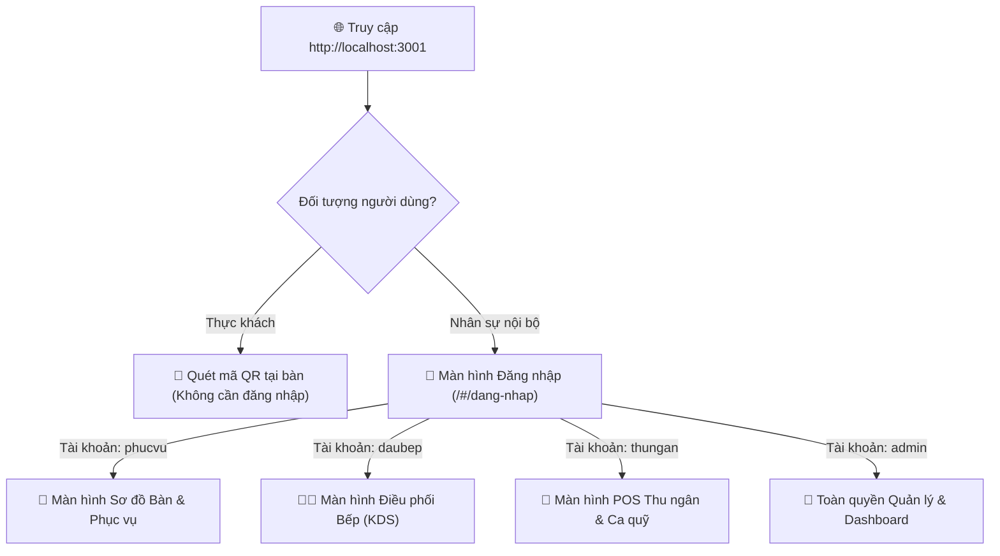
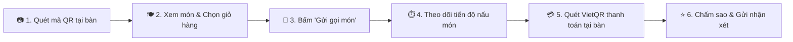
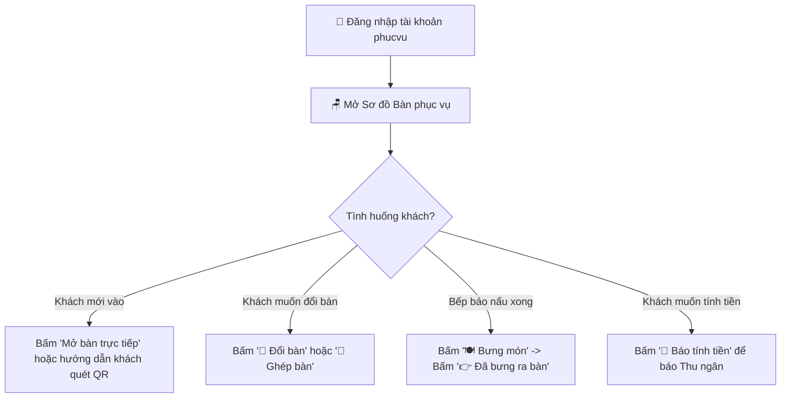
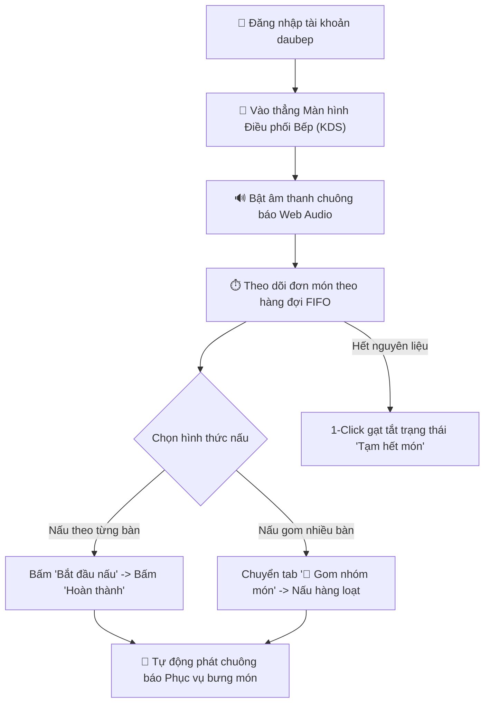
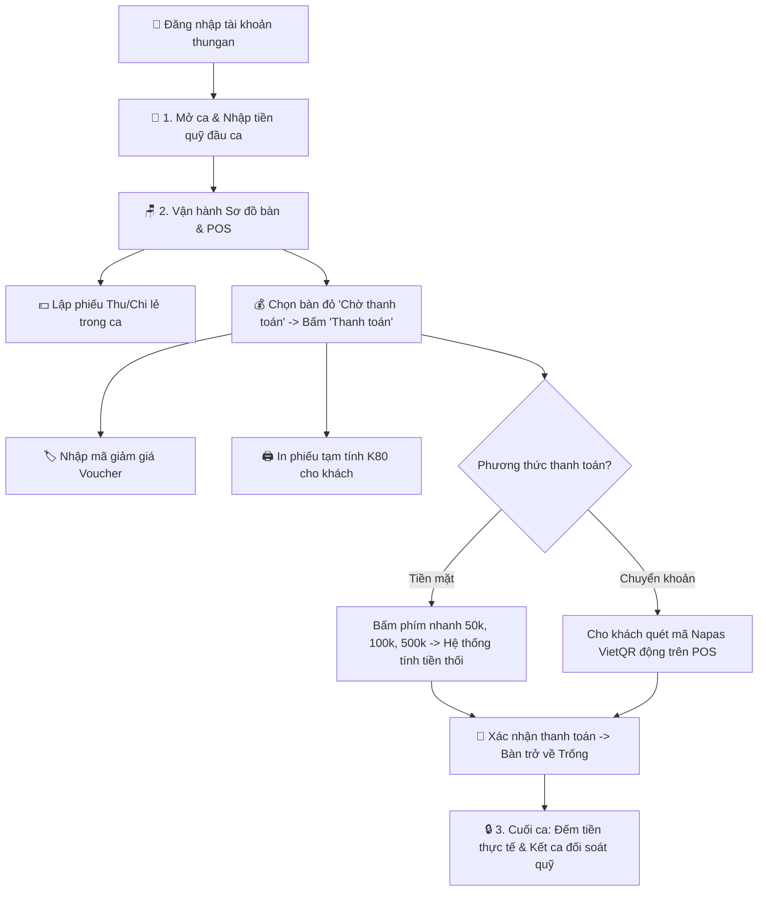
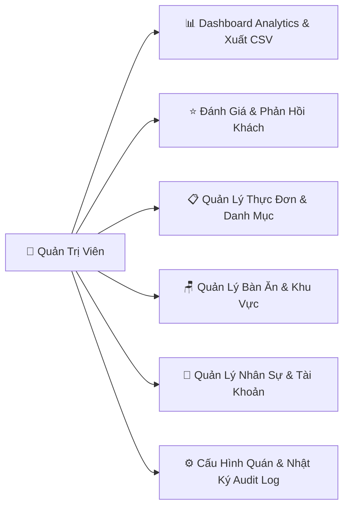

# CẨM NANG HƯỚNG DẪN SỬ DỤNG HỆ THỐNG TOÀN DIỆN
**Hệ Thống:** Website Quản Lý Nhà Hàng & Gọi Món QR (Quán Mộc POS & E-Menu)  
**Dành cho:** Khách Hàng, Nhân Viên Phục Vụ, Đầu Bếp, Thu Ngân & Quản Lý  
**Phiên bản:** 4.0  

---

## 1. TỔNG QUAN PHÂN HỆ VÀ TRUY CẬP

Hệ thống được thiết kế theo kiến trúc chuyên biệt hóa cao: Mỗi bộ phận chỉ thao tác với các chức năng thuộc phạm vi phụ trách của mình, giúp loại bỏ nhầm lẫn và nâng cao tốc độ phục vụ.

---

## 2. HƯỚNG DẪN DÀNH CHO THỰC KHÁCH (GỌI MÓN E-MENU QR)

Thực khách tại bàn được trải nghiệm dịch vụ gọi món tự phục vụ (Self-service) hiện đại, không chạm:

### Bước 1: Quét mã QR tại bàn
* Mở ứng dụng **Camera** hoặc **Zalo / Ứng dụng quét QR** trên điện thoại di động.
* Hướng camera vào mã QR dán trên mặt bàn ăn.
* Nhấp vào đường link xuất hiện trên màn hình (định dạng `http://.../#/menu?token=...`).
* Trình duyệt tự động mở Thực đơn điện tử của Quán Mộc và hiển thị đúng số bàn của bạn.

### Bước 2: Khám phá thực đơn & Chọn món
* **Thanh danh mục trượt (Sticky Category):** Chạm vào các mục *Khai vị, Món đặc sản, Món nướng, Món lẩu, Đồ uống* để cuộn nhanh đến nhóm món tương ứng.
* **Món nổi bật:** Các món đặc sản hoặc bán chạy có huy hiệu màu đỏ `HOT` kèm hình ảnh vector sắc nét.
* **Tìm kiếm món:** Nhập tên món vào ô tìm kiếm ở đầu trang để tìm nhanh món ăn bạn muốn.
* **Tùy chỉnh món:** Chạm vào dấu `+` để thêm số lượng, dấu `-` để giảm bớt; nhấp vào ô "Ghi chú" để thêm yêu cầu riêng (ví dụ: *ít cay, không hành, nhiều đá*).

### Bước 3: Kiểm tra giỏ hàng & Gửi gọi món
* Thanh giỏ hàng nổi màu vàng cố định ở chân màn hình luôn hiển thị tổng số món và số tiền tạm tính.
* Chạm vào **"Xem giỏ hàng"** để kiểm tra lại toàn bộ danh sách món đã chọn.
* Bấm nút **"GỬI GỌI MÓN"** màu đỏ nổi bật.
* Hệ thống sẽ gửi đơn hàng tức thì xuống nhà bếp, chuông báo bếp sẽ vang lên và món ăn bắt đầu được chế biến.

### Bước 4: Theo dõi tiến độ chế biến món ăn thời gian thực
* Sau khi gửi đơn, hệ thống tự động chuyển bạn sang màn hình **Theo dõi đơn món**.
* Tại đây bạn có thể thấy rõ tiến trình của từng món ăn:
  - ⏳ **Chờ chế biến:** Đơn đã vào hàng đợi của bếp.
  - 🔥 **Đang nấu:** Đầu bếp đang trực tiếp chế biến món ăn của bạn.
  - ✅ **Bếp đã nấu xong:** Món ăn đã sẵn sàng trên quầy chờ phục vụ mang ra.
  - 🍽️ **Đã phục vụ:** Món ăn đã được dọn lên bàn của bạn.

### Bước 5: Gọi phục vụ & Thanh toán tại bàn
* **Gọi phục vụ:** Khi cần thêm nước mắm, khăn lạnh hoặc đá, chạm nút **"🔔 Gọi phục vụ"**.
* **Thanh toán tại bàn:** Khi dùng bữa xong, chạm nút **"💳 Yêu cầu thanh toán"**:
  - Màn hình sẽ hiển thị bảng kê hóa đơn tạm tính (tiền món ăn, thuế VAT, tiền giảm giá nếu có).
  - Hệ thống tự động sinh **Mã Napas VietQR động** kèm chính xác số tiền cần trả.
  - Bạn chỉ cần mở ứng dụng Ngân hàng (Vietcombank, MB, Techcombank, MoMo...) quét mã VietQR để chuyển khoản ngay tại bàn mà không cần đợi nhân viên mang máy POS lại.

### Bước 6: Chấm điểm và gửi nhận xét
* Sau khi thanh toán thành công, màn hình Đánh giá sẽ xuất hiện.
* Bạn chọn số sao từ 1 đến 5 sao và viết lời nhận xét góp ý cho nhà hàng (có tùy chọn gửi ẩn danh để bảo mật thông tin).

---

## 3. HƯỚNG DẪN DÀNH CHO NHÂN VIÊN PHỤC VỤ (`phucvu` / `123456`)

Nhân viên phục vụ chịu trách nhiệm quản lý bàn, đón tiếp khách và bưng bê món ăn:

### Bước 1: Đăng nhập hệ thống
* Truy cập `http://localhost:3001/#/dang-nhap`.
* Nhập: Tên đăng nhập `phucvu`, Mật khẩu `123456`.
* Giao diện phục vụ tự động hiển thị màn hình **"🪑 Sơ Đồ Bàn & Phục Vụ Bàn Ăn"** (các chức năng bếp, ca quỹ và cấu hình được ẩn hoàn toàn để phục vụ tập trung làm việc).

### Bước 2: Theo dõi sơ đồ bàn
* **Màu sắc bàn:**
  - 🟢 **Xanh lá (Bàn trống):** Bàn sẵn sàng đón khách.
  - 🟡 **Vàng (Đang phục vụ):** Bàn đang có khách ngồi dùng bữa, hiển thị số phút khách đã ngồi và số món đang chế biến.
  - 🔴 **Đỏ (Chờ thanh toán):** Khách đang yêu cầu tính tiền.
* **Bộ lọc:** Bấm các tab *Tất cả*, *Bàn trống*, *Đang phục vụ*, *Chờ thanh toán* hoặc gõ số bàn vào ô tìm kiếm để tra cứu nhanh.

### Bước 3: Đón khách & Mở bàn
* Khi khách vào quán, chọn bàn trống tương ứng và bấm **"👤 Mở bàn trực tiếp"**.
* Nhập số lượng khách và ghi chú đón tiếp (nếu có), bấm **"Xác nhận Mở bàn"**.
* Bấm nút **"📱 Mã QR"** trên thẻ bàn để đưa màn hình điện thoại/mã in cho khách quét gọi món.
* Nếu khách là người lớn tuổi không dùng điện thoại thông minh, phục vụ có thể bấm **"➕ Đặt món hộ"** bên trong bàn để chọn món giúp khách.

### Bước 4: Chuyển bàn & Ghép bàn
* **Khi khách muốn đổi sang bàn khác:**
  - Bấm nút **"🔀 Đổi bàn"** trên thẻ bàn.
  - Chọn bàn trống muốn chuyển đến và nhập lý do, bấm **"Chuyển bàn"**. Toàn bộ món ăn và hóa đơn sẽ được chuyển tự động sang bàn mới.
* **Khi hai nhóm khách muốn ngồi chung:**
  - Bấm nút **"🔗 Ghép bàn"**.
  - Chọn bàn đang phục vụ muốn ghép vào, bấm **"Xác nhận Ghép"**. Hệ thống sẽ gộp chung các đơn món lại với nhau.

### Bước 5: Xem món & Bưng món đã nấu xong lên bàn (Chức năng cốt lõi)
* Khi bếp hoàn thành món ăn, trên thẻ bàn sẽ hiện huy hiệu màu đỏ cảnh báo số món đã xong (ví dụ: `2 xong`).
* Bấm nút **"🍽️ Bưng món"** trên bàn đó.
* Hộp thoại chi tiết món của bàn sẽ mở ra, các món bếp đã nấu xong được làm nổi bật màu xanh lá kèm nút **"👉 Đã bưng ra bàn"**.
* Nhân viên bưng món ra đặt lên bàn của khách, sau đó bấm nút **"👉 Đã bưng ra bàn"** để xác nhận hoàn tất.

### Bước 6: Báo tính tiền
* Khi khách thông báo muốn thanh toán, phục vụ bấm nút **"🔔 Báo tính tiền"** trên thẻ bàn.
* Bàn sẽ đổi sang trạng thái màu đỏ **"Chờ thanh toán"** để nhân viên Thu ngân nhìn thấy và xử lý in bill thu tiền.

---

## 4. HƯỚNG DẪN DÀNH CHO ĐẦU BẾP (`daubep` / `123456`)

Màn hình KDS (Kitchen Display System) được thiết kế tối ưu cho môi trường bếp chịu nhiệt độ và thao tác nhanh:

### Bước 1: Đăng nhập & Thiết lập KDS
* Đăng nhập với tài khoản `daubep`, mật khẩu `123456`.
* Hệ thống sẽ tự động đưa đầu bếp vào thẳng màn hình **"🍳 ĐIỀU PHỐI BẾP (KDS)"**.
* **Bật chế độ Toàn màn hình:** Bấm nút **"⛶ Toàn màn hình"** ở góc phải để mở rộng tối đa không gian hiển thị trên màn hình treo tường bếp.
* **Chuông báo âm thanh:** Đảm bảo loa bếp đang bật. Khi có đơn mới gửi từ khách hoặc phục vụ, chuông Web Audio Chime sẽ tự động vang lên báo hiệu.

### Bước 2: Quản lý hàng đợi gọi món (Tab "⏱ Hàng đợi gọi món FIFO")
* Các món ăn mới gọi được xếp lần lượt từ trái sang phải theo thứ tự thời gian gọi (First-In, First-Out).
* Mỗi thẻ món hiển thị rõ: Tên món, số lượng, tên bàn, thời gian chờ và ghi chú của khách (ví dụ: *ít cay, không hành*).
* Các món chờ lâu trên 15 phút sẽ tự động đổi sang viền đỏ nhấp nháy để nhà bếp ưu tiên xử lý trước.

### Bước 3: Nấu món theo từng bàn
* Khi bắt đầu chế biến món nào, đầu bếp bấm nút **"🔥 Nấu"**: Thẻ món chuyển sang trạng thái *Đang chế biến*.
* Khi món ăn nấu xong và đặt lên khay ra đồ, đầu bếp bấm nút **"✅ Xong"**:
  - Món ăn được chuyển sang trạng thái *Hoàn thành*.
  - Hệ thống tự động phát tín hiệu chuông tới điện thoại/màn hình của Phục vụ để ra bưng đồ ăn lên bàn.

### Bước 4: Chức năng gom nhóm món (Tab "🍲 Gom nhóm món")
* Vào giờ cao điểm, nhiều bàn khác nhau thường gọi các món giống nhau (ví dụ: Bàn 1 gọi 2 Lẩu riêu cua, Bàn 3 gọi 1 Lẩu riêu cua, Bàn 5 gọi 2 Lẩu riêu cua).
* Đầu bếp bấm vào tab **"🍲 Gom nhóm món"**: Hệ thống tự động tính tổng số suất cần nấu của từng món (ví dụ: *Lẩu riêu cua: Tổng 5 suất*).
* Đầu bếp có thể nấu đồng loạt để tiết kiệm công sức và gas/điện.

### Bước 5: Báo tạm hết món
* Khi một nguyên liệu bị hết đột xuất (ví dụ: hết cá lăng hoặc hết sườn non), đầu bếp chuyển sang danh sách thực đơn hoặc tab hết món, gạt nút **"Tạm hết"**.
* Món ăn này sẽ lập tức bị khóa trên điện thoại của toàn bộ khách hàng, ngăn chặn việc khách tiếp tục gọi món đã hết.

---

## 5. HƯỚNG DẪN DÀNH CHO THU NGÂN (`thungan` / `123456`)

Thu ngân chịu trách nhiệm chính xác tuyệt đối về dòng tiền, xuất hóa đơn và đối soát quỹ két:

### Bước 1: Mở ca làm việc & Khởi tạo quỹ (Đầu ca)
* Đăng nhập với tài khoản `thungan`, mật khẩu `123456`.
* Nhấp vào mục **"💼 Quản lý Ca & Quỹ"** trên thanh menu bên trái.
* Chọn ca trực (Ca sáng / Ca chiều / Ca tối).
* Nhập **Số tiền mặt đầu ca** có trong két (ví dụ: `1,000,000 đ` tiền lẻ thối lại).
* Bấm **"Xác nhận Mở ca"**. Hệ thống bắt đầu tính toán dòng tiền của ca trực.

### Bước 2: Quản lý thu - chi tiền mặt lẻ trong ca
* Trong ca trực nếu có các khoản tiền mặt phát sinh ngoài việc bán hàng:
  - **Phiếu Chi:** Mua thêm đá viên ngoài chợ (`50,000 đ`), mua đồ dùng vệ sinh (`30,000 đ`).
  - **Phiếu Thu:** Nạp thêm tiền lẻ vào két (`500,000 đ`), bán ve chai/vỏ bia (`120,000 đ`).
* Thu ngân bấm **"+ Lập phiếu Thu / Chi"**, chọn loại phiếu, điền số tiền và ghi chú rõ ràng lý do để số liệu két cuối ca luôn khớp từng đồng.

### Bước 3: Thu tiền & Thanh toán POS
* Nhấp vào mục **"🪑 Sơ đồ Bàn & POS"**.
* Các bàn đang yêu cầu thanh toán sẽ có màu đỏ nổi bật **"Chờ thanh toán"**.
* Bấm nút **"💰 Thanh toán"** trên thẻ bàn để vào màn hình thanh toán hóa đơn.
* **Áp dụng khuyến mãi (Voucher):** Nếu khách có mã ưu đãi (ví dụ: `KM10`, `QUANMOC50K`), nhập mã vào ô voucher và bấm "Áp dụng". Hệ thống sẽ tự động trừ số tiền giảm giá.
* **In phiếu tạm tính:** Bấm nút **"🖨️ In tạm tính (K80)"** để in hóa đơn khổ in nhiệt 80mm gửi cho khách đối soát danh sách món.
* **Chọn phương thức thu tiền:**
  - **Nếu khách trả Tiền mặt:** Bấm vào các nút phím nhanh mệnh giá gợi ý (`50k`, `100k`, `200k`, `500k`) hoặc gõ số tiền khách đưa. Màn hình sẽ hiển thị to rõ số **Tiền thừa trả khách** để thu ngân thối lại chuẩn xác.
  - **Nếu khách Chuyển khoản:** Màn hình POS tự động hiển thị **Mã Napas VietQR động** kèm chính xác số tiền cần chuyển. Khách dùng app ngân hàng quét mã và tiền sẽ vào tài khoản nhà hàng.
* Bấm nút **"HOÀN TẤT THANH TOÁN"**:
  - Hóa đơn chuyển trạng thái `da_thanh_toan`.
  - Phiên phục vụ đóng lại và bàn ăn tự động giải phóng về trạng thái 🟢 **Bàn trống**.

### Bước 4: Kết ca & Đối soát quỹ (Cuối ca)
* Khi hết giờ làm việc, thu ngân quay lại mục **"💼 Quản lý Ca & Quỹ"** ➔ Chọn **"Kết thúc ca làm việc"**.
* Thu ngân kiểm đếm toàn bộ tiền mặt thực tế đang có trong két và nhập vào ô **Tiền mặt thực tế kiểm đếm**.
* Hệ thống sẽ tự động so sánh:
  $$\text{Chênh lệch} = \text{Tiền thực tế} - (\text{Tiền đầu ca} + \text{Doanh thu tiền mặt} + \text{Thu phát sinh} - \text{Chi phát sinh})$$
* Hệ thống hiển thị rõ: *Khớp quỹ hoàn toàn*, *Thừa tiền* hoặc *Thiếu tiền*.
* Nhập ghi chú bàn giao cho thu ngân ca sau và bấm **"Xác nhận Kết ca & Bàn giao"**.

---

## 6. HƯỚNG DẪN DÀNH CHO QUẢN LÝ / CHỦ QUÁN (`admin` / `123456`)

Quản lý có đặc quyền cao nhất, nắm bắt bức tranh toàn cảnh hoạt động kinh doanh:

### 1. Báo cáo Doanh thu & Dashboard Analytics (`#/thong-ke`)
* **Chỉ số tổng quan:** Xem doanh thu hôm nay, tổng số hóa đơn, giá trị trung bình mỗi đơn và tỷ lệ tăng trưởng so với hôm qua.
* **Biểu đồ doanh thu chu kỳ:** Bấm chọn xem biểu đồ theo *7 ngày gần nhất*, *8 tuần gần nhất*, *12 tháng gần nhất* hoặc chọn khoảng ngày linh hoạt từ ngày `tuNgay` đến `denNgay`.
* **Tỷ trọng phương thức thanh toán:** Biểu đồ tròn thể hiện cơ cấu nguồn tiền (Bao nhiêu % tiền mặt vs Bao nhiêu % chuyển khoản VietQR).
* **Top món bán chạy:** Bảng xếp hạng 5 món mang lại doanh số cao nhất để lên kế hoạch nhập nguyên liệu tươi ngon.
* **Giờ cao điểm & Tỷ lệ hủy món:** Giúp chủ quán biết khung giờ nào khách đông nhất (ví dụ: trưa 12h-13h, tối 19h-21h) để bố trí nhân sự phục vụ hợp lý.
* **Xuất báo cáo CSV:** Bấm nút **"Xuất báo cáo Doanh thu (CSV)"** hoặc **"Xuất danh sách Hóa đơn (CSV)"** để tải tệp dữ liệu về máy. File được mã hóa UTF-8 BOM nên mở trực tiếp bằng Microsoft Excel mà không bị lỗi font tiếng Việt.

### 2. Quản lý Đánh giá & Chăm sóc khách hàng (`#/danh-gia`)
* Xem điểm hài lòng trung bình (ví dụ: `4.8 / 5.0 ⭐`).
* **Lọc đánh giá tiêu cực:** Nhấp vào bộ lọc `< 4 sao` để xem ngay các phản hồi chưa hài lòng về món ăn hoặc thái độ phục vụ.
* **Phản hồi 1-click:** Nhấp vào nút "Mẫu phản hồi" để chọn các mẫu câu cảm ơn hoặc xin lỗi lịch sự, sau đó bấm "Gửi phản hồi" để giải trình chăm sóc khách hàng.

### 3. Quản lý Thực đơn & Bàn ăn (`#/thuc-don`, `#/so-do-ban`)
* **Thêm món ăn mới:** Bấm "+ Thêm món mới", điền tên món, giá bán, danh mục, tải ảnh minh họa vector SVG sắc nét và gán nhãn HOT nếu là đặc sản của quán.
* **Cập nhật giá:** Nhấp vào biểu tượng chỉnh sửa trên món ăn để đổi giá hoặc đơn vị tính.
* **Thêm bàn ăn & In QR:** Vào mục Sơ đồ bàn, bấm "+ Thêm Bàn Ăn", chọn khu vực và sức chứa. Sau đó bấm "📱 Mã QR" để tải ảnh mã QR in ra dán lên bàn.

### 4. Quản lý Nhân sự & Phân quyền (`#/nhan-vien`)
* **Tạo tài khoản nhân viên mới:** Bấm "+ Thêm nhân viên", nhập họ tên, tên đăng nhập, số điện thoại và chọn vai trò:
  - `Phục vụ`: Chỉ được xem sơ đồ bàn phục vụ và bưng món.
  - `Đầu bếp`: Chỉ được vào màn hình KDS điều phối bếp.
  - `Thu ngân`: Được vận hành POS, in bill và quản lý ca quỹ.
  - `Quản lý`: Toàn quyền hệ thống.
* **Khóa tài khoản:** Khi nhân viên nghỉ việc hoặc tạm nghỉ, bấm đổi trạng thái sang "Bị khóa" để chặn đăng nhập ngay lập tức.
* **Đặt lại mật khẩu:** Nếu nhân viên quên mật khẩu, bấm nút "Đặt lại mật khẩu" để trả về mật khẩu mặc định `123456`.

### 5. Cấu hình Nhà hàng & Nhật ký hệ thống (`#/quan-tri`)
* **Thông tin thương hiệu:** Cập nhật Tên nhà hàng, Địa chỉ, Số điện thoại hotline, Mật khẩu Wifi miễn phí cho khách.
* **Thuế VAT:** Thiết lập tỷ lệ phần trăm thuế VAT (mặc định 10% hoặc 8%).
* **Tài khoản VietQR:** Cấu hình tên ngân hàng (MBBank, Vietcombank...), Số tài khoản và Tên chủ tài khoản để mã QR thanh toán trên mobile của khách luôn chuyển tiền về đúng tài khoản của chủ quán.
* **Nhật ký Audit Log:** Xem toàn bộ lịch sử các thao tác nhạy cảm (nhân viên nào xóa bàn, nhân viên nào sửa giá món, ai mở ca kết ca vào lúc mấy giờ) để chống thất thoát tài chính.

---
*Cẩm nang Hướng dẫn Sử dụng Hệ thống Quán Mộc POS được biên soạn chi tiết và phát hành chính thức cho toàn bộ nhân sự.*
