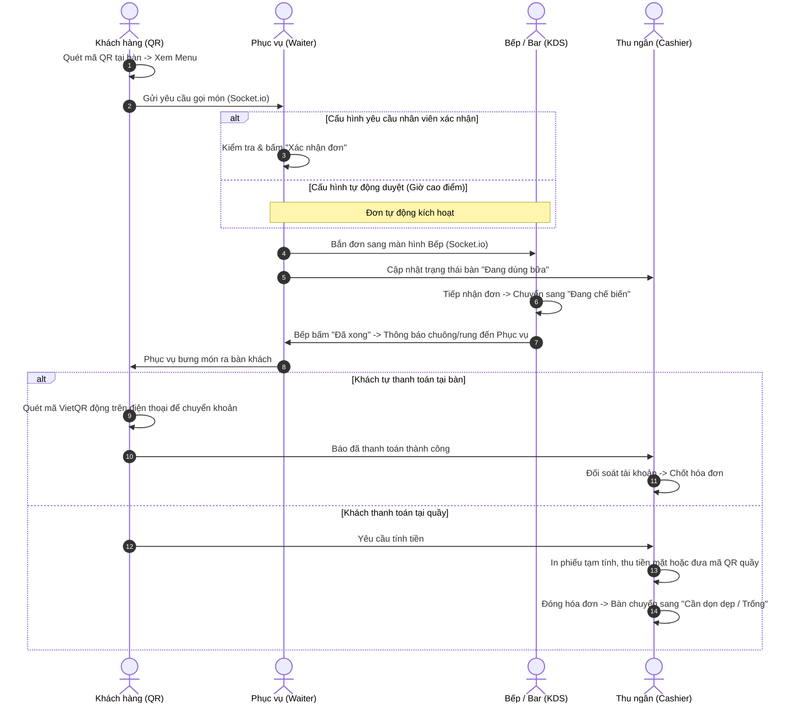
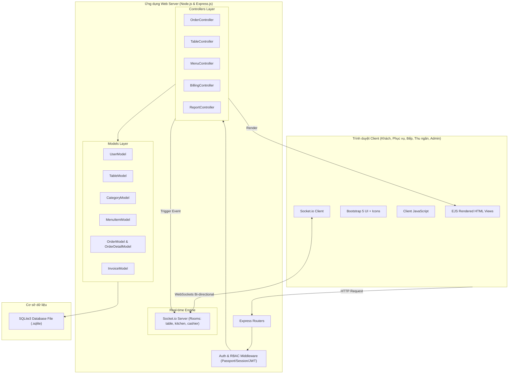

# TÀI LIỆU PHÁT BIỂU BÀI TOÁN & MÔ TẢ SƠ BỘ DỰ ÁN
## ĐỀ TÀI: XÂY DỰNG HỆ THỐNG QUẢN LÝ NHÀ HÀNG PHỤC VỤ TẠI BÀN (RESTAURANT MANAGEMENT SYSTEM)

---

## 1. Bối cảnh và Đặt vấn đề (Problem Background)

Trong hoạt động kinh doanh dịch vụ ăn uống (F&B) truyền thống, quy trình phục vụ tại bàn thường gặp phải các hạn chế lớn:
- **Thời gian chờ đợi lâu:** Khách hàng phải vẫy gọi nhân viên để lấy menu, chờ nhân viên ghi chép order bằng giấy, sau đó nhân viên mới di chuyển về quầy/bếp để chuyển order.
- **Dễ sai sót và nhầm lẫn:** Ghi chép thủ công dễ dẫn đến sai món, thiếu món, hoặc bếp làm nhầm thứ tự ưu tiên trong giờ cao điểm.
- **Khó đồng bộ trạng thái:** Nhân viên không nắm bắt tức thì bàn nào đang chờ món, món nào đã chế biến xong, dẫn đến tình trạng món nguội hoặc phục vụ trễ.
- **Áp lực thanh toán tại quầy:** Vào khung giờ đông khách, việc dồn ứ tại quầy thu ngân để chờ kiểm tra hóa đơn, chia tiền, quẹt thẻ gây ùn tắc và tăng nguy cơ thất thoát.

**Nhu cầu đặt ra:** Xây dựng một **Hệ thống Quản lý Nhà hàng thông minh**, ứng dụng công nghệ Web và truyền thông thời gian thực (Real-time Web) nhằm số hóa toàn diện quy trình từ khâu quét mã QR gọi món tại bàn, điều phối chế biến tại Bếp/Bar, quản lý sơ đồ bàn đến thanh toán và báo cáo doanh thu.

---

## 2. Mục tiêu của Đồ án (Project Objectives)

1. **Tối ưu hóa trải nghiệm khách hàng:** Khách hàng có thể tự quét mã QR tại bàn để xem thực đơn trực quan, đặt món và theo dõi tiến độ món ăn theo thời gian thực trên chính điện thoại của mình.
2. **Nâng cao năng suất vận hành nội bộ:** 
   - Nhân viên phục vụ gọi món nhanh chóng qua thiết bị di động/tablet, linh hoạt gộp/chuyển bàn.
   - Bộ phận Bếp/Bar (KDS) tiếp nhận đơn chế biến lập tức qua màn hình hiển thị, không dùng giấy in tốn kém và dễ thất lạc.
   - Thu ngân kiểm soát chính xác hóa đơn từng bàn, hỗ trợ thanh toán đa kênh (tiền mặt, mã VietQR động).
3. **Quản trị minh bạch và hiệu quả:** Giúp chủ nhà hàng/quản lý giám sát doanh thu, tình trạng bàn trống, món bán chạy mọi lúc mọi nơi.
4. **Mục tiêu học thuật & kỹ thuật:** Triển khai hoàn chỉnh kiến trúc phần mềm **MVC (Model - View - Controller)** truyền thống với **Node.js, Express.js, EJS, SQLite3**, kết hợp công nghệ **Socket.io** xử lý đồng bộ sự kiện thời gian thực.

---

## 3. Phạm vi Dự án (Project Scope)

### 3.1. Phạm vi bao gồm (In-Scope)
- **Mô hình nhà hàng:** Phục vụ tại bàn (Dine-in full-service) với sơ đồ bàn trực quan theo khu vực/tầng.
- **Hệ thống 5 phân hệ người dùng (Actors):**
  1. *Khách hàng (Customer):* Quét QR xem menu, đặt món, theo dõi trạng thái, thanh toán online/gọi thanh toán.
  2. *Nhân viên phục vụ (Waiter):* Nhận/duyệt order, đặt món hộ khách, quản lý chuyển bàn/gộp bàn.
  3. *Bộ phận Bếp/Bar (KDS):* Màn hình bếp nhận order real-time, đổi trạng thái món (Chờ nấu -> Đang nấu -> Đã xong).
  4. *Thu ngân (Cashier/POS):* Quản lý hóa đơn bàn, thanh toán tiền mặt/chuyển khoản VietQR, in hóa đơn.
  5. *Quản trị viên (Admin/Manager):* Quản lý menu, bàn ăn, tạo QR code bàn, cấu hình duyệt order, phân quyền nhân viên, thống kê doanh thu.
- **Đồng bộ thời gian thực (Real-time Sync):** Khi có món mới, bàn mới, hoặc trạng thái món thay đổi, màn hình Phục vụ, Bếp và Thu ngân được cập nhật tức thì qua WebSockets (Socket.io).
- **Thanh toán linh hoạt:** Hỗ trợ song song cả thanh toán tại bàn (quét mã VietQR trên điện thoại) và thanh toán tại quầy thu ngân.

### 3.2. Phạm vi chưa triển khai ở giai đoạn 1 (Out-of-Scope)
- Chưa quản lý kho nguyên vật liệu thô và công thức định lượng (Recipe/BOM). Món ăn chỉ quản lý theo trạng thái *Còn món* hoặc *Tạm hết*.
- Chưa tích hợp giao hàng mang về (Takeaway/Delivery) qua bên thứ ba (GrabFood, ShopeeFood).
- Chưa tích hợp phần cứng máy quét thẻ ngân hàng chuyên dụng (POS EDC) ngoài phương thức quét mã QR và tiền mặt.

---

## 4. Phân tích Các Tác nhân & Ca sử dụng (Actors & Use Cases)

```mermaid
flowchart TD
    Customer["👤 Khách hàng (Customer)"]
    Waiter["🤵 Nhân viên Phục vụ (Waiter)"]
    Kitchen["👨‍🍳 Bếp / Bar (KDS)"]
    Cashier["💳 Thu ngân (Cashier)"]
    Admin["👔 Quản trị viên (Admin)"]

    subgraph ClientLayer["Giao diện Khách hàng (Mobile Web via QR)"]
        UC_QR["Quét mã QR tại bàn"]
        UC_ViewMenu["Xem thực đơn & Tìm kiếm"]
        UC_Order["Chọn món & Gửi yêu cầu đặt"]
        UC_Track["Theo dõi tiến độ món"]
        UC_PayTable["Thanh toán QR tại bàn / Gọi tính tiền"]
    end

    subgraph StaffLayer["Giao diện Phục vụ & Thu ngân"]
        UC_TableMap["Xem sơ đồ bàn trực quan"]
        UC_Approve["Duyệt / Từ chối yêu cầu món từ QR"]
        UC_TakeOrder["Tạo order tại bàn hộ khách"]
        UC_ChangeTable["Chuyển bàn / Gộp bàn"]
        UC_Checkout["Lập hóa đơn & Xác nhận thanh toán"]
    end

    subgraph KitchenLayer["Màn hình Bếp / Bar (KDS)"]
        UC_LiveOrders["Nhận thông báo món mới (Real-time)"]
        UC_UpdateStatus["Cập nhật: Đang làm / Đã nấu xong"]
    end

    subgraph AdminLayer["Bảng điều khiển Quản lý"]
        UC_ManageMenu["Quản lý Danh mục & Món ăn"]
        UC_ManageTables["Quản lý Sơ đồ bàn & Xuất mã QR"]
        UC_Config["Cấu hình tự động duyệt theo bàn/khu vực"]
        UC_StaffMgmt["Quản lý tài khoản nhân viên"]
        UC_Reports["Báo cáo Doanh thu & Món bán chạy"]
    end

    Customer --> UC_QR
    Customer --> UC_ViewMenu
    Customer --> UC_Order
    Customer --> UC_Track
    Customer --> UC_PayTable

    Waiter --> UC_TableMap
    Waiter --> UC_Approve
    Waiter --> UC_TakeOrder
    Waiter --> UC_ChangeTable

    Kitchen --> UC_LiveOrders
    Kitchen --> UC_UpdateStatus

    Cashier --> UC_TableMap
    Cashier --> UC_Checkout

    Admin --> UC_ManageMenu
    Admin --> UC_ManageTables
    Admin --> UC_Config
    Admin --> UC_StaffMgmt
    Admin --> UC_Reports
```

---

## 5. Quy trình Nghiệp vụ Cốt lõi (Core Business Flow)

---

## 6. Kiến trúc Kỹ thuật Hệ thống (Technical Architecture)

Dự án áp dụng mô hình **MVC (Model - View - Controller)** trên nền tảng **Node.js & Express.js**:

### Chi tiết Stack công nghệ:
- **Ngôn ngữ:** JavaScript (Node.js LTS).
- **Backend Framework:** Express.js (kiến trúc MVC chuẩn với tách biệt `models/`, `views/`, `controllers/`, `routes/`, `middlewares/`).
- **Template Engine:** EJS (Embedded JavaScript) - hiển thị giao diện phía server, kết hợp layout dùng chung.
- **Frontend / Styling:** Bootstrap 5, FontAwesome / Bootstrap Icons, Responsive chuẩn trên cả Mobile (dành cho Khách & Phục vụ) và Desktop (dành cho Bếp, Thu ngân, Admin).
- **Cơ sở dữ liệu:** SQLite3 (sử dụng thư viện `sqlite3` hoặc `better-sqlite3`, lưu trữ file cơ sở dữ liệu dạng file đơn, cực kỳ thuận tiện khi đóng gói và chấm đồ án).
- **Real-time Engine:** Socket.io (chia Room theo bàn, bếp và quầy thu ngân để push sự kiện tức thời).
- **Tạo mã QR & Thanh toán:** Thư viện `qrcode` (tạo mã QR động gắn kèm `table_id` và mã VietQR chuẩn NAPAS 247).

---

## 7. Kế hoạch Phân rã Chức năng (Functional Breakdown)

| Phân hệ | Chức năng chính | Ghi chú kỹ thuật |
| :--- | :--- | :--- |
| **1. Xác thực & Phân quyền** | - Đăng nhập/Đăng xuất cho nhân viên. - Phân quyền vai trò (Admin, Waiter, Kitchen, Cashier) qua Session/Middleware. | Session-based Auth hoặc JWT cookie |
| **2. Thực đơn (Menu)** | - Danh mục món ăn (Khai vị, Món chính, Đồ uống...). - Chi tiết món: Tên, đơn giá, ảnh, mô tả, tình trạng (Còn/Hết). | CRUD đầy đủ, upload ảnh món |
| **3. Bàn ăn & Phòng** | - Quản lý danh sách bàn theo khu vực (Tầng 1, Tầng 2, Ngoài trời). - Trạng thái bàn: Trống, Đang có khách, Đặt trước, Cần dọn. - Xuất mã QR cho từng bàn (in ra dán tại bàn). | Sinh mã QR động chứa URL `.../order?table=X` |
| **4. Gọi món QR (Customer)** | - Khách quét mã vào thẳng menu bàn tương ứng. - Thêm món vào giỏ, ghi chú món (ít cay, không đá...). - Gửi order và xem danh sách món đã gọi kèm trạng thái chế biến. | Lưu giỏ hàng LocalStorage / Session |
| **5. Phục vụ (Waiter)** | - Xem sơ đồ bàn dạng lưới trực quan. - Tạo đơn hộ khách hoặc duyệt đơn gửi từ mã QR. - Thêm món mới vào bàn đang ăn. - Chuyển bàn, gộp bàn. | Socket.io nhận đơn mới tức thì |
| **6. Bếp / Bar (KDS)** | - Danh sách order hiển thị theo thứ tự thời gian gọi (First-In First-Out). - Tách biệt món cần nấu (Bếp) và đồ pha chế (Bar). - Cập nhật trạng thái: *Đang nấu* -> *Hoàn thành*. | Âm thanh thông báo khi có món mới |
| **7. Thu ngân & Hóa đơn** | - Xem tổng tiền theo bàn (món, số lượng, đơn giá, thuế/VAT nếu có). - Áp dụng chiết khấu / mã giảm giá. - Tiện ích Tách hóa đơn (Split Bill) & Công cụ chia đều tiền cho nhóm. - Thanh toán: Tiền mặt hoặc hiển thị mã VietQR động. - In phiếu tạm tính / hóa đơn thanh toán K80. | Thư viện tạo mã VietQR động |
| **8. Báo cáo & Thống kê** | - Doanh thu theo ngày, tuần, tháng. - Biểu đồ món bán chạy nhất. - Số lượng khách và lượt phục vụ theo bàn. | Chart.js kết hợp dữ liệu từ SQLite |
| **9. Kiểm soát Chống thất thoát** | - Quy trình phê duyệt hủy món đã nấu từ Admin. - Nhật ký kiểm toán (Audit Logs) ghi vết mọi thao tác sửa/hủy đơn, giảm giá. | Middleware ghi log thao tác CSDL |

---

## 8. Kết luận & Định hướng tiếp theo

Tài liệu này đóng vai trò là **Phát biểu bài toán chính thức** và **Bản đặc tả yêu cầu sơ bộ** cho đồ án môn học Web Quản Lý Nhà Hàng. Kiến trúc MVC kết hợp SQLite3 và Socket.io đảm bảo vừa đáp ứng đầy đủ tính khoa học, cấu trúc mã nguồn sáng sủa, vừa có trải nghiệm thực tế mượt mà cho đầy đủ các tác nhân trong nhà hàng.
