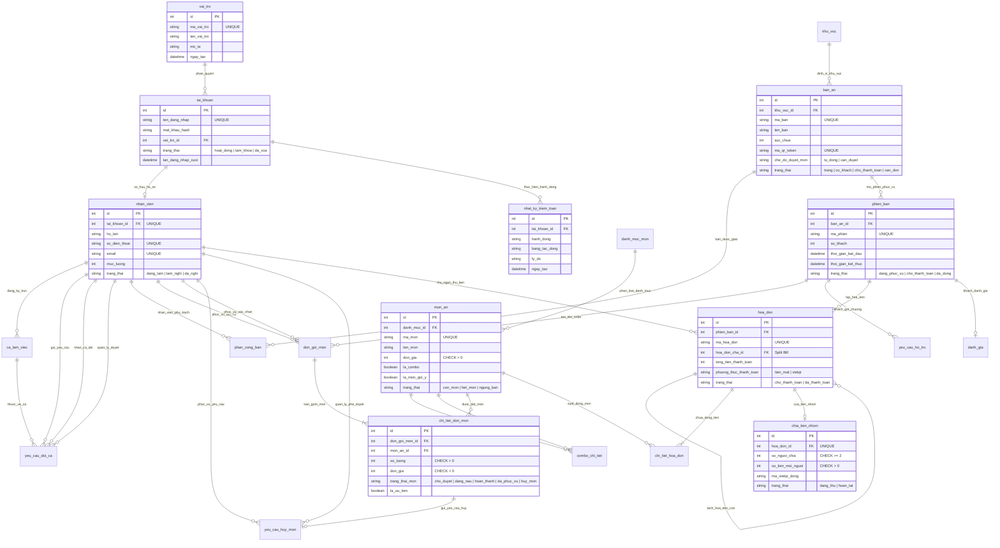
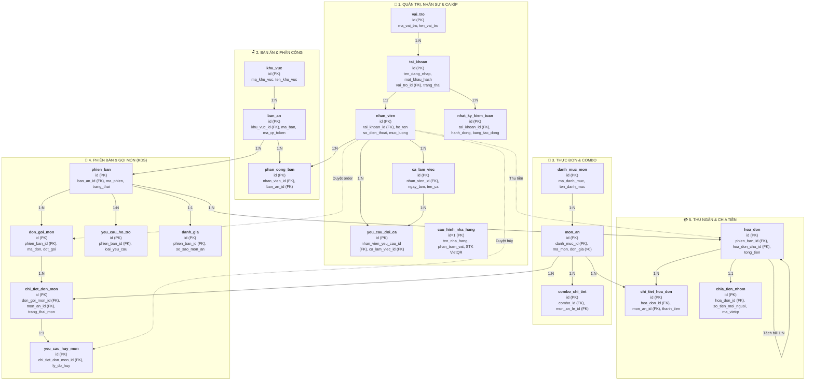

# TÀI LIỆU BIỂU ĐỒ ERD & DATABASE DIAGRAM
## ĐỀ TÀI: HỆ THỐNG QUẢN LÝ NHÀ HÀNG & GỌI MÓN QR (QUÁN MỘC POS & E-MENU)

---

## 1. TỔNG QUAN HỆ CƠ SỞ DỮ LIỆU

Hệ thống cơ sở dữ liệu của dự án được xây dựng trên nền tảng **SQLite3**, tuân thủ nghiêm ngặt **Quy chuẩn phát triển phần mềm toàn dự án**:
- **Quy tắc đặt tên:** Tên bảng và tên cột dùng chuẩn `snake_case` tiếng Việt không dấu.
- **Chuẩn hóa dữ liệu:** Đạt dạng chuẩn 3 (**3NF - Third Normal Form**), loại bỏ hoàn toàn dư thừa dữ liệu và dị thường cập nhật.
- **Quy mô:** Bao gồm **22 bảng thực thể** và **31 chỉ mục (Index) chiến lược** tối ưu hóa truy vấn thời gian thực cho 5 phân hệ người dùng.

---

## 2. BIỂU ĐỒ QUAN HỆ THỰC THỂ (ENTITY-RELATIONSHIP DIAGRAM - ERD)

Biểu đồ ERD dưới đây mô tả đầy đủ 22 thực thể, các thuộc tính khóa chính (`PK`), khóa ngoại (`FK`), kiểu dữ liệu và bản số quan hệ (Crow's Foot Notation):

* **File ảnh Vector SVG:** [taiLieu/soDoCoSoDuLieu.svg](file:///d:/PHAT%20TRIEN%20WEB/quan%20ly%20nha%20hang/taiLieu/soDoCoSoDuLieu.svg)
* **File ảnh độ phân giải cao PNG:** [taiLieu/soDoCoSoDuLieu.png](file:///d:/PHAT%20TRIEN%20WEB/quan%20ly%20nha%20hang/taiLieu/soDoCoSoDuLieu.png)
* **Mã nguồn Mermaid:** [taiLieu/soDoCoSoDuLieu.mmd](file:///d:/PHAT%20TRIEN%20WEB/quan%20ly%20nha%20hang/taiLieu/soDoCoSoDuLieu.mmd)

---

## 3. SƠ ĐỒ PHÂN VÙNG KIẾN TRÚC CSDL VẬT LÝ (DATABASE DIAGRAM)

Sơ đồ Database Diagram phân rã 22 bảng thành **5 cụm phân hệ chức năng độc lập**, thể hiện rõ luồng dữ liệu nghiệp vụ và các liên kết khóa ngoại:

* **File ảnh Vector SVG:** [taiLieu/databaseDiagram.svg](file:///d:/PHAT%20TRIEN%20WEB/quan%20ly%20nha%20hang/taiLieu/databaseDiagram.svg)
* **File ảnh độ phân giải cao PNG:** [taiLieu/databaseDiagram.png](file:///d:/PHAT%20TRIEN%20WEB/quan%20ly%20nha%20hang/taiLieu/databaseDiagram.png)
* **Mã nguồn Mermaid:** [taiLieu/databaseDiagram.mmd](file:///d:/PHAT%20TRIEN%20WEB/quan%20ly%20nha%20hang/taiLieu/databaseDiagram.mmd)

