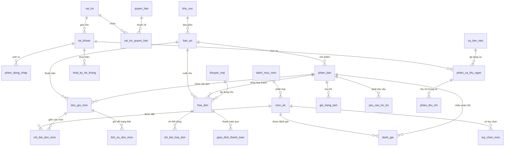

# SƠ ĐỒ CƠ SỞ DỮ LIỆU & TỪ ĐIỂN DỮ LIỆU (DATABASE SCHEMA & ERD)
**Hệ Thống:** Website Quản Lý Nhà Hàng & Gọi Món QR (Quán Mộc POS)  
**Hệ quản trị CSDL:** SQLite 3 (Chế độ Write-Ahead Logging - WAL)  
**Trình điều khiển:** `better-sqlite3` (Độ trễ thấp, hỗ trợ Database Transaction đồng bộ)  
**Phiên bản hoàn thiện:** 4.0 (29 bảng dữ liệu từ Sprint 1 - Sprint 4)  

---

## 1. TỔNG QUAN KIẾN TRÚC DỮ LIỆU

Hệ thống Quán Mộc sử dụng cơ sở dữ liệu quan hệ nhúng **SQLite 3** với cấu hình tối ưu hiệu năng cao cho môi trường nhà hàng:
- **Chế độ WAL (`PRAGMA journal_mode = WAL;`):** Cho phép các tác vụ đọc (Khách xem thực đơn, Dashboard thống kê) và các tác vụ ghi (Khách đặt món, Bếp cập nhật trạng thái, Thu ngân thanh toán) diễn ra đồng thời mà không bị khóa bảng (Non-blocking concurrency).
- **Ràng buộc khóa ngoại (`PRAGMA foreign_keys = ON;`):** Đảm bảo toàn vẹn tham chiếu nghiêm ngặt giữa các bảng nghiệp vụ.
- **Tính nguyên tử (ACID Transactions):** Mọi giao dịch quan trọng (Tạo đơn món, Đổi/ghép bàn, Chốt thanh toán, Mở/kết ca quỹ) đều được thực thi bên trong `db.transaction()` để đảm bảo dữ liệu không bao giờ bị sai lệch.

---

## 2. SƠ ĐỒ THỰC THỂ LIÊN KẾT (ENTITY-RELATIONSHIP DIAGRAM - ERD)

---

## 3. TỪ ĐIỂN DỮ LIỆU CHI TIẾT (DATA DICTIONARY)

### 3.1. Nhóm Quản Trị Hệ Thống, Nhân Sự & Phân Quyền

#### Bảng: `vai_tro` (Danh mục vai trò người dùng)
| Tên cột | Kiểu dữ liệu | Khóa | Ràng buộc / Mặc định | Ý nghĩa nghiệp vụ |
|---|---|:---:|---|---|
| `id` | INTEGER | PK | AUTOINCREMENT | Khóa chính tự tăng |
| `ma_vai_tro` | TEXT | | UNIQUE, NOT NULL | Mã định danh vai trò (`quan_ly`, `thu_ngan`, `bep`, `phuc_vu`) |
| `ten_vai_tro` | TEXT | | NOT NULL | Tên hiển thị tiếng Việt (Quản lý, Thu ngân, Đầu bếp, Phục vụ) |
| `mo_ta` | TEXT | | NULL | Mô tả trách nhiệm của vai trò |
| `ngay_tao` | DATETIME | | DEFAULT CURRENT_TIMESTAMP | Thời điểm tạo vai trò |

#### Bảng: `quyen_han` (Danh mục quyền hạn chi tiết)
| Tên cột | Kiểu dữ liệu | Khóa | Ràng buộc / Mặc định | Ý nghĩa nghiệp vụ |
|---|---|:---:|---|---|
| `id` | INTEGER | PK | AUTOINCREMENT | Khóa chính tự tăng |
| `ma_quyen` | TEXT | | UNIQUE, NOT NULL | Mã quyền (`quan_ly_thuc_don`, `quan_ly_ban_an`...) |
| `ten_quyen` | TEXT | | NOT NULL | Tên quyền chi tiết |
| `nhom_quyen` | TEXT | | NOT NULL | Nhóm phân hệ quản lý |
| `mo_ta` | TEXT | | NULL | Mô tả quyền hạn |

#### Bảng: `vai_tro_quyen_han` (Bảng liên kết Nhiều - Nhiều giữa Vai trò và Quyền hạn)
| Tên cột | Kiểu dữ liệu | Khóa | Ràng buộc / Mặc định | Ý nghĩa nghiệp vụ |
|---|---|:---:|---|---|
| `vai_tro_id` | INTEGER | PK, FK | REFERENCES vai_tro(id) | Mã vai trò |
| `quyen_han_id` | INTEGER | PK, FK | REFERENCES quyen_han(id) | Mã quyền hạn |

#### Bảng: `tai_khoan` (Hồ sơ nhân sự và thông tin đăng nhập)
| Tên cột | Kiểu dữ liệu | Khóa | Ràng buộc / Mặc định | Ý nghĩa nghiệp vụ |
|---|---|:---:|---|---|
| `id` | INTEGER | PK | AUTOINCREMENT | Khóa chính tài khoản |
| `ten_dang_nhap` | TEXT | | UNIQUE, NOT NULL | Tên đăng nhập hệ thống (`admin`, `thungan`...) |
| `mat_khau_bam` | TEXT | | NOT NULL | Mật khẩu mã hóa bằng thuật toán `bcrypt` |
| `ho_ten` | TEXT | | NOT NULL | Họ và tên nhân viên |
| `so_dien_thoai` | TEXT | | NULL | Số điện thoại liên hệ |
| `email` | TEXT | | NULL | Địa chỉ thư điện tử |
| `vai_tro_id` | INTEGER | FK | REFERENCES vai_tro(id) | Vai trò được phân quyền |
| `trang_thai` | TEXT | | CHECK IN ('hoat_dong', 'bi_khoa', 'nghi_viec') | Trạng thái công việc |
| `ngay_tao` | DATETIME | | DEFAULT CURRENT_TIMESTAMP | Ngày tạo tài khoản |
| `ngay_cap_nhat` | DATETIME | | DEFAULT CURRENT_TIMESTAMP | Ngày cập nhật thông tin |

#### Bảng: `phien_dang_nhap` (Tokens phiên đăng nhập)
| Tên cột | Kiểu dữ liệu | Khóa | Ràng buộc / Mặc định | Ý nghĩa nghiệp vụ |
|---|---|:---:|---|---|
| `id` | INTEGER | PK | AUTOINCREMENT | Khóa chính phiên |
| `tai_khoan_id` | INTEGER | FK | REFERENCES tai_khoan(id) | Tài khoản đăng nhập |
| `token` | TEXT | | NOT NULL | Chuỗi JWT Token |
| `da_thu_hoi` | INTEGER | | DEFAULT 0 | Đã thu hồi token hay chưa (1: Đã thu hồi) |
| `het_han_luc` | DATETIME | | NOT NULL | Thời điểm hết hạn token |
| `ngay_tao` | DATETIME | | DEFAULT CURRENT_TIMESTAMP | Thời điểm cấp token |

#### Bảng: `cau_hinh_nha_hang` (Cấu hình thương hiệu và thanh toán)
| Tên cột | Kiểu dữ liệu | Khóa | Ràng buộc / Mặc định | Ý nghĩa nghiệp vụ |
|---|---|:---:|---|---|
| `khoa` | TEXT | PK | PRIMARY KEY | Khóa cấu hình (`ten_nha_hang`, `dia_chi`, `ty_le_thue_vat`...) |
| `gia_tri` | TEXT | | NOT NULL | Giá trị thiết lập tương ứng |
| `mo_ta` | TEXT | | NULL | Giải thích cấu hình |
| `ngay_cap_nhat` | DATETIME | | DEFAULT CURRENT_TIMESTAMP | Thời điểm cập nhật |

#### Bảng: `nhat_ky_he_thong` (Audit Logs lưu vết thao tác)
| Tên cột | Kiểu dữ liệu | Khóa | Ràng buộc / Mặc định | Ý nghĩa nghiệp vụ |
|---|---|:---:|---|---|
| `id` | INTEGER | PK | AUTOINCREMENT | Khóa chính nhật ký |
| `tai_khoan_id` | INTEGER | FK | REFERENCES tai_khoan(id) | Người thực hiện (NULL nếu là khách hoặc cron) |
| `hanh_dong` | TEXT | | NOT NULL | Mã hành động (`DANG_NHAP`, `THANH_TOAN`...) |
| `chi_tiet` | TEXT | | NULL | Nội dung chi tiết thao tác |
| `ip` | TEXT | | NULL | Địa chỉ IP của máy khách |
| `thoi_gian` | DATETIME | | DEFAULT CURRENT_TIMESTAMP | Thời điểm thực hiện |

---

### 3.2. Nhóm Bàn Ăn & Thực Đơn

#### Bảng: `khu_vuc` (Khu vực / Tầng phục vụ)
| Tên cột | Kiểu dữ liệu | Khóa | Ràng buộc / Mặc định | Ý nghĩa nghiệp vụ |
|---|---|:---:|---|---|
| `id` | INTEGER | PK | AUTOINCREMENT | Khóa chính khu vực |
| `ten_khu_vuc` | TEXT | | NOT NULL | Tên khu vực (Tầng 1, Sân vườn, Phòng VIP) |
| `tang` | INTEGER | | DEFAULT 1 | Số tầng |
| `mo_ta` | TEXT | | NULL | Ghi chú vị trí |
| `thu_tu_hien_thi` | INTEGER | | DEFAULT 0 | Thứ tự hiển thị trên sơ đồ |
| `trang_thai` | TEXT | | CHECK IN ('hoat_dong', 'tam_dung') | Trạng thái hoạt động |

#### Bảng: `ban_an` (Sơ đồ bàn và mã QR Code định danh)
| Tên cột | Kiểu dữ liệu | Khóa | Ràng buộc / Mặc định | Ý nghĩa nghiệp vụ |
|---|---|:---:|---|---|
| `id` | INTEGER | PK | AUTOINCREMENT | Khóa chính bàn ăn |
| `ma_ban` | TEXT | | UNIQUE, NOT NULL | Mã định danh bàn (`B01`, `VIP01`...) |
| `ten_ban` | TEXT | | NOT NULL | Tên hiển thị của bàn |
| `khu_vuc_id` | INTEGER | FK | REFERENCES khu_vuc(id) | Khu vực chứa bàn |
| `suc_chua` | INTEGER | | DEFAULT 4, CHECK(suc_chua > 0) | Sức chứa số lượng khách |
| `trang_thai` | TEXT | | CHECK IN ('trong', 'dang_dung', 'cho_thanh_toan', 'tam_khoa') | Trạng thái phục vụ hiện tại |
| `ma_qr_token` | TEXT | | UNIQUE, NOT NULL | Chuỗi token bảo mật gắn với mã QR của bàn |
| `url_ma_qr` | TEXT | | NULL | Đường dẫn ảnh Data URI hoặc tệp QR Code |
| `ngay_tao` | DATETIME | | DEFAULT CURRENT_TIMESTAMP | Ngày tạo bàn |

#### Bảng: `danh_muc_mon` (Danh mục thực đơn)
| Tên cột | Kiểu dữ liệu | Khóa | Ràng buộc / Mặc định | Ý nghĩa nghiệp vụ |
|---|---|:---:|---|---|
| `id` | INTEGER | PK | AUTOINCREMENT | Khóa chính danh mục |
| `ten_danh_muc` | TEXT | | NOT NULL | Tên danh mục (Món nướng, Món lẩu, Đồ uống...) |
| `mo_ta` | TEXT | | NULL | Mô tả danh mục |
| `thu_tu_hien_thi` | INTEGER | | DEFAULT 0 | Thứ tự sắp xếp hiển thị |
| `trang_thai` | TEXT | | CHECK IN ('hien_thi', 'tam_an') | Trạng thái hiển thị |
| `ngay_tao` | DATETIME | | DEFAULT CURRENT_TIMESTAMP | Ngày tạo danh mục |

#### Bảng: `mon_an` (Thực đơn món ăn)
| Tên cột | Kiểu dữ liệu | Khóa | Ràng buộc / Mặc định | Ý nghĩa nghiệp vụ |
|---|---|:---:|---|---|
| `id` | INTEGER | PK | AUTOINCREMENT | Khóa chính món ăn |
| `danh_muc_id` | INTEGER | FK | REFERENCES danh_muc_mon(id) | Danh mục món |
| `ma_mon` | TEXT | | UNIQUE, NOT NULL | Mã món ăn (`MON01`, `LAU02`...) |
| `ten_mon` | TEXT | | NOT NULL | Tên món ăn |
| `mo_ta` | TEXT | | NULL | Giới thiệu thành phần, hương vị |
| `gia_ban` | REAL | | NOT NULL, CHECK(gia_ban >= 0) | Giá niêm yết (VNĐ) |
| `don_vi_tinh` | TEXT | | DEFAULT 'Phần' | Đơn vị tính (Đĩa, Nồi, Ly, Lon...) |
| `hinh_anh` | TEXT | | NULL | Đường dẫn ảnh minh họa vector SVG hoặc tệp tải lên |
| `trang_thai` | TEXT | | CHECK IN ('dang_ban', 'tam_het') | Trạng thái kinh doanh |
| `la_mon_noi_bat` | INTEGER | | DEFAULT 0 | Món đặc sản / Bán chạy (1: Có huy hiệu HOT) |
| `da_xoa` | INTEGER | | DEFAULT 0 | Cờ xóa mềm (1: Đã xóa, không hiện trên menu) |
| `ngay_tao` | DATETIME | | DEFAULT CURRENT_TIMESTAMP | Ngày thêm món |
| `ngay_cap_nhat` | DATETIME | | DEFAULT CURRENT_TIMESTAMP | Ngày sửa đổi gần nhất |

#### Bảng: `tuy_chon_mon` (Tùy chọn món ăn: Kích cỡ, Topping, Khẩu vị)
| Tên cột | Kiểu dữ liệu | Khóa | Ràng buộc / Mặc định | Ý nghĩa nghiệp vụ |
|---|---|:---:|---|---|
| `id` | INTEGER | PK | AUTOINCREMENT | Khóa chính tùy chọn |
| `mon_an_id` | INTEGER | FK | REFERENCES mon_an(id) ON DELETE CASCADE | Món ăn áp dụng |
| `loai_tuy_chon` | TEXT | | CHECK IN ('kich_co', 'topping', 'khau_vi') | Phân loại tùy chọn |
| `ten_tuy_chon` | TEXT | | NOT NULL | Tên tùy chọn (Size Lớn, Thêm trứng...) |
| `gia_them` | REAL | | DEFAULT 0, CHECK(gia_them >= 0) | Giá phụ thu thêm |
| `bat_buoc` | INTEGER | | DEFAULT 0 | Bắt buộc chọn hay không |

---

### 3.3. Nhóm Phiên Bàn, Giỏ Hàng & Đơn Gọi Món

#### Bảng: `phien_ban` (Phiên phục vụ ẩm thực của bàn)
| Tên cột | Kiểu dữ liệu | Khóa | Ràng buộc / Mặc định | Ý nghĩa nghiệp vụ |
|---|---|:---:|---|---|
| `id` | INTEGER | PK | AUTOINCREMENT | Khóa chính phiên phục vụ |
| `ban_an_id` | INTEGER | FK | REFERENCES ban_an(id) | Bàn ăn tương ứng |
| `ma_phien` | TEXT | | UNIQUE, NOT NULL | Mã phiên duy nhất (`PHIEN_B01_...`) |
| `thoi_gian_bat_dau` | DATETIME | | DEFAULT CURRENT_TIMESTAMP | Thời điểm khách bắt đầu ngồi |
| `thoi_gian_ket_thuc` | DATETIME | | NULL | Thời điểm thanh toán rời bàn |
| `trang_thai` | TEXT | | CHECK IN ('dang_su_dung', 'cho_thanh_toan', 'da_thanh_toan', 'da_huy') | Trạng thái phiên phục vụ |
| `tong_tien_tam_tinh` | REAL | | DEFAULT 0 | Tổng tiền tích lũy của các đơn |

#### Bảng: `gio_hang_tam` (Lưu trữ giỏ hàng khách hàng theo phiên bàn)
| Tên cột | Kiểu dữ liệu | Khóa | Ràng buộc / Mặc định | Ý nghĩa nghiệp vụ |
|---|---|:---:|---|---|
| `id` | INTEGER | PK | AUTOINCREMENT | Khóa chính giỏ hàng |
| `phien_ban_id` | INTEGER | FK | REFERENCES phien_ban(id) ON DELETE CASCADE | Phiên bàn ăn |
| `du_lieu_gio_hang` | TEXT | | DEFAULT '[]' | Dữ liệu giỏ hàng định dạng JSON |
| `ngay_cap_nhat` | DATETIME | | DEFAULT CURRENT_TIMESTAMP | Thời điểm lưu gần nhất |

#### Bảng: `don_goi_mon` (Đơn đặt món của khách / phục vụ gửi xuống bếp)
| Tên cột | Kiểu dữ liệu | Khóa | Ràng buộc / Mặc định | Ý nghĩa nghiệp vụ |
|---|---|:---:|---|---|
| `id` | INTEGER | PK | AUTOINCREMENT | Khóa chính đơn món |
| `phien_ban_id` | INTEGER | FK | REFERENCES phien_ban(id) | Phiên bàn ăn |
| `ban_an_id` | INTEGER | FK | REFERENCES ban_an(id) | Bàn ăn phát sinh đơn |
| `ma_don` | TEXT | | UNIQUE, NOT NULL | Mã đơn món (`DON_...`) |
| `lan_goi` | INTEGER | | DEFAULT 1 | Lần gọi món thứ mấy của bàn |
| `tong_tien_don` | REAL | | DEFAULT 0 | Tổng tiền đợt gọi món này |
| `ghi_chu` | TEXT | | NULL | Ghi chú chung cho đơn |
| `trang_thai` | TEXT | | CHECK IN ('cho_xac_nhan', 'dang_che_bien', 'hoan_thanh', 'da_phuc_vu', 'tu_choi', 'da_huy') | Trạng thái chế biến |
| `thoi_gian_dat` | DATETIME | | DEFAULT CURRENT_TIMESTAMP | Thời điểm bấm gửi đơn |

#### Bảng: `chi_tiet_don_mon` (Chi tiết từng món trong đơn)
| Tên cột | Kiểu dữ liệu | Khóa | Ràng buộc / Mặc định | Ý nghĩa nghiệp vụ |
|---|---|:---:|---|---|
| `id` | INTEGER | PK | AUTOINCREMENT | Khóa chính chi tiết món |
| `don_goi_mon_id` | INTEGER | FK | REFERENCES don_goi_mon(id) ON DELETE CASCADE | Đơn món chứa dòng này |
| `mon_an_id` | INTEGER | FK | REFERENCES mon_an(id) | Món ăn được đặt |
| `ten_mon` | TEXT | | NOT NULL | Tên món thời điểm đặt |
| `so_luong` | INTEGER | | NOT NULL, CHECK(so_luong > 0) | Số lượng đặt |
| `don_gia` | REAL | | NOT NULL, CHECK(don_gia >= 0) | Đơn giá kiểm tra tại Server |
| `thanh_tien` | REAL | | NOT NULL, CHECK(thanh_tien >= 0) | Thành tiền dòng món |
| `tuy_chon_chon` | TEXT | | NULL | Danh sách tùy chọn khách chọn |
| `ghi_chu_mon` | TEXT | | NULL | Ghi chú khẩu vị ("ít cay", "không hành") |
| `trang_thai` | TEXT | | CHECK IN ('cho_xac_nhan', 'dang_che_bien', 'hoan_thanh', 'da_phuc_vu', 'tu_choi', 'da_huy') | Trạng thái món ăn |

#### Bảng: `lich_su_don_mon` (Lịch sử chuyển đổi trạng thái chế biến)
| Tên cột | Kiểu dữ liệu | Khóa | Ràng buộc / Mặc định | Ý nghĩa nghiệp vụ |
|---|---|:---:|---|---|
| `id` | INTEGER | PK | AUTOINCREMENT | Khóa chính lịch sử |
| `don_goi_mon_id` | INTEGER | FK | REFERENCES don_goi_mon(id) ON DELETE CASCADE | Đơn món liên quan |
| `chi_tiet_don_mon_id` | INTEGER | | NULL | Dòng món ăn cụ thể |
| `trang_thai_cu` | TEXT | | NULL | Trạng thái trước khi chuyển |
| `trang_thai_moi` | TEXT | | NOT NULL | Trạng thái mới chuyển sang |
| `nguoi_thuc_hien` | TEXT | | DEFAULT 'Khách hàng' | Tác nhân thực hiện (Khách, Bếp, Phục vụ) |
| `ly_do` | TEXT | | NULL | Ghi chú lý do chuyển trạng thái |
| `thoi_gian` | DATETIME | | DEFAULT CURRENT_TIMESTAMP | Thời điểm ghi nhận |

#### Bảng: `yeu_cau_ho_tro` (Yêu cầu gọi phục vụ / gọi thanh toán)
| Tên cột | Kiểu dữ liệu | Khóa | Ràng buộc / Mặc định | Ý nghĩa nghiệp vụ |
|---|---|:---:|---|---|
| `id` | INTEGER | PK | AUTOINCREMENT | Khóa chính yêu cầu |
| `phien_ban_id` | INTEGER | FK | REFERENCES phien_ban(id) | Phiên bàn ăn |
| `ban_an_id` | INTEGER | FK | REFERENCES ban_an(id) | Bàn ăn yêu cầu |
| `loai_yeu_cau` | TEXT | | CHECK IN ('goi_nhan_vien', 'yeu_cau_thanh_toan', 'yeu_cau_khac') | Loại hình hỗ trợ |
| `ly_do` | TEXT | | NULL | Chi tiết (xin thêm đá, xin nước mắm...) |
| `trang_thai` | TEXT | | CHECK IN ('cho_tiep_nhan', 'da_tiep_nhan', 'hoan_thanh', 'da_huy') | Trạng thái xử lý |
| `thoi_gian_tao` | DATETIME | | DEFAULT CURRENT_TIMESTAMP | Thời điểm khách bấm |
| `thoi_gian_xu_ly` | DATETIME | | NULL | Thời điểm nhân viên nhận xử lý |

---

### 3.4. Nhóm Khuyến Mãi, Hóa Đơn & Thanh Toán

#### Bảng: `khuyen_mai` (Chương trình khuyến mãi & Mã giảm giá Voucher)
| Tên cột | Kiểu dữ liệu | Khóa | Ràng buộc / Mặc định | Ý nghĩa nghiệp vụ |
|---|---|:---:|---|---|
| `id` | INTEGER | PK | AUTOINCREMENT | Khóa chính khuyến mãi |
| `ma_khuyen_mai` | TEXT | | UNIQUE, NOT NULL | Mã nhập voucher (`KM10`, `QUANMOC50K`...) |
| `ten_chuong_trinh` | TEXT | | NOT NULL | Tên chương trình ưu đãi |
| `loai_giam` | TEXT | | CHECK IN ('phan_tram', 'so_tien'), DEFAULT 'phan_tram' | Giảm theo % hoặc số tiền cố định |
| `gia_tri_giam` | REAL | | NOT NULL, CHECK(gia_tri_giam > 0) | Tỷ lệ % giảm hoặc số tiền giảm |
| `giam_toi_da` | REAL | | DEFAULT 0 | Mức giảm tối đa (VNĐ) |
| `don_toi_thieu` | REAL | | DEFAULT 0 | Giá trị đơn tối thiểu để áp dụng |
| `ngay_bat_dau` | DATETIME | | DEFAULT CURRENT_TIMESTAMP | Ngày bắt đầu áp dụng |
| `ngay_ket_thuc` | DATETIME | | NULL | Ngày hết hạn |
| `so_luot_dung` | INTEGER | | DEFAULT 0 | Số lượt đã sử dụng thực tế |
| `gioi_han_luot_dung` | INTEGER | | DEFAULT 1000 | Số lượt tối đa cho phép |
| `trang_thai` | INTEGER | | DEFAULT 1 | Trạng thái hiệu lực (1: Đang chạy, 0: Tắt) |

#### Bảng: `hoa_don` (Hóa đơn bán hàng)
| Tên cột | Kiểu dữ liệu | Khóa | Ràng buộc / Mặc định | Ý nghĩa nghiệp vụ |
|---|---|:---:|---|---|
| `id` | INTEGER | PK | AUTOINCREMENT | Khóa chính hóa đơn |
| `ma_hoa_don` | TEXT | | UNIQUE, NOT NULL | Mã hóa đơn duy nhất (`HD_...`) |
| `phien_ban_id` | INTEGER | FK | REFERENCES phien_ban(id) | Phiên bàn ăn |
| `ban_an_id` | INTEGER | FK | REFERENCES ban_an(id) | Bàn ăn phát sinh |
| `tong_tien_mon` | REAL | | DEFAULT 0, NOT NULL | Tổng tiền các món ăn |
| `khuyen_mai_id` | INTEGER | FK | REFERENCES khuyen_mai(id) | Voucher áp dụng (nếu có) |
| `tien_giam_gia` | REAL | | DEFAULT 0 | Số tiền được giảm giá |
| `ty_le_vat` | REAL | | DEFAULT 10 | Tỷ lệ thuế VAT (%) |
| `tien_vat` | REAL | | DEFAULT 0 | Tiền thuế VAT |
| `phu_phi` | REAL | | DEFAULT 0 | Phí phục vụ / phụ phí |
| `tong_thanh_toan` | REAL | | DEFAULT 0, NOT NULL | Tổng số tiền khách phải trả cuối cùng |
| `phuong_thuc_thanh_toan`| TEXT | | CHECK IN ('tien_mat', 'chuyen_khoan', 'the', 'chua_thanh_toan') | Phương thức thanh toán |
| `trang_thai` | TEXT | | CHECK IN ('tam_tinh', 'da_thanh_toan', 'da_huy') | Trạng thái hóa đơn |
| `thoi_gian_tao` | DATETIME | | DEFAULT CURRENT_TIMESTAMP | Thời điểm lập hóa đơn |
| `thoi_gian_thanh_toan` | DATETIME | | NULL | Thời điểm thanh toán thành công |
| `ghi_chu` | TEXT | | NULL | Ghi chú hóa đơn |

#### Bảng: `chi_tiet_hoa_don` (Các dòng chi tiết trong hóa đơn)
| Tên cột | Kiểu dữ liệu | Khóa | Ràng buộc / Mặc định | Ý nghĩa nghiệp vụ |
|---|---|:---:|---|---|
| `id` | INTEGER | PK | AUTOINCREMENT | Khóa chính dòng hóa đơn |
| `hoa_don_id` | INTEGER | FK | REFERENCES hoa_don(id) ON DELETE CASCADE | Hóa đơn liên kết |
| `mon_an_id` | INTEGER | | NOT NULL | Mã món ăn |
| `ten_mon` | TEXT | | NOT NULL | Tên món ăn |
| `so_luong` | INTEGER | | NOT NULL, CHECK(so_luong > 0) | Số lượng |
| `don_gia` | REAL | | NOT NULL, CHECK(don_gia >= 0) | Đơn giá |
| `thanh_tien` | REAL | | NOT NULL, CHECK(thanh_tien >= 0) | Thành tiền dòng |
| `tuy_chon_chon` | TEXT | | NULL | Tùy chọn kèm theo |

#### Bảng: `giao_dich_thanh_toan` (Nhật ký giao dịch dòng tiền)
| Tên cột | Kiểu dữ liệu | Khóa | Ràng buộc / Mặc định | Ý nghĩa nghiệp vụ |
|---|---|:---:|---|---|
| `id` | INTEGER | PK | AUTOINCREMENT | Khóa chính giao dịch |
| `hoa_don_id` | INTEGER | FK | REFERENCES hoa_don(id) | Hóa đơn được thanh toán |
| `ma_giao_dich` | TEXT | | UNIQUE, NOT NULL | Mã giao dịch (`GD_...`) |
| `phuong_thuc` | TEXT | | CHECK IN ('tien_mat', 'chuyen_khoan_vietqr', 'the') | Phương thức thanh toán thực tế |
| `so_tien_phai_tra` | REAL | | NOT NULL | Số tiền phải thanh toán |
| `so_tien_khach_dua` | REAL | | NOT NULL | Số tiền khách đưa (hoặc tiền nhận CK) |
| `tien_thoi_lai` | REAL | | DEFAULT 0 | Tiền thừa trả lại khách |
| `ma_chuyen_khoan` | TEXT | | NULL | Mã tham chiếu ngân hàng |
| `trang_thai` | TEXT | | CHECK IN ('thanh_cong', 'that_bai', 'dang_cho') | Trạng thái giao dịch |
| `thoi_gian` | DATETIME | | DEFAULT CURRENT_TIMESTAMP | Thời điểm giao dịch |

#### Bảng: `lich_su_chuyen_ghep_ban` (Lưu vết vận hành đổi bàn / ghép bàn)
| Tên cột | Kiểu dữ liệu | Khóa | Ràng buộc / Mặc định | Ý nghĩa nghiệp vụ |
|---|---|:---:|---|---|
| `id` | INTEGER | PK | AUTOINCREMENT | Khóa chính lịch sử |
| `loai_thao_tac` | TEXT | | CHECK IN ('chuyen_ban', 'ghep_ban', 'tach_ban') | Loại thao tác |
| `ban_nguon_id` | INTEGER | FK | REFERENCES ban_an(id) | Bàn ban đầu |
| `ban_dich_id` | INTEGER | FK | REFERENCES ban_an(id) | Bàn chuyển đến / ghép vào |
| `phien_ban_nguon_id` | INTEGER | | NOT NULL | Phiên bàn ban đầu |
| `phien_ban_dich_id` | INTEGER | | NULL | Phiên bàn đích (nếu ghép) |
| `nguoi_thuc_hien` | TEXT | | DEFAULT 'Nhân viên' | Tên nhân viên thao tác |
| `ly_do` | TEXT | | NULL | Lý do chuyển bàn |
| `thoi_gian` | DATETIME | | DEFAULT CURRENT_TIMESTAMP | Thời điểm thao tác |

---

### 3.5. Nhóm Ca Làm Việc, Quỹ Tiền Mặt & Đánh Giá

#### Bảng: `ca_lam_viec` (Định nghĩa ca làm việc chuẩn)
| Tên cột | Kiểu dữ liệu | Khóa | Ràng buộc / Mặc định | Ý nghĩa nghiệp vụ |
|---|---|:---:|---|---|
| `id` | INTEGER | PK | AUTOINCREMENT | Khóa chính ca |
| `ma_ca` | TEXT | | UNIQUE, NOT NULL | Mã ca (`CA_SANG`, `CA_CHIEU`, `CA_TOI`) |
| `ten_ca` | TEXT | | NOT NULL | Tên ca hiển thị |
| `gio_bat_dau` | TEXT | | NOT NULL | Giờ bắt đầu (`06:00`) |
| `gio_ket_thuc` | TEXT | | NOT NULL | Giờ kết thúc (`14:00`) |
| `trang_thai` | TEXT | | DEFAULT 'hoat_dong' | Trạng thái hoạt động |

#### Bảng: `phien_ca_thu_ngan` (Phiên làm việc thu ngân & Đối soát két tiền)
| Tên cột | Kiểu dữ liệu | Khóa | Ràng buộc / Mặc định | Ý nghĩa nghiệp vụ |
|---|---|:---:|---|---|
| `id` | INTEGER | PK | AUTOINCREMENT | Khóa chính phiên ca |
| `ma_phien_ca` | TEXT | | UNIQUE, NOT NULL | Mã phiên ca (`CA_...`) |
| `nhan_vien_id` | INTEGER | FK | REFERENCES tai_khoan(id) | Nhân viên thu ngân trực ca |
| `ca_lam_viec_id` | INTEGER | FK | REFERENCES ca_lam_viec(id) | Khung ca làm việc |
| `thoi_gian_mo` | DATETIME | | DEFAULT CURRENT_TIMESTAMP | Thời điểm mở ca |
| `thoi_gian_dong` | DATETIME | | NULL | Thời điểm kết ca |
| `tien_dau_ca` | REAL | | DEFAULT 0 | Tiền mặt có sẵn trong két đầu ca |
| `tien_mat_he_thong` | REAL | | DEFAULT 0 | Doanh thu tiền mặt bán hàng hệ thống tính |
| `tien_ck_he_thong` | REAL | | DEFAULT 0 | Doanh thu chuyển khoản VietQR hệ thống tính |
| `tong_thu_phat_sinh` | REAL | | DEFAULT 0 | Tổng các phiếu thu tiền mặt trong ca |
| `tong_chi_phat_sinh` | REAL | | DEFAULT 0 | Tổng các phiếu chi tiền mặt trong ca |
| `tien_mat_thuc_te` | REAL | | DEFAULT 0 | Tiền mặt thu ngân đếm thực tế cuối ca |
| `chenh_lech` | REAL | | DEFAULT 0 | Chênh lệch tiền (Thực tế - Hệ thống tính) |
| `ghi_chu` | TEXT | | NULL | Ghi chú bàn giao ca |
| `trang_thai` | TEXT | | CHECK IN ('dang_mo', 'da_dong'), DEFAULT 'dang_mo' | Trạng thái phiên ca |

#### Bảng: `phieu_thu_chi` (Phiếu thu tiền mặt / chi tiền mặt phát sinh trong ca)
| Tên cột | Kiểu dữ liệu | Khóa | Ràng buộc / Mặc định | Ý nghĩa nghiệp vụ |
|---|---|:---:|---|---|
| `id` | INTEGER | PK | AUTOINCREMENT | Khóa chính phiếu |
| `ma_phieu` | TEXT | | UNIQUE, NOT NULL | Mã phiếu (`PT_...`, `PC_...`) |
| `phien_ca_id` | INTEGER | FK | REFERENCES phien_ca_thu_ngan(id) | Phiên ca phát sinh |
| `loai_phieu` | TEXT | | CHECK IN ('thu', 'chi'), NOT NULL | Loại phiếu (Thu tiền hoặc Chi tiền) |
| `so_tien` | REAL | | NOT NULL, CHECK(so_tien > 0) | Số tiền mặt phát sinh |
| `ly_do` | TEXT | | NOT NULL | Mục đích thu / chi (Mua đá, Nhập hàng...) |
| `nguoi_thuc_hien_id` | INTEGER | FK | REFERENCES tai_khoan(id) | Người lập phiếu |
| `thoi_gian_tao` | DATETIME | | DEFAULT CURRENT_TIMESTAMP | Thời điểm lập |

#### Bảng: `danh_gia` (Đánh giá và nhận xét của thực khách)
| Tên cột | Kiểu dữ liệu | Khóa | Ràng buộc / Mặc định | Ý nghĩa nghiệp vụ |
|---|---|:---:|---|---|
| `id` | INTEGER | PK | AUTOINCREMENT | Khóa chính đánh giá |
| `phien_ban_id` | INTEGER | FK | REFERENCES phien_ban(id) | Phiên bàn ăn |
| `mon_an_id` | INTEGER | FK | REFERENCES mon_an(id) | Món ăn cụ thể (nếu có) |
| `ten_khach_hang` | TEXT | | DEFAULT 'Khách hàng' | Tên người nhận xét |
| `so_sao` | INTEGER | | NOT NULL, CHECK(so_sao >= 1 AND so_sao <= 5) | Điểm chấm từ 1 đến 5 sao |
| `nhan_xet` | TEXT | | NULL | Nội dung nhận xét phản hồi |
| `phan_hoi_quan_ly` | TEXT | | NULL | Lời giải trình / cảm ơn của Quản lý |
| `thoi_gian_phan_hoi` | DATETIME | | NULL | Thời điểm quản lý trả lời |
| `an_danh` | INTEGER | | DEFAULT 0 | Đánh giá ẩn danh (1: Ẩn danh) |
| `trang_thai` | TEXT | | CHECK IN ('cho_duyet', 'da_duyet', 'an') | Trạng thái kiểm duyệt |
| `thoi_gian_tao` | DATETIME | | DEFAULT CURRENT_TIMESTAMP | Thời điểm gửi đánh giá |

---

## 4. DANH MỤC CHỈ MỤC TỐI ƯU HÓA HIỆU NĂNG (INDEXING)

Để đảm bảo các truy vấn Dashboard thống kê doanh thu và hàng đợi KDS phản hồi dưới 50ms, hệ thống đã xây dựng hệ thống Index chuyên dụng:

| Tên Index | Bảng áp dụng | Các cột đánh chỉ mục | Mục đích tối ưu hóa |
|---|---|---|---|
| `idx_phien_ban_ban` | `phien_ban` | `(ban_an_id, trang_thai)` | Tìm nhanh phiên đang hoạt động của bàn |
| `idx_don_goi_mon_phien` | `don_goi_mon` | `(phien_ban_id)` | Lấy toàn bộ đơn món của một bàn |
| `idx_don_goi_mon_trang_thai` | `don_goi_mon` | `(trang_thai)` | Hàng đợi KDS lọc món chờ nấu FIFO |
| `idx_chi_tiet_don` | `chi_tiet_don_mon` | `(don_goi_mon_id)` | Truy vấn chi tiết dòng món trong đơn |
| `idx_chi_tiet_trang_thai` | `chi_tiet_don_mon` | `(trang_thai)` | Thống kê số lượng món chờ / đang nấu |
| `idx_hoa_don_thoi_gian_tao` | `hoa_don` | `(thoi_gian_tao)` | Lọc doanh thu theo ngày, tuần, tháng |
| `idx_hoa_don_trang_thai` | `hoa_don` | `(trang_thai)` | Lọc các hóa đơn đã hoàn tất thanh toán |
| `idx_hoa_don_phuong_thuc` | `hoa_don` | `(phuong_thuc_thanh_toan)` | Thống kê tỷ trọng Tiền mặt vs VietQR |
| `idx_danh_gia_so_sao` | `danh_gia` | `(so_sao)` | Tính điểm sao TB và lọc đánh giá tiêu cực |
| `idx_phien_ca_nhan_vien` | `phien_ca_thu_ngan` | `(nhan_vien_id, trang_thai)` | Kiểm tra ca đang mở của thu ngân |
| `idx_phieu_thu_chi_phien` | `phieu_thu_chi` | `(phien_ca_id)` | Tổng hợp dòng tiền thu chi trong ca |

---
*Tài liệu Sơ đồ Cơ sở Dữ liệu & Từ điển Dữ liệu (Schema & ERD) được phê chuẩn và áp dụng cho toàn bộ dự án Quán Mộc POS.*
