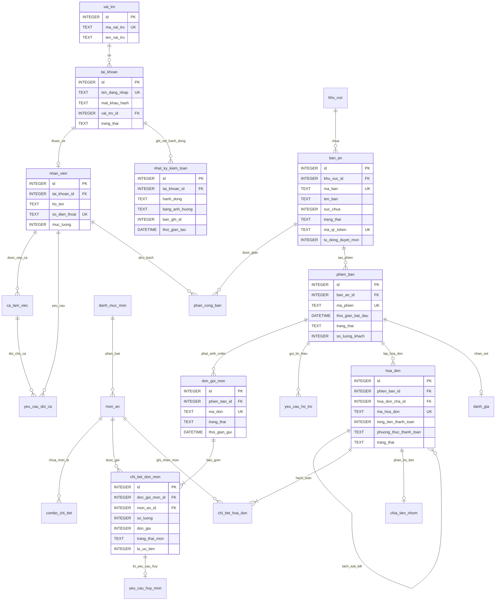

# TÀI LIỆU THIẾT KẾ CƠ SỞ DỮ LIỆU TOÀN DIỆN
## DỰ ÁN: HỆ THỐNG QUẢN LÝ NHÀ HÀNG VÀ GỌI MÓN TẠI BÀN QUA MÃ QR (QUÁN MỘC POS & E-MENU)
### HỌC PHẦN: PHÁT TRIỂN ỨNG DỤNG WEB — TRƯỜNG ĐẠI HỌC CMC

---

## MỤC LỤC TÀI LIỆU

1. [TỔNG QUAN VÀ MỤC TIÊU THIẾT KẾ](#1-tổng-quan-và-mục-tiêu-thiết-kế)
2. [BƯỚC 1: XÁC ĐỊNH CÁC THỰC THỂ (ENTITY IDENTIFICATION)](#bước-1-xác-định-các-thực-thể-entity-identification)
   - 2.1. Phân hệ Quản trị, Phân quyền & Nhân sự
   - 2.2. Phân hệ Khu vực & Sơ đồ Bàn ăn
   - 2.3. Phân hệ Thực đơn, Món ăn & Gói Combo
   - 2.4. Phân hệ Phiên bàn, Gọi món & Điều phối Bếp KDS
   - 2.5. Phân hệ Thu ngân POS, Hóa đơn & Tiện ích Tách bill
   - 2.6. Phân hệ Đánh giá Khách hàng & Nhật ký kiểm toán (Audit Logs)
3. [BƯỚC 2: XÁC ĐỊNH CÁC MỐI QUAN HỆ (RELATIONSHIP IDENTIFICATION)](#bước-2-xác-định-các-mối-quan-hệ-relationship-identification)
   - 3.1. Bảng ma trận các mối quan hệ trong hệ thống
   - 3.2. Phân tích các mối quan hệ Một - Nhiều (1 - N)
   - 3.3. Phân tích các mối quan hệ Nhiều - Nhiều (N - N) và giải pháp Bảng liên kết
   - 3.4. Phân tích các mối quan hệ Tự kết hợp / Đệ quy (Self-Referencing)
   - 3.5. Ràng buộc toàn vẹn tham chiếu (ON DELETE / ON UPDATE)
4. [BƯỚC 3: QUÁ TRÌNH CHUẨN HÓA DỮ LIỆU ĐẾN DẠNG CHUẨN 3NF](#bước-3-quá-trình-chuẩn-hóa-dữ-liệu-đến-dạng-chuẩn-3nf)
   - 4.1. Phân tích dạng chưa chuẩn hóa (UNF / 0NF) và các dị thường dữ liệu
   - 4.2. Chuẩn hóa lên Dạng chuẩn 1 (1NF)
   - 4.3. Chuẩn hóa lên Dạng chuẩn 2 (2NF)
   - 4.4. Chuẩn hóa lên Dạng chuẩn 3 (3NF)
   - 4.5. Phân tích kỹ thuật Snapshot giá tiền trong F&B (Denormalization có kiểm soát)
5. [BƯỚC 4: SƠ ĐỒ ERD, DATABASE DIAGRAM VÀ TỪ ĐIỂN DỮ LIỆU (TABLES)](#bước-4-sơ-đồ-erd-database-diagram-và-từ-điển-dữ-liệu-tables)
   - 5.1. Sơ đồ thực thể liên kết (Mermaid ERD)
   - 5.2. Sơ đồ Database Diagram phân nhóm chức năng
   - 5.3. Từ điển dữ liệu chi tiết 22 bảng (Data Dictionary)
   - 5.4. Chiến lược thiết lập Chỉ mục (Index) tối ưu hóa truy vấn
6. [HƯỚNG DẪN TRIỂN KHAI & TỔNG KẾT](#6-hướng-dẫn-triển-khai--tổng-kết)

---

## 1. TỔNG QUAN VÀ MỤC TIÊU THIẾT KẾ

Cơ sở dữ liệu (CSDL) của hệ thống **Quán Mộc POS & E-Menu** được thiết kế nhằm đáp ứng trọn vẹn 5 phân hệ nghiệp vụ cốt lõi theo tài liệu đặc tả chức năng và 23 User Stories:
1. **Khách hàng (Customer Web QR):** Quét mã QR tại bàn, tham gia vào phiên dùng chung bàn (**Shared Table Session**), giỏ hàng thời gian thực, gửi đơn gọi món, chia tiền nhóm và đánh giá chất lượng dịch vụ.
2. **Nhân viên Phục vụ (Waiter Subsystem):** Đăng nhập di động, theo dõi trực quan sơ đồ trạng thái bàn, duyệt đơn món QR, hỗ trợ gọi món hộ khách, chuyển/gộp bàn và gửi yêu cầu hủy món có kiểm soát.
3. **Bộ phận Bếp / Bar (Kitchen Display System - KDS):** Tiếp nhận chế biến thời gian thực qua Socket.io, theo dõi thời gian chờ đổi màu cảnh báo, chuyển trạng thái chế biến linh hoạt (chờ duyệt, đang nấu, hoàn thành, đã phục vụ), nhận cờ ưu tiên khẩn cấp và bật/tắt cờ hết món tức thì.
4. **Nhân viên Thu ngân (Cashier / POS):** Kiểm tra bill bàn, áp dụng chiết khấu %, xuất mã VietQR động chuẩn NAPAS 247, tính tiền thối tiền mặt, in bill K80, giải phóng bàn tự động và hỗ trợ tiện ích Tách bill (Split Bill).
5. **Quản trị viên (Admin Dashboard):** Quản lý hồ sơ nhân viên, phân quyền RBAC, quản lý ca làm việc và duyệt đổi/nghỉ ca, thiết lập thực đơn & gói Combo, cấu hình duyệt món tự động theo bàn, kiểm soát thất thoát doanh thu thông qua phê duyệt hủy món và tra cứu Nhật ký kiểm toán (**Audit Logs**).

### Các quy chuẩn bắt buộc tuân thủ:
- **Hệ quản trị CSDL:** SQLite3 phiên bản mới nhất, kích hoạt `PRAGMA foreign_keys = ON;` để bảo đảm toàn vẹn tham chiếu.
- **Quy chuẩn đặt tên:** 100% tên bảng và tên cột đặt bằng **tiếng Việt không dấu theo chuẩn `snake_case`** (ví dụ: `tai_khoan`, `nhan_vien`, `ca_lam_viec`, `khu_vuc`, `ban_an`, `phien_ban`, `don_goi_mon`, `chi_tiet_don_mon`, `hoa_don`, `nhat_ky_kiem_toan`).
- **Toàn vẹn dữ liệu:** Thiết lập đầy đủ khóa chính (`PRIMARY KEY`), khóa ngoại (`FOREIGN KEY`), các ràng buộc duy nhất (`UNIQUE`), bắt buộc (`NOT NULL`), và kiểm tra miền giá trị hợp lệ (`CHECK`).
- **Tối ưu hóa hiệu năng:** Đánh chỉ mục (`INDEX`) toàn diện cho các khóa ngoại, trường mã định danh và các trường thường xuyên lọc trạng thái hoặc sắp xếp thời gian thực.

---

## BƯỚC 1: XÁC ĐỊNH CÁC THỰC THỂ (ENTITY IDENTIFICATION)

Hệ thống được chuẩn hóa thành **22 thực thể nghiệp vụ**, chia thành 6 nhóm phân hệ chức năng:

```
+-----------------------------------------------------------------------------------+
|                        TỔNG HỢP 22 THỰC THỂ HỆ THỐNG QUÁN MỘC                     |
+-----------------------------------------------------------------------------------+
| 1. Quản trị & Nhân sự: vai_tro, tai_khoan, nhan_vien, ca_lam_viec,               |
|                       yeu_cau_doi_ca, cau_hinh_nha_hang                           |
| 2. Sơ đồ Bàn:         khu_vuc, ban_an, phan_cong_ban                              |
| 3. Thực đơn & Món ăn: danh_muc_mon, mon_an, combo_chi_tiet                        |
| 4. Phiên & Gọi món:   phien_ban, don_goi_mon, chi_tiet_don_mon,                   |
|                       yeu_cau_huy_mon, yeu_cau_ho_tro                            |
| 5. Thu ngân & Bill:   hoa_don, chi_tiet_hoa_don, chia_tien_nhom                   |
| 6. Đánh giá & Giám sát: danh_gia, nhat_ky_kiem_toan                               |
+-----------------------------------------------------------------------------------+
```

### 2.1. Nhóm 1: Quản trị, Phân quyền & Nhân sự

#### Thực thể 1: `vai_tro` (Vai trò người dùng)
- **Ý nghĩa nghiệp vụ:** Định nghĩa các nhóm quyền hạn phân cấp trong hệ thống theo mô hình RBAC (Role-Based Access Control).
- **Thuộc tính khóa chính:** `id` (Mã định danh duy nhất của vai trò).
- **Thuộc tính mô tả:** `ma_vai_tro` (Mã viết tắt chuẩn: `quan_ly`, `thu_ngan`, `bep`, `phuc_vu`), `ten_vai_tro` (Tên hiển thị tiếng Việt), `mo_ta` (Mô tả phạm vi quyền hạn), `ngay_tao` (Thời điểm khởi tạo).

#### Thực thể 2: `tai_khoan` (Tài khoản người dùng nội bộ)
- **Ý nghĩa nghiệp vụ:** Lưu trữ thông tin định danh và xác thực của nhân sự khi đăng nhập vào hệ thống Web hoặc thiết bị di động.
- **Thuộc tính khóa chính:** `id`.
- **Thuộc tính khóa ngoại:** `vai_tro_id` (Tham chiếu đến vai trò phụ trách trong bảng `vai_tro`).
- **Thuộc tính mô tả & bảo mật:** `ten_dang_nhap` (Duy nhất, không trùng lặp), `mat_khau_hash` (Chuỗi băm bảo mật bcrypt/Argon2id), `trang_thai` (`hoat_dong`, `tam_khoa`, `da_xoa`), `lan_dang_nhap_cuoi`, `ngay_tao`, `ngay_cap_nhat`.

#### Thực thể 3: `nhan_vien` (Hồ sơ nhân sự)
- **Ý nghĩa nghiệp vụ:** Lưu thông tin lý lịch cá nhân, thông tin liên lạc và chế độ lao động của nhân viên.
- **Thuộc tính khóa chính:** `id`.
- **Thuộc tính khóa ngoại:** `tai_khoan_id` (Liên kết 1-1 với tài khoản đăng nhập).
- **Thuộc tính mô tả:** `ho_ten`, `so_dien_thoai`, `email`, `cccd`, `hinh_thuc_lam_viec` (`toan_thoi_gian`, `ban_thoi_gian`), `muc_luong` (Lương cơ bản), `ngay_vao_lam`, `trang_thai` (`dang_lam`, `tam_nghi`, `da_nghi`), `ngay_tao`, `ngay_cap_nhat`.

#### Thực thể 4: `ca_lam_viec` (Lịch phân ca làm việc)
- **Ý nghĩa nghiệp vụ:** Quản lý lịch phân ca hàng ngày cho nhân viên phục vụ, thu ngân, bếp.
- **Thuộc tính khóa chính:** `id`.
- **Thuộc tính khóa ngoại:** `nhan_vien_id` (Nhân viên được xếp ca).
- **Thuộc tính mô tả:** `ngay_lam` (Ngày làm việc), `ten_ca` (`ca_sang`, `ca_chieu`, `ca_toi`, `ca_gay`), `gio_bat_dau`, `gio_ket_thuc`, `trang_thai` (`ke_hoach`, `da_checkin`, `da_hoan_thanh`, `vang_mat`, `da_huy`), `ghi_chu`, `ngay_tao`.

#### Thực thể 5: `yeu_cau_doi_ca` (Đơn xin nghỉ ca / Đổi ca)
- **Ý nghĩa nghiệp vụ:** Số hóa quy trình xin nghỉ việc đột xuất hoặc đổi ca giữa 2 nhân viên có sự phê duyệt của Quản lý.
- **Thuộc tính khóa chính:** `id`.
- **Thuộc tính khóa ngoại:** `nhan_vien_yeu_cau_id`, `ca_lam_viec_id`, `nhan_vien_nhan_ca_id` (Người nhận ca thay thế nếu là đổi ca), `quan_ly_duyet_id` (Quản lý ra quyết định duyệt).
- **Thuộc tính mô tả:** `loai_yeu_cau` (`nghi_ca`, `doi_ca`), `ly_do`, `trang_thai` (`cho_duyet`, `da_duyet`, `tu_choi`), `ghi_chu_duyet`, `ngay_tao`, `ngay_duyet`.

#### Thực thể 6: `cau_hinh_nha_hang` (Thông tin nhà hàng & Cổng thanh toán)
- **Ý nghĩa nghiệp vụ:** Lưu thông tin thương hiệu hiển thị trên Menu QR, hóa đơn in K80 và thông tin tài khoản thụ hưởng mã VietQR NAPAS 247.
- **Thuộc tính khóa chính:** `id`.
- **Thuộc tính mô tả:** `ten_nha_hang`, `dia_chi`, `so_dien_thoai`, `email`, `anh_logo`, `phan_tram_vat`, `ngan_hang_vietqr`, `so_tai_khoan_vietqr`, `ten_chu_tai_khoan_vietqr`, `ngay_cap_nhat`.

---

### 2.2. Nhóm 2: Sơ đồ Khu vực & Bàn ăn

#### Thực thể 7: `khu_vuc` (Khu vực / Tầng phục vụ)
- **Ý nghĩa nghiệp vụ:** Phân tách không gian phục vụ trong nhà hàng (Phòng lạnh tầng 1, Không gian gia đình tầng 2, Sân vườn ngoài trời).
- **Thuộc tính khóa chính:** `id`.
- **Thuộc tính mô tả:** `ma_khu_vuc`, `ten_khu_vuc`, `mo_ta`, `thu_tu_hien_thi`, `kich_hoat`, `ngay_tao`.

#### Thực thể 8: `ban_an` (Bàn ăn & Mã nhận diện QR)
- **Ý nghĩa nghiệp vụ:** Đại diện cho vị trí ngồi của khách, liên kết trực tiếp với mã QR định danh vật lý dán tại bàn.
- **Thuộc tính khóa chính:** `id`.
- **Thuộc tính khóa ngoại:** `khu_vuc_id` (Thuộc về khu vực nào).
- **Thuộc tính mô tả:** `ma_ban` (Mã bàn: B101, B102, VIP201), `ten_ban`, `suc_chua` (Số ghế ngồi tối đa), `trang_thai` (`trong`, `co_khach`, `cho_mon`, `yeu_cau_thanh_toan`, `can_don_dep`), `ma_qr_token` (Chuỗi mã hóa bảo mật dùng để sinh URL và QR code), `tu_dong_duyet_mon` (Cờ cấu hình: 1 = Gửi thẳng Bếp KDS; 0 = Chờ nhân viên duyệt), `kich_hoat`, `ngay_tao`, `ngay_cap_nhat`.

#### Thực thể 9: `phan_cong_ban` (Phân công phục vụ bàn)
- **Ý nghĩa nghiệp vụ:** Thiết lập khu vực và danh sách bàn mà nhân viên phục vụ phụ trách chính trong từng ca trực (US-A02, US-W01).
- **Thuộc tính khóa chính:** `id`.
- **Thuộc tính khóa ngoại:** `nhan_vien_id`, `ban_an_id`.
- **Thuộc tính mô tả:** `ngay_phan_cong`, `ten_ca`, `ngay_tao`.

---

### 2.3. Nhóm 3: Thực đơn, Món ăn & Gói Combo

#### Thực thể 10: `danh_muc_mon` (Danh mục thực đơn)
- **Ý nghĩa nghiệp vụ:** Nhóm các món ăn theo thể loại phục vụ (Khai vị, Món nướng, Món lẩu, Món xào, Đồ uống, Gói combo).
- **Thuộc tính khóa chính:** `id`.
- **Thuộc tính mô tả:** `ma_danh_muc`, `ten_danh_muc`, `thu_tu_hien_thi`, `kich_hoat`, `ngay_tao`.

#### Thực thể 11: `mon_an` (Món ăn / Đồ uống)
- **Ý nghĩa nghiệp vụ:** Thông tin chi tiết về từng món trong thực đơn của nhà hàng, bao gồm cả món đơn lẻ và gói combo.
- **Thuộc tính khóa chính:** `id`.
- **Thuộc tính khóa ngoại:** `danh_muc_id`.
- **Thuộc tính mô tả:** `ma_mon`, `ten_mon`, `don_gia`, `don_vi_tinh` (đĩa, nồi, ly, lon, set), `anh_mon_an`, `mo_ta`, `con_mon` (Cờ trạng thái còn món/hết món để Bếp thao tác nhanh), `la_combo` (Cờ xác định là gói combo), `la_ban_chay` (Nhãn Best Seller), `la_goi_y` (Nhãn Chef Recommend), `kich_hoat`, `ngay_tao`, `ngay_cap_nhat`.

#### Thực thể 12: `combo_chi_tiet` (Thành phần gói Combo)
- **Ý nghĩa nghiệp vụ:** Định nghĩa cơ cấu các món ăn đơn lẻ cấu thành một gói combo tiết kiệm (US-A11).
- **Thuộc tính khóa chính:** `id`.
- **Thuộc tính khóa ngoại:** `combo_id` (Tham chiếu đến `mon_an` có `la_combo = 1`), `mon_an_le_id` (Tham chiếu đến món ăn đơn lẻ thành phần).
- **Thuộc tính mô tả:** `so_luong` (Số lượng định mức của món lẻ trong gói).

---

### 2.4. Nhóm 4: Phiên bàn, Gọi món & Điều phối Bếp KDS

#### Thực thể 13: `phien_ban` (Phiên phục vụ bàn - Shared Table Session)
- **Ý nghĩa nghiệp vụ:** Là thực thể trung tâm quản lý toàn bộ vòng đời phục vụ một lượt khách ngồi tại bàn. Mọi khách cùng ngồi tại một bàn sẽ kết nối chung vào một `phien_ban_id` (qua room Socket.io), chia sẻ chung danh sách món và giỏ hàng.
- **Thuộc tính khóa chính:** `id`.
- **Thuộc tính khóa ngoại:** `ban_an_id`.
- **Thuộc tính mô tả:** `ma_phien` (Mã phiên duy nhất: PB-YYYYMMDD-XXX), `thoi_gian_bat_dau`, `thoi_gian_ket_thuc`, `trang_thai` (`dang_hoat_dong`, `da_thanh_toan`, `da_dong`), `so_luong_khach`, `ghi_chu`, `ngay_tao`.

#### Thực thể 14: `don_goi_mon` (Đợt gọi món)
- **Ý nghĩa nghiệp vụ:** Đại diện cho mỗi lần thực khách hoặc nhân viên bấm nút "Gửi order" từ giỏ hàng. Một phiên bàn có thể có nhiều đợt gọi món (gọi ban đầu, gọi thêm đồ uống, gọi thêm món nướng).
- **Thuộc tính khóa chính:** `id`.
- **Thuộc tính khóa ngoại:** `phien_ban_id`, `nhan_vien_tao_id` (Nếu nhân viên đặt hộ), `nhan_vien_duyet_id` (Nhân viên phục vụ bấm duyệt đơn).
- **Thuộc tính mô tả:** `ma_don`, `nguon_tao` (`khach_qr`, `phuc_vu_dat_ho`), `trang_thai` (`cho_duyet`, `da_duyet`, `tu_choi`, `hoan_tat`, `da_huy`), `ly_do_tu_choi`, `thoi_gian_gui`, `thoi_gian_duyet`, `ngay_tao`.

#### Thực thể 15: `chi_tiet_don_mon` (Dòng món ăn chế biến KDS)
- **Ý nghĩa nghiệp vụ:** Quản lý chi tiết từng món ăn được gọi và trạng thái điều phối chế biến trực tiếp trên màn hình KDS Bếp/Bar.
- **Thuộc tính khóa chính:** `id`.
- **Thuộc tính khóa ngoại:** `don_goi_mon_id`, `mon_an_id`, `dau_bep_id` (Đầu bếp phụ trách chế biến).
- **Thuộc tính mô tả:** `so_luong`, `don_gia` (Đơn giá tại thời điểm gọi), `ghi_chu` (Ghi chú khẩu vị: ít cay, không đá), `trang_thai_mon` (`cho_duyet`, `dang_nau`, `hoan_thanh`, `da_phuc_vu`, `yeu_cau_huy`, `huy_mon`, `da_huy`), `la_uu_tien` (Cờ ưu tiên khẩn cấp đẩy lên đầu hàng đợi KDS), `thoi_gian_bat_dau_nau`, `thoi_gian_hoan_thanh_nau`, `ngay_tao`, `ngay_cap_nhat`.

#### Thực thể 16: `yeu_cau_huy_mon` (Đơn kiểm soát hủy món)
- **Ý nghĩa nghiệp vụ:** Kiểm soát chặt chẽ quy trình hủy món khi món đang chế biến hoặc đã nấu xong (US-W07, US-A16), ngăn ngừa triệt để nhân viên thông đồng gian lận tiền quán.
- **Thuộc tính khóa chính:** `id`.
- **Thuộc tính khóa ngoại:** `chi_tiet_don_mon_id`, `nhan_vien_yeu_cau_id`, `admin_duyet_id` (Quản lý phê duyệt).
- **Thuộc tính mô tả:** `ly_do_huy`, `trang_thai_yeu_cau` (`cho_admin_duyet`, `da_chap_thuan`, `tu_choi`), `phan_hoi_admin`, `thoi_gian_yeu_cau`, `thoi_gian_duyet`.

#### Thực thể 17: `yeu_cau_ho_tro` (Yêu cầu phục vụ tại bàn)
- **Ý nghĩa nghiệp vụ:** Lưu các tín hiệu tương tác nhanh từ điện thoại khách hàng gửi về ứng dụng di động của phục vụ (US-C06).
- **Thuộc tính khóa chính:** `id`.
- **Thuộc tính khóa ngoại:** `phien_ban_id`, `nhan_vien_tiep_nhan_id`.
- **Thuộc tính mô tả:** `loai_yeu_cau` (`goi_phuc_vu`, `yeu_cau_thanh_toan`, `nuoc_cham`, `khac`), `noi_dung`, `trang_thai` (`cho_tiep_nhan`, `dang_xu_ly`, `da_xong`), `thoi_gian_gui`, `thoi_gian_hoan_thanh`.

---

### 2.5. Nhóm 5: Thu ngân POS, Hóa đơn & Tiện ích Tách bill

#### Thực thể 18: `hoa_don` (Hóa đơn thanh toán)
- **Ý nghĩa nghiệp vụ:** Chứng từ thanh toán chính thức của phiên bàn. Thiết kế hỗ trợ cấu trúc cây phân cấp (cha/con) thông qua `hoa_don_cha_id` để thực hiện tính năng **Tách bill (Split Bill)** khi khách về trước muốn thanh toán riêng phần của mình.
- **Thuộc tính khóa chính:** `id`.
- **Thuộc tính khóa ngoại:** `phien_ban_id`, `hoa_don_cha_id` (Tự tham chiếu, dùng khi là hóa đơn con tách ra), `thu_ngan_id`.
- **Thuộc tính mô tả:** `ma_hoa_don`, `tong_tien_mon`, `phan_tram_chiet_khau`, `tien_chiet_khau`, `phan_tram_vat`, `tien_vat`, `tong_tien_thanh_toan`, `phuong_thuc_thanh_toan` (`tien_mat`, `vietqr`, `ket_hop`), `tien_khach_dua`, `tien_thoi_lai`, `ma_giao_dich_vietqr`, `trang_thai` (`chua_thanh_toan`, `da_thanh_toan`, `da_huy`), `thoi_gian_thanh_toan`, `ghi_chu`, `ngay_tao`.

#### Thực thể 19: `chi_tiet_hoa_don` (Dòng hạch toán hóa đơn)
- **Ý nghĩa nghiệp vụ:** Lưu lại danh sách thực tế các món ăn được chốt tính tiền trong hóa đơn tương ứng (phục vụ in phiếu K80 và hạch toán sau khi tách bill).
- **Thuộc tính khóa chính:** `id`.
- **Thuộc tính khóa ngoại:** `hoa_don_id`, `chi_tiet_don_mon_id`, `mon_an_id`.
- **Thuộc tính mô tả:** `ten_mon`, `don_gia`, `so_luong`, `thanh_tien`.

#### Thực thể 20: `chia_tien_nhom` (Công cụ chia đều tiền nhóm)
- **Ý nghĩa nghiệp vụ:** Phục vụ chức năng chia đều tổng bill cho số lượng khách ngồi cùng bàn, tính toán chính xác số tiền/người và phát sinh mã VietQR con tương ứng (US-C09, US-CS07).
- **Thuộc tính khóa chính:** `id`.
- **Thuộc tính khóa ngoại:** `hoa_don_id`.
- **Thuộc tính mô tả:** `so_nguoi_chia`, `so_tien_moi_nguoi`, `ma_tham_chieu_qr`, `trang_thai` (`dang_thu`, `hoan_tat`), `ngay_tao`.

---

### 2.6. Nhóm 6: Đánh giá Thực khách & Nhật ký Kiểm toán (Audit Logs)

#### Thực thể 21: `danh_gia` (Phản hồi chất lượng dịch vụ)
- **Ý nghĩa nghiệp vụ:** Tiếp nhận số sao chấm điểm và nhận xét của khách hàng từ giao diện QR sau bữa ăn để quản lý theo dõi và nâng cao chất lượng phục vụ (US-C08, US-A14).
- **Thuộc tính khóa chính:** `id`.
- **Thuộc tính khóa ngoại:** `phien_ban_id`.
- **Thuộc tính mô tả:** `so_sao` (Từ 1 đến 5), `nhan_xet`, `ten_khach_hang`, `so_dien_thoai`, `ngay_tao`.

#### Thực thể 22: `nhat_ky_kiem_toan` (Audit Logs)
- **Ý nghĩa nghiệp vụ:** Ghi vết tự động (System Audit Trail) toàn bộ các hành vi trọng yếu và có nguy cơ thất thoát: đăng nhập thất bại, hủy món, sửa đơn giá, chiết khấu cao, tách/gộp bàn, đổi ca (US-A16).
- **Thuộc tính khóa chính:** `id`.
- **Thuộc tính khóa ngoại:** `tai_khoan_id` (Người thực hiện hành động).
- **Thuộc tính mô tả:** `hanh_dong`, `bang_anh_huong`, `ban_ghi_id`, `du_lieu_cu` (Dạng JSON chuỗi), `du_lieu_moi` (Dạng JSON chuỗi), `dia_chi_ip`, `thiet_bi`, `ly_do`, `thoi_gian_tao`.

---

## BƯỚC 2: XÁC ĐỊNH CÁC MỐI QUAN HỆ (RELATIONSHIP IDENTIFICATION)

### 3.1. Bảng ma trận các mối quan hệ trong hệ thống

| STT | Thực thể nguồn | Thực thể đích | Bản số (Cardinality) | Khóa ngoại | Ý nghĩa nghiệp vụ |
| :---: | :--- | :--- | :---: | :--- | :--- |
| 1 | `vai_tro` | `tai_khoan` | **1 — N** | `tai_khoan.vai_tro_id` | Một vai trò được cấp cho nhiều tài khoản người dùng |
| 2 | `tai_khoan` | `nhan_vien` | **1 — 1 (0..1)** | `nhan_vien.tai_khoan_id` | Mỗi nhân viên gắn với tối đa 1 tài khoản đăng nhập |
| 3 | `nhan_vien` | `ca_lam_viec` | **1 — N** | `ca_lam_viec.nhan_vien_id` | Một nhân viên có nhiều ca trực theo lịch tuần/tháng |
| 4 | `nhan_vien` | `yeu_cau_doi_ca` | **1 — N** | `yeu_cau_doi_ca.nhan_vien_yeu_cau_id` | Nhân viên gửi đơn xin đổi ca hoặc nghỉ ca |
| 5 | `khu_vuc` | `ban_an` | **1 — N** | `ban_an.khu_vuc_id` | Một khu vực chứa nhiều bàn ăn |
| 6 | `nhan_vien` | `phan_cong_ban` | **1 — N** | `phan_cong_ban.nhan_vien_id` | Phân công nhân viên phụ trách các bàn trong ca |
| 7 | `ban_an` | `phan_cong_ban` | **1 — N** | `phan_cong_ban.ban_an_id` | Bàn ăn được phụ trách bởi nhân viên phục vụ |
| 8 | `danh_muc_mon` | `mon_an` | **1 — N** | `mon_an.danh_muc_id` | Mỗi danh mục phân loại nhiều món ăn |
| 9 | `mon_an` | `combo_chi_tiet` | **1 — N** | `combo_chi_tiet.combo_id` | Gói combo được cấu thành từ nhiều món ăn lẻ |
| 10 | `ban_an` | `phien_ban` | **1 — N** | `phien_ban.ban_an_id` | Bàn ăn trải qua nhiều phiên phục vụ khác nhau qua thời gian |
| 11 | `phien_ban` | `don_goi_mon` | **1 — N** | `don_goi_mon.phien_ban_id` | Một phiên bàn có thể gọi nhiều đợt món (gọi thêm) |
| 12 | `don_goi_mon` | `chi_tiet_don_mon`| **1 — N** | `chi_tiet_don_mon.don_goi_mon_id` | Mỗi đợt gọi gồm nhiều món ăn với số lượng cụ thể |
| 13 | `mon_an` | `chi_tiet_don_mon`| **1 — N** | `chi_tiet_don_mon.mon_an_id` | Món ăn xuất hiện trong nhiều chi tiết đơn |
| 14 | `chi_tiet_don_mon`| `yeu_cau_huy_mon`| **1 — 1 (0..1)** | `yeu_cau_huy_mon.chi_tiet_don_mon_id` | Một món đang nấu chỉ có tối đa 1 yêu cầu hủy đang xử lý |
| 15 | `phien_ban` | `yeu_cau_ho_tro` | **1 — N** | `yeu_cau_ho_tro.phien_ban_id` | Thực khách tại bàn gửi nhiều yêu cầu phục vụ |
| 16 | `phien_ban` | `hoa_don` | **1 — N** | `hoa_don.phien_ban_id` | Một phiên bàn có ít nhất 1 hóa đơn chính (và các hóa đơn con nếu tách) |
| 17 | `hoa_don` | `hoa_don` (Con) | **1 — N** | `hoa_don.hoa_don_cha_id` | Hóa đơn cha phân rã thành các hóa đơn tách lẻ con (Split bill) |
| 18 | `hoa_don` | `chi_tiet_hoa_don`| **1 — N** | `chi_tiet_hoa_don.hoa_don_id` | Hóa đơn gồm danh sách chi tiết các món thanh toán |
| 19 | `hoa_don` | `chia_tien_nhom` | **1 — 1 (0..1)** | `chia_tien_nhom.hoa_don_id` | Hóa đơn có thể gắn kèm 1 bảng phân bổ chia đều tiền nhóm |
| 20 | `phien_ban` | `danh_gia` | **1 — 1 (0..1)** | `danh_gia.phien_ban_id` | Mỗi phiên bàn kết thúc thực khách gửi 1 đánh giá |
| 21 | `tai_khoan` | `nhat_ky_kiem_toan`| **1 — N** | `nhat_ky_kiem_toan.tai_khoan_id`| Tài khoản thực hiện nhiều thao tác được ghi vết audit log |

---

### 3.2. Phân tích các mối quan hệ Một - Nhiều (1 - N)
- **`khu_vuc` — `ban_an`:** Một khu vực địa lý trong quán (ví dụ: Tầng 1) chứa nhiều bàn ăn cụ thể (`B101`, `B102`,...). Mỗi bàn ăn luôn thuộc về duy nhất một khu vực cố định. Khóa ngoại `khu_vuc_id` được đặt tại bảng `ban_an`.
- **`ban_an` — `phien_ban`:** Một bàn ăn theo thời gian sẽ tiếp đón nhiều lượt khách khác nhau (mỗi lượt là một `phien_ban`). Tuy nhiên, tại một thời điểm nhất định, bàn chỉ có tối đa 1 phiên bàn ở trạng thái `dang_hoat_dong`.
- **`phien_ban` — `don_goi_mon`:** Đây là thiết kế then chốt đáp ứng cơ chế **Shared Table Session**. Cả nhóm khách ngồi cùng bàn đều kết nối chung vào 1 phiên bàn. Bất kỳ thành viên nào gửi món sẽ sinh ra một `don_goi_mon` mới trỏ về `phien_ban_id` này.
- **`don_goi_mon` — `chi_tiet_don_mon`:** Một đợt gọi món chứa nhiều dòng món ăn khác nhau (Khai vị, Món nướng, Đồ uống) kèm số lượng và ghi chú riêng.

---

### 3.3. Phân tích các mối quan hệ Nhiều - Nhiều (N - N) và giải pháp Bảng liên kết
Trong mô hình thực tế, có 3 mối quan hệ Nhiều - Nhiều cốt lõi và đã được phân rã thành các bảng trung gian chuẩn 3NF:
1. **Quan hệ giữa `don_goi_mon` và `mon_an`:**
   - *Vấn đề:* Một đợt gọi món có thể gọi nhiều món ăn khác nhau; một món ăn có thể xuất hiện trong nhiều đợt gọi của nhiều bàn.
   - *Giải pháp:* Tách thành bảng trung gian `chi_tiet_don_mon`. Bảng này lưu thêm các thuộc tính phong phú: `so_luong`, `don_gia`, `ghi_chu`, `trang_thai_mon` (phục vụ KDS bếp), `la_uu_tien`, `thoi_gian_bat_dau_nau`, `thoi_gian_hoan_thanh_nau`.
2. **Quan hệ giữa `nhan_vien` và `ban_an`:**
   - *Vấn đề:* Một nhân viên phục vụ trong ca trực có thể được giao trông coi nhiều bàn (ví dụ: phụ trách bàn 101, 102, 103); một bàn ăn trong các ca khác nhau lại do các nhân viên khác nhau đảm nhiệm.
   - *Giải pháp:* Tách thành bảng liên kết `phan_cong_ban` với các khóa ngoại `nhan_vien_id`, `ban_an_id`, kết hợp cùng trường ngày `ngay_phan_cong` và ca `ten_ca`.
3. **Quan hệ giữa `mon_an` (Combo) và `mon_an` (Món lẻ):**
   - *Vấn đề:* Một gói combo gồm nhiều món ăn lẻ; một món ăn lẻ có thể nằm trong nhiều gói combo khác nhau (ví dụ: Nem rán vừa bán lẻ, vừa có trong Combo Mộc và Combo Lẩu).
   - *Giải pháp:* Sử dụng bảng liên kết `combo_chi_tiet` với cặp khóa ngoại `combo_id` và `mon_an_le_id` cùng số lượng thành phần `so_luong`.

---

### 3.4. Phân tích các mối quan hệ Tự kết hợp / Đệ quy (Self-Referencing)
Hệ thống sử dụng hai mối quan hệ tự kết hợp mẫu mực để xử lý nghiệp vụ phức tạp:
1. **Hóa đơn cha — Hóa đơn con (`hoa_don` trỏ tới `hoa_don`):**
   - Phục vụ nghiệp vụ **Tách bill (Split Bill)** (US-CS07): Khi một nhóm khách ăn chung bàn nhưng có một vài thành viên cần thanh toán trước để về sớm.
   - Hóa đơn gốc toàn bàn là hóa đơn cha (`hoa_don_cha_id = NULL`). Khi tách món, thu ngân chọn các món cần thanh toán trước để sinh ra một hóa đơn mới có `hoa_don_cha_id` trỏ về `id` của hóa đơn gốc. Hóa đơn con này có thể thanh toán độc lập và in riêng bill K80.
2. **Đổi ca trực (`nhan_vien` liên kết kép trong `yeu_cau_doi_ca`):**
   - Một bản ghi đổi ca liên kết cùng lúc với 3 nhân viên: `nhan_vien_yeu_cau_id` (người xin đổi ca), `nhan_vien_nhan_ca_id` (đồng nghiệp trực thay thế) và `quan_ly_duyet_id` (quản lý phê duyệt).

---

### 3.5. Ràng buộc toàn vẹn tham chiếu (Referential Integrity Constraints)

Để đảm bảo tính nhất quán tuyệt đối của dữ liệu giao dịch tài chính nhà hàng, các hành vi `ON DELETE` và `ON UPDATE` được quy định chặt chẽ:
- **`ON UPDATE CASCADE`:** Áp dụng trên toàn bộ 100% các khóa ngoại trong CSDL, đảm bảo khi cập nhật mã định danh thì các bảng liên quan tự động đồng bộ.
- **`ON DELETE RESTRICT`:** Áp dụng cho các quan hệ cha - con trọng yếu:
  - Không cho phép xóa `khu_vuc` khi đang có `ban_an` tồn tại.
  - Không cho phép xóa `danh_muc_mon` khi đang có `mon_an` thuộc danh mục đó.
  - Không cho phép xóa `ban_an` khi đang gắn với lịch sử các `phien_ban`.
  - Không cho phép xóa `mon_an` khi món ăn đó đã xuất hiện trong các hóa đơn `chi_tiet_hoa_don` (để bảo vệ dữ liệu kế toán đối soát).
- **`ON DELETE CASCADE`:** Áp dụng cho các bảng chi tiết phụ thuộc sống còn vào bản ghi cha:
  - Xóa `don_goi_mon` sẽ tự động xóa các dòng `chi_tiet_don_mon` phụ thuộc.
  - Xóa `hoa_don` sẽ tự động dọn sạch các dòng `chi_tiet_hoa_don` và bản ghi `chia_tien_nhom`.
- **`ON DELETE SET NULL`:** Áp dụng cho các khóa ngoại mang tính chất theo dõi người thực hiện (Audit/Tracking):
  - Khi xóa tài khoản nhân viên, các trường `nhan_vien_tao_id`, `nhan_vien_duyet_id`, `dau_bep_id`, `thu_ngan_id` sẽ được gán thành `NULL` thay vì xóa mất dữ liệu lịch sử đơn hàng và hóa đơn của nhà hàng.

---

## BƯỚC 3: QUÁ TRÌNH CHUẨN HÓA DỮ LIỆU ĐẾN DẠNG CHUẨN 3NF

### 4.1. Phân tích dạng chưa chuẩn hóa (UNF / 0NF) và các dị thường dữ liệu

Nếu gom toàn bộ dữ liệu nghiệp vụ vào một cấu trúc bảng phẳng ban đầu:
`DON_HANG_TONG_HOP (ma_ban, ten_ban, khu_vuc, ten_khach, danh_sach_mon, don_gia_cac_mon, so_luong_mon, thoi_gian_goi, ten_phuc_vu, ten_dau_bep, ten_thu_ngan, tong_tien, phan_tram_giam, hinh_thuc_thanh_toan, ma_giao_dich_qr, so_sao_danh_gia)`

**Các vấn đề dị thường (Anomalies) nghiêm trọng phát sinh trong UNF:**
1. **Dị thường lặp dữ liệu (Redundancy):** Mỗi lần khách gọi thêm 1 lon nước ngọt, toàn bộ thông tin về tên bàn, khu vực, tên nhân viên phục vụ, nhân viên thu ngân đều phải lưu lặp lại.
2. **Dị thường thêm mới (Insertion Anomaly):** Không thể thêm một món ăn mới vào thực đơn nếu chưa có khách hàng nào đặt bàn gọi món ăn đó. Không thể thêm một nhân viên mới nếu nhân viên chưa được giao bàn hoặc chưa xử lý hóa đơn nào.
3. **Dị thường xóa (Deletion Anomaly):** Nếu xóa một hóa đơn của bàn đã phục vụ xong, vô tình toàn bộ dữ liệu phản hồi đánh giá sao của khách hoặc thông tin định giá món ăn trong đơn đó cũng bị xóa theo.
4. **Dị thường cập nhật (Update Anomaly):** Khi nhà hàng đổi giá một món ăn hoặc điều chuyển bàn sang khu vực khác, nhân viên phải đi tìm và sửa đổi ở hàng nghìn dòng bản ghi cũ, rất dễ dẫn đến hiện tượng dữ liệu không nhất quán.

---

### 4.2. Chuẩn hóa lên Dạng chuẩn 1 (First Normal Form - 1NF)

#### Định nghĩa 1NF:
Một quan hệ đạt chuẩn 1NF khi và chỉ khi:
1. Mọi thuộc tính đều mang **giá trị nguyên tố** (Atomic Values) — không chứa danh sách, mảng hay tập hợp lặp lại.
2. Mỗi bản ghi được xác định duy nhất bởi một **Khóa chính (Primary Key)**.
3. Không có hai cột nào lưu trữ dữ liệu trùng lặp về ngữ nghĩa.

#### Quá trình chuyển đổi lên 1NF:
- **Loại bỏ thuộc tính đa trị `danh_sach_mon`:** Trong bảng gốc, một hóa đơn có thể có danh sách gồm nhiều món `{Nem rán: 1, Bò nướng: 1, Trà đào: 2}`. Ta phân rã thành thực thể `don_goi_mon` và `chi_tiet_don_mon`. Mỗi dòng trong `chi_tiet_don_mon` chỉ lưu đúng 1 món duy nhất với 1 số lượng nguyên tố.
- **Tách thông tin người dùng và nhân sự:** Tách họ tên, số điện thoại, vai trò ra khỏi dòng giao dịch đơn hàng.
- **Xác lập khóa chính:** Bổ sung khóa chính duy nhất cho từng bảng (`id`).

*Kết quả sau 1NF:* Toàn bộ các thuộc tính của các bảng `ban_an`, `mon_an`, `phien_ban`, `don_goi_mon`, `chi_tiet_don_mon`, `hoa_don` đều là đơn trị, không còn nhóm lặp.

---

### 4.3. Chuẩn hóa lên Dạng chuẩn 2 (Second Normal Form - 2NF)

#### Định nghĩa 2NF:
Một quan hệ đạt chuẩn 2NF khi và chỉ khi:
1. Quan hệ đã **đạt chuẩn 1NF**.
2. Mọi thuộc tính không khóa đều **phụ thuộc hàm đầy đủ (Fully Functionally Dependent)** vào toàn bộ khóa chính, không có thuộc tính nào phụ thuộc một phần (Partial Dependency) vào một thành phần con của khóa chính phức hợp.

#### Quá trình chuyển đổi lên 2NF:
Xem xét bảng chi tiết đơn hàng nếu dùng khóa chính phức hợp `(don_goi_mon_id, mon_an_id)`:
- Ta có phụ thuộc hàm: `(don_goi_mon_id, mon_an_id) -> so_luong, ghi_chu`.
- Tuy nhiên: `mon_an_id -> ten_mon, don_vi_tinh, mo_ta_mon, danh_muc_id`.
- Rõ ràng `ten_mon`, `don_vi_tinh` chỉ phụ thuộc vào một phần của khóa là `mon_an_id`, chứ không phụ thuộc vào `don_goi_mon_id`. Nếu giữ nguyên, khi một món ăn được gọi 1000 lần, tên món ăn sẽ bị lặp lại 1000 lần.

**Biện pháp giải quyết:**
- Tách riêng toàn bộ thông tin mô tả món ăn sang bảng độc lập `mon_an (id, danh_muc_id, ma_mon, ten_mon, don_gia, don_vi_tinh, ...)`.
- Trong bảng trung gian `chi_tiet_don_mon`, chỉ lưu khóa chính đơn lẻ `id`, khóa ngoại `don_goi_mon_id`, `mon_an_id` và các thuộc tính phụ thuộc đầy đủ vào ngữ cảnh đợt gọi đó: `so_luong`, `don_gia`, `ghi_chu`, `trang_thai_mon`.
- Tương tự với bảng gói combo: `combo_chi_tiet` chỉ lưu `combo_id`, `mon_an_le_id`, `so_luong`.

*Kết quả sau 2NF:* Loại bỏ 100% hiện tượng phụ thuộc hàm một phần.

---

### 4.4. Chuẩn hóa lên Dạng chuẩn 3 (Third Normal Form - 3NF)

#### Định nghĩa 3NF:
Một quan hệ đạt chuẩn 3NF khi và chỉ khi:
1. Quan hệ đã **đạt chuẩn 2NF**.
2. Không tồn tại **phụ thuộc bắc cầu (Transitive Dependency)** giữa các thuộc tính không khóa. Nghĩa là: nếu $X$ là khóa chính, không được tồn tại thuộc tính không khóa $Y$ và $Z$ sao cho $X \to Y$ và $Y \to Z$.

#### Quá trình phát hiện và triệt tiêu phụ thuộc bắc cầu:

1. **Trường hợp Bàn ăn và Khu vực:**
   - Trong bảng `phien_ban`: Có `phien_ban_id -> ban_an_id` và `ban_an_id -> ma_khu_vuc, ten_khu_vuc`.
   - Đây là phụ thuộc bắc cầu `phien_ban_id -> ban_an_id -> ten_khu_vuc`.
   - *Khắc phục:* `phien_ban` chỉ lưu `ban_an_id`. Thông tin khu vực chuyển hẳn sang bảng `khu_vuc (id, ma_khu_vuc, ten_khu_vuc)` và bảng `ban_an` lưu khóa ngoại `khu_vuc_id`.
2. **Trường hợp Tài khoản và Quyền hạn vai trò:**
   - Trong hồ sơ nhân viên: `nhan_vien_id -> tai_khoan_id` và `tai_khoan_id -> ma_vai_tro, ten_vai_tro, mo_ta_vai_tro`.
   - Phụ thuộc bắc cầu: `nhan_vien_id -> tai_khoan_id -> ten_vai_tro`.
   - *Khắc phục:* Tách thành bảng danh mục `vai_tro (id, ma_vai_tro, ten_vai_tro)`. `tai_khoan` trỏ khóa ngoại `vai_tro_id`. Bảng `nhan_vien` chỉ trỏ khóa ngoại `tai_khoan_id`.
3. **Trường hợp Thực đơn và Danh mục món:**
   - Trong món ăn: `mon_an_id -> danh_muc_id -> ten_danh_muc`.
   - *Khắc phục:* Tách bảng `danh_muc_mon (id, ma_danh_muc, ten_danh_muc)`. Trong bảng `mon_an` chỉ lưu `danh_muc_id`.

---

### 4.5. Phân tích kỹ thuật Snapshot giá tiền trong F&B (Denormalization có kiểm soát)

Trong thiết kế bảng `chi_tiet_don_mon` và `chi_tiet_hoa_don`, có hai trường thoạt nhìn giống như dư thừa dữ liệu:
- `chi_tiet_don_mon.don_gia` và `chi_tiet_hoa_don.don_gia`
- `chi_tiet_hoa_don.ten_mon`

**Chứng minh tính đúng đắn khoa học:**
1. **Bảo toàn bất biến dữ liệu tài chính lịch sử (Financial Immutability):**
   - Giá của món ăn trong bảng `mon_an.don_gia` là **giá hiện tại của thực đơn** và có thể biến động theo thời gian (ví dụ: ngày 01/01 món Nem rán giá 60.000đ, sang ngày 15/01 nhà hàng cập nhật giá lên 65.000đ).
   - Nếu trong `chi_tiet_hoa_don` ta không lưu `don_gia` mà dùng phép kết nối `JOIN mon_an` để lấy giá, thì toàn bộ các hóa đơn đã xuất trong quá khứ sẽ bị tính lại theo giá mới (65.000đ), làm sai lệch toàn bộ báo cáo doanh thu và sổ sách kế toán thuế!
2. **Nguyên lý thiết kế chuẩn:**
   - `chi_tiet_hoa_don.don_gia` và `chi_tiet_hoa_don.ten_mon` ở đây không phải là phụ thuộc bắc cầu vào `mon_an_id`, mà là **thuộc tính lịch sử giao dịch tại thời điểm ký kết hóa đơn (Transaction Snapshot Attribute)**.
   - Do đó, việc lưu trữ snapshot giá và tên món tại bảng chi tiết hóa đơn hoàn toàn tuân thủ bản chất của 3NF và là chuẩn mực vàng trong hệ thống ERP và F&B POS chuyên nghiệp.

---

## BƯỚC 4: SƠ ĐỒ ERD, DATABASE DIAGRAM VÀ TỪ ĐIỂN DỮ LIỆU (TABLES)

### 5.1. Sơ đồ thực thể liên kết (Mermaid ERD)

Dưới đây là sơ đồ quan hệ thực thể hoàn chỉnh biểu diễn trực quan 22 bảng dữ liệu và toàn bộ các mối liên kết khóa ngoại:



---

### 5.2. Sơ đồ Database Diagram phân nhóm chức năng

Hệ thống được tổ chức thành 5 cụm module dữ liệu liên kết hữu cơ:
1. **Cụm 1 — Phân quyền & Nhân sự:** `vai_tro` $\to$ `tai_khoan` $\to$ `nhan_vien` $\to$ `ca_lam_viec` / `yeu_cau_doi_ca`.
2. **Cụm 2 — Hạ tầng Phòng Bàn:** `khu_vuc` $\to$ `ban_an` $\leftarrow$ `phan_cong_ban`.
3. **Cụm 3 — Thực đơn F&B:** `danh_muc_mon` $\to$ `mon_an` $\to$ `combo_chi_tiet`.
4. **Cụm 4 — Vòng đời Phiên Bàn & Điều phối KDS:** `ban_an` $\to$ `phien_ban` $\to$ `don_goi_mon` $\to$ `chi_tiet_don_mon` $\to$ `yeu_cau_huy_mon`.
5. **Cụm 5 — Kế toán Thu ngân & Kiểm soát:** `hoa_don` $\to$ `chi_tiet_hoa_don` / `chia_tien_nhom`, `danh_gia`, `nhat_ky_kiem_toan`.

---

### 5.3. Từ điển dữ liệu chi tiết 22 bảng (Data Dictionary)

#### 1. Bảng `vai_tro`
| Tên cột | Kiểu dữ liệu | Khóa | Bắt buộc | Ràng buộc / Mặc định | Ý nghĩa nghiệp vụ |
| :--- | :--- | :---: | :---: | :--- | :--- |
| `id` | INTEGER | **PK** | NOT NULL | AUTOINCREMENT | Khóa chính tự tăng |
| `ma_vai_tro` | TEXT | | NOT NULL | UNIQUE | Mã định danh (`quan_ly`, `thu_ngan`, `bep`, `phuc_vu`) |
| `ten_vai_tro` | TEXT | | NOT NULL | | Tên vai trò hiển thị tiếng Việt |
| `mo_ta` | TEXT | | | NULL | Mô tả nhiệm vụ và quyền hạn |
| `ngay_tao` | DATETIME | | | DEFAULT `CURRENT_TIMESTAMP` | Thời điểm tạo bản ghi |

#### 2. Bảng `tai_khoan`
| Tên cột | Kiểu dữ liệu | Khóa | Bắt buộc | Ràng buộc / Mặc định | Ý nghĩa nghiệp vụ |
| :--- | :--- | :---: | :---: | :--- | :--- |
| `id` | INTEGER | **PK** | NOT NULL | AUTOINCREMENT | Khóa chính tự tăng |
| `ten_dang_nhap` | TEXT | | NOT NULL | UNIQUE | Tên đăng nhập hệ thống |
| `mat_khau_hash` | TEXT | | NOT NULL | | Chuỗi mật khẩu băm bảo mật bcrypt |
| `vai_tro_id` | INTEGER | **FK** | NOT NULL | REFERENCES `vai_tro(id)` | Quyền hạn vai trò |
| `trang_thai` | TEXT | | NOT NULL | IN (`hoat_dong`, `tam_khoa`, `da_xoa`) | Trạng thái tài khoản |
| `lan_dang_nhap_cuoi` | DATETIME | | | NULL | Lịch sử đăng nhập gần nhất |
| `ngay_tao` | DATETIME | | | DEFAULT `CURRENT_TIMESTAMP` | Ngày khởi tạo |
| `ngay_cap_nhat` | DATETIME | | | DEFAULT `CURRENT_TIMESTAMP` | Ngày cập nhật |

#### 3. Bảng `nhan_vien`
| Tên cột | Kiểu dữ liệu | Khóa | Bắt buộc | Ràng buộc / Mặc định | Ý nghĩa nghiệp vụ |
| :--- | :--- | :---: | :---: | :--- | :--- |
| `id` | INTEGER | **PK** | NOT NULL | AUTOINCREMENT | Khóa chính |
| `tai_khoan_id` | INTEGER | **FK** | | UNIQUE, REFERENCES `tai_khoan(id)` | Tài khoản đăng nhập tương ứng |
| `ho_ten` | TEXT | | NOT NULL | | Họ và tên nhân viên |
| `so_dien_thoai` | TEXT | | NOT NULL | UNIQUE | Số điện thoại liên hệ |
| `email` | TEXT | | | UNIQUE | Địa chỉ hòm thư điện tử |
| `cccd` | TEXT | | | UNIQUE | Số căn cước công dân |
| `hinh_thuc_lam_viec`| TEXT | | NOT NULL | IN (`toan_thoi_gian`, `ban_thoi_gian`) | Hình thức lao động |
| `muc_luong` | INTEGER | | NOT NULL | CHECK (`muc_luong` >= 0) | Mức lương thỏa thuận (VND) |
| `ngay_vao_lam` | DATE | | NOT NULL | DEFAULT `CURRENT_DATE` | Ngày bắt đầu làm việc |
| `trang_thai` | TEXT | | NOT NULL | IN (`dang_lam`, `tam_nghi`, `da_nghi`)| Tình trạng công tác |
| `ngay_tao` | DATETIME | | | DEFAULT `CURRENT_TIMESTAMP` | Ngày lập hồ sơ |
| `ngay_cap_nhat` | DATETIME | | | DEFAULT `CURRENT_TIMESTAMP` | Ngày cập nhật |

#### 4. Bảng `ca_lam_viec`
| Tên cột | Kiểu dữ liệu | Khóa | Bắt buộc | Ràng buộc / Mặc định | Ý nghĩa nghiệp vụ |
| :--- | :--- | :---: | :---: | :--- | :--- |
| `id` | INTEGER | **PK** | NOT NULL | AUTOINCREMENT | Khóa chính |
| `nhan_vien_id` | INTEGER | **FK** | NOT NULL | REFERENCES `nhan_vien(id)` | Nhân viên được xếp ca |
| `ngay_lam` | DATE | | NOT NULL | | Ngày phân ca |
| `ten_ca` | TEXT | | NOT NULL | IN (`ca_sang`, `ca_chieu`, `ca_toi`, `ca_gay`)| Tên ca trực |
| `gio_bat_dau` | TIME | | NOT NULL | | Giờ bắt đầu ca |
| `gio_ket_thuc` | TIME | | NOT NULL | | Giờ kết thúc ca |
| `trang_thai` | TEXT | | NOT NULL | IN (`ke_hoach`, `da_checkin`, `da_hoan_thanh`, `vang_mat`, `da_huy`)| Tiến độ ca trực |
| `ghi_chu` | TEXT | | | NULL | Ghi chú ca trực |
| `ngay_tao` | DATETIME | | | DEFAULT `CURRENT_TIMESTAMP` | Ngày tạo lịch ca |

#### 5. Bảng `yeu_cau_doi_ca`
| Tên cột | Kiểu dữ liệu | Khóa | Bắt buộc | Ràng buộc / Mặc định | Ý nghĩa nghiệp vụ |
| :--- | :--- | :---: | :---: | :--- | :--- |
| `id` | INTEGER | **PK** | NOT NULL | AUTOINCREMENT | Khóa chính |
| `nhan_vien_yeu_cau_id` | INTEGER | **FK** | NOT NULL | REFERENCES `nhan_vien(id)` | Nhân viên làm đơn |
| `ca_lam_viec_id` | INTEGER | **FK** | NOT NULL | REFERENCES `ca_lam_viec(id)` | Ca trực cần đổi/nghỉ |
| `loai_yeu_cau` | TEXT | | NOT NULL | IN (`nghi_ca`, `doi_ca`) | Loại hình đơn từ |
| `nhan_vien_nhan_ca_id` | INTEGER | **FK** | | REFERENCES `nhan_vien(id)` | Người nhận ca thay thế |
| `ly_do` | TEXT | | NOT NULL | | Lý do xin đổi/nghỉ |
| `trang_thai` | TEXT | | NOT NULL | IN (`cho_duyet`, `da_duyet`, `tu_choi`)| Tình trạng phê duyệt |
| `quan_ly_duyet_id` | INTEGER | **FK** | | REFERENCES `nhan_vien(id)` | Quản lý ký duyệt |
| `ghi_chu_duyet` | TEXT | | | NULL | Ý kiến chỉ đạo của quản lý |
| `ngay_tao` | DATETIME | | | DEFAULT `CURRENT_TIMESTAMP` | Thời điểm gửi đơn |
| `ngay_duyet` | DATETIME | | | NULL | Thời điểm ký duyệt |

#### 6. Bảng `cau_hinh_nha_hang`
| Tên cột | Kiểu dữ liệu | Khóa | Bắt buộc | Ràng buộc / Mặc định | Ý nghĩa nghiệp vụ |
| :--- | :--- | :---: | :---: | :--- | :--- |
| `id` | INTEGER | **PK** | NOT NULL | AUTOINCREMENT | Khóa chính |
| `ten_nha_hang` | TEXT | | NOT NULL | | Tên thương hiệu hiển thị |
| `dia_chi` | TEXT | | NOT NULL | | Địa chỉ trụ sở |
| `so_dien_thoai` | TEXT | | NOT NULL | | Số hotline nhà hàng |
| `email` | TEXT | | | NULL | Hòm thư liên hệ |
| `anh_logo` | TEXT | | | NULL | Đường dẫn ảnh logo |
| `phan_tram_vat` | INTEGER | | NOT NULL | DEFAULT 8, CHECK (0..100) | Thuế suất VAT mặc định (%) |
| `ngan_hang_vietqr` | TEXT | | NOT NULL | | Tên ngân hàng thụ hưởng VietQR |
| `so_tai_khoan_vietqr` | TEXT | | NOT NULL | | Số tài khoản ngân hàng |
| `ten_chu_tai_khoan_vietqr`| TEXT | | NOT NULL | | Tên chủ sở hữu tài khoản |
| `ngay_cap_nhat` | DATETIME | | | DEFAULT `CURRENT_TIMESTAMP` | Ngày cập nhật |

#### 7. Bảng `khu_vuc`
| Tên cột | Kiểu dữ liệu | Khóa | Bắt buộc | Ràng buộc / Mặc định | Ý nghĩa nghiệp vụ |
| :--- | :--- | :---: | :---: | :--- | :--- |
| `id` | INTEGER | **PK** | NOT NULL | AUTOINCREMENT | Khóa chính |
| `ma_khu_vuc` | TEXT | | NOT NULL | UNIQUE | Mã phân loại khu vực |
| `ten_khu_vuc` | TEXT | | NOT NULL | | Tên hiển thị (Tầng 1, Tầng 2, Sân vườn) |
| `mo_ta` | TEXT | | | NULL | Mô tả đặc điểm khu vực |
| `thu_tu_hien_thi` | INTEGER | | NOT NULL | DEFAULT 1 | Thứ tự sắp xếp hiển thị |
| `kich_hoat` | INTEGER | | NOT NULL | IN (0, 1), DEFAULT 1 | Cờ trạng thái hoạt động |
| `ngay_tao` | DATETIME | | | DEFAULT `CURRENT_TIMESTAMP` | Ngày tạo |

#### 8. Bảng `ban_an`
| Tên cột | Kiểu dữ liệu | Khóa | Bắt buộc | Ràng buộc / Mặc định | Ý nghĩa nghiệp vụ |
| :--- | :--- | :---: | :---: | :--- | :--- |
| `id` | INTEGER | **PK** | NOT NULL | AUTOINCREMENT | Khóa chính |
| `khu_vuc_id` | INTEGER | **FK** | NOT NULL | REFERENCES `khu_vuc(id)` | Vị trí thuộc khu vực |
| `ma_ban` | TEXT | | NOT NULL | UNIQUE | Mã bàn (`B101`, `B102`,...) |
| `ten_ban` | TEXT | | NOT NULL | | Tên hiển thị trên sơ đồ |
| `suc_chua` | INTEGER | | NOT NULL | CHECK (`suc_chua` > 0) | Số lượng khách tối đa |
| `trang_thai` | TEXT | | NOT NULL | IN (`trong`, `co_khach`, `cho_mon`, `yeu_cau_thanh_toan`, `can_don_dep`)| Trạng thái phục vụ theo màu |
| `ma_qr_token` | TEXT | | NOT NULL | UNIQUE | Token bảo mật để sinh mã QR |
| `tu_dong_duyet_mon` | INTEGER | | NOT NULL | IN (0, 1), DEFAULT 0 | 1 = Gửi thẳng Bếp; 0 = Chờ duyệt |
| `kich_hoat` | INTEGER | | NOT NULL | IN (0, 1), DEFAULT 1 | Trạng thái sử dụng bàn |
| `ngay_tao` | DATETIME | | | DEFAULT `CURRENT_TIMESTAMP` | Ngày tạo |
| `ngay_cap_nhat` | DATETIME | | | DEFAULT `CURRENT_TIMESTAMP` | Ngày cập nhật |

#### 9. Bảng `phan_cong_ban`
| Tên cột | Kiểu dữ liệu | Khóa | Bắt buộc | Ràng buộc / Mặc định | Ý nghĩa nghiệp vụ |
| :--- | :--- | :---: | :---: | :--- | :--- |
| `id` | INTEGER | **PK** | NOT NULL | AUTOINCREMENT | Khóa chính |
| `nhan_vien_id` | INTEGER | **FK** | NOT NULL | REFERENCES `nhan_vien(id)` | Nhân viên phục vụ |
| `ban_an_id` | INTEGER | **FK** | NOT NULL | REFERENCES `ban_an(id)` | Bàn ăn được phân công |
| `ngay_phan_cong`| DATE | | NOT NULL | | Ngày nhận bàn |
| `ten_ca` | TEXT | | NOT NULL | IN (`ca_sang`, `ca_chieu`, `ca_toi`, `ca_gay`)| Ca nhận bàn |
| `ngay_tao` | DATETIME | | | DEFAULT `CURRENT_TIMESTAMP` | Ngày phân công |

#### 10. Bảng `danh_muc_mon`
| Tên cột | Kiểu dữ liệu | Khóa | Bắt buộc | Ràng buộc / Mặc định | Ý nghĩa nghiệp vụ |
| :--- | :--- | :---: | :---: | :--- | :--- |
| `id` | INTEGER | **PK** | NOT NULL | AUTOINCREMENT | Khóa chính |
| `ma_danh_muc` | TEXT | | NOT NULL | UNIQUE | Mã danh mục |
| `ten_danh_muc` | TEXT | | NOT NULL | | Tên nhóm món |
| `thu_tu_hien_thi` | INTEGER | | NOT NULL | DEFAULT 1 | Thứ tự sắp xếp menu |
| `kich_hoat` | INTEGER | | NOT NULL | IN (0, 1), DEFAULT 1 | Cờ hiển thị trên Menu QR |
| `ngay_tao` | DATETIME | | | DEFAULT `CURRENT_TIMESTAMP` | Ngày tạo |

#### 11. Bảng `mon_an`
| Tên cột | Kiểu dữ liệu | Khóa | Bắt buộc | Ràng buộc / Mặc định | Ý nghĩa nghiệp vụ |
| :--- | :--- | :---: | :---: | :--- | :--- |
| `id` | INTEGER | **PK** | NOT NULL | AUTOINCREMENT | Khóa chính |
| `danh_muc_id` | INTEGER | **FK** | NOT NULL | REFERENCES `danh_muc_mon(id)` | Thuộc danh mục thực đơn |
| `ma_mon` | TEXT | | NOT NULL | UNIQUE | Mã món (`KV01`, `MN01`) |
| `ten_mon` | TEXT | | NOT NULL | | Tên món ăn / thức uống |
| `don_gia` | INTEGER | | NOT NULL | CHECK (`don_gia` > 0) | Giá niêm yết hiện tại (VND) |
| `don_vi_tinh` | TEXT | | NOT NULL | DEFAULT 'phan' | Đơn vị tính (đĩa, nồi, ly) |
| `anh_mon_an` | TEXT | | | NULL | Đường dẫn tệp ảnh món ăn |
| `mo_ta` | TEXT | | | NULL | Mô tả hương vị / nguyên liệu |
| `con_mon` | INTEGER | | NOT NULL | IN (0, 1), DEFAULT 1 | Cờ báo còn/hết món của Bếp |
| `la_combo` | INTEGER | | NOT NULL | IN (0, 1), DEFAULT 0 | 1 = Gói combo; 0 = Món đơn |
| `la_ban_chay` | INTEGER | | NOT NULL | IN (0, 1), DEFAULT 0 | Nhãn món bán chạy |
| `la_goi_y` | INTEGER | | NOT NULL | IN (0, 1), DEFAULT 0 | Nhãn gợi ý món ngon |
| `kich_hoat` | INTEGER | | NOT NULL | IN (0, 1), DEFAULT 1 | Trạng thái hiển thị bán |
| `ngay_tao` | DATETIME | | | DEFAULT `CURRENT_TIMESTAMP` | Ngày tạo |
| `ngay_cap_nhat` | DATETIME | | | DEFAULT `CURRENT_TIMESTAMP` | Ngày cập nhật |

#### 12. Bảng `combo_chi_tiet`
| Tên cột | Kiểu dữ liệu | Khóa | Bắt buộc | Ràng buộc / Mặc định | Ý nghĩa nghiệp vụ |
| :--- | :--- | :---: | :---: | :--- | :--- |
| `id` | INTEGER | **PK** | NOT NULL | AUTOINCREMENT | Khóa chính |
| `combo_id` | INTEGER | **FK** | NOT NULL | REFERENCES `mon_an(id)` | Gói combo cha |
| `mon_an_le_id` | INTEGER | **FK** | NOT NULL | REFERENCES `mon_an(id)` | Món ăn lẻ thành phần |
| `so_luong` | INTEGER | | NOT NULL | CHECK (`so_luong` > 0) | Định mức món lẻ trong combo |

#### 13. Bảng `phien_ban`
| Tên cột | Kiểu dữ liệu | Khóa | Bắt buộc | Ràng buộc / Mặc định | Ý nghĩa nghiệp vụ |
| :--- | :--- | :---: | :---: | :--- | :--- |
| `id` | INTEGER | **PK** | NOT NULL | AUTOINCREMENT | Khóa chính |
| `ban_an_id` | INTEGER | **FK** | NOT NULL | REFERENCES `ban_an(id)` | Bàn ăn diễn ra phiên |
| `ma_phien` | TEXT | | NOT NULL | UNIQUE | Mã phiên phục vụ |
| `thoi_gian_bat_dau` | DATETIME | | NOT NULL | DEFAULT `CURRENT_TIMESTAMP` | Giờ khách mở bàn |
| `thoi_gian_ket_thuc`| DATETIME | | | NULL | Giờ kết thúc phiên bàn |
| `trang_thai` | TEXT | | NOT NULL | IN (`dang_hoat_dong`, `da_thanh_toan`, `da_dong`)| Vòng đời phiên bàn |
| `so_luong_khach` | INTEGER | | NOT NULL | CHECK (`so_luong_khach` > 0) | Số lượng khách ngồi tại bàn |
| `ghi_chu` | TEXT | | | NULL | Yêu cầu vị trí ngồi / tiệc |
| `ngay_tao` | DATETIME | | | DEFAULT `CURRENT_TIMESTAMP` | Thời điểm tạo phiên |

#### 14. Bảng `don_goi_mon`
| Tên cột | Kiểu dữ liệu | Khóa | Bắt buộc | Ràng buộc / Mặc định | Ý nghĩa nghiệp vụ |
| :--- | :--- | :---: | :---: | :--- | :--- |
| `id` | INTEGER | **PK** | NOT NULL | AUTOINCREMENT | Khóa chính |
| `phien_ban_id` | INTEGER | **FK** | NOT NULL | REFERENCES `phien_ban(id)` | Thuộc phiên bàn nào |
| `ma_don` | TEXT | | NOT NULL | UNIQUE | Mã đợt gọi món |
| `nguon_tao` | TEXT | | NOT NULL | IN (`khach_qr`, `phuc_vu_dat_ho`)| Nguồn gửi order |
| `nhan_vien_tao_id` | INTEGER | **FK** | | REFERENCES `nhan_vien(id)` | Nhân viên nếu đặt hộ |
| `trang_thai` | TEXT | | NOT NULL | IN (`cho_duyet`, `da_duyet`, `tu_choi`, `hoan_tat`, `da_huy`)| Tiến độ duyệt đợt order |
| `ly_do_tu_choi` | TEXT | | | NULL | Lý do nhân viên từ chối |
| `nhan_vien_duyet_id`| INTEGER | **FK** | | REFERENCES `nhan_vien(id)` | Phục vụ bấm duyệt đơn |
| `thoi_gian_gui` | DATETIME | | NOT NULL | DEFAULT `CURRENT_TIMESTAMP` | Giờ gửi đơn |
| `thoi_gian_duyet` | DATETIME | | | NULL | Giờ duyệt chuyển Bếp |
| `ngay_tao` | DATETIME | | | DEFAULT `CURRENT_TIMESTAMP` | Ngày tạo |

#### 15. Bảng `chi_tiet_don_mon`
| Tên cột | Kiểu dữ liệu | Khóa | Bắt buộc | Ràng buộc / Mặc định | Ý nghĩa nghiệp vụ |
| :--- | :--- | :---: | :---: | :--- | :--- |
| `id` | INTEGER | **PK** | NOT NULL | AUTOINCREMENT | Khóa chính |
| `don_goi_mon_id` | INTEGER | **FK** | NOT NULL | REFERENCES `don_goi_mon(id)` | Thuộc đợt gọi nào |
| `mon_an_id` | INTEGER | **FK** | NOT NULL | REFERENCES `mon_an(id)` | Món ăn được gọi |
| `so_luong` | INTEGER | | NOT NULL | CHECK (`so_luong` > 0) | Số lượng món |
| `don_gia` | INTEGER | | NOT NULL | CHECK (`don_gia` > 0) | Snapshot đơn giá lúc đặt (VND) |
| `ghi_chu` | TEXT | | | NULL | Ghi chú vị (ít cay, không đá) |
| `trang_thai_mon` | TEXT | | NOT NULL | IN (`cho_duyet`, `dang_nau`, `hoan_thanh`, `da_phuc_vu`, `yeu_cau_huy`, `huy_mon`, `da_huy`)| Trạng thái KDS hiển thị |
| `la_uu_tien` | INTEGER | | NOT NULL | IN (0, 1), DEFAULT 0 | 1 = Lệnh khẩn cấp ưu tiên |
| `thoi_gian_bat_dau_nau` | DATETIME | | | NULL | Thời điểm Bếp bắt đầu nấu |
| `thoi_gian_hoan_thanh_nau`| DATETIME | | | NULL | Thời điểm Bếp bấm xong |
| `dau_bep_id` | INTEGER | **FK** | | REFERENCES `nhan_vien(id)` | Đầu bếp trực tiếp nấu |
| `ngay_tao` | DATETIME | | | DEFAULT `CURRENT_TIMESTAMP` | Ngày tạo |
| `ngay_cap_nhat` | DATETIME | | | DEFAULT `CURRENT_TIMESTAMP` | Ngày cập nhật |

#### 16. Bảng `yeu_cau_huy_mon`
| Tên cột | Kiểu dữ liệu | Khóa | Bắt buộc | Ràng buộc / Mặc định | Ý nghĩa nghiệp vụ |
| :--- | :--- | :---: | :---: | :--- | :--- |
| `id` | INTEGER | **PK** | NOT NULL | AUTOINCREMENT | Khóa chính |
| `chi_tiet_don_mon_id` | INTEGER | **FK** | NOT NULL | REFERENCES `chi_tiet_don_mon(id)`| Món ăn bị yêu cầu hủy |
| `nhan_vien_yeu_cau_id`| INTEGER | **FK** | NOT NULL | REFERENCES `nhan_vien(id)` | Phục vụ đề xuất hủy |
| `ly_do_huy` | TEXT | | NOT NULL | | Lý do hủy món |
| `trang_thai_yeu_cau` | TEXT | | NOT NULL | IN (`cho_admin_duyet`, `da_chap_thuan`, `tu_choi`)| Tình trạng phê duyệt |
| `admin_duyet_id` | INTEGER | **FK** | | REFERENCES `nhan_vien(id)` | Quản lý phê duyệt |
| `phan_hoi_admin` | TEXT | | | NULL | Ý kiến của Quản lý |
| `thoi_gian_yeu_cau` | DATETIME | | NOT NULL | DEFAULT `CURRENT_TIMESTAMP` | Giờ tạo yêu cầu |
| `thoi_gian_duyet` | DATETIME | | | NULL | Giờ phê duyệt quyết định |

#### 17. Bảng `yeu_cau_ho_tro`
| Tên cột | Kiểu dữ liệu | Khóa | Bắt buộc | Ràng buộc / Mặc định | Ý nghĩa nghiệp vụ |
| :--- | :--- | :---: | :---: | :--- | :--- |
| `id` | INTEGER | **PK** | NOT NULL | AUTOINCREMENT | Khóa chính |
| `phien_ban_id` | INTEGER | **FK** | NOT NULL | REFERENCES `phien_ban(id)` | Bàn phát sinh yêu cầu |
| `loai_yeu_cau` | TEXT | | NOT NULL | IN (`goi_phuc_vu`, `yeu_cau_thanh_toan`, `nuoc_cham`, `khac`)| Phân loại hỗ trợ |
| `noi_dung` | TEXT | | | NULL | Chi tiết yêu cầu của khách |
| `trang_thai` | TEXT | | NOT NULL | IN (`cho_tiep_nhan`, `dang_xu_ly`, `da_xong`)| Tình trạng xử lý |
| `nhan_vien_tiep_nhan_id`| INTEGER| **FK** | | REFERENCES `nhan_vien(id)` | Nhân viên đến hỗ trợ |
| `thoi_gian_gui` | DATETIME | | NOT NULL | DEFAULT `CURRENT_TIMESTAMP` | Giờ khách bấm nút |
| `thoi_gian_hoan_thanh` | DATETIME | | | NULL | Giờ nhân viên xử lý xong |

#### 18. Bảng `hoa_don`
| Tên cột | Kiểu dữ liệu | Khóa | Bắt buộc | Ràng buộc / Mặc định | Ý nghĩa nghiệp vụ |
| :--- | :--- | :---: | :---: | :--- | :--- |
| `id` | INTEGER | **PK** | NOT NULL | AUTOINCREMENT | Khóa chính |
| `phien_ban_id` | INTEGER | **FK** | NOT NULL | REFERENCES `phien_ban(id)` | Phiên bàn thanh toán |
| `hoa_don_cha_id` | INTEGER | **FK** | | REFERENCES `hoa_don(id)` | Hóa đơn gốc nếu là bill con tách ra |
| `ma_hoa_don` | TEXT | | NOT NULL | UNIQUE | Mã hóa đơn in bill |
| `thu_ngan_id` | INTEGER | **FK** | | REFERENCES `nhan_vien(id)` | Thu ngân xuất hóa đơn |
| `tong_tien_mon` | INTEGER | | NOT NULL | CHECK (`tong_tien_mon` >= 0) | Tiền hàng trước giảm và VAT |
| `phan_tram_chiet_khau`| INTEGER | | NOT NULL | DEFAULT 0, CHECK (0..100) | % chiết khấu ưu đãi |
| `tien_chiet_khau` | INTEGER | | NOT NULL | DEFAULT 0, CHECK (>= 0) | Số tiền chiết khấu (VND) |
| `phan_tram_vat` | INTEGER | | NOT NULL | DEFAULT 8, CHECK (0..100) | Tỷ lệ thuế VAT (%) |
| `tien_vat` | INTEGER | | NOT NULL | DEFAULT 0, CHECK (>= 0) | Tiền thuế VAT (VND) |
| `tong_tien_thanh_toan`| INTEGER | | NOT NULL | CHECK (>= 0) | Tổng tiền thực thu (VND) |
| `phuong_thuc_thanh_toan`| TEXT | | NOT NULL | IN (`tien_mat`, `vietqr`, `ket_hop`)| Hình thức thanh toán |
| `tien_khach_dua` | INTEGER | | | DEFAULT 0, CHECK (>= 0) | Tiền mặt khách đưa (VND) |
| `tien_thoi_lai` | INTEGER | | | DEFAULT 0, CHECK (>= 0) | Tiền thừa thối lại khách |
| `ma_giao_dich_vietqr` | TEXT | | | NULL | Mã tham chiếu thanh toán VietQR |
| `trang_thai` | TEXT | | NOT NULL | IN (`chua_thanh_toan`, `da_thanh_toan`, `da_huy`)| Tình trạng thu tiền |
| `thoi_gian_thanh_toan`| DATETIME | | | NULL | Giờ giao dịch thành công |
| `ghi_chu` | TEXT | | | NULL | Ghi chú thu ngân |
| `ngay_tao` | DATETIME | | | DEFAULT `CURRENT_TIMESTAMP` | Thời điểm lập bill |

#### 19. Bảng `chi_tiet_hoa_don`
| Tên cột | Kiểu dữ liệu | Khóa | Bắt buộc | Ràng buộc / Mặc định | Ý nghĩa nghiệp vụ |
| :--- | :--- | :---: | :---: | :--- | :--- |
| `id` | INTEGER | **PK** | NOT NULL | AUTOINCREMENT | Khóa chính |
| `hoa_don_id` | INTEGER | **FK** | NOT NULL | REFERENCES `hoa_don(id)` | Hóa đơn sở hữu |
| `chi_tiet_don_mon_id` | INTEGER | **FK** | | REFERENCES `chi_tiet_don_mon(id)`| Tham chiếu dòng gọi món |
| `mon_an_id` | INTEGER | **FK** | NOT NULL | REFERENCES `mon_an(id)` | Mã món ăn |
| `ten_mon` | TEXT | | NOT NULL | | Tên món ăn in trên bill K80 |
| `don_gia` | INTEGER | | NOT NULL | CHECK (`don_gia` > 0) | Đơn giá thanh toán (VND) |
| `so_luong` | INTEGER | | NOT NULL | CHECK (`so_luong` > 0) | Số lượng món thanh toán |
| `thanh_tien` | INTEGER | | NOT NULL | CHECK (`thanh_tien` = `so_luong` * `don_gia`) | Thành tiền = đơn giá * số lượng |

#### 20. Bảng `chia_tien_nhom`
| Tên cột | Kiểu dữ liệu | Khóa | Bắt buộc | Ràng buộc / Mặc định | Ý nghĩa nghiệp vụ |
| :--- | :--- | :---: | :---: | :--- | :--- |
| `id` | INTEGER | **PK** | NOT NULL | AUTOINCREMENT | Khóa chính |
| `hoa_don_id` | INTEGER | **FK** | NOT NULL | REFERENCES `hoa_don(id)` | Hóa đơn cần chia tiền |
| `so_nguoi_chia` | INTEGER | | NOT NULL | CHECK (`so_nguoi_chia` >= 2) | Số người chia tiền trong bàn |
| `so_tien_moi_nguoi` | INTEGER | | NOT NULL | CHECK (`so_tien_moi_nguoi` > 0) | Số tiền mỗi người phải trả (VND) |
| `ma_tham_chieu_qr` | TEXT | | | NULL | Nội dung chuyển khoản VietQR |
| `trang_thai` | TEXT | | NOT NULL | IN (`dang_thu`, `hoan_tat`)| Tiến độ thu đủ tiền |
| `ngay_tao` | DATETIME | | | DEFAULT `CURRENT_TIMESTAMP` | Ngày tạo |

#### 21. Bảng `danh_gia`
| Tên cột | Kiểu dữ liệu | Khóa | Bắt buộc | Ràng buộc / Mặc định | Ý nghĩa nghiệp vụ |
| :--- | :--- | :---: | :---: | :--- | :--- |
| `id` | INTEGER | **PK** | NOT NULL | AUTOINCREMENT | Khóa chính |
| `phien_ban_id` | INTEGER | **FK** | NOT NULL | REFERENCES `phien_ban(id)` | Phiên bàn nhận đánh giá |
| `so_sao` | INTEGER | | NOT NULL | CHECK (`so_sao` BETWEEN 1 AND 5) | Điểm số đánh giá (1 - 5 sao) |
| `nhan_xet` | TEXT | | | NULL | Nội dung phản hồi văn bản |
| `ten_khach_hang` | TEXT | | | NULL | Họ tên khách (không bắt buộc) |
| `so_dien_thoai` | TEXT | | | NULL | SĐT khách để chăm sóc lại |
| `ngay_tao` | DATETIME | | | DEFAULT `CURRENT_TIMESTAMP` | Thời điểm gửi đánh giá |

#### 22. Bảng `nhat_ky_kiem_toan` (Audit Logs)
| Tên cột | Kiểu dữ liệu | Khóa | Bắt buộc | Ràng buộc / Mặc định | Ý nghĩa nghiệp vụ |
| :--- | :--- | :---: | :---: | :--- | :--- |
| `id` | INTEGER | **PK** | NOT NULL | AUTOINCREMENT | Khóa chính |
| `tai_khoan_id` | INTEGER | **FK** | | REFERENCES `tai_khoan(id)` | Tài khoản thực hiện hành động |
| `hanh_dong` | TEXT | | NOT NULL | | Mã hành động (`HUY_MON`, `TACH_BILL`) |
| `bang_anh_huong` | TEXT | | NOT NULL | | Tên bảng bị tác động |
| `ban_ghi_id` | INTEGER | | | NULL | ID của bản ghi bị tác động |
| `du_lieu_cu` | TEXT | | | NULL | Snapshot dữ liệu trước khi đổi (JSON) |
| `du_lieu_moi` | TEXT | | | NULL | Snapshot dữ liệu sau khi đổi (JSON) |
| `dia_chi_ip` | TEXT | | | NULL | Địa chỉ IP của thiết bị thao tác |
| `thiet_bi` | TEXT | | | NULL | Tên trình duyệt / Loại thiết bị |
| `ly_do` | TEXT | | | NULL | Diễn giải lý do can thiệp nhạy cảm |
| `thoi_gian_tao` | DATETIME | | | DEFAULT `CURRENT_TIMESTAMP` | Thời điểm phát sinh hành vi |

---

### PHẦN MỞ RỘNG: BỔ SUNG CƠ SỞ DỮ LIỆU TÀI CHÍNH NÂNG CAO & ĐỐI SOÁT NGOẠI LỆ *(VÁ CÁC LỖ HỔNG THIẾT KẾ)*

#### 23. Bảng `giao_dich_thanh_toan` *(Vá lỗ hổng 2 - Sổ cái Ledger & Idempotency)*
| Tên cột | Kiểu dữ liệu | Khóa | Bắt buộc | Ràng buộc / Mặc định | Ý nghĩa nghiệp vụ |
| :--- | :--- | :---: | :---: | :--- | :--- |
| `id` | INTEGER | **PK** | NOT NULL | AUTOINCREMENT | Khóa chính |
| `hoa_don_id` | INTEGER | **FK** | NOT NULL | REFERENCES `hoa_don(id)` | Hóa đơn thanh toán lũy kế |
| `ca_lam_viec_id` | INTEGER | **FK** | | REFERENCES `ca_lam_viec(id)` | Ca thu tiền thực tế (Bàn giao ca) |
| `so_tien` | INTEGER | | NOT NULL | CHECK (`so_tien` > 0) | Số tiền của từng lượt giao dịch |
| `phuong_thuc` | TEXT | | NOT NULL | IN (`TIEN_MAT`, `VIETQR`, `THE_POS`)| Kênh thanh toán |
| `ma_giao_dich_ngan_hang`| TEXT| | | UNIQUE | Khóa Idempotency chống trùng lặp Webhook |
| `noi_dung_chuyen_khoan`| TEXT| | | NULL | Cú pháp nội dung khách chuyển khoản |
| `trang_thai` | TEXT | | NOT NULL | IN (`thanh_cong`, `cho_doi_soat`, `da_hoan_tien`)| Tình trạng đối soát giao dịch |
| `thoi_gian_tao` | DATETIME | | | DEFAULT `CURRENT_TIMESTAMP` | Thời điểm giao dịch phát sinh |

#### 24. Bảng `phieu_thu_chi_noi_bo` *(Vá lỗ hổng 2 & 4 - Hoàn tiền thừa & Thu chi két)*
| Tên cột | Kiểu dữ liệu | Khóa | Bắt buộc | Ràng buộc / Mặc định | Ý nghĩa nghiệp vụ |
| :--- | :--- | :---: | :---: | :--- | :--- |
| `id` | INTEGER | **PK** | NOT NULL | AUTOINCREMENT | Khóa chính |
| `ca_lam_viec_id` | INTEGER | **FK** | NOT NULL | REFERENCES `ca_lam_viec(id)` | Ca làm việc phát sinh thu/chi |
| `loai` | TEXT | | NOT NULL | IN (`THU`, `CHI`) | Phân loại phiếu tiền mặt |
| `so_tien` | INTEGER | | NOT NULL | CHECK (`so_tien` > 0) | Số tiền thu hoặc chi thực tế |
| `ly_do` | TEXT | | NOT NULL | | Diễn giải lý do (Hoàn tiền VietQR dư, Mua đá...) |
| `nguoi_tao_id` | INTEGER | **FK** | NOT NULL | REFERENCES `nhan_vien(id)` | Nhân sự thực hiện |
| `thoi_gian_tao` | DATETIME | | | DEFAULT `CURRENT_TIMESTAMP` | Thời điểm thu chi tiền mặt |

---

### 5.4. Chiến lược thiết lập Chỉ mục (Index) tối ưu hóa truy vấn

Để đảm bảo hiệu năng thời gian thực (Real-time latency < 50ms) ngay cả trong giờ cao điểm khi hàng chục bàn cùng gọi món và gửi lệnh liên tục qua Socket.io, hệ thống đã thiết lập **31 chỉ mục chiến lược**:

1. **Nhóm tối ưu phân quyền & xác thực đăng nhập:**
   - `idx_tai_khoan_ten_dang_nhap`: Tìm kiếm tài khoản cực nhanh khi đăng nhập O(1).
   - `idx_tai_khoan_vai_tro`: Lọc danh sách nhân viên theo phân quyền RBAC.
   - `idx_nhan_vien_so_dien_thoai`: Tìm kiếm hồ sơ nhân sự theo số điện thoại.
   - `idx_ca_lam_viec_ngay_nhan_vien`: Truy vấn lịch ca trực theo ngày và nhân viên.
   - `idx_yeu_cau_doi_ca_trang_thai`: Lọc các yêu cầu đổi ca đang chờ duyệt.
2. **Nhóm tối ưu sơ đồ bàn & quét mã QR:**
   - `idx_ban_an_qr_token`: Xử lý tức thì khi khách quét mã QR để mở đúng bàn `table_id`.
   - `idx_ban_an_trang_thai`: Phục vụ màn hình sơ đồ bàn phục vụ lọc các bàn `trong`, `co_khach`, `yeu_cau_thanh_toan`.
   - `idx_ban_an_khu_vuc`: Lọc nhanh danh sách bàn theo tầng/khu vực.
   - `idx_phan_cong_ban_nhan_vien`: Xác định danh sách bàn phân công cho từng nhân viên.
   - `idx_phan_cong_ban_ban`: Xác định nhanh nhân viên đang trực phụ trách bàn ăn cụ thể.
   - `idx_phien_ban_ban_an`: Xác định phiên bàn đang hoạt động (`dang_hoat_dong`) của bàn ăn.
   - `idx_phien_ban_ma_phien`: Tra cứu phiên bàn qua mã định danh.
3. **Nhóm tối ưu Màn hình Bếp KDS (Kitchen Display System):**
   - `idx_chi_tiet_don_mon_kds` trên `(trang_thai_mon, la_uu_tien, ngay_tao)`: Đây là **chỉ mục phức hợp (Composite Index) quan trọng nhất** của Bếp, giúp KDS lọc ngay các món đang chờ nấu, đẩy các món có `la_uu_tien = 1` lên đầu tiên và tính thời gian trễ đổi màu (Xanh/Vàng/Đỏ) từ lúc gửi order theo hàng đợi FIFO mà không gây Table Scan.
   - `idx_chi_tiet_don_mon_don`: Lấy toàn bộ món ăn của một đợt gọi món.
   - `idx_chi_tiet_don_mon_mon`: Hỗ trợ thống kê tần suất món ăn và kiểm tra ràng buộc toàn vẹn khi chỉnh sửa thực đơn.
4. **Nhóm tối ưu Quầy Thu ngân POS, Hóa đơn & Chia tiền:**
   - `idx_hoa_don_phien_ban`: Truy xuất tức thì hóa đơn của phiên bàn khi khách gọi thanh toán.
   - `idx_hoa_don_hoa_don_cha`: Xử lý gom nhóm và truy vấn cây hóa đơn tách (Split bill).
   - `idx_hoa_don_ma_hoa_don`: Tra cứu hóa đơn theo mã.
   - `idx_hoa_don_trang_thai_thoi_gian`: Phục vụ báo cáo doanh thu theo ngày, tuần, tháng cho Admin Dashboard.
   - `idx_chi_tiet_hoa_don_hoa_don`: Lấy toàn bộ dòng món ăn khi in hóa đơn K80.
   - `idx_chi_tiet_hoa_don_mon`: Thống kê Top 10 món bán chạy nhất và báo cáo doanh thu theo món.
   - `idx_chia_tien_nhom_hoa_don`: Tối ưu hóa truy vấn tiện ích chia tiền nhóm và bảo đảm tốc độ khi cascade hóa đơn.
5. **Nhóm tối ưu Giám sát Chống thất thoát & Đánh giá:**
   - `idx_nhat_ky_kiem_toan_hanh_dong`: Lọc nhanh các hành vi nhạy cảm (`HUY_MON`, `CHIET_KHAU_CAO`).
   - `idx_nhat_ky_kiem_toan_bang_ban_ghi`: Tra cứu lịch sử thay đổi của từng bản ghi cụ thể.
   - `idx_yeu_cau_huy_mon_trang_thai`: Hiển thị thông báo popup cho Quản lý khi có yêu cầu hủy món cần phê duyệt.
   - `idx_danh_gia_phien_so_sao`: Thống kê xếp hạng sao đánh giá của khách hàng.

---

## 6. HƯỚNG DẪN TRIỂN KHAI & TỔNG KẾT

### 6.1. Hướng dẫn thực thi khởi tạo CSDL

Toàn bộ CSDL đã được đóng gói thành hai tập tin SQL tự động tại thư mục `database/`:
- **Bước 1:** Chạy kịch bản tạo cấu trúc 22 bảng và 27 chỉ mục:
  ```bash
  sqlite3 database/quan_ly_nha_hang.db < database/taoBang.sql
  ```
- **Bước 2:** Nạp dữ liệu mẫu hoàn chỉnh phục vụ kiểm thử và chạy thử nghiệm hệ thống:
  ```bash
  sqlite3 database/quan_ly_nha_hang.db < database/duLieuMau.sql
  ```
- **Bước 3:** Kiểm tra tính toàn vẹn tham chiếu khóa ngoại:
  ```sql
  PRAGMA foreign_keys = ON;
  PRAGMA foreign_key_check;
  ```

### 6.2. Kết luận
Bản thiết kế cơ sở dữ liệu trên đã giải quyết triệt để bài toán tích hợp 5 phân hệ người dùng, đảm bảo:
- **Chuẩn hóa 3NF tuyệt đối:** Loại bỏ hoàn toàn dư thừa dữ liệu và các dị thường thêm/xóa/sửa.
- **Tính bất biến của dữ liệu tài chính:** Ứng dụng kỹ thuật Snapshot đơn giá và tên món tại thời điểm giao dịch, bảo vệ sự chính xác của doanh thu và thuế.
- **Đáp ứng hoàn hảo các tính năng nâng cao:** Hỗ trợ Phiên bàn dùng chung (**Shared Table Session**), Màn hình Bếp KDS đổi màu theo thời gian chờ, Tách hóa đơn con (**Split Bill**), Công cụ cưa tiền nhóm VietQR, và Quy trình phê duyệt Hủy món kết hợp Ghi vết Audit Log chống thất thoát 100%.
