# TÀI LIỆU PHÂN TÍCH VÀ THIẾT KẾ HỆ THỐNG THÔNG TIN SỬ DỤNG BIỂU ĐỒ UML
## ĐỀ TÀI: HỆ THỐNG QUẢN LÝ NHÀ HÀNG & GỌI MÓN TẠI BÀN QUA MÃ QR (QUÁN MỘC POS & E-MENU)
**Trường:** Đại học CMC - Khoa Công nghệ Thông tin & Truyền thông  
**Học phần:** Phát triển ứng dụng Web (Lớp N06 - Nhóm 1)  
**Tiêu chuẩn áp dụng:** Phương pháp luận UML 2.5 chuẩn hóa theo tài liệu học thuật Bách Khoa / CMC (Viblo Standard).

---

## 1. TỔNG QUAN PHƯƠNG PHÁP LUẬN UML TRONG HỆ THỐNG
Dựa trên phân tích yêu cầu nghiệp vụ và mô hình kiến trúc MVC hướng dịch vụ thời gian thực (Real-time Event-Driven Architecture), hệ thống biểu đồ UML của dự án Quán Mộc được phân định thành 2 nhóm chính:

1. **Nhóm biểu đồ cấu trúc (Structural Diagrams):**
   * **Biểu đồ Ca sử dụng (Use Case Diagram):** Khoanh vùng ranh giới hệ thống, xác định 5 tác nhân (Actor) và 24 ca sử dụng cốt lõi (phân rã thành 49 User Stories chuẩn mực kèm tiêu chí chấp nhận).
   * **Biểu đồ Lớp kiến trúc (Class Diagram):** Phác thảo các Lớp theo mô hình Express MVC (Controller - Service - Model - Socket Gateway), tích hợp trọn vẹn tầng quản lý Phiên bàn (`phien_ban`).
   * **Biểu đồ Cơ sở dữ liệu (ERD / Database Diagram):** 22 thực thể dữ liệu chuẩn hóa 3NF.
2. **Nhóm biểu đồ hành vi & tương tác (Behavioral & Interaction Diagrams):**
   * **Biểu đồ Hoạt động / Quy trình (Activity Diagram / BPMN):** Phân chia 5 làn bơi trách nhiệm (Swimlanes).
   * **Biểu đồ Tuần tự (Sequence Diagrams):** Trục thời gian tương tác giữa User, Client, API Controller, Business Service, SQLite3 và Socket.io Gateway cho 3 kịch bản cốt lõi.
   * **Biểu đồ Trạng thái (State Machine Diagrams):** Vòng đời biến đổi trạng thái nội tại của Bàn ăn, Phiên bàn, Món ăn và Hóa đơn thanh toán.

---

## 2. BIỂU ĐỒ TUẦN TỰ (SEQUENCE DIAGRAMS)

### 2.1. Kịch bản 1: Khách hàng quét mã QR & Đặt món Real-time
* **Mục đích:** Mô tả chi tiết dòng sự kiện khi khách quét mã QR (`ma_qr_token`), kiểm tra/tạo phiên bàn (`phien_ban`), chọn món, kiểm tra trạng thái còn món (`con_mon`), tạo đơn đặt món và phát socket realtime tới Bếp KDS và Phục vụ.
* **Tài nguyên:** [soDoTuanTuGoiMon.svg](file:///d:/PHAT%20TRIEN%20WEB/quan%20ly%20nha%20hang/taiLieu/soDoTuanTuGoiMon.svg) | [soDoTuanTuGoiMon.png](file:///d:/PHAT%20TRIEN%20WEB/quan%20ly%20nha%20hang/taiLieu/soDoTuanTuGoiMon.png) | [soDoTuanTuGoiMon.mmd](file:///d:/PHAT%20TRIEN%20WEB/quan%20ly%20nha%20hang/taiLieu/soDoTuanTuGoiMon.mmd)

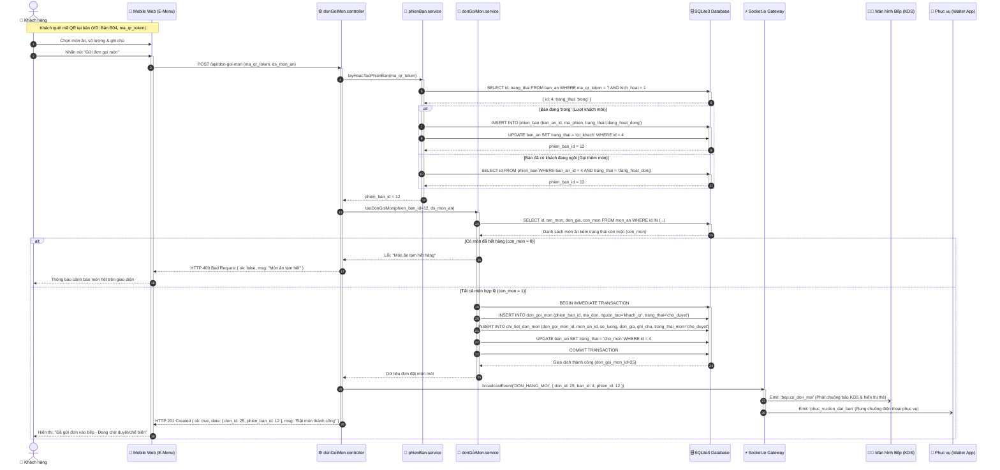

---

### 2.2. Kịch bản 2: Bếp KDS Tiếp nhận & Điều phối chế biến Real-time
* **Mục đích:** Mô tả dòng điều khiển khi đầu bếp chuyển đổi trạng thái món ăn (`dang_nau` $\rightarrow$ `hoan_thanh`), ghi nhận mốc thời gian `thoi_gian_bat_dau_nau`, `thoi_gian_hoan_thanh_nau`, kích hoạt chuông báo phục vụ bưng món và cập nhật thanh tiến độ cho khách.
* **Tài nguyên:** [soDoTuanTuDieuPhoiBep.svg](file:///d:/PHAT%20TRIEN%20WEB/quan%20ly%20nha%20hang/taiLieu/soDoTuanTuDieuPhoiBep.svg) | [soDoTuanTuDieuPhoiBep.png](file:///d:/PHAT%20TRIEN%20WEB/quan%20ly%20nha%20hang/taiLieu/soDoTuanTuDieuPhoiBep.png) | [soDoTuanTuDieuPhoiBep.mmd](file:///d:/PHAT%20TRIEN%20WEB/quan%20ly%20nha%20hang/taiLieu/soDoTuanTuDieuPhoiBep.mmd)

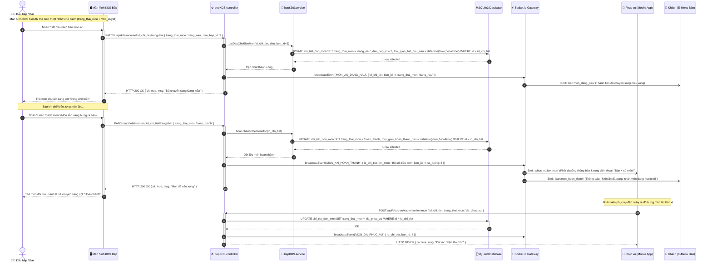

---

### 2.3. Kịch bản 3: Lập hóa đơn & Thanh toán VietQR NAPAS 247 Khép kín
* **Mục đích:** Mô tả chu trình lập bill dựa trên phiên bàn (`phien_ban_id`), tính VAT 8%, sinh mã VietQR chuẩn EMVCo, xác thực giao dịch chuyển khoản qua IPN/Webhook, cập nhật đồng thời hóa đơn, phiên bàn và trạng thái bàn ăn, in hóa đơn K80.
* **Tài nguyên:** [soDoTuanTuThanhToanVietQR.svg](file:///d:/PHAT%20TRIEN%20WEB/quan%20ly%20nha%20hang/taiLieu/soDoTuanTuThanhToanVietQR.svg) | [soDoTuanTuThanhToanVietQR.png](file:///d:/PHAT%20TRIEN%20WEB/quan%20ly%20nha%20hang/taiLieu/soDoTuanTuThanhToanVietQR.png) | [soDoTuanTuThanhToanVietQR.mmd](file:///d:/PHAT%20TRIEN%20WEB/quan%20ly%20nha%20hang/taiLieu/soDoTuanTuThanhToanVietQR.mmd)

```mermaid
sequenceDiagram
    autonumber
    actor C as 👤 Khách hàng
    actor TN as 💳 Thu ngân
    participant POS as 🖥️ POS Thu ngân
    participant Ctrl as ⚙️ hoaDon.controller
    participant SvcP as 🚪 phienBan.service
    participant SvcH as 🧠 hoaDon.service
    participant Bank as 🏦 VietQR / Cổng Ngân hàng
    participant DB as 🗄️ SQLite3 Database
    participant Sock as ⚡ Socket.io Gateway
    participant Printer as 🖨️ Máy in Bill K80

    Note over C,TN: Khách yêu cầu thanh toán tại Bàn B04
    C->>POS: Bấm "Yêu cầu tính tiền" trên E-Menu (hoặc báo nhân viên)
    activate POS
    POS->>Ctrl: POST /api/ban-an/4/yeu-cau-thanh-toan
    activate Ctrl
    Ctrl->>DB: UPDATE ban_an SET trang_thai = 'yeu_cau_thanh_toan' WHERE id = 4
    activate DB
    DB-->>Ctrl: OK
    deactivate DB
    Ctrl-->>POS: Đổi màu bàn B04 sang đỏ (Yêu cầu thanh toán)
    deactivate Ctrl

    TN->>POS: Chọn Bàn B04, nhấn "Lập hóa đơn thanh toán"
    POS->>Ctrl: POST /api/hoa-don/lap-hoa-don { ban_id: 4, ma_voucher: null, phuong_thuc: 'vietqr' }
    activate Ctrl

    Ctrl->>SvcP: layPhienDangHoatDong(ban_id=4)
    activate SvcP
    SvcP->>DB: SELECT id FROM phien_ban WHERE ban_an_id = 4 AND trang_thai = 'dang_hoat_dong'
    activate DB
    DB-->>SvcP: phien_ban_id = 12
    deactivate DB
    SvcP-->>Ctrl: phien_ban_id = 12
    deactivate SvcP

    Ctrl->>SvcH: taoHoaDonTamTinh(phien_ban_id=12, thu_ngan_id=2)
    activate SvcH
    SvcH->>DB: SELECT c.so_luong, c.don_gia FROM chi_tiet_don_mon c JOIN don_goi_mon d ON c.don_goi_mon_id = d.id WHERE d.phien_ban_id = 12 AND c.trang_thai_mon NOT IN ('huy_mon', 'da_huy')
    activate DB
    DB-->>SvcH: Danh sách món ăn hợp lệ
    deactivate DB

    SvcH->>SvcH: Tính: tong_tien_mon=781,000đ; VAT 8%=62,480đ; tong_tien_thanh_toan=843,480đ
    SvcH->>DB: INSERT INTO hoa_don (phien_ban_id, ma_hoa_don, thu_ngan_id, tong_tien_mon, phan_tram_vat, tien_vat, tong_tien_thanh_toan, phuong_thuc_thanh_toan, trang_thai='chua_thanh_toan')
    activate DB
    DB-->>SvcH: hoa_don_id = 105
    deactivate DB
    SvcH-->>Ctrl: Dữ liệu hóa đơn #105
    deactivate SvcH
    Ctrl-->>POS: Trả về thông tin hóa đơn #105
    deactivate Ctrl
    POS-->>TN: Hiển thị giao diện thanh toán số tiền: 843,480 VNĐ

    Note over TN,Bank: Khách lựa chọn thanh toán chuyển khoản VietQR NAPAS 247
    TN->>POS: Bấm "Tạo mã VietQR"
    POS->>Ctrl: POST /api/hoa-don/105/tao-ma-vietqr
    activate Ctrl
    Ctrl->>Bank: API VietQR (STK, BankCode, SoTien=843480, NoiDung="QM BAN04 HD105")
    activate Bank
    Bank-->>Ctrl: Trả về Chuỗi EMVCo & URL ảnh QR động
    deactivate Bank
    Ctrl-->>POS: Hiển thị mã QR động lên màn hình phụ hướng về khách
    deactivate Ctrl

    Note over C,Bank: Khách dùng App Ngân hàng quét QR và xác nhận chuyển 843,480 VNĐ
    C->>Bank: Chuyển khoản thành công qua hệ thống NAPAS 247
    activate Bank
    Bank->>Ctrl: Webhook / SePAY IPN: Báo có 843,480đ với nội dung "QM BAN04 HD105"
    deactivate Bank
    activate Ctrl

    Ctrl->>SvcH: xuLyThanhToanThanhCong(hoa_don_id=105, ma_giao_dich_vietqr)
    activate SvcH
    SvcH->>DB: BEGIN IMMEDIATE TRANSACTION
    activate DB
    SvcH->>DB: UPDATE hoa_don SET trang_thai = 'da_thanh_toan', thoi_gian_thanh_toan = datetime('now','localtime'), ma_giao_dich_vietqr = ? WHERE id = 105
    SvcH->>DB: UPDATE phien_ban SET trang_thai = 'da_thanh_toan', thoi_gian_ket_thuc = datetime('now','localtime') WHERE id = 12
    SvcH->>DB: UPDATE ban_an SET trang_thai = 'can_don_dep' WHERE id = 4
    SvcH->>DB: COMMIT TRANSACTION
    DB-->>SvcH: Cập nhật CSDL hoàn tất
    deactivate DB
    SvcH-->>Ctrl: Giao dịch thành công
    deactivate SvcH

    Ctrl->>Sock: broadcastEvent('THANH_TOAN_THANH_CONG', { hoa_don_id: 105, ban_id: 4, phien_id: 12 })
    activate Sock
    Sock-)POS: Đổi màu bàn B04 sang xám ('can_don_dep'), phát âm thanh chốt bill
    Sock-)C: Thông báo: "Thanh toán thành công. Cảm ơn Quý khách!"
    deactivate Sock

    Ctrl->>Printer: Lệnh in hóa đơn nhiệt K80
    activate Printer
    Printer-->>TN: Xuất phiếu thanh toán K80 giao khách
    deactivate Printer
    Ctrl-->>Bank: HTTP 200 OK (Xác nhận Webhook)
    deactivate Ctrl
    deactivate POS
```

---

### 2.4. Kịch bản 4: Xử lý Ngoại lệ Thanh toán VietQR & Sổ cái Lũy kế (Ledger Model, Idempotency, Refund Flow) *(Vá lỗ hổng 2)*
* **Mục đích:** Mô tả dòng điều khiển đối soát đa kênh khi khách chia bill quét nhiều mã QR, xử lý các tình huống ngoại lệ: Khách chuyển thiếu tiền, chuyển thừa tiền (tạo phiếu chi hoàn tiền), gõ sai cú pháp chuyển khoản, và Webhook ngân hàng bắn lặp nhiều lần (bảo vệ bằng khóa Idempotency).

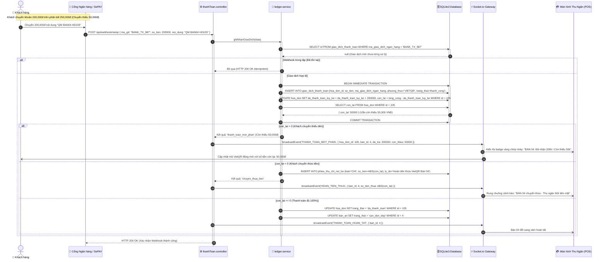

---

### 2.5. Kịch bản 5: Cơ chế Timeout 90s & Tự động Leo thang khi Hủy món Bếp đang nấu *(Vá lỗ hổng 5)*
* **Mục đích:** Mô tả dòng sự kiện khi khách yêu cầu hủy món đang nấu trên KDS. Hệ thống kích hoạt bộ đếm ngược Timeout 90 giây; nếu Bếp không xác nhận kịp thời, hệ thống tự động rung chuông cảnh báo lần 2 và leo thang (Escalate) thông báo đẩy về Admin Dashboard của Quản lý để can thiệp.

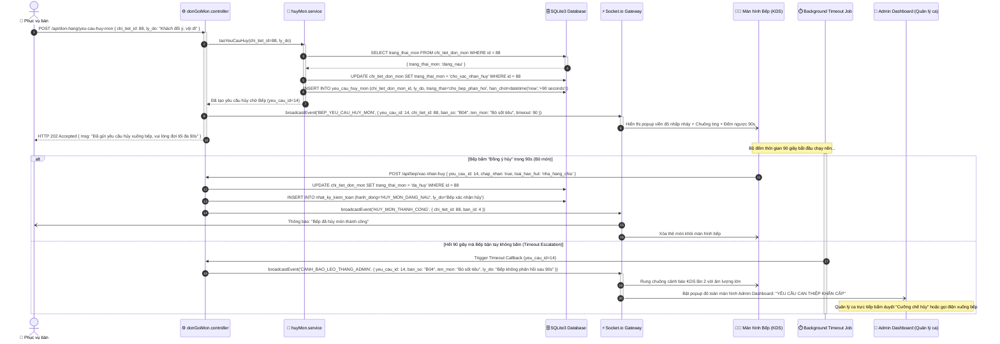

---

### 2.6. Kịch bản 6: Quy trình Đóng ca, Chốt két mù (Blind Cash Drop) & In Báo cáo Z-Report *(Vá lỗ hổng 4)*
* **Mục đích:** Mô tả dòng sự kiện khi Thu ngân kết thúc ca làm việc (ví dụ 14:00 đổi ca sáng sang chiều). Thu ngân đếm tiền mặt thực tế và nhập vào hệ thống mà không được xem trước số liệu sổ sách. Hệ thống tự động so khớp, tính chênh lệch, in báo cáo Z-Report và bàn giao các bàn ăn dở dang.

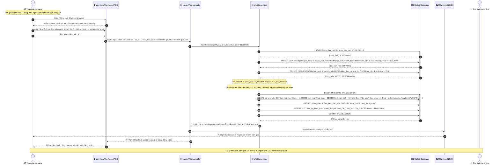

### 2.7. Kịch bản 7: Quy trình Nhân viên nộp phiếu Đổi ca / Xin nghỉ & Quản lý phê duyệt Real-time *(Đồng bộ Figma W11 & A07)*
* **Mục đích:** Mô tả dòng tương tác 2 chiều giữa Nhân viên phục vụ (`W11 · Ca làm và yêu cầu nghỉ`) và Quản trị viên (`A07 · Duyệt nghỉ và đổi ca`). Nhân viên tra cứu lịch tuần, gửi đơn xin đổi ca/nghỉ ca kèm lý do; Server kích hoạt Socket.io rung chuông trên Admin Dashboard. Khi Quản lý bấm duyệt, hệ thống mở Transaction hoán đổi `nhan_vien_id` trong `ca_lam_viec`, ghi Audit Log và bắn Socket.io cập nhật lịch trực tuần tức thời về thiết bị nhân viên.
* **Tài nguyên:** [soDoTuanTuDoiCa.svg](file:///d:/PHAT%20TRIEN%20WEB/quan%20ly%20nha%20hang/taiLieu/soDoTuanTuDoiCa.svg) | [soDoTuanTuDoiCa.png](file:///d:/PHAT%20TRIEN%20WEB/quan%20ly%20nha%20hang/taiLieu/soDoTuanTuDoiCa.png) | [soDoTuanTuDoiCa.mmd](file:///d:/PHAT%20TRIEN%20WEB/quan%20ly%20nha%20hang/taiLieu/soDoTuanTuDoiCa.mmd)

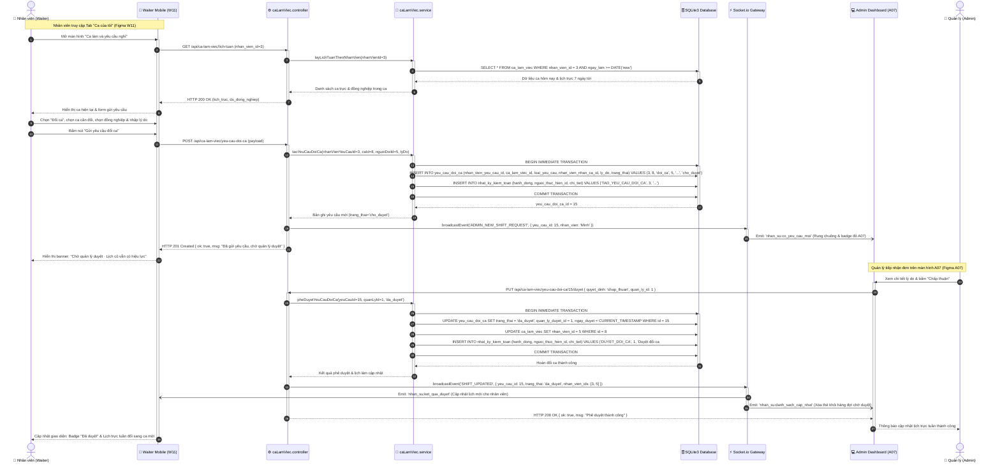

---

## 3. BIỂU ĐỒ TRẠNG THÁI (STATE MACHINE DIAGRAMS)

### 3.1. Vòng đời Bàn ăn (Table Lifecycle)
* **Trạng thái chuẩn SQLite3:** `'trong'`, `'co_khach'`, `'cho_mon'`, `'yeu_cau_thanh_toan'`, `'can_don_dep'`.
* **Tài nguyên:** [soDoTrangThaiBanAn.svg](file:///d:/PHAT%20TRIEN%20WEB/quan%20ly%20nha%20hang/taiLieu/soDoTrangThaiBanAn.svg) | [soDoTrangThaiBanAn.png](file:///d:/PHAT%20TRIEN%20WEB/quan%20ly%20nha%20hang/taiLieu/soDoTrangThaiBanAn.png) | [soDoTrangThaiBanAn.mmd](file:///d:/PHAT%20TRIEN%20WEB/quan%20ly%20nha%20hang/taiLieu/soDoTrangThaiBanAn.mmd)

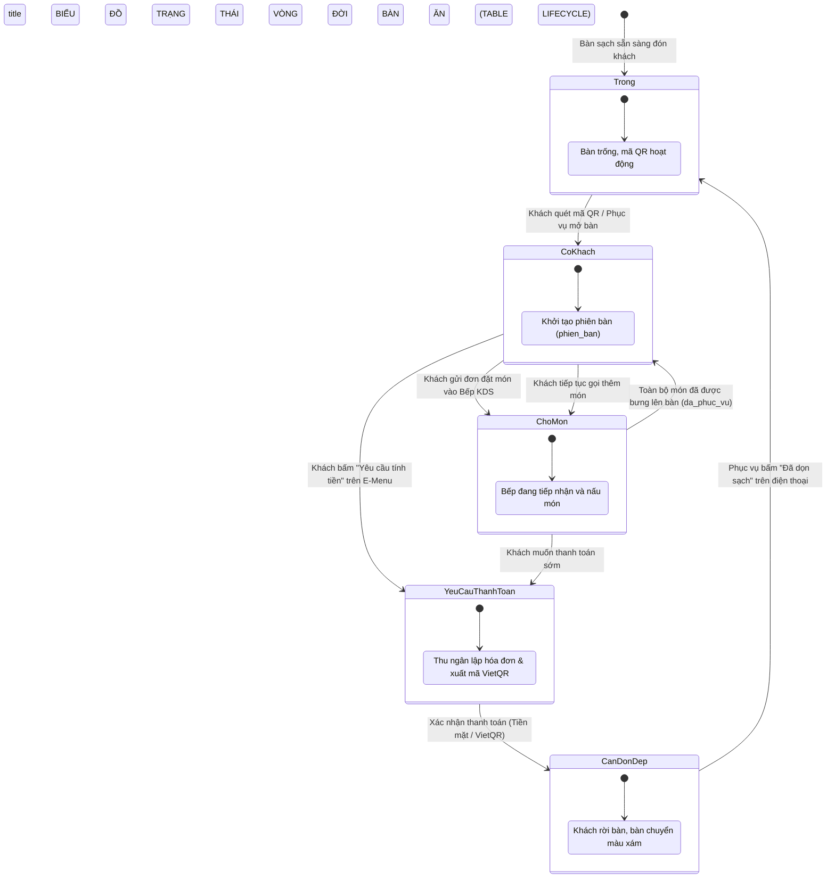

---

### 3.2. Vòng đời Phiên bàn (Table Session Lifecycle)
* **Trạng thái chuẩn SQLite3:** `'dang_hoat_dong'`, `'da_thanh_toan'`, `'da_dong'`.
* **Tài nguyên:** [soDoTrangThaiPhienBan.svg](file:///d:/PHAT%20TRIEN%20WEB/quan%20ly%20nha%20hang/taiLieu/soDoTrangThaiPhienBan.svg) | [soDoTrangThaiPhienBan.png](file:///d:/PHAT%20TRIEN%20WEB/quan%20ly%20nha%20hang/taiLieu/soDoTrangThaiPhienBan.png) | [soDoTrangThaiPhienBan.mmd](file:///d:/PHAT%20TRIEN%20WEB/quan%20ly%20nha%20hang/taiLieu/soDoTrangThaiPhienBan.mmd)

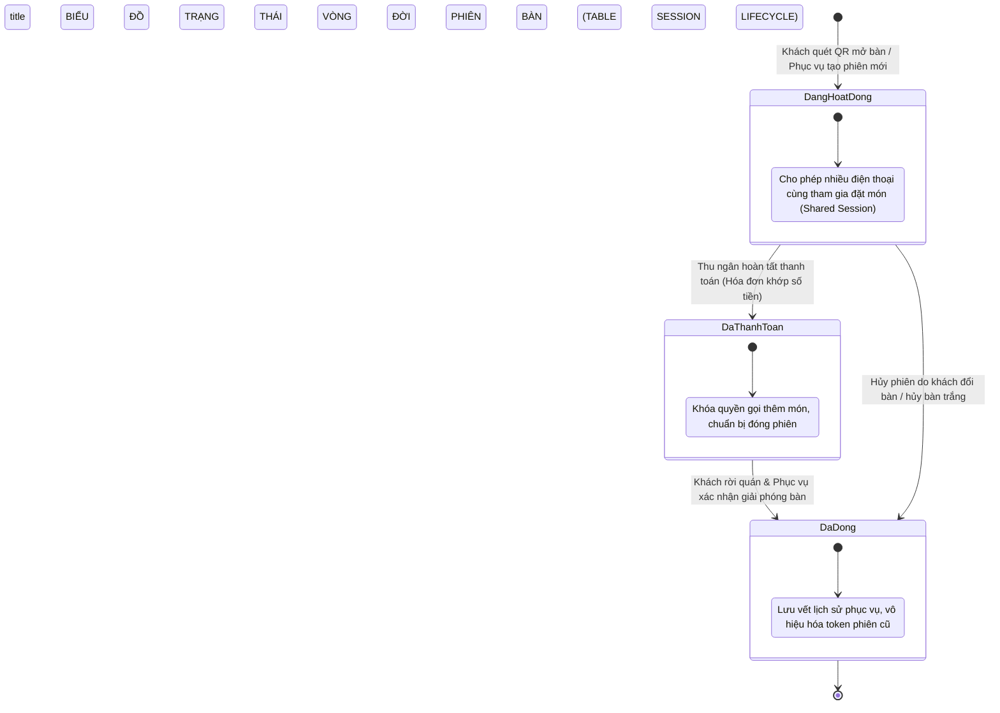

---

### 3.3. Vòng đời Món ăn trong đơn (Order Item Lifecycle)
* **Trạng thái chuẩn SQLite3:** `'cho_duyet'`, `'dang_nau'`, `'hoan_thanh'`, `'da_phuc_vu'`, `'yeu_cau_huy'`, `'huy_mon'`, `'da_huy'`.
* **Tài nguyên:** [soDoTrangThaiMonAn.svg](file:///d:/PHAT%20TRIEN%20WEB/quan%20ly%20nha%20hang/taiLieu/soDoTrangThaiMonAn.svg) | [soDoTrangThaiMonAn.png](file:///d:/PHAT%20TRIEN%20WEB/quan%20ly%20nha%20hang/taiLieu/soDoTrangThaiMonAn.png) | [soDoTrangThaiMonAn.mmd](file:///d:/PHAT%20TRIEN%20WEB/quan%20ly%20nha%20hang/taiLieu/soDoTrangThaiMonAn.mmd)

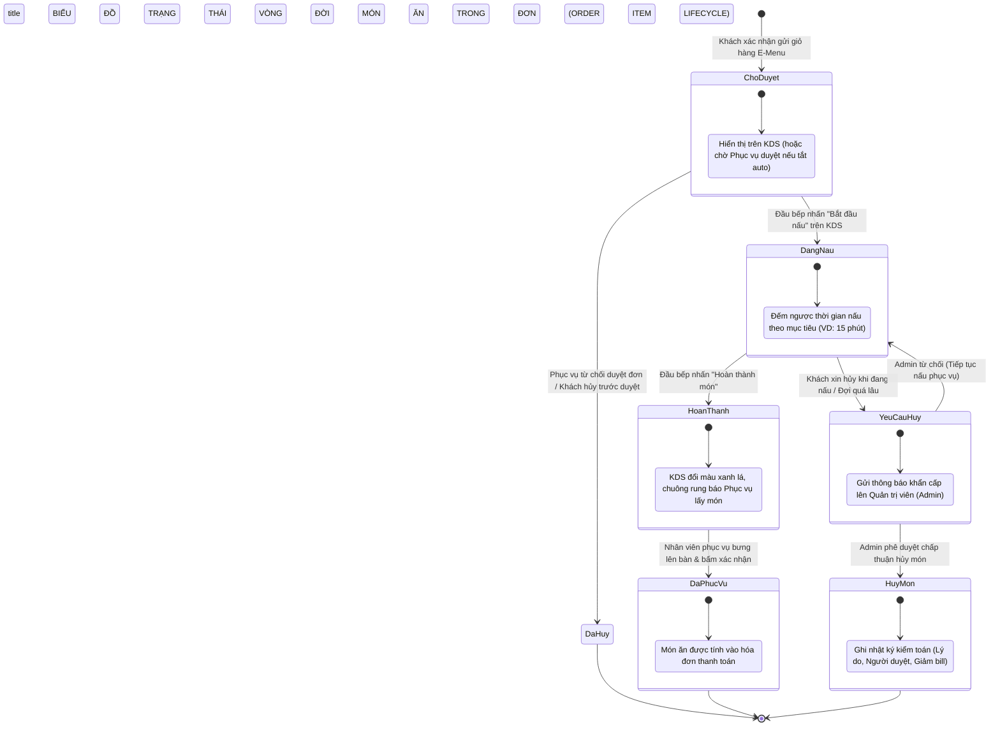

---

### 3.4. Vòng đời Hóa đơn thanh toán (Invoice Lifecycle)
* **Trạng thái chuẩn SQLite3:** `'chua_thanh_toan'`, `'da_thanh_toan'`, `'da_huy'`.
* **Tài nguyên:** [soDoTrangThaiHoaDon.svg](file:///d:/PHAT%20TRIEN%20WEB/quan%20ly%20nha%20hang/taiLieu/soDoTrangThaiHoaDon.svg) | [soDoTrangThaiHoaDon.png](file:///d:/PHAT%20TRIEN%20WEB/quan%20ly%20nha%20hang/taiLieu/soDoTrangThaiHoaDon.png) | [soDoTrangThaiHoaDon.mmd](file:///d:/PHAT%20TRIEN%20WEB/quan%20ly%20nha%20hang/taiLieu/soDoTrangThaiHoaDon.mmd)

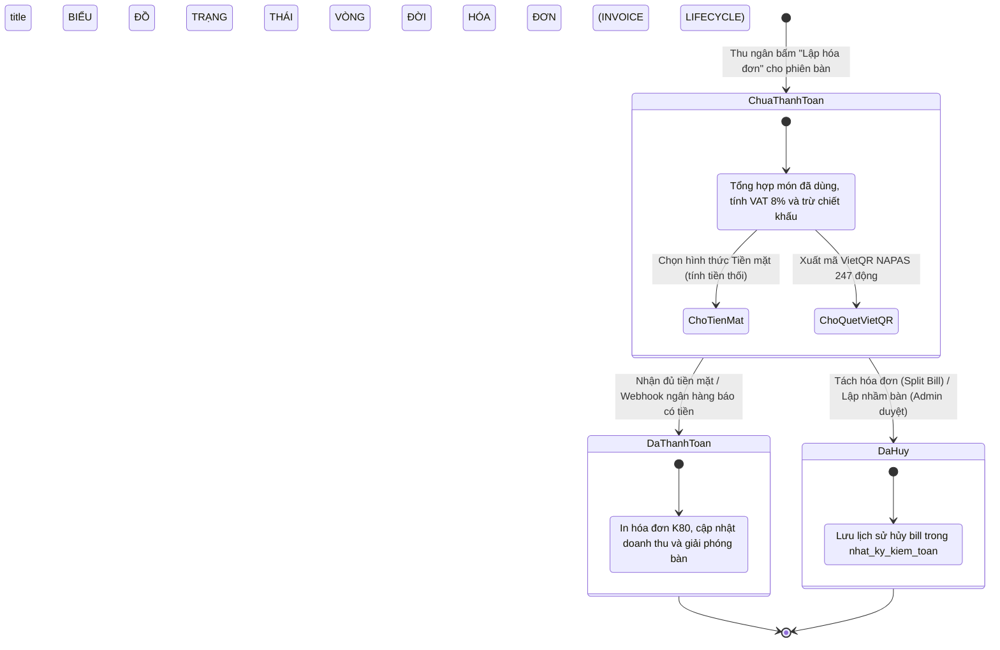

---

## 4. BIỂU ĐỒ LỚP KIẾN TRÚC HỆ THỐNG MVC (CLASS DIAGRAM)
* **Mục đích:** Đặc tả rõ mối quan hệ phân tầng kiến trúc theo quy chuẩn Express MVC: Các tầng Controller điều hướng và validate, tầng Service xử lý logic nghiệp vụ, tầng Model tương tác CSDL SQLite3, và SocketGateway phát tán sự kiện thời gian thực. Bổ sung đầy đủ module `PhienBan` làm trung gian phiên bàn.
* **Tài nguyên:** [soDoLopHeThong.svg](file:///d:/PHAT%20TRIEN%20WEB/quan%20ly%20nha%20hang/taiLieu/soDoLopHeThong.svg) | [soDoLopHeThong.png](file:///d:/PHAT%20TRIEN%20WEB/quan%20ly%20nha%20hang/taiLieu/soDoLopHeThong.png) | [soDoLopHeThong.mmd](file:///d:/PHAT%20TRIEN%20WEB/quan%20ly%20nha%20hang/taiLieu/soDoLopHeThong.mmd)

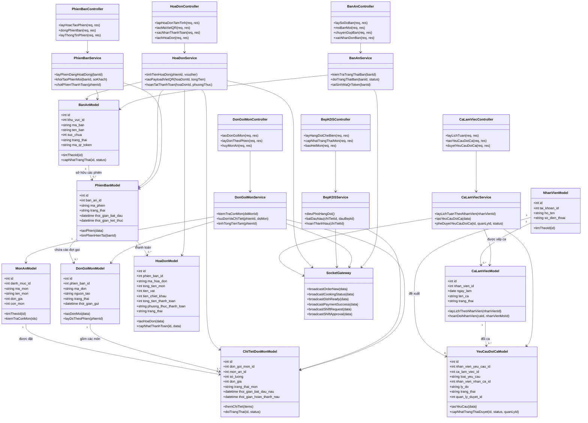

---

## 5. BIỂU ĐỒ TRIỂN KHAI (DEPLOYMENT DIAGRAM) — KIẾN TRÚC HYBRID LOCAL-FIRST *(Vá lỗ hổng 3)*
* **Mục đích:** Mô tả kiến trúc vật lý và các nút phần cứng tại nhà hàng. Đảm bảo khi mất kết nối cáp quang Internet ra ngoài, hệ thống mạng nội bộ LAN/Wi-Fi của quán vẫn duy trì 100% hoạt động gọi món, nấu nướng và in hóa đơn K80 không bị tê liệt. Đồng thời định tuyến traffic khách 4G thông qua Cloudflare Tunnel bảo mật.

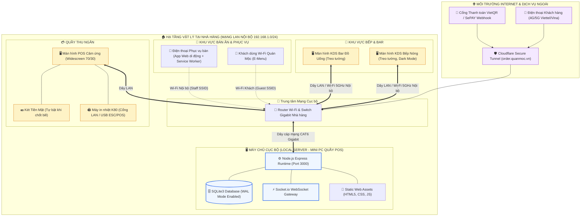

---

## 6. TỔNG KẾT BỘ TÀI NGUYÊN THIẾT KẾ ĐÃ ĐỒNG BỘ 100% CSDL

| Nhóm sơ đồ | Tên file biểu đồ | Định dạng Vector (.svg) | Định dạng Ảnh (.png) | Mã nguồn (.mmd / .puml) |
| :--- | :--- | :---: | :---: | :---: |
| **Ca sử dụng** | Sơ đồ Use Case Tổng quan | [SVG](file:///d:/PHAT%20TRIEN%20WEB/quan%20ly%20nha%20hang/taiLieu/soDoCaSuDung.svg) | [PNG](file:///d:/PHAT%20TRIEN%20WEB/quan%20ly%20nha%20hang/taiLieu/soDoCaSuDung.png) | [MMD](file:///d:/PHAT%20TRIEN%20WEB/quan%20ly%20nha%20hang/taiLieu/soDoCaSuDung.mmd) / [PUML](file:///d:/PHAT%20TRIEN%20WEB/quan%20ly%20nha%20hang/taiLieu/soDoCaSuDung.puml) |
| **Ca sử dụng** | Phân rã Khách hàng | [SVG](file:///d:/PHAT%20TRIEN%20WEB/quan%20ly%20nha%20hang/taiLieu/usecaseKhachHang.svg) | — | [MMD](file:///d:/PHAT%20TRIEN%20WEB/quan%20ly%20nha%20hang/taiLieu/usecaseKhachHang.mmd) |
| **Ca sử dụng** | Phân rã Phục vụ | [SVG](file:///d:/PHAT%20TRIEN%20WEB/quan%20ly%20nha%20hang/taiLieu/usecasePhucVu.svg) | — | [MMD](file:///d:/PHAT%20TRIEN%20WEB/quan%20ly%20nha%20hang/taiLieu/usecasePhucVu.mmd) |
| **Ca sử dụng** | Phân rã Bếp KDS | [SVG](file:///d:/PHAT%20TRIEN%20WEB/quan%20ly%20nha%20hang/taiLieu/usecaseBepKDS.svg) | — | [MMD](file:///d:/PHAT%20TRIEN%20WEB/quan%20ly%20nha%20hang/taiLieu/usecaseBepKDS.mmd) |
| **Ca sử dụng** | Phân rã Thu ngân & Admin | [SVG](file:///d:/PHAT%20TRIEN%20WEB/quan%20ly%20nha%20hang/taiLieu/usecaseThuNganAdmin.svg) | — | [MMD](file:///d:/PHAT%20TRIEN%20WEB/quan%20ly%20nha%20hang/taiLieu/usecaseThuNganAdmin.mmd) |
| **Hoạt động** | Quy trình nghiệp vụ 5 làn | [SVG](file:///d:/PHAT%20TRIEN%20WEB/quan%20ly%20nha%20hang/taiLieu/soDoQuyTrinhNghiepVu.svg) | [PNG](file:///d:/PHAT%20TRIEN%20WEB/quan%20ly%20nha%20hang/taiLieu/soDoQuyTrinhNghiepVu.png) | [MMD](file:///d:/PHAT%20TRIEN%20WEB/quan%20ly%20nha%20hang/taiLieu/soDoQuyTrinhNghiepVu.mmd) / [DRAWIO](file:///d:/PHAT%20TRIEN%20WEB/quan%20ly%20nha%20hang/taiLieu/quyTrinhNhaHang.drawio) |
| **Tuần tự** | Khách gọi món QR Realtime | [SVG](file:///d:/PHAT%20TRIEN%20WEB/quan%20ly%20nha%20hang/taiLieu/soDoTuanTuGoiMon.svg) | [PNG](file:///d:/PHAT%20TRIEN%20WEB/quan%20ly%20nha%20hang/taiLieu/soDoTuanTuGoiMon.png) | [MMD](file:///d:/PHAT%20TRIEN%20WEB/quan%20ly%20nha%20hang/taiLieu/soDoTuanTuGoiMon.mmd) |
| **Tuần tự** | Bếp điều phối & chế biến | [SVG](file:///d:/PHAT%20TRIEN%20WEB/quan%20ly%20nha%20hang/taiLieu/soDoTuanTuDieuPhoiBep.svg) | [PNG](file:///d:/PHAT%20TRIEN%20WEB/quan%20ly%20nha%20hang/taiLieu/soDoTuanTuDieuPhoiBep.png) | [MMD](file:///d:/PHAT%20TRIEN%20WEB/quan%20ly%20nha%20hang/taiLieu/soDoTuanTuDieuPhoiBep.mmd) |
| **Tuần tự** | Thanh toán VietQR NAPAS | [SVG](file:///d:/PHAT%20TRIEN%20WEB/quan%20ly%20nha%20hang/taiLieu/soDoTuanTuThanhToanVietQR.svg) | [PNG](file:///d:/PHAT%20TRIEN%20WEB/quan%20ly%20nha%20hang/taiLieu/soDoTuanTuThanhToanVietQR.png) | [MMD](file:///d:/PHAT%20TRIEN%20WEB/quan%20ly%20nha%20hang/taiLieu/soDoTuanTuThanhToanVietQR.mmd) |
| **Tuần tự** | Nhân viên đổi ca & xin nghỉ | [SVG](file:///d:/PHAT%20TRIEN%20WEB/quan%20ly%20nha%20hang/taiLieu/soDoTuanTuDoiCa.svg) | [PNG](file:///d:/PHAT%20TRIEN%20WEB/quan%20ly%20nha%20hang/taiLieu/soDoTuanTuDoiCa.png) | [MMD](file:///d:/PHAT%20TRIEN%20WEB/quan%20ly%20nha%20hang/taiLieu/soDoTuanTuDoiCa.mmd) |
| **Trạng thái** | Vòng đời Bàn ăn | [SVG](file:///d:/PHAT%20TRIEN%20WEB/quan%20ly%20nha%20hang/taiLieu/soDoTrangThaiBanAn.svg) | [PNG](file:///d:/PHAT%20TRIEN%20WEB/quan%20ly%20nha%20hang/taiLieu/soDoTrangThaiBanAn.png) | [MMD](file:///d:/PHAT%20TRIEN%20WEB/quan%20ly%20nha%20hang/taiLieu/soDoTrangThaiBanAn.mmd) |
| **Trạng thái** | Vòng đời Phiên bàn | [SVG](file:///d:/PHAT%20TRIEN%20WEB/quan%20ly%20nha%20hang/taiLieu/soDoTrangThaiPhienBan.svg) | [PNG](file:///d:/PHAT%20TRIEN%20WEB/quan%20ly%20nha%20hang/taiLieu/soDoTrangThaiPhienBan.png) | [MMD](file:///d:/PHAT%20TRIEN%20WEB/quan%20ly%20nha%20hang/taiLieu/soDoTrangThaiPhienBan.mmd) |
| **Trạng thái** | Vòng đời Món trong đơn | [SVG](file:///d:/PHAT%20TRIEN%20WEB/quan%20ly%20nha%20hang/taiLieu/soDoTrangThaiMonAn.svg) | [PNG](file:///d:/PHAT%20TRIEN%20WEB/quan%20ly%20nha%20hang/taiLieu/soDoTrangThaiMonAn.png) | [MMD](file:///d:/PHAT%20TRIEN%20WEB/quan%20ly%20nha%20hang/taiLieu/soDoTrangThaiMonAn.mmd) |
| **Trạng thái** | Vòng đời Hóa đơn thanh toán | [SVG](file:///d:/PHAT%20TRIEN%20WEB/quan%20ly%20nha%20hang/taiLieu/soDoTrangThaiHoaDon.svg) | [PNG](file:///d:/PHAT%20TRIEN%20WEB/quan%20ly%20nha%20hang/taiLieu/soDoTrangThaiHoaDon.png) | [MMD](file:///d:/PHAT%20TRIEN%20WEB/quan%20ly%20nha%20hang/taiLieu/soDoTrangThaiHoaDon.mmd) |
| **Lớp (Class)**| Kiến trúc Express MVC | [SVG](file:///d:/PHAT%20TRIEN%20WEB/quan%20ly%20nha%20hang/taiLieu/soDoLopHeThong.svg) | [PNG](file:///d:/PHAT%20TRIEN%20WEB/quan%20ly%20nha%20hang/taiLieu/soDoLopHeThong.png) | [MMD](file:///d:/PHAT%20TRIEN%20WEB/quan%20ly%20nha%20hang/taiLieu/soDoLopHeThong.mmd) |
